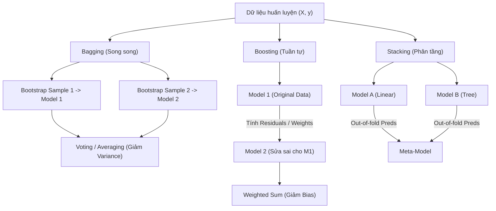

> **Motto:** *"Một cây quyết định sâu dễ học vẹt (high variance); một cây nông dễ đoán sai (high bias). Ensemble không cố tìm một siêu mô hình hoàn hảo — nó kết hợp nhiều mô hình bình thường để triệt tiêu điểm yếu của nhau."*

---

## Thông tin nhanh (Quick Spec)

* **Loại bài (Type):** Thực chiến (Build)
* **Ngôn ngữ & Công cụ:** Python 3.12, NumPy
* **Kiến thức tiên quyết (Prerequisites):** Decision Trees, Bias-Variance Tradeoff, Model Evaluation
* **Thời gian thực hành:** ~45 phút

---

## Mục tiêu bài học (Learning Objectives)

Sau bài học này, bạn sẽ có khả năng:
- [ ] Phân biệt rõ cơ chế giảm Variance (Bagging) và giảm Bias (Boosting).
- [ ] Tự tay cài đặt **BaggingClassifier (Random Forest tối giản)** và **GradientBoostingRegressor** bằng thuần Python + NumPy.
- [ ] Hiểu cách **Stacking** hoạt động với out-of-fold predictions để tránh rò rỉ dữ liệu (data leakage).
- [ ] Biết khi nào nên chọn Random Forest, XGBoost/LightGBM, hay Stacking trong bài toán production.

---

## 1. Vấn đề thực tế (The Problem)

Trong các bài toán dữ liệu dạng bảng (tabular data) ở production — như chấm điểm tín dụng, dự đoán rời bỏ (churn), hay phát hiện gian lận — một mô hình đơn lẻ (single model) thường đụng trần rất nhanh:

1. **Decision Tree sâu:** Đạt 99% accuracy trên tập train, nhưng rớt xuống 72% trên tập test. Chỉ cần thay đổi 5% dữ liệu train, cấu trúc cây thay đổi hoàn toàn (*high variance*).
2. **Linear Regression / Decision Stump (cây độ sâu 1):** Ổn định qua các lần chia dữ liệu, nhưng không thể nắm bắt các mối quan hệ phi tuyến phức tạp (*high bias*).

Nếu bạn cố gắng tinh chỉnh một mô hình đơn lẻ mãi mà vẫn không qua nổi ngưỡng hiệu năng, vấn đề không nằm ở việc bạn chưa tune đủ hyperparameter — mà nằm ở giới hạn của một mô hình đơn.

---

## 2. Mô hình tư duy & Bản chất (The Concept)

Ensemble Learning giải quyết bài toán trên bằng 3 chiến lược cốt lõi:



### 2.1. Bagging (Bootstrap Aggregating) & Random Forest
- Tạo $B$ tập dữ liệu con bằng cách lấy mẫu có hoàn lại (*bootstrap*).
- Huấn luyện $B$ mô hình độc lập (thường là cây quyết định sâu) song song.
- Với **Random Forest**, tại mỗi nút chia (split), thuật toán chỉ xét ngẫu nhiên $m \approx \sqrt{p}$ đặc trưng (features) thay vì toàn bộ $p$ features. Điều này giúp **giảm tương quan (decorrelate)** giữa các cây.
- Nếu các cây có phương sai $\sigma^2$ và hệ số tương quan cặp là $\rho$, phương sai của trung bình $B$ cây là:
$$\text{Var}\left(\frac{1}{B}\sum_{b=1}^{B} \hat{f}_b(x)\right) = \rho\sigma^2 + \frac{1 - \rho}{B}\sigma^2$$
Khi $B$ lớn, số hạng thứ hai tiến về $0$, chỉ còn $\rho\sigma^2$. Giảm $\rho$ (nhờ chọn ngẫu nhiên feature) chính là chìa khóa sức mạnh của Random Forest.

### 2.2. Gradient Boosting
Thay vì lấy trung bình các cây độc lập, Gradient Boosting xây dựng mô hình theo dạng cộng tính (*additive*):
$$F_m(x) = F_{m-1}(x) + \eta \cdot h_m(x)$$
Trong đó:
- $F_{m-1}(x)$ là dự đoán hiện tại.
- $h_m(x)$ là một cây nông (*weak learner*, thường `max_depth` từ 3 đến 6) được huấn luyện để khớp với **phần dư (pseudo-residuals)** — chính là âm gradient của hàm mất mát:
$$r_{im} = -\left[\frac{\partial L(y_i, F(x_i))}{\partial F(x_i)}\right]_{F(x)=F_{m-1}(x)}$$
- Với hàm mất mát MSE $L(y, F) = \frac{1}{2}(y - F)^2$, phần dư đơn giản là $r_{im} = y_i - F_{m-1}(x_i)$.
- $\eta \in (0, 1]$ là *learning rate* (shrinkage) giúp mô hình học từng bước nhỏ, tránh overfitting.

---

## 3. Tự tay xây dựng từ đầu (Build It: From Scratch)

Chúng ta sẽ tự xây dựng một **Decision Stump / Shallow Tree** thuần NumPy, sau đó dùng nó làm nền tảng cho cả **BaggingClassifier** và **GradientBoostingRegressor**.

### Bước 1: Xây dựng Decision Tree tối giản (NumPy)

```python
import numpy as np
from typing import Optional


class SimpleTree:
    """Cây quyết định tối giản hỗ trợ cả Classification (Gini) và Regression (MSE)."""

    def __init__(self, max_depth: int = 3, min_samples_split: int = 2, max_features: Optional[int] = None, task: str = "regression"):
        self.max_depth = max_depth
        self.min_samples_split = min_samples_split
        self.max_features = max_features
        self.task = task
        self.feature_idx: Optional[int] = None
        self.threshold: Optional[float] = None
        self.left: Optional["SimpleTree"] = None
        self.right: Optional["SimpleTree"] = None
        self.value: Optional[float] = None

    def _impurity(self, y: np.ndarray) -> float:
        if len(y) == 0:
            return 0.0
        if self.task == "regression":
            return float(np.var(y) * len(y))
        # Gini impurity cho classification
        _, counts = np.unique(y, return_counts=True)
        probs = counts / len(y)
        return float((1.0 - np.sum(probs ** 2)) * len(y))

    def _leaf_value(self, y: np.ndarray) -> float:
        if self.task == "regression":
            return float(np.mean(y))
        vals, counts = np.unique(y, return_counts=True)
        return float(vals[np.argmax(counts)])

    def fit(self, X: np.ndarray, y: np.ndarray, depth: int = 0) -> "SimpleTree":
        n_samples, n_features = X.shape
        if depth >= self.max_depth or n_samples < self.min_samples_split or len(np.unique(y)) == 1:
            self.value = self._leaf_value(y)
            return self

        feat_indices = np.arange(n_features)
        if self.max_features is not None and self.max_features < n_features:
            feat_indices = np.random.choice(n_features, self.max_features, replace=False)

        best_score = float("inf")
        best_feat, best_thresh = None, None

        for feat in feat_indices:
            thresholds = np.unique(X[:, feat])
            for thresh in thresholds:
                left_mask = X[:, feat] <= thresh
                right_mask = ~left_mask
                if not np.any(left_mask) or not np.any(right_mask):
                    continue
                score = self._impurity(y[left_mask]) + self._impurity(y[right_mask])
                if score < best_score:
                    best_score = score
                    best_feat = int(feat)
                    best_thresh = float(thresh)

        if best_feat is None:
            self.value = self._leaf_value(y)
            return self

        self.feature_idx = best_feat
        self.threshold = best_thresh
        left_mask = X[:, best_feat] <= best_thresh
        self.left = SimpleTree(self.max_depth, self.min_samples_split, self.max_features, self.task).fit(X[left_mask], y[left_mask], depth + 1)
        self.right = SimpleTree(self.max_depth, self.min_samples_split, self.max_features, self.task).fit(X[~left_mask], y[~left_mask], depth + 1)
        return self

    def predict_one(self, x: np.ndarray) -> float:
        if self.value is not None:
            return self.value
        if self.feature_idx is None or self.threshold is None or self.left is None or self.right is None:
            raise RuntimeError("Tree must be fitted before predict.")
        if x[self.feature_idx] <= self.threshold:
            return self.left.predict_one(x)
        return self.right.predict_one(x)

    def predict(self, X: np.ndarray) -> np.ndarray:
        return np.array([self.predict_one(x) for x in X])
```

### Bước 2: Random Forest Classifier (Bagging + Feature Subsampling)

```python
class RandomForestScratch:
    def __init__(self, n_estimators: int = 15, max_depth: int = 5, max_features: Optional[int] = None):
        self.n_estimators = n_estimators
        self.max_depth = max_depth
        self.max_features = max_features
        self.trees: list[SimpleTree] = []

    def fit(self, X: np.ndarray, y: np.ndarray) -> "RandomForestScratch":
        n_samples, n_features = X.shape
        m_features = self.max_features or max(1, int(np.sqrt(n_features)))
        self.trees = []
        for _ in range(self.n_estimators):
            idx = np.random.choice(n_samples, n_samples, replace=True)
            tree = SimpleTree(max_depth=self.max_depth, max_features=m_features, task="classification")
            tree.fit(X[idx], y[idx])
            self.trees.append(tree)
        return self

    def predict(self, X: np.ndarray) -> np.ndarray:
        if not self.trees:
            raise RuntimeError("Model must be fitted before predict.")
        preds = np.array([tree.predict(X) for tree in self.trees])  # (n_trees, n_samples)
        final_preds = []
        for col in range(X.shape[0]):
            vals, counts = np.unique(preds[:, col], return_counts=True)
            final_preds.append(vals[np.argmax(counts)])
        return np.array(final_preds)
```

### Bước 3: Gradient Boosting Regressor & Kiểm thử

```python
class GradientBoostingScratch:
    def __init__(self, n_estimators: int = 50, learning_rate: float = 0.1, max_depth: int = 3):
        self.n_estimators = n_estimators
        self.learning_rate = learning_rate
        self.max_depth = max_depth
        self.init_pred: float = 0.0
        self.trees: list[SimpleTree] = []

    def fit(self, X: np.ndarray, y: np.ndarray) -> "GradientBoostingScratch":
        self.init_pred = float(np.mean(y))
        current_pred = np.full(len(y), self.init_pred, dtype=float)
        self.trees = []

        for _ in range(self.n_estimators):
            residuals = y - current_pred
            tree = SimpleTree(max_depth=self.max_depth, task="regression")
            tree.fit(X, residuals)
            update = tree.predict(X)
            current_pred += self.learning_rate * update
            self.trees.append(tree)
        return self

    def predict(self, X: np.ndarray) -> np.ndarray:
        if not self.trees:
            raise RuntimeError("Model must be fitted before predict.")
        pred = np.full(X.shape[0], self.init_pred, dtype=float)
        for tree in self.trees:
            pred += self.learning_rate * tree.predict(X)
        return pred


if __name__ == "__main__":
    np.random.seed(42)
    # 1. Test Random Forest trên bài toán phân loại phi tuyến
    X_cls = np.random.randn(200, 4)
    y_cls = ((X_cls[:, 0] ** 2 + X_cls[:, 1] ** 2) > 1.5).astype(int)
    rf = RandomForestScratch(n_estimators=20, max_depth=5).fit(X_cls[:150], y_cls[:150])
    acc = np.mean(rf.predict(X_cls[150:]) == y_cls[150:])
    print(f"Random Forest Test Accuracy: {acc:.2%}")

    # 2. Test Gradient Boosting trên bài toán hồi quy phi tuyến
    X_reg = np.linspace(-3, 3, 150).reshape(-1, 1)
    y_reg = np.sin(X_reg[:, 0]) + np.random.normal(0, 0.1, 150)
    gbr = GradientBoostingScratch(n_estimators=60, learning_rate=0.1, max_depth=2).fit(X_reg, y_reg)
    mse = np.mean((gbr.predict(X_reg) - y_reg) ** 2)
    print(f"Gradient Boosting Train MSE: {mse:.4f}")
```

---

## 4. Ứng dụng thực tế & So sánh Framework (Use It)

Trong môi trường production, bạn sẽ không tự viết cây quyết định bằng NumPy mà dùng các thư viện tối ưu C++/CUDA:

| Tiêu chí | Random Forest (`scikit-learn`) | XGBoost / LightGBM / CatBoost | Stacking |
|---|---|---|---|
| **Mục tiêu chính** | Giảm Variance, chống overfit | Giảm Bias, đạt độ chính xác tối đa | Tối đa hóa điểm số (Kaggle / High-stakes) |
| **Tốc độ train** | Nhanh (song song hóa theo cây) | Rất nhanh (Histogram-based, GPU) | Chậm (phải train K-fold cho nhiều model) |
| **Xử lý Missing Values** | Cần impute trước | Tự động xử lý (học hướng rẽ tối ưu) | Phụ thuộc vào từng base model |
| **Độ nhạy Hyperparameter** | Thấp (mặc định chạy đã khá tốt) | Cao (`learning_rate`, `max_depth`, `reg_lambda`) | Rất cao |

**Production Tips:**
1. **Luôn bắt đầu với LightGBM hoặc CatBoost** cho dữ liệu bảng: nhanh hơn XGBoost trên tập dữ liệu lớn và ít tốn RAM hơn.
2. **Dùng Early Stopping** cho Boosting: truyền `eval_set` và dừng khi metric trên validation không cải thiện sau 50-100 vòng để tránh overfitting.
3. **Đừng vội dùng Stacking** nếu hệ thống yêu cầu *low latency* (< 20ms) khi inference: việc chạy 5-10 model cùng lúc rồi qua meta-model sẽ nhân gấp nhiều lần độ trễ và chi phí bảo trì.

---

## 5. Đóng gói & Tái sử dụng (Ship It)

**Checklist chọn Ensemble Model cho dự án mới:**
- [ ] Dữ liệu nhỏ (< 10k dòng), nhiều nhiễu, cần baseline nhanh, ít phải tune? $\rightarrow$ **Random Forest**.
- [ ] Dữ liệu vừa/lớn, nhiều feature dạng số & phân loại, cần độ chính xác cao nhất? $\rightarrow$ **LightGBM / CatBoost**.
- [ ] Đã có 3+ mô hình khác họ (VD: LightGBM + Neural Net + Logistic Regression) và muốn vắt thêm 0.5–1% hiệu năng? $\rightarrow$ **Stacking với Out-of-Fold predictions**.

---

## 6. Giải ngố thuật ngữ (Key Terms & Misconceptions)

| Thuật ngữ (Term) | Người ta thường nghĩ là... | Bản chất kỹ thuật thực sự là... |
|---|---|---|
| **Bagging** | Chỉ đơn giản là train nhiều model giống nhau rồi lấy trung bình. | Phải kết hợp **Bootstrap sampling** (lấy mẫu có hoàn lại) để tạo sự đa dạng dữ liệu, từ đó mới giảm được variance. |
| **Boosting** | Càng thêm nhiều cây thì mô hình càng tốt mãi. | Boosting giảm bias nhưng nếu số cây quá lớn hoặc `learning_rate` quá cao, mô hình sẽ **overfit nhiễu** (tăng variance). |
| **Stacking** | Lấy dự đoán của các base model trên tập train đưa thẳng vào meta-model. | Làm vậy sẽ gây **data leakage** nghiêm trọng. Bắt buộc phải dùng **Out-of-Fold (OOF)** predictions từ K-Fold CV. |

---

## 7. Bài tập thử thách (Hands-on Challenges)

1. 🟢 **Cơ bản (Easy):** Chạy đoạn code `GradientBoostingScratch` ở trên với `learning_rate=0.5` và `n_estimators=200`. Quan sát xem MSE trên tập train và tập test (tự tách 20% làm test) thay đổi thế nào.
2. 🟡 **Trung bình (Medium):** Bổ sung tính năng **Subsampling (Stochastic Gradient Boosting)** vào `GradientBoostingScratch`: ở mỗi vòng lặp, chỉ lấy ngẫu nhiên 80% mẫu dữ liệu (không hoàn lại) để train cây mới.
3. 🔴 **Nâng cao (Hard):** Tự viết lớp `StackingClassifierScratch` thuần NumPy: dùng 3-Fold Cross-Validation để tạo out-of-fold predictions từ `RandomForestScratch` và một mô hình tuyến tính (tự viết), sau đó train một meta-model (Logistic Regression) trên các dự đoán đó.

---

## 8. Tài liệu đọc thêm (Further Reading)

- [Greedy Function Approximation: A Gradient Boosting Machine (Jerome Friedman, 2001)](https://jerryfriedman.su.domains/ftp/trebst.pdf) — *Bài báo gốc đặt nền móng cho toàn bộ họ Gradient Boosting.*
- [XGBoost: A Scalable Tree Boosting System (Chen & Guestrin, 2016)](https://arxiv.org/abs/1603.02754) — *Cách tối ưu hóa hệ thống (cache-aware, sparsity-aware) giúp Boosting chạy nhanh trên production.*
