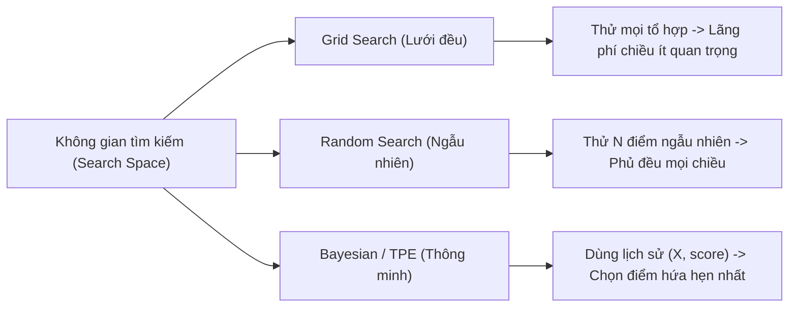

> **Motto:** *"Grid Search lãng phí 90% ngân sách tính toán vào các chiều ít quan trọng; Random Search khám phá tốt hơn nhiều, còn Bayesian Optimization học từ chính những lần thử thất bại."*

---

## Thông tin nhanh (Quick Spec)

* **Loại bài (Type):** Thực chiến (Build)
* **Ngôn ngữ & Công cụ:** Python 3.12, NumPy
* **Kiến thức tiên quyết (Prerequisites):** Model Evaluation (Cross-Validation), Bias-Variance Tradeoff
* **Thời gian thực hành:** ~40 phút

---

## Mục tiêu bài học (Learning Objectives)

Sau bài học này, bạn sẽ có khả năng:
- [ ] Phân biệt rõ *Model Parameters* và *Hyperparameters*.
- [ ] Giải thích vì sao **Random Search** hiệu quả hơn **Grid Search** về mặt toán học (effective dimensionality).
- [ ] Tự tay cài đặt **GridSearchCV**, **RandomSearchCV**, và một bộ **Bayesian-inspired Surrogate Search** thuần Python + NumPy.
- [ ] Nhận diện và phòng tránh bẫy **Validation Overfitting** và **Data Leakage** khi tinh chỉnh siêu tham số.

---

## 1. Vấn đề thực tế (The Problem)

Bạn có một mô hình Gradient Boosting với 5 hyperparameters quan trọng: `learning_rate`, `max_depth`, `n_estimators`, `subsample`, `reg_lambda`.
Nếu bạn dùng **Grid Search** với 5 giá trị cho mỗi tham số, tổng số lần chạy là:
$$5^5 = 3,125 \text{ cấu hình}$$
Nếu mỗi cấu hình chạy 5-Fold Cross-Validation, bạn phải train mô hình **15,625 lần**. Với 1 phút cho mỗi lần train, bạn mất hơn **10 ngày** chỉ để tìm một bộ tham số.

Tệ hơn nữa: trong 5 tham số đó, thường chỉ có 1–2 tham số (ví dụ `learning_rate` và `max_depth`) thực sự quyết định 90% hiệu năng. Grid Search kiểm tra đi kiểm tra lại cùng một giá trị `learning_rate` chỉ để đổi một tham số ít quan trọng khác — một sự lãng phí tài nguyên khổng lồ.

---

## 2. Mô hình tư duy & Bản chất (The Concept)



### 2.1. Tại sao Random Search thắng Grid Search?
Giả sử bạn có ngân sách $N = 9$ lần thử với 2 hyperparameters: $h_1$ (quan trọng) và $h_2$ (ít quan trọng).
- **Grid Search ($3 \times 3$):** Chỉ thử được đúng **3 giá trị khác nhau** của $h_1$!
- **Random Search ($9$ điểm):** Thử được **9 giá trị khác nhau** của $h_1$, tăng gấp 3 lần cơ hội rơi trúng vùng tối ưu.

### 2.2. Bayesian Optimization & Acquisition Function
Thay vì chọn mù quáng, Bayesian Optimization xây dựng một **Surrogate Model** (thường là Gaussian Process hoặc Tree-structured Parzen Estimator - TPE) để ước lượng hàm mục tiêu $f(h)$, sau đó dùng **Acquisition Function** (như *Upper Confidence Bound* - UCB) để cân bằng giữa:
- **Exploitation (Khai thác):** Thử gần những vùng đã cho điểm cao.
- **Exploration (Khám phá):** Thử những vùng chưa có nhiều dữ liệu (độ bất định $\sigma(h)$ cao).

$$\text{UCB}(h) = \mu(h) + \kappa \cdot \sigma(h)$$

---

## 3. Tự tay xây dựng từ đầu (Build It: From Scratch)

Chúng ta sẽ xây dựng một hệ thống Tuning thuần Python + NumPy gồm: K-Fold Cross-Validation, Random Search, và một bộ **Surrogate-Guided Search** (dùng RBF kernel regression làm surrogate model + UCB acquisition function).

### Bước 1: K-Fold Cross-Validation & Hàm mục tiêu giả lập

```python
import numpy as np
from typing import Callable


def kfold_indices(n_samples: int, k: int = 5, seed: int = 42) -> list[tuple[np.ndarray, np.ndarray]]:
    rng = np.random.default_rng(seed)
    indices = rng.permutation(n_samples)
    folds = np.array_split(indices, k)
    splits = []
    for i in range(k):
        val_idx = folds[i]
        train_idx = np.concatenate([folds[j] for j in range(k) if j != i])
        splits.append((train_idx, val_idx))
    return splits


class RidgeRegressionScratch:
    """Mô hình Ridge Regression thuần NumPy để làm đối tượng tune."""

    def __init__(self, alpha: float = 1.0):
        self.alpha = alpha
        self.weights: np.ndarray | None = None

    def fit(self, X: np.ndarray, y: np.ndarray) -> "RidgeRegressionScratch":
        n_features = X.shape[1]
        # Nghiệm đóng: (X^T X + alpha * I)^(-1) X^T y
        A = X.T @ X + self.alpha * np.eye(n_features)
        self.weights = np.linalg.solve(A, X.T @ y)
        return self

    def predict(self, X: np.ndarray) -> np.ndarray:
        if self.weights is None:
            raise RuntimeError("Model must be fitted before predict.")
        return X @ self.weights


def evaluate_ridge_cv(X: np.ndarray, y: np.ndarray, alpha: float, k: int = 5) -> float:
    """Trả về âm MSE trung bình (càng cao càng tốt)."""
    mses = []
    for train_idx, val_idx in kfold_indices(len(X), k=k):
        model = RidgeRegressionScratch(alpha=alpha).fit(X[train_idx], y[train_idx])
        preds = model.predict(X[val_idx])
        mses.append(np.mean((y[val_idx] - preds) ** 2))
    return -float(np.mean(mses))
```

### Bước 2: Random Search vs. Surrogate-Guided Search (UCB)

```python
def random_search(
    eval_fn: Callable[[float], float],
    low: float,
    high: float,
    n_trials: int = 15,
    log_scale: bool = True,
    seed: int = 42,
) -> tuple[float, float]:
    if n_trials <= 0:
        raise ValueError("n_trials must be a positive integer.")
    if log_scale and (low <= 0 or high <= 0):
        raise ValueError("low and high must be positive when log_scale=True.")
    rng = np.random.default_rng(seed)
    best_param = low
    best_score = -float("inf")

    for _ in range(n_trials):
        if log_scale:
            val = float(10 ** rng.uniform(np.log10(low), np.log10(high)))
        else:
            val = float(rng.uniform(low, high))
        score = eval_fn(val)
        if score > best_score:
            best_score = score
            best_param = val
    return best_param, best_score


def surrogate_ucb_search(
    eval_fn: Callable[[float], float],
    low: float,
    high: float,
    n_trials: int = 15,
    n_init: int = 5,
    kappa: float = 1.5,
    seed: int = 42,
) -> tuple[float, float]:
    """Bayesian-inspired search trên không gian log10 dùng RBF Kernel làm surrogate."""
    if n_trials <= 0:
        raise ValueError("n_trials must be a positive integer.")
    if low <= 0 or high <= 0:
        raise ValueError("low and high must be positive for log-scale search.")
    rng = np.random.default_rng(seed)
    log_low, log_high = np.log10(low), np.log10(high)
    n_init = min(n_init, n_trials)

    # Khởi tạo ngẫu nhiên n_init điểm đầu tiên
    xs = list(rng.uniform(log_low, log_high, size=n_init))
    ys = [eval_fn(float(10 ** x)) for x in xs]

    candidates = np.linspace(log_low, log_high, 200)

    for _ in range(n_trials - n_init):
        X_obs = np.array(xs)
        y_obs = np.array(ys)
        y_mean, y_std = np.mean(y_obs), np.std(y_obs) + 1e-8
        y_norm = (y_obs - y_mean) / y_std

        # Tính độ tương đồng RBF giữa candidates và các điểm đã thử
        length_scale = (log_high - log_low) / 5.0
        dists = (candidates[:, None] - X_obs[None, :]) ** 2
        K = np.exp(-dists / (2 * length_scale ** 2))  # (200, n_obs)

        weights = K / (np.sum(K, axis=1, keepdims=True) + 1e-8)
        mu = weights @ y_norm
        # Độ bất định cao ở nơi xa các điểm đã quan sát
        sigma = 1.0 - np.max(K, axis=1)
        ucb = mu + kappa * sigma

        next_x = float(candidates[np.argmax(ucb)])
        next_y = eval_fn(float(10 ** next_x))
        xs.append(next_x)
        ys.append(next_y)

    best_idx = int(np.argmax(ys))
    return float(10 ** xs[best_idx]), float(ys[best_idx])


if __name__ == "__main__":
    np.random.seed(42)
    X = np.random.randn(120, 15)
    true_w = np.array([3.0, -2.0, 1.5] + [0.0] * 12)
    y = X @ true_w + np.random.normal(0, 1.5, 120)

    obj = lambda a: evaluate_ridge_cv(X, y, alpha=a, k=5)

    best_a_rand, score_rand = random_search(obj, low=1e-3, high=1e3, n_trials=15)
    best_a_ucb, score_ucb = surrogate_ucb_search(obj, low=1e-3, high=1e3, n_trials=15)

    print(f"Random Search   -> best alpha: {best_a_rand:.4f}, neg-MSE: {score_rand:.4f}")
    print(f"Surrogate UCB   -> best alpha: {best_a_ucb:.4f}, neg-MSE: {score_ucb:.4f}")
```

---

## 4. Ứng dụng thực tế & So sánh Framework (Use It)

| Công cụ | Thuật toán mặc định | Điểm mạnh | Khi nào dùng? |
|---|---|---|---|
| **Scikit-learn (`RandomizedSearchCV`)** | Random Search | Tích hợp sẵn với `Pipeline`, dễ dùng | Baseline nhanh, số lượng tham số ít |
| **Optuna** | TPE (Tree-structured Parzen Estimator) | Hỗ trợ *Pruning* (dừng sớm trial tệ), API Pythonic | **Tiêu chuẩn vàng** cho hầu hết dự án ML/DL |
| **Ray Tune** | ASHA, HyperBand, BOHB | Phân tán trên nhiều GPU/node | Train Deep Learning quy mô lớn |

**Production Tips:**
1. **Dùng Log-scale cho các tham số biên độ rộng:** `learning_rate` ($10^{-4} \to 10^{-1}$), `alpha`/`reg_lambda` ($10^{-3} \to 10^{2}$) luôn phải lấy mẫu theo log-uniform, nếu không 90% mẫu sẽ rơi vào vùng giá trị lớn.
2. **Bật Pruning (Early Stopping theo trial):** Trong Optuna, dùng `MedianPruner` hoặc `HyperbandPruner` để cắt bỏ ngay các cấu hình có validation loss tệ ở epoch/iteration đầu tiên — tiết kiệm tới 60-80% thời gian GPU.
3. **Cảnh giác Validation Overfitting:** Nếu bạn chạy 1,000 trials trên cùng một tập validation, mô hình có thể vô tình khớp với nhiễu của chính tập validation đó. Luôn giữ một tập **Hold-out Test** chưa từng đụng tới để đánh giá cuối cùng.

---

## 5. Đóng gói & Tái sử dụng (Ship It)

**Checklist trước khi bấm nút chạy Tuning:**
- [ ] Đã khóa `random_state` / `seed` để đảm bảo tái lập kết quả (reproducibility)?
- [ ] Đã đưa toàn bộ bước tiền xử lý (Scaler, Imputer) vào trong vòng lặp CV (hoặc `Pipeline`) để tránh Data Leakage?
- [ ] Các tham số như `learning_rate`, `C`, `alpha` đã được đặt ở thang **log-scale** chưa?
- [ ] Đã đặt giới hạn thời gian (`timeout`) hoặc số lần thử (`n_trials`) phù hợp với ngân sách chưa?

---

## 6. Giải ngố thuật ngữ (Key Terms & Misconceptions)

| Thuật ngữ (Term) | Người ta thường nghĩ là... | Bản chất kỹ thuật thực sự là... |
|---|---|---|
| **Hyperparameter Tuning** | Chạy Grid Search cho tất cả mọi tham số của mô hình. | Tập trung vào 2–4 tham số có độ nhạy cao nhất, dùng Random/Bayesian Search trên thang đo phù hợp. |
| **Bayesian Optimization** | Lúc nào cũng nhanh hơn Random Search. | Với không gian rất lớn (> 20 chiều) hoặc ngân sách cực nhỏ, chi phí tính toán surrogate có thể chậm hơn Random Search; nó tỏa sáng nhất ở khoảng 10–200 trials. |
| **Nested CV** | Dùng để train mô hình cuối cùng đưa lên production. | Dùng để **ước lượng độ chính xác không thiên lệch** của quy trình tuning; mô hình production vẫn được retrain trên toàn bộ dữ liệu với bộ tham số tốt nhất. |

---

## 7. Bài tập thử thách (Hands-on Challenges)

1. 🟢 **Cơ bản (Easy):** Thay đổi `kappa` trong `surrogate_ucb_search` thành `0.1` (thuần khai thác) và `5.0` (thuần khám phá). Quan sát sự khác biệt về `best_alpha` tìm được.
2. 🟡 **Trung bình (Medium):** Mở rộng `random_search` để hỗ trợ tìm kiếm **nhiều hyperparameters cùng lúc** (ví dụ truyền vào một `dict` định nghĩa không gian tìm kiếm gồm cả `log_scale` và `linear_scale`).
3. 🔴 **Nâng cao (Hard):** Tự cài đặt **Successive Halving** (nền tảng của HyperBand): bắt đầu với 16 cấu hình chạy ở ngân sách nhỏ (ví dụ `n_estimators=10`), giữ lại 50% tốt nhất để chạy tiếp ở ngân sách gấp đôi, lặp lại cho đến khi còn 1 cấu hình thắng cuộc.

---

## 8. Tài liệu đọc thêm (Further Reading)

- [Random Search for Hyper-Parameter Optimization (Bergstra & Bengio, 2012)](https://www.jmlr.org/papers/volume13/bergstra12a/bergstra12a.pdf) — *Bài báo kinh điển chứng minh vì sao Random Search đánh bại Grid Search.*
- [Optuna: A Next-generation Hyperparameter Optimization Framework (Akiba et al., 2019)](https://arxiv.org/abs/1907.10902) — *Kiến trúc Define-by-Run và cơ chế Pruning hiện đại.*
