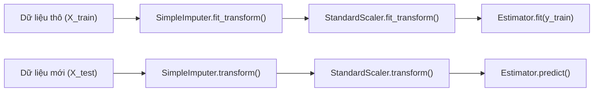

> **Motto:** *"Notebook rời rạc là nơi sinh ra Data Leakage và Training-Serving Skew. Pipeline không chỉ để code đẹp — nó là hợp đồng kỹ thuật đảm bảo dữ liệu đi vào mô hình lúc train và lúc serve giống hệt nhau."*

---

## Thông tin nhanh (Quick Spec)

* **Loại bài (Type):** Thực chiến (Build)
* **Ngôn ngữ & Công cụ:** Python 3.12, NumPy
* **Kiến thức tiên quyết (Prerequisites):** Feature Engineering, Model Evaluation
* **Thời gian thực hành:** ~35 phút

---

## Mục tiêu bài học (Learning Objectives)

Sau bài học này, bạn sẽ có khả năng:
- [ ] Nhận diện chính xác các điểm gây **Data Leakage** trong quy trình tiền xử lý dữ liệu.
- [ ] Tự tay thiết kế và cài đặt kiến trúc **Transformer / Estimator / Pipeline** thuần Python + NumPy.
- [ ] Lưu trữ (serialize) và tái sử dụng toàn bộ pipeline để phục vụ inference mà không bị lệch phân phối (*training-serving skew*).

---

## 1. Vấn đề thực tế (The Problem)

Đây là kịch bản kinh điển khiến nhiều mô hình đạt 98% accuracy trên notebook nhưng sập hoàn toàn khi lên production:

```python
# ❌ CÁCH LÀM SAI (Gây Data Leakage)
X_scaled = (X - X.mean(axis=0)) / X.std(axis=0)
X_train, X_test, y_train, y_test = train_test_split(X_scaled, y)
```

Khi bạn chuẩn hóa (`StandardScaler`) trên **toàn bộ `X`** trước khi chia `train/test`, giá trị `mean` và `std` của tập test đã lén lút đi vào tập train. Trong Cross-Validation, lỗi này còn tinh vi hơn: nếu bạn impute missing values hoặc chọn feature (`SelectKBest`) trước khi chạy K-Fold, điểm CV sẽ cao giả tạo.

Ngoài ra, khi deploy lên API server, nếu bạn viết lại logic chuẩn hóa bằng tay thay vì dùng chung một pipeline object, chỉ cần lệch một dấu phẩy hay thứ tự cột là mô hình sẽ dự đoán sai bét (*Training-Serving Skew*).

---

## 2. Mô hình tư duy & Bản chất (The Concept)

Một ML Pipeline chuẩn hoạt động như một dây chuyền lắp ráp một chiều, trong đó mỗi bước (step) đều tuân thủ hợp đồng `fit` / `transform`:



Nguyên tắc bất di bất dịch:
1. **`fit(X, y)`**: Chỉ được phép chạy trên **tập train** (hoặc fold train trong CV). Lưu lại các tham số nội tại (như $\mu, \sigma$, median, trọng số $w$).
2. **`transform(X)`**: Dùng các tham số đã lưu để biến đổi dữ liệu. Tuyệt đối không tính toán lại thống kê trên tập validation/test.
3. **`fit_transform(X, y)`**: Tiện ích gộp `fit` rồi `transform` trên tập train.

### Hợp đồng toán học giữa Train và Test

Với bước chuẩn hóa Z-score (`StandardScaler`), hợp đồng chuẩn bắt buộc phải dùng **cùng một cặp thống kê $(\mu_{\text{train}}, \sigma_{\text{train}})$** học từ tập huấn luyện để biến đổi cả tập train lẫn tập test:

$$x'_{\text{train}} = \frac{x_{\text{train}} - \mu_{\text{train}}}{\sigma_{\text{train}}}, \qquad x'_{\text{test}} = \frac{x_{\text{test}} - \mu_{\text{train}}}{\sigma_{\text{train}}}$$

Nếu bạn gọi `fit` trên toàn bộ dữ liệu $X_{\text{all}} = X_{\text{train}} \cup X_{\text{test}}$, trung bình thực tế bị trộn bởi cả tập test:

$$\mu_{\text{all}} = \frac{n_{\text{train}}\mu_{\text{train}} + n_{\text{test}}\mu_{\text{test}}}{n_{\text{train}} + n_{\text{test}}}$$

Điều này làm rò rỉ thông tin phân phối của tương lai ($\mu_{\text{test}}, \sigma_{\text{test}}$) trực tiếp vào các đặc trưng huấn luyện, khiến điểm đánh giá trên tập test/validation bị thổi phồng giả tạo và không phản ánh đúng hiệu năng khi gặp dữ liệu mới ngoài production.

---

## 3. Tự tay xây dựng từ đầu (Build It: From Scratch)

Chúng ta sẽ xây dựng một hệ thống Pipeline hoàn chỉnh thuần Python + NumPy, bao gồm `BaseTransformer`, `MeanImputerScratch`, `StandardScalerScratch`, một `LogisticRegressionScratch`, và lớp `PipelineScratch` kết nối tất cả lại.

### Bước 1: Định nghĩa các Transformer chuẩn hóa

```python
import numpy as np
import pickle
from typing import Protocol, Any


class Transformer(Protocol):
    def fit(self, X: np.ndarray, y: np.ndarray | None = None) -> "Transformer": ...
    def transform(self, X: np.ndarray) -> np.ndarray: ...
    def fit_transform(self, X: np.ndarray, y: np.ndarray | None = None) -> np.ndarray: ...


class MeanImputerScratch:
    """Thay thế giá trị NaN bằng giá trị trung bình của cột (chỉ học trên tập train)."""

    def __init__(self):
        self.means_: np.ndarray | None = None

    def fit(self, X: np.ndarray, y: np.ndarray | None = None) -> "MeanImputerScratch":
        X_arr = np.asarray(X, dtype=np.float64)
        means = np.nanmean(X_arr, axis=0)
        self.means_ = np.where(np.isnan(means), 0.0, means)
        return self

    def transform(self, X: np.ndarray) -> np.ndarray:
        if self.means_ is None:
            raise RuntimeError("Imputer chưa được fit!")
        X_out = np.asarray(X, dtype=np.float64).copy()
        nan_mask = np.isnan(X_out)
        # Điền mean tương ứng cho từng cột bị NaN
        col_indices = np.where(nan_mask)[1]
        X_out[nan_mask] = self.means_[col_indices]
        return X_out

    def fit_transform(self, X: np.ndarray, y: np.ndarray | None = None) -> np.ndarray:
        return self.fit(X, y).transform(X)


class StandardScalerScratch:
    """Chuẩn hóa Z-score: (X - mean) / std."""

    def __init__(self):
        self.mean_: np.ndarray | None = None
        self.std_: np.ndarray | None = None

    def fit(self, X: np.ndarray, y: np.ndarray | None = None) -> "StandardScalerScratch":
        self.mean_ = np.mean(X, axis=0)
        self.std_ = np.std(X, axis=0)
        self.std_ = np.where(self.std_ == 0, 1.0, self.std_)  # Tránh chia cho 0
        return self

    def transform(self, X: np.ndarray) -> np.ndarray:
        if self.mean_ is None or self.std_ is None:
            raise RuntimeError("Scaler chưa được fit!")
        return (X - self.mean_) / self.std_

    def fit_transform(self, X: np.ndarray, y: np.ndarray | None = None) -> np.ndarray:
        return self.fit(X, y).transform(X)
```

### Bước 2: Estimator & Pipeline kết nối các bước

```python
class LogisticRegressionScratch:
    def __init__(self, lr: float = 0.1, n_iters: int = 300):
        self.lr = lr
        self.n_iters = n_iters
        self.weights: np.ndarray | None = None
        self.bias: float = 0.0

    @staticmethod
    def _sigmoid(z: np.ndarray) -> np.ndarray:
        return 1.0 / (1.0 + np.exp(-np.clip(z, -250, 250)))

    def fit(self, X: np.ndarray, y: np.ndarray) -> "LogisticRegressionScratch":
        n_samples, n_features = X.shape
        self.weights = np.zeros(n_features)
        self.bias = 0.0
        for _ in range(self.n_iters):
            preds = self._sigmoid(X @ self.weights + self.bias)
            dw = (1 / n_samples) * (X.T @ (preds - y))
            db = (1 / n_samples) * np.sum(preds - y)
            self.weights -= self.lr * dw
            self.bias -= self.lr * db
        return self

    def predict(self, X: np.ndarray) -> np.ndarray:
        if self.weights is None:
            raise RuntimeError("Model chưa được fit!")
        probs = self._sigmoid(X @ self.weights + self.bias)
        return (probs >= 0.5).astype(int)


class PipelineScratch:
    """Chuỗi các Transformers kết thúc bằng một Estimator."""

    def __init__(self, steps: list[tuple[str, Any]]):
        if not steps:
            raise ValueError("Pipeline phải có ít nhất một bước!")
        self.steps = steps

    def fit(self, X: np.ndarray, y: np.ndarray) -> "PipelineScratch":
        X_curr = X
        for _, step in self.steps[:-1]:
            X_curr = step.fit_transform(X_curr, y)
        _, estimator = self.steps[-1]
        estimator.fit(X_curr, y)
        return self

    def predict(self, X: np.ndarray) -> np.ndarray:
        X_curr = X
        for _, step in self.steps[:-1]:
            X_curr = step.transform(X_curr)
        _, estimator = self.steps[-1]
        return estimator.predict(X_curr)


if __name__ == "__main__":
    np.random.seed(42)
    X = np.random.randn(200, 3) * 10 + 50
    y = (X[:, 0] + X[:, 1] > 100).astype(int)
    # Cố tình chèn NaN vào dữ liệu
    X[5, 0] = np.nan
    X[160, 1] = np.nan

    X_train, X_test = X[:150], X[150:]
    y_train, y_test = y[:150], y[150:]

    pipe = PipelineScratch([
        ("imputer", MeanImputerScratch()),
        ("scaler", StandardScalerScratch()),
        ("clf", LogisticRegressionScratch(lr=0.2, n_iters=500)),
    ])
    pipe.fit(X_train, y_train)
    acc = np.mean(pipe.predict(X_test) == y_test)
    print(f"Pipeline Test Accuracy: {acc:.2%}")

    # Kiểm chứng đóng gói & tái sử dụng
    serialized = pickle.dumps(pipe)
    loaded_pipe = pickle.loads(serialized)
    assert np.array_equal(pipe.predict(X_test), loaded_pipe.predict(X_test))
    print("Serialize & Load Pipeline thành công, kết quả khớp 100%!")
```

---

## 4. Ứng dụng thực tế & So sánh Framework (Use It)

| Công cụ | Điểm mạnh | Khi nào dùng? |
|---|---|---|
| **`sklearn.pipeline.Pipeline` + `ColumnTransformer`** | Chuẩn mực cho dữ liệu bảng, xử lý riêng biệt cột số và cột chữ, tích hợp `GridSearchCV`. | Mọi dự án Tabular ML từ prototype đến production. |
| **Feature Store (Feast, Tecton)** | Đảm bảo feature được tính toán đồng nhất giữa offline training và online serving. | Hệ thống lớn có real-time features (sliding window, user clicks). |
| **ONNX / TorchScript** | Đóng gói cả tiền xử lý và mô hình thành đồ thị tính toán C++ không phụ thuộc Python. | Cần latency cực thấp (< 5ms) hoặc deploy trên edge/mobile. |

**Production Tips:**
1. **Không bao giờ lưu riêng lẻ `scaler.pkl` và `model.pkl`:** Hãy gộp chung vào một `pipeline.pkl` (hoặc `joblib`) để không bao giờ quên bước biến đổi nào khi inference.
2. **Cẩn thận với `pickle`:** Trong production, `pickle` có rủi ro bảo mật (arbitrary code execution) và dễ gãy khi nâng cấp phiên bản thư viện. Hãy khóa chặt version trong `requirements.txt` hoặc dùng định dạng an toàn hơn như ONNX / Safetensors khi có thể.

---

## 5. Đóng gói & Tái sử dụng (Ship It)

**Checklist kiểm tra Pipeline trước khi Deploy:**
- [ ] Toàn bộ bước Impute, Scale, Encode, Feature Selection đã nằm **bên trong** `Pipeline` chưa?
- [ ] Có bước nào vô tình gọi `fit` trên tập `X_test` hoặc `X_val` không?
- [ ] Pipeline có xử lý được giá trị `NaN` hoặc category lạ (*unseen categories*) khi chạy thực tế trên production không?
- [ ] Đã viết unit test kiểm tra: `pipe.predict(single_row)` cho kết quả giống hệt khi chạy batch?

---

## 6. Giải ngố thuật ngữ (Key Terms & Misconceptions)

| Thuật ngữ (Term) | Người ta thường nghĩ là... | Bản chất kỹ thuật thực sự là... |
|---|---|---|
| **Data Leakage** | Chỉ là việc quên tách tập train/test. | Bất kỳ thông tin nào từ tương lai hoặc tập đánh giá (kể cả `mean`, `std`, `IDF` của TF-IDF) lọt vào quá trình `fit` đều là Data Leakage. |
| **Training-Serving Skew** | Mô hình bị giảm độ chính xác theo thời gian (Model Drift). | Sự sai khác về code hoặc phân phối dữ liệu giữa lúc train và lúc serve (VD: lúc train chia 255.0, lúc serve quên chia). |
| **ColumnTransformer** | Một thuật toán giảm chiều dữ liệu. | Bộ định tuyến (router) áp dụng các nhánh Pipeline khác nhau cho từng nhóm cột (số, chữ, ngày tháng) rồi ghép lại. |

---

## 7. Bài tập thử thách (Hands-on Challenges)

1. 🟢 **Cơ bản (Easy):** Thêm một bước `MinMaxScalerScratch` (đưa dữ liệu về $[0, 1]$) và thay thế `StandardScalerScratch` trong `PipelineScratch`, so sánh độ chính xác.
2. 🟡 **Trung bình (Medium):** Mở rộng `PipelineScratch` để có phương thức `predict_proba(X)` nếu estimator cuối cùng hỗ trợ.
3. 🔴 **Nâng cao (Hard):** Tự viết một lớp `ColumnTransformerScratch` thuần NumPy cho phép áp dụng `StandardScalerScratch` lên các cột `[0, 1]` và `MeanImputerScratch` lên cột `[2]`, sau đó nối kết quả theo chiều ngang (`np.hstack`).

---

## 8. Tài liệu đọc thêm (Further Reading)

- [Scikit-learn Pipelines and Composite Estimators](https://scikit-learn.org/stable/modules/compose.html) — *Tài liệu chuẩn mực về cách thiết kế Pipeline và ColumnTransformer.*
- [Rules of Machine Learning: Best Practices for ML Engineering (Google)](https://developers.google.com/machine-learning/guides/rules-of-ml) — *Đọc kỹ phần Training-Serving Skew.*
