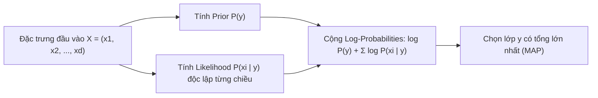

> **Motto:** *"Giả định 'ngây thơ' rằng các đặc trưng độc lập với nhau thường sai trong thực tế — nhưng chính sự ngây thơ đó giúp Naive Bayes học trong một lần quét dữ liệu với tốc độ $O(N \cdot d)$ mà vẫn cực kỳ chính xác."*

---

## Thông tin nhanh (Quick Spec)

* **Loại bài (Type):** Thực chiến (Build)
* **Ngôn ngữ & Công cụ:** Python 3.12, NumPy
* **Kiến thức tiên quyết (Prerequisites):** Xác suất cơ bản (Định lý Bayes), Classification
* **Thời gian thực hành:** ~35 phút

---

## Mục tiêu bài học (Learning Objectives)

Sau bài học này, bạn sẽ có khả năng:
- [ ] Giải thích được ý nghĩa của giả định *Conditional Independence* và lý do nó vẫn hoạt động tốt dù giả định bị vi phạm.
- [ ] Tự tay cài đặt **Gaussian Naive Bayes** (cho dữ liệu số liên tục) và **Multinomial Naive Bayes** (cho văn bản/tần suất) thuần Python + NumPy.
- [ ] Xử lý triệt để 2 vấn đề sống còn khi code Naive Bayes: **Numerical Underflow** (dùng `log`) và **Zero Probability** (dùng *Laplace Smoothing*).

---

## 1. Vấn đề thực tế (The Problem)

Bạn cần xây dựng bộ lọc Spam cho 10 triệu email mỗi ngày với từ điển 50,000 từ.
- Nếu dùng **Logistic Regression** hoặc **SVM**, bạn phải chạy nhiều epoch tối ưu hóa lặp đi lặp lại trên ma trận $10^7 \times 50,000$.
- Nếu muốn ước lượng trực tiếp phân phối đồng thời $P(x_1, x_2, \dots, x_{50000} \mid y)$, số lượng tham số cần học sẽ bùng nổ theo cấp số nhân ($2^{50000}$), bất khả thi về mặt tính toán và dữ liệu.

Bạn cần một mô hình **baseline cực nhanh**, huấn luyện chỉ trong **một lần duyệt dữ liệu**, ít tốn RAM, và hoạt động tốt ngay cả khi số chiều $d$ lớn hơn số mẫu $N$.

---

## 2. Mô hình tư duy & Bản chất (The Concept)



### 2.1. Định lý Bayes & Giả định "Naive"
Mục tiêu là tìm lớp $y$ tối đa hóa xác suất hậu nghiệm (*Maximum A Posteriori - MAP*):
$$\hat{y} = \arg\max_{y} P(y \mid X) = \arg\max_{y} P(y) \prod_{i=1}^{d} P(x_i \mid y)$$

### 2.2. Chống Underflow bằng Log-Space
Khi $d = 10,000$, tích của $10,000$ số nhỏ hơn $1$ (ví dụ $0.01^{10000}$) sẽ làm máy tính làm tròn thành `0.0` (*numerical underflow*). Chuyển sang `log` biến phép nhân thành phép cộng:
$$\hat{y} = \arg\max_{y} \left[ \log P(y) + \sum_{i=1}^{d} \log P(x_i \mid y) \right]$$

### 2.3. Hai biến thể phổ biến
1. **Gaussian Naive Bayes (Dữ liệu liên tục):** Giả sử $x_i \mid y \sim \mathcal{N}(\mu_{y,i}, \sigma_{y,i}^2)$.
2. **Multinomial Naive Bayes (Dữ liệu đếm/văn bản):** Dùng **Laplace Smoothing** ($\alpha > 0$) để tránh xác suất bằng $0$ khi gặp từ mới:
$$P(w_i \mid y) = \frac{\text{count}(w_i, y) + \alpha}{\sum_{j=1}^{|V|} \text{count}(w_j, y) + \alpha |V|}$$

---

## 3. Tự tay xây dựng từ đầu (Build It: From Scratch)

### Bước 1: Gaussian Naive Bayes (Dữ liệu số liên tục)

```python
import numpy as np


class GaussianNBScratch:
    def __init__(self, var_smoothing: float = 1e-9):
        self.var_smoothing = var_smoothing
        self.classes_: np.ndarray | None = None
        self.log_priors_: np.ndarray | None = None
        self.means_: np.ndarray | None = None
        self.vars_: np.ndarray | None = None

    def fit(self, X: np.ndarray, y: np.ndarray) -> "GaussianNBScratch":
        self.classes_ = np.unique(y)
        n_classes = len(self.classes_)
        n_features = X.shape[1]

        self.means_ = np.zeros((n_classes, n_features))
        self.vars_ = np.zeros((n_classes, n_features))
        self.log_priors_ = np.zeros(n_classes)

        for idx, c in enumerate(self.classes_):
            X_c = X[y == c]
            self.means_[idx] = np.mean(X_c, axis=0)
            self.vars_[idx] = np.var(X_c, axis=0) + self.var_smoothing
            self.log_priors_[idx] = np.log(len(X_c) / len(X))
        return self

    def predict(self, X: np.ndarray) -> np.ndarray:
        if self.classes_ is None or self.means_ is None or self.vars_ is None or self.log_priors_ is None:
            raise RuntimeError("Model must be fitted before predict.")
        # Tính log-likelihood cho từng lớp bằng broadcasting
        log_probs = []
        for idx in range(len(self.classes_)):
            mean = self.means_[idx]
            var = self.vars_[idx]
            log_likelihood = -0.5 * np.sum(np.log(2.0 * np.pi * var) + ((X - mean) ** 2) / var, axis=1)
            log_probs.append(self.log_priors_[idx] + log_likelihood)

        log_probs = np.column_stack(log_probs)  # (n_samples, n_classes)
        return self.classes_[np.argmax(log_probs, axis=1)]
```

### Bước 2: Multinomial Naive Bayes (Phân loại văn bản / Bag-of-Words)

```python
class MultinomialNBScratch:
    def __init__(self, alpha: float = 1.0):
        self.alpha = alpha
        self.classes_: np.ndarray | None = None
        self.log_priors_: np.ndarray | None = None
        self.feature_log_probs_: np.ndarray | None = None

    def fit(self, X: np.ndarray, y: np.ndarray) -> "MultinomialNBScratch":
        self.classes_ = np.unique(y)
        n_classes = len(self.classes_)
        n_features = X.shape[1]

        self.log_priors_ = np.zeros(n_classes)
        self.feature_log_probs_ = np.zeros((n_classes, n_features))

        for idx, c in enumerate(self.classes_):
            X_c = X[y == c]
            self.log_priors_[idx] = np.log(len(X_c) / len(X))
            word_counts = np.sum(X_c, axis=0) + self.alpha
            total_counts = np.sum(word_counts)
            self.feature_log_probs_[idx] = np.log(word_counts / total_counts)
        return self

    def predict(self, X: np.ndarray) -> np.ndarray:
        if self.classes_ is None or self.feature_log_probs_ is None or self.log_priors_ is None:
            raise RuntimeError("Model must be fitted before predict.")
        # Phép nhân ma trận cực nhanh: (n_samples, n_features) @ (n_features, n_classes)
        joint_log_likelihood = X @ self.feature_log_probs_.T + self.log_priors_
        return self.classes_[np.argmax(joint_log_likelihood, axis=1)]


if __name__ == "__main__":
    np.random.seed(42)
    # 1. Test GaussianNB (xáo trộn trước khi tách Train/Test để cả 2 lớp có mặt ở tập Test)
    X_num = np.vstack([np.random.randn(60, 4) - 1.5, np.random.randn(60, 4) + 1.5])
    y_num = np.array([0] * 60 + [1] * 60)
    perm = np.random.permutation(len(y_num))
    X_num, y_num = X_num[perm], y_num[perm]
    gnb = GaussianNBScratch().fit(X_num[:100], y_num[:100])
    print(f"GaussianNB Accuracy: {np.mean(gnb.predict(X_num[100:]) == y_num[100:]):.2%}")

    # 2. Test MultinomialNB (giả lập Bag-of-Words với 10 từ)
    X_txt = np.random.poisson(lam=2, size=(100, 10))
    y_txt = (X_txt[:, 0] + X_txt[:, 1] > 4).astype(int)
    mnb = MultinomialNBScratch(alpha=1.0).fit(X_txt[:80], y_txt[:80])
    print(f"MultinomialNB Accuracy: {np.mean(mnb.predict(X_txt[80:]) == y_txt[80:]):.2%}")
```

---

## 4. Ứng dụng thực tế & So sánh Framework (Use It)

- **Baseline thần tốc cho NLP:** Trước khi fine-tune PhoBERT hay DeBERTa, hãy luôn chạy `TfidfVectorizer` + `MultinomialNB` (hoặc `ComplementNB` cho dữ liệu mất cân bằng) trong `scikit-learn`. Nó mất chưa tới 1 giây và thường đạt 85–92% độ chính xác của các mô hình nặng nề.
- **Online Learning:** Naive Bayes hỗ trợ cập nhật tăng dần (`partial_fit`) cực tốt vì bạn chỉ cần cộng dồn `word_counts` mới mà không cần train lại từ đầu.

**Production Tips:**
1. **Đừng tin vào xác suất đầu ra (`predict_proba`):** Do giả định độc lập bị vi phạm, Naive Bayes thường đẩy xác suất về rất gần `0.0` hoặc `1.0` (*overconfident*). Nếu cần xác suất chuẩn để tính ngưỡng rủi ro, hãy calibrate lại bằng Platt Scaling hoặc Isotonic Regression.
2. **Dữ liệu mất cân bằng (Imbalanced):** Nếu lớp Spam chỉ chiếm 1%, `ComplementNB` thường hoạt động tốt hơn `MultinomialNB`.

---

## 5. Đóng gói & Tái sử dụng (Ship It)

**Checklist triển khai Naive Bayes:**
- [ ] Đã dùng `log` cho toàn bộ phép tính xác suất chưa?
- [ ] Đã bật Laplace Smoothing (`alpha >= 1.0` hoặc `var_smoothing`) chưa?
- [ ] Với dữ liệu văn bản, đã loại bỏ stop-words và dùng TF-IDF hoặc Bag-of-Words nhất quán chưa?
- [ ] Nếu dùng `predict_proba` cho business logic, đã kiểm tra calibration chưa?

---

## 6. Giải ngố thuật ngữ (Key Terms & Misconceptions)

| Thuật ngữ (Term) | Người ta thường nghĩ là... | Bản chất kỹ thuật thực sự là... |
|---|---|---|
| **Naive (Ngây thơ)** | Thuật toán kém thông minh, độ chính xác thấp. | Chỉ là tên gọi của giả định **độc lập có điều kiện** giữa các đặc trưng. Thực tế nó rất mạnh ở không gian nhiều chiều. |
| **Laplace Smoothing** | Làm mượt biểu đồ đường cong. | Cộng thêm hằng số $\alpha$ vào tử số (và $\alpha|V|$ vào mẫu số) để tránh xác suất bằng $0$ khi gặp từ mới. |
| **Probability Calibration** | `predict_proba()` của Naive Bayes là xác suất thực tế. | Không! Đó chỉ là điểm số xếp hạng (ranking); xác suất thường bị đẩy về cực trị 0 hoặc 1. |

---

## 7. Bài tập thử thách (Hands-on Challenges)

1. 🟢 **Cơ bản (Easy):** Thử đặt `alpha=0.0` trong `MultinomialNBScratch` và đưa vào một từ mới chưa từng xuất hiện trong tập train. Quan sát lỗi `divide by zero` / `-inf` xảy ra.
2. 🟡 **Trung bình (Medium):** Thêm phương thức `predict_proba(X)` vào `GaussianNBScratch` sử dụng **Log-Sum-Exp trick** để chuyển đổi log-probabilities về xác suất có tổng bằng 1 mà không bị overflow.
3. 🔴 **Nâng cao (Hard):** Tự cài đặt **Bernoulli Naive Bayes** (chỉ quan tâm từ có xuất hiện `1` hay không `0`, phạt cả những từ *không* xuất hiện) và so sánh với `MultinomialNBScratch` trên bài toán phân loại văn bản ngắn.

---

## 8. Tài liệu đọc thêm (Further Reading)

- [The Optimality of Naive Bayes (Harry Zhang, 2004)](https://www.cs.unb.ca/~hzhang/publications/FLAIRS04ZhangH.pdf) — *Giải thích toán học vì sao Naive Bayes vẫn phân loại đúng ngay cả khi các đặc trưng phụ thuộc nhau.*
- [Scikit-learn Naive Bayes Documentation](https://scikit-learn.org/stable/modules/naive_bayes.html) — *So sánh chi tiết Gaussian, Multinomial, Complement và Bernoulli NB.*
