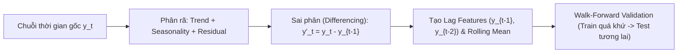

> **Motto:** *"Trong chuỗi thời gian, xáo trộn dữ liệu (shuffle) là tội lỗi lớn nhất. Bạn không thể dùng tương lai để dự đoán quá khứ, và mọi phép đánh giá đều phải tôn trọng mũi tên thời gian."*

---

## Thông tin nhanh (Quick Spec)

* **Loại bài (Type):** Thực chiến (Build)
* **Ngôn ngữ & Công cụ:** Python 3.12, NumPy
* **Kiến thức tiên quyết (Prerequisites):** Linear Regression, Model Evaluation, Feature Engineering
* **Thời gian thực hành:** ~45 phút

---

## Mục tiêu bài học (Learning Objectives)

Sau bài học này, bạn sẽ có khả năng:
- [ ] Nhận diện 3 thành phần cốt lõi của chuỗi thời gian: **Trend**, **Seasonality**, và **Residual/Noise**.
- [ ] Hiểu rõ khái niệm **Stationarity (Tính dừng)** và cách dùng **Differencing** để loại bỏ Trend.
- [ ] Tự tay cài đặt **Walk-Forward Validation**, tạo **Lag & Rolling Features**, và huấn luyện mô hình **Autoregressive (AR)** thuần Python + NumPy.

---

## 1. Vấn đề thực tế (The Problem)

Bạn được giao bài toán dự báo doanh thu bán hàng theo ngày cho 30 ngày tới. Nếu bạn lấy dữ liệu 3 năm qua, gọi `train_test_split(X, y, test_size=0.2, shuffle=True)`, mô hình đạt $R^2 = 0.99$. Bạn tự tin deploy lên production — và tuần đầu tiên sai số lên tới 40%.

**Tại sao?**
Vì `shuffle=True` đã trộn lẫn dữ liệu ngày mai vào tập train để dự đoán ngày hôm qua! Trong thực tế, tại thời điểm $t$, bạn chỉ có dữ liệu từ $t-1$ trở về trước. Hơn nữa, doanh thu năm nay có thể cao gấp đôi năm ngoái (*Trend*), khiến các mô hình cây quyết định (như Random Forest / XGBoost) **không thể ngoại suy (extrapolate)** vượt ra ngoài khoảng giá trị đã thấy trong tập train.

---

## 2. Mô hình tư duy & Bản chất (The Concept)



### 2.1. Tính dừng (Stationarity) & Sai phân (Differencing)
Một chuỗi thời gian có tính dừng khi **mean** và **variance** của nó không đổi theo thời gian.
Để khử Trend tuyến tính, ta dùng sai phân bậc 1 (*First-order Differencing*):
$$\Delta y_t = y_t - y_{t-1}$$
Sau khi mô hình dự đoán $\widehat{\Delta y}_{t+1}$, ta cộng ngược lại giá trị thực tế gần nhất để khôi phục dự báo gốc:
$$\hat{y}_{t+1} = y_t + \widehat{\Delta y}_{t+1}$$

### 2.2. Mô hình Autoregressive $AR(p)$
Dự đoán giá trị hiện tại dựa trên $p$ bước thời gian trong quá khứ:
$$y_t = c + \sum_{i=1}^{p} \phi_i y_{t-i} + \epsilon_t$$

---

## 3. Tự tay xây dựng từ đầu (Build It: From Scratch)

Chúng ta sẽ xây dựng:
1. Hàm tạo **Lag Features** và **Rolling Mean** (đảm bảo chỉ nhìn về quá khứ, không rò rỉ tương lai).
2. Mô hình **AR(p) với Differencing** thuần NumPy.
3. Bộ đánh giá **Walk-Forward Validation**.

```python
import numpy as np


def create_lag_features(series: np.ndarray, n_lags: int = 3, rolling_window: int = 3) -> tuple[np.ndarray, np.ndarray]:
    """Biến đổi chuỗi 1D thành ma trận (X, y) chỉ sử dụng thông tin quá khứ."""
    start_idx = max(n_lags, rolling_window)
    if len(series) <= start_idx:
        raise ValueError("Series is too short for the requested n_lags and rolling_window.")
    X, y = [], []
    for t in range(start_idx, len(series)):
        lags = series[t - n_lags : t][::-1]  # [y_{t-1}, y_{t-2}, ..., y_{t-p}]
        roll_mean = np.mean(series[t - rolling_window : t])
        X.append(np.append(lags, roll_mean))
        y.append(series[t])
    return np.array(X), np.array(y)


class AutoregressiveScratch:
    """Mô hình AR(p) kết hợp Differencing tùy chọn, giải bằng OLS."""

    def __init__(self, n_lags: int = 3, use_diff: bool = True):
        self.n_lags = n_lags
        self.use_diff = use_diff
        self.weights: np.ndarray | None = None

    def fit(self, series: np.ndarray) -> "AutoregressiveScratch":
        data = np.diff(series) if self.use_diff else series
        X, y = create_lag_features(data, n_lags=self.n_lags, rolling_window=self.n_lags)
        # Thêm cột bias (1s)
        X_b = np.column_stack([np.ones(len(X)), X])
        self.weights = np.linalg.pinv(X_b) @ y
        return self

    def predict_next(self, history: np.ndarray) -> float:
        """Dự đoán 1 bước tiếp theo dựa trên lịch sử gần nhất."""
        if self.weights is None:
            raise RuntimeError("Model must be fitted before predict_next.")
        data = np.diff(history) if self.use_diff else history
        if len(data) < self.n_lags:
            raise ValueError("History is too short for the configured n_lags.")
        lags = data[-self.n_lags :][::-1]
        roll_mean = np.mean(data[-self.n_lags :])
        x_b = np.concatenate([[1.0], lags, [roll_mean]])
        pred = float(x_b @ self.weights)
        if self.use_diff:
            return float(history[-1] + pred)
        return pred


def walk_forward_validation(series: np.ndarray, initial_train_size: int, n_lags: int = 3) -> float:
    """Đánh giá mô hình bằng Expanding Window: train trên [0:t], dự đoán t."""
    if initial_train_size <= n_lags + 1:
        raise ValueError("initial_train_size must be greater than n_lags + 1 when differencing is enabled.")
    errors = []
    for t in range(initial_train_size, len(series)):
        train_hist = series[:t]
        model = AutoregressiveScratch(n_lags=n_lags, use_diff=True).fit(train_hist)
        pred = model.predict_next(train_hist)
        errors.append(abs(series[t] - pred))
    return float(np.mean(errors))


if __name__ == "__main__":
    np.random.seed(42)
    t = np.arange(100)
    # Chuỗi có Trend tăng dần + Seasonality chu kỳ 12 + Nhiễu
    series = 0.5 * t + 5.0 * np.sin(2 * np.pi * t / 12) + np.random.normal(0, 0.8, 100)

    mae = walk_forward_validation(series, initial_train_size=60, n_lags=4)
    print(f"Walk-Forward MAE (40 bước tương lai): {mae:.4f}")
```

---

## 4. Ứng dụng thực tế & So sánh Framework (Use It)

| Cách tiếp cận | Thư viện tiêu biểu | Khi nào dùng? |
|---|---|---|
| **Thống kê cổ điển** | `statsmodels` (ARIMA, SARIMA, ETS) | Dữ liệu ít (< 1,000 điểm), 1 chuỗi đơn lẻ, cần khoảng tin cậy (confidence interval). |
| **Additive / Prophet** | `prophet`, `NeuralProphet` | Dữ liệu kinh doanh có nhiều ngày lễ (holidays), seasonality phức tạp theo tuần/năm. |
| **Tabular ML (Global Model)** | `LightGBM` / `XGBoost` + `skforecast` | **Tối ưu nhất cho production** khi có hàng nghìn chuỗi cùng lúc (VD: dự báo 10,000 SKU sản phẩm). |

**Production Tips:**
1. **Cẩn thận với Multi-step Forecasting:** Dự đoán $t+1$ rồi lấy kết quả đó làm lag để dự đoán $t+2, t+3 \dots$ (Recursive strategy) sẽ bị **tích tụ sai số (error accumulation)**. Nếu cần dự đoán xa, hãy cân nhắc huấn luyện mô hình riêng cho từng horizon (Direct strategy).
2. **Đừng quên các đặc trưng lịch (Calendar Features):** `day_of_week`, `is_weekend`, `is_holiday`, `day_of_month` thường mang lại mức tăng hiệu năng lớn nhất trong bài toán thực tế.

---

## 5. Đóng gói & Tái sử dụng (Ship It)

**Checklist trước khi đưa mô hình Time Series lên Production:**
- [ ] Đã kiểm tra không có bất kỳ **Future Leakage** nào trong `Lag`, `Rolling Mean`, hay `Scaler`?
- [ ] Đã dùng **Walk-Forward Validation** thay vì random K-Fold?
- [ ] Đã so sánh với **Naive Baseline** (ví dụ: dự đoán ngày mai bằng đúng hôm nay $\hat{y}_{t+1} = y_t$) để chắc chắn mô hình phức tạp thực sự tốt hơn?

---

## 6. Giải ngố thuật ngữ (Key Terms & Misconceptions)

| Thuật ngữ (Term) | Người ta thường nghĩ là... | Bản chất kỹ thuật thực sự là... |
|---|---|---|
| **Stationarity (Tính dừng)** | Chuỗi dữ liệu đi ngang, không thay đổi gì cả. | Các đặc trưng thống kê (mean, variance, autocorrelation) **không đổi theo thời gian**. |
| **Data Leakage trong Time Series** | Chỉ là việc quên tách tập train/test. | Tính `StandardScaler` hoặc `Rolling Mean` trên cả chuỗi trước khi cắt train/test cũng là rò rỉ thông tin tương lai. |
| **XGBoost cho Time Series** | Cứ ném thẳng `y_t` vào XGBoost là xong. | Cây quyết định không thể ngoại suy vượt quá `max(y_train)`. Nếu dữ liệu có Trend tăng mạnh, bắt buộc phải **Differencing** hoặc tách Trend trước. |

---

## 7. Bài tập thử thách (Hands-on Challenges)

1. 🟢 **Cơ bản (Easy):** Tính **Naive Baseline MAE** ($\hat{y}_t = y_{t-1}$) trên chuỗi dữ liệu mẫu ở trên và so sánh với `AutoregressiveScratch`.
2. 🟡 **Trung bình (Medium):** Thay đổi `walk_forward_validation` từ *Expanding Window* (`series[:t]`) sang *Sliding Window* cố định kích thước 40 (`series[t-40:t]`) và quan sát kết quả.
3. 🔴 **Nâng cao (Hard):** Viết hàm `recursive_forecast(model, history, horizon=10)` để dự đoán liên tiếp 10 bước tương lai, sau đó tính MAE ở từng bước từ $1$ đến $10$ để quan sát hiện tượng tích tụ sai số.

---

## 8. Tài liệu đọc thêm (Further Reading)

- [Forecasting: Principles and Practice (Rob J Hyndman & George Athanasopoulos)](https://otexts.com/fpp3/) — *Cuốn sách kinh điển và miễn phí hay nhất về Time Series.*
- [Nixtla / StatsForecast & MLForecast](https://nixtlaverse.nixtla.io/) — *Bộ thư viện Python hiện đại và cực nhanh cho Time Series trên production.*
