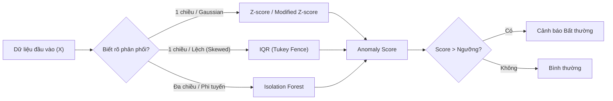

> **[Motto / Châm ngôn cốt lõi]**: Đừng cố học mọi hình dạng của sự bất thường; hãy mô hình hóa thật tốt trạng thái bình thường. Bất thường là mọi thứ nằm ngoài ranh giới đó.

---

## Thông tin nhanh (Quick Spec)

* **Loại bài (Type):** Thực chiến (Build)
* **Ngôn ngữ & Công cụ:** Python 3.12 (Standard Library)
* **Kiến thức tiên quyết (Prerequisites):** Phase 2, Bài 01-09 (Thống kê cơ bản, Cây quyết định)
* **Thời gian thực hành:** ~75 phút

---

## Mục tiêu bài học (Learning Objectives)

Sau bài học này, bạn sẽ có khả năng:
- [ ] Tự tay cài đặt Z-score, IQR (Tukey fence) và Isolation Forest từ đầu bằng Python thuần.
- [ ] Phân biệt 3 loại bất thường: Điểm (Point), Ngữ cảnh (Contextual) và Tập thể (Collective).
- [ ] Giải thích vì sao bài toán Anomaly Detection thường dùng Unsupervised Learning thay vì Supervised Classification.
- [ ] Thiết kế hệ thống cảnh báo bất thường trên production với tỷ lệ báo động giả (False Positive) kiểm soát được.

---

## 1. Vấn đề thực tế (The Problem)

> *Tại sao chúng ta không thể dùng Logistic Regression hay Random Forest thông thường cho bài toán gian lận?*

Một thẻ tín dụng quẹt ở Hà Nội lúc 14:00, rồi 14:05 lại quẹt ở Tokyo. Một cảm biến nhà máy báo 150°C khi dải hoạt động chuẩn là 80–120°C. Một server nhận 50,000 request/giây trong khi trung bình ngày chỉ là 200.

Nếu bạn định dùng Supervised Learning (nhãn `0` = bình thường, `1` = bất thường), bạn sẽ đụng 3 bức tường:
1. **Thiếu nhãn nghiêm trọng:** Gian lận chỉ chiếm 0.05%–0.1% giao dịch. Hỏng hóc phần cứng xảy ra vài lần mỗi năm.
2. **Bất thường luôn biến hình:** Kẻ tấn công ngày mai không dùng lại kịch bản ngày hôm nay. Classifier chỉ học được các kiểu gian lận *đã từng thấy* trong quá khứ.
3. **Mất cân bằng cực độ:** Mô hình dễ dàng đạt 99.9% accuracy bằng cách đoán mọi thứ đều là "bình thường".

Vì vậy, ta đổi góc nhìn: **học thật kỹ thế nào là "bình thường"**, rồi đo xem điểm dữ liệu mới lệch khỏi vùng bình thường bao xa.

---

## 2. Mô hình tư duy & Bản chất (The Concept)

> *Hiểu đúng bản chất trước khi viết một dòng code nào.*

Có 3 dạng bất thường cần phân biệt:
- **Point Anomaly:** Một điểm đơn lẻ tách biệt khỏi phần còn lại (ví dụ: giao dịch 500 triệu VNĐ lúc 3h sáng).
- **Contextual Anomaly:** Bình thường ở ngữ cảnh này nhưng bất thường ở ngữ cảnh khác (ví dụ: 30°C vào mùa hè là bình thường, nhưng 30°C giữa mùa đông Hà Nội là bất thường).
- **Collective Anomaly:** Từng điểm riêng lẻ trông bình thường, nhưng chuỗi hành vi gộp lại thì bất thường (ví dụ: 100 request/giây từ cùng một IP trong 5 phút liên tiếp).



### Toán học cốt lõi

1. **Z-score:** Đo khoảng cách tính bằng độ lệch chuẩn ($\sigma$) so với trung bình ($\mu$):
   $$z = \frac{x - \mu}{\sigma}$$
   Thường $|z| > 3$ được coi là bất thường. Nhược điểm: $\mu$ và $\sigma$ bị kéo lệch bởi chính các điểm ngoại lai.

2. **IQR (Interquartile Range):** Dùng trung vị nên kháng nhiễu tốt:
   $$\text{IQR} = Q_3 - Q_1, \quad \text{Bounds} = [Q_1 - 1.5 \cdot \text{IQR},\; Q_3 + 1.5 \cdot \text{IQR}]$$

3. **Isolation Forest:** Thay vì đo khoảng cách, thuật toán cắt ngẫu nhiên không gian dữ liệu bằng các đường thẳng song song trục. Điểm bất thường nằm ở vùng thưa thớt nên bị cô lập rất sớm (độ dài đường đi $h(x)$ ngắn):
   $$s(x, n) = 2^{-\frac{E(h(x))}{c(n)}}$$
   trong đó $c(n) = 2H(n-1) - \frac{2(n-1)}{n}$ là độ dài đường đi trung bình của cây tìm kiếm nhị phân với $n$ mẫu. Nếu $s(x, n) \to 1$, $x$ rất có khả năng là bất thường; nếu $s(x, n) \le 0.5$, $x$ là bình thường.

---

## 3. Tự tay xây dựng từ đầu (Build It: From Scratch)

### Bước 1: Z-score & IQR Detector

```python
import math
import random
from typing import List


def zscore_anomalies(data: List[float], threshold: float = 3.0) -> List[int]:
    n = len(data)
    mean = sum(data) / n
    std = math.sqrt(sum((x - mean) ** 2 for x in data) / n)
    if std == 0:
        return []
    return [i for i, x in enumerate(data) if abs(x - mean) / std > threshold]


def iqr_anomalies(data: List[float], k: float = 1.5) -> List[int]:
    sorted_d = sorted(data)
    n = len(sorted_d)
    q1 = sorted_d[n // 4]
    q3 = sorted_d[(3 * n) // 4]
    iqr = q3 - q1
    low, high = q1 - k * iqr, q3 + k * iqr
    return [i for i, x in enumerate(data) if x < low or x > high]
```

### Bước 2: Isolation Forest thuần Python 3.12

```python
class IsolationTree:
    def __init__(self, max_depth: int):
        self.max_depth = max_depth
        self.split_feat: int | None = None
        self.split_val: float | None = None
        self.left: IsolationTree | None = None
        self.right: IsolationTree | None = None
        self.size: int = 0

    def fit(self, X: List[List[float]], depth: int = 0) -> "IsolationTree":
        self.size = len(X)
        if depth >= self.max_depth or len(X) <= 1:
            return self

        n_features = len(X[0])
        feat = random.randrange(n_features)
        vals = [row[feat] for row in X]
        min_v, max_v = min(vals), max(vals)
        if min_v == max_v:
            return self

        split = random.uniform(min_v, max_v)
        self.split_feat = feat
        self.split_val = split

        left_X = [row for row in X if row[feat] < split]
        right_X = [row for row in X if row[feat] >= split]
        self.left = IsolationTree(self.max_depth).fit(left_X, depth + 1)
        self.right = IsolationTree(self.max_depth).fit(right_X, depth + 1)
        return self

    def path_length(self, x: List[float], depth: int = 0) -> float:
        if self.split_feat is None or self.left is None or self.right is None:
            return depth + _c_factor(self.size)
        if x[self.split_feat] < self.split_val:  # type: ignore[operator]
            return self.left.path_length(x, depth + 1)
        return self.right.path_length(x, depth + 1)


def _c_factor(n: int) -> float:
    if n <= 1:
        return 0.0
    if n == 2:
        return 1.0
    harmonic = math.log(n - 1) + 0.5772156649
    return 2.0 * harmonic - (2.0 * (n - 1) / n)


class IsolationForest:
    def __init__(self, n_trees: int = 50, sample_size: int = 64, seed: int = 42):
        self.n_trees = n_trees
        self.sample_size = sample_size
        self.seed = seed
        self.trees: List[IsolationTree] = []

    def fit(self, X: List[List[float]]) -> "IsolationForest":
        random.seed(self.seed)
        max_depth = math.ceil(math.log2(max(2, self.sample_size)))
        self.trees = []
        for _ in range(self.n_trees):
            sample = random.sample(X, min(self.sample_size, len(X)))
            tree = IsolationTree(max_depth).fit(sample)
            self.trees.append(tree)
        return self

    def score(self, x: List[float]) -> float:
        avg_path = sum(t.path_length(x) for t in self.trees) / len(self.trees)
        c = _c_factor(self.sample_size)
        return 2.0 ** (-avg_path / c) if c > 0 else 0.5


if __name__ == "__main__":
    random.seed(42)
    normal_1d = [random.gauss(50, 5) for _ in range(100)] + [120.0, -10.0]
    print("Z-score anomalies:", zscore_anomalies(normal_1d))
    print("IQR anomalies:", iqr_anomalies(normal_1d))

    X_2d = [[random.gauss(0, 1), random.gauss(0, 1)] for _ in range(120)]
    X_2d.extend([[6.0, 6.0], [-5.5, 5.0]])
    iso = IsolationForest(n_trees=50, sample_size=64).fit(X_2d)
    print(f"Normal point score:  {iso.score([0.1, -0.2]):.3f}")
    print(f"Anomaly point score: {iso.score([6.0, 6.0]):.3f}")
```

---

## 4. Ứng dụng thực tế & So sánh Framework (Use It)

| Thuật toán / Công cụ | Thư viện tiêu biểu | Ưu điểm nổi bật | Trade-off cần lưu ý |
|---|---|---|---|
| **Z-score / Modified Z-score (MAD)** | `scipy.stats`, `numpy` | Siêu nhanh $O(N)$, dễ giải thích cho vận hành. | Chỉ hiệu quả cho 1 chiều; Z-score thường dễ bị bẻ cong bởi outlier lớn. |
| **IQR (Tukey Fence)** | `pandas`, `numpy` | Kháng nhiễu tốt, không giả định phân phối chuẩn. | Bỏ sót tương tác đa chiều (điểm bình thường từng cột nhưng bất thường khi kết hợp). |
| **Isolation Forest** | `scikit-learn`, `PyOD` | Mở rộng tốt $O(N \log \psi)$, không cần chuẩn hóa feature, mặc định mạnh cho bảng dữ liệu. | Kém hiệu quả ở không gian quá nhiều chiều nhiễu hoặc bất thường cục bộ (local clusters). |
| **LOF (Local Outlier Factor)** | `scikit-learn`, `PyOD` | Bắt tốt bất thường cục bộ khi các cụm có mật độ khác nhau. | Tốn chi phí tính khoảng cách $O(N^2)$ khi dữ liệu lớn. |
| **Autoencoder / Reconstruction** | `PyTorch`, `PyOD` | Xử lý mạnh dữ liệu phi cấu trúc (ảnh, log, chuỗi cảm biến phức tạp). | Cần nhiều dữ liệu sạch để train, khó giải thích lý do báo động. |

**Production Tips:**
1. **Đừng hard-code ngưỡng `0.5` hay `3.0`:** Hãy chọn ngưỡng dựa trên **ngân sách xử lý cảnh báo (Alert Budget)** — ví dụ team vận hành chỉ xử lý được tối đa 20 alert/ngày thì lấy top-k hoặc percentile 99.5%.
2. **Contextualize trước khi detect:** Thay vì chạy Z-score trên tổng traffic cả tuần, hãy chuẩn hóa theo khung giờ hoặc phân khúc (ví dụ: 2h sáng thứ Ba khác hẳn 20h tối thứ Bảy).
3. **Human-in-the-loop:** Lưu lại phản hồi của người vận hành (True Positive vs False Positive) để tinh chỉnh ngưỡng và dần nâng cấp lên mô hình bán giám sát (Semi-supervised).

---

## 5. Đóng gói & Tái sử dụng (Ship It)

### Cheatsheet chọn thuật toán nhanh

| Dạng dữ liệu | Thuật toán khởi điểm | Ngưỡng gợi ý ban đầu |
|---|---|---|
| 1 chiều, xấp xỉ phân phối chuẩn | Z-score / Modified Z-score (MAD) | $|z| > 3.0$ hoặc $|z_{\text{MAD}}| > 3.5$ |
| 1 chiều, phân phối lệch (doanh thu, latency) | IQR (Tukey Fence) | $k = 1.5$ (nhẹ) hoặc $k = 3.0$ (cực đoan) |
| Đa chiều, bảng dữ liệu (Tabular) | Isolation Forest (`PyOD` / `sklearn`) | Percentile 99%–99.9% theo Alert Budget |

### Checklist trước khi bật cảnh báo Anomaly trên Production

- [ ] Đã tách riêng theo ngữ cảnh (khung giờ, nhóm user, khu vực) để tránh báo động giả theo mùa/giờ cao điểm?
- [ ] Đã kiểm tra **Alert Budget**: số cảnh báo trung bình/ngày có nằm trong khả năng xử lý của team vận hành không?
- [ ] Đã lọc lỗi **Data Quality** (`null`, `0`, mất kết nối cảm biến) trước khi đẩy vào model để tránh bão cảnh báo?
- [ ] Đã gắn kèm **lý do giải thích** (feature nào lệch mạnh nhất) trong tin nhắn alert để kỹ sư điều tra nhanh?
- [ ] Đã lưu log phản hồi (TP/FP) để định kỳ hiệu chỉnh lại ngưỡng?

---

## 6. Giải ngố thuật ngữ (Key Terms & Misconceptions)

| Thuật ngữ (Term) | Người ta thường nghĩ là... | Bản chất kỹ thuật thực sự là... |
|---|---|---|
| **Anomaly Detection** | Giống hệt bài toán phân loại nhị phân nhưng ít nhãn `1` hơn. | Là bài toán mô hình hóa phân phối **bình thường** (Unsupervised/One-class) nhằm phát hiện cả những kiểu bất thường *chưa từng xuất hiện*. |
| **Z-score** | Chỉ cần $|z| > 3$ là chắc chắn bắt đúng mọi điểm ngoại lai. | Do $\mu$ và $\sigma$ bị kéo lệch bởi chính các điểm cực đoan (*masking effect*), dữ liệu lệch hoặc nhiều nhiễu cần dùng **Modified Z-score (MAD)** hoặc **IQR**. |
| **Isolation Forest** | Một phiên bản Random Forest để phân loại bất thường. | Thuật toán **không giám sát** chia ngẫu nhiên không gian; điểm bất thường nằm vùng thưa nên có độ dài đường đi trung bình $E(h(x))$ ngắn hơn hẳn điểm bình thường. |
| **Contamination Rate** | Độ chính xác kỳ vọng của mô hình phát hiện bất thường. | Tỷ lệ phần trăm bất thường giả định trong tập dữ liệu, chỉ dùng để **quy đổi Anomaly Score liên tục thành ngưỡng cắt nhị phân**. |

---

## 7. Bài tập thử thách (Hands-on Challenges)

1. 🟢 **Cơ bản (Easy):** Cài đặt **Modified Z-score** dùng Median và MAD (Median Absolute Deviation) thay cho Mean và Std, sau đó so sánh với Z-score thường khi dữ liệu có 5% nhiễu cực lớn.
2. 🟡 **Trung bình (Medium):** Thêm tham số `contamination: float = 0.05` vào `IsolationForest` để tự động tính ngưỡng cắt theo percentile và thêm phương thức `predict(x)` trả về `1` (bất thường) hoặc `0` (bình thường).
3. 🔴 **Nâng cao (Hard):** Áp dụng `IsolationForest` cho dữ liệu chuỗi thời gian (time-series) bằng cách tạo sliding window features (`mean`, `std`, `min`, `max` của 10 bước gần nhất) để phát hiện **Collective Anomaly**.

---

## 8. Tài liệu đọc thêm (Further Reading)

- [Isolation Forest — Fei Tony Liu, Kai Ming Ting, Zhi-Hua Zhou (ICDM 2008)](https://cs.nju.edu.cn/zhouzh/zhouzh.files/publication/icdm08b.pdf) — *Bài báo gốc ngắn gọn và dễ đọc nhất giải thích vì sao "cô lập" lại nhanh và hiệu quả hơn đo mật độ.*
- [Scikit-learn: Novelty and Outlier Detection](https://scikit-learn.org/stable/modules/outlier_detection.html) — *So sánh trực quan ranh giới quyết định của Isolation Forest, LOF, One-Class SVM và Elliptic Envelope.*
- [PyOD — Python Outlier Detection Library](https://pyod.readthedocs.io/) — *Thư viện tiêu chuẩn công nghiệp tổng hợp hơn 40 thuật toán phát hiện bất thường sẵn sàng cho production.*
