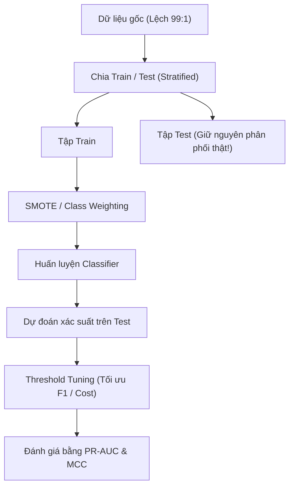

> **[Motto / Châm ngôn cốt lõi]**: Đừng tối ưu Accuracy trên dữ liệu lệch; hãy tối ưu đúng metric phản ánh chi phí sai lầm thực tế của bài toán.

---

## Thông tin nhanh (Quick Spec)

* **Loại bài (Type):** Thực chiến (Build)
* **Ngôn ngữ & Công cụ:** Python 3.12 (Standard Library)
* **Kiến thức tiên quyết (Prerequisites):** Phase 2, Bài 01-09 (Classification, Precision/Recall)
* **Thời gian thực hành:** ~80 phút

---

## Mục tiêu bài học (Learning Objectives)

Sau bài học này, bạn sẽ có khả năng:
- [ ] Tự tay cài đặt thuật toán **SMOTE** (Synthetic Minority Over-sampling Technique) từ đầu.
- [ ] Tính toán **F1-score**, **MCC** (Matthews Correlation Coefficient) và **PR-AUC** thay cho Accuracy.
- [ ] Phân biệt và lựa chọn giữa **Class Weighting**, **Threshold Tuning** và **Resampling**.
- [ ] Tránh lỗi **Data Leakage** kinh điển khi oversample dữ liệu.

---

## 1. Vấn đề thực tế (The Problem)

> *Mô hình đạt 99.9% Accuracy nhưng hoàn toàn vô dụng trên production.*

Bạn xây dựng mô hình phát hiện gian lận thẻ tín dụng. Tập dữ liệu có 99,900 giao dịch hợp lệ và 100 giao dịch gian lận (0.1%). Mô hình của bạn đạt **99.9% Accuracy**!

Kiểm tra kỹ lại: mô hình dự đoán `0` (không gian lận) cho **tất cả** giao dịch. Nó không bắt được một ca gian lận nào, nhưng vẫn đúng 99.9% vì đa số giao dịch là hợp lệ.

Tình huống này xuất hiện ở mọi bài toán giá trị cao: chẩn đoán bệnh hiếm (1%), phát hiện lỗi sản xuất (0.5%), xâm nhập mạng (0.01%), rời bỏ dịch vụ / churn (5%).

---

## 2. Mô hình tư duy & Bản chất (The Concept)

> *Xử lý mất cân bằng gồm 3 tầng: Đánh giá đúng (Metrics) → Huấn luyện đúng (Weights/Resampling) → Quyết định đúng (Threshold).*



### Toán học cốt lõi

1. **Matthews Correlation Coefficient (MCC):** Chỉ số cân bằng cả 4 ô của Confusion Matrix ($TP, TN, FP, FN$), nằm trong $[-1, 1]$:
   $$\text{MCC} = \frac{TP \cdot TN - FP \cdot FN}{\sqrt{(TP+FP)(TP+FN)(TN+FP)(TN+FN)}}$$
   Nếu mô hình đoán toàn `0`, tử số bằng 0 → $\text{MCC} = 0$ (vạch trần ngay mô hình vô dụng).

2. **SMOTE:** Với mỗi mẫu thiểu số $x_i$, chọn ngẫu nhiên một láng giềng $x_{nn}$ trong $k$ láng giềng gần nhất cùng lớp, rồi nội suy:
   $$x_{\text{new}} = x_i + \lambda \cdot (x_{nn} - x_i), \quad \lambda \sim U(0, 1)$$

---

## 3. Tự tay xây dựng từ đầu (Build It: From Scratch)

```python
import math
import random
from typing import List, Tuple


def euclidean_dist(a: List[float], b: List[float]) -> float:
    return math.sqrt(sum((x - y) ** 2 for x, y in zip(a, b)))


def smote(
    X_min: List[List[float]], n_synthetic: int, k: int = 5, seed: int = 42
) -> List[List[float]]:
    random.seed(seed)
    n = len(X_min)
    k = min(k, n - 1)
    synthetic: List[List[float]] = []

    # Tính k láng giềng gần nhất cho mỗi điểm thiểu số
    neighbors: List[List[int]] = []
    for i in range(n):
        dists = [
            (euclidean_dist(X_min[i], X_min[j]), j)
            for j in range(n)
            if j != i
        ]
        dists.sort(key=lambda t: t[0])
        neighbors.append([idx for _, idx in dists[:k]])

    for _ in range(n_synthetic):
        i = random.randrange(n)
        nn_idx = random.choice(neighbors[i])
        lam = random.random()
        new_pt = [
            X_min[i][d] + lam * (X_min[nn_idx][d] - X_min[i][d])
            for d in range(len(X_min[0]))
        ]
        synthetic.append(new_pt)
    return synthetic


def classification_metrics(
    y_true: List[int], y_pred: List[int]
) -> dict[str, float]:
    tp = sum(1 for yt, yp in zip(y_true, y_pred) if yt == 1 and yp == 1)
    tn = sum(1 for yt, yp in zip(y_true, y_pred) if yt == 0 and yp == 0)
    fp = sum(1 for yt, yp in zip(y_true, y_pred) if yt == 0 and yp == 1)
    fn = sum(1 for yt, yp in zip(y_true, y_pred) if yt == 1 and yp == 0)

    precision = tp / (tp + fp) if (tp + fp) > 0 else 0.0
    recall = tp / (tp + fn) if (tp + fn) > 0 else 0.0
    f1 = (
        2 * precision * recall / (precision + recall)
        if (precision + recall) > 0
        else 0.0
    )
    denom = math.sqrt((tp + fp) * (tp + fn) * (tn + fp) * (tn + fn))
    mcc = (tp * tn - fp * fn) / denom if denom > 0 else 0.0
    return {"precision": precision, "recall": recall, "f1": f1, "mcc": mcc}


def tune_threshold(
    y_true: List[int], y_probs: List[float]
) -> Tuple[float, float]:
    best_t, best_f1 = 0.5, -1.0
    for step in range(5, 96, 5):
        t = step / 100.0
        preds = [1 if p >= t else 0 for p in y_probs]
        f1 = classification_metrics(y_true, preds)["f1"]
        if f1 > best_f1:
            best_f1, best_t = f1, t
    return best_t, best_f1


if __name__ == "__main__":
    random.seed(42)
    X_minority = [[random.gauss(2.0, 0.5), random.gauss(2.0, 0.5)] for _ in range(10)]
    synth = smote(X_minority, n_synthetic=20, k=3)
    print(f"Original minority: {len(X_minority)}, Synthetic generated: {len(synth)}")

    y_true = [0] * 95 + [1] * 5
    y_probs = [random.uniform(0.05, 0.45) for _ in range(95)] + [
        random.uniform(0.35, 0.85) for _ in range(5)
    ]
    print("Default threshold (0.5):", classification_metrics(y_true, [1 if p >= 0.5 else 0 for p in y_probs]))
    best_t, best_f1 = tune_threshold(y_true, y_probs)
    print(f"Best threshold: {best_t:.2f} -> F1: {best_f1:.3f}")
```

---

## 4. Ứng dụng thực tế & So sánh Framework (Use It)

| Kỹ thuật | Công cụ / API tiêu biểu | Điểm mạnh | Trade-off cần lưu ý |
|---|---|---|---|
| **Class Weighting** | `class_weight="balanced"` (`sklearn`), `scale_pos_weight` (`XGBoost`/`LightGBM`) | Không tăng dung lượng dữ liệu, không tạo mẫu ảo, chạy nhanh nhất. | Làm lệch xác suất dự đoán (cần calibrate lại nếu dùng trực tiếp probability). |
| **Threshold Tuning** | `TunedThresholdClassifierCV` (`sklearn`), tối ưu Cost Matrix | Giữ nguyên phân phối gốc và xác suất đã hiệu chỉnh; gắn thẳng vào bài toán kinh doanh. | Chỉ đổi ranh giới cắt, không giúp mô hình học tốt hơn nếu lớp thiểu số quá ít mẫu. |
| **SMOTE / ADASYN** | `imblearn.over_sampling.SMOTE` + `imblearn.pipeline.Pipeline` | Giúp mô hình tuyến tính/KNN mở rộng vùng quyết định cho lớp thiểu số. | Dễ tạo mẫu nhiễu trên vùng chồng lấn ở dữ liệu nhiều chiều; phải chạy bên trong từng fold CV. |
| **Undersampling** | `RandomUnderSampler`, `TomekLinks` (`imbalanced-learn`) | Giảm mạnh thời gian train khi lớp đa số có hàng chục triệu dòng. | Vứt bỏ thông tin từ lớp đa số; nên kết hợp với Ensemble (BalancedBagging / EasyEnsemble). |
| **Focal Loss** | Custom objective trong `PyTorch` / `LightGBM` | Tự động hạ trọng số các mẫu dễ, tập trung học các mẫu khó ở biên. | Thêm hyperparameter ($\gamma, \alpha$) cần tune kỹ. |

**Production Tips:**
1. **Luật bất di bất dịch:** Chỉ chạy SMOTE trên tập `Train` (và bên trong từng fold của Cross-Validation) sau khi đã `StratifiedKFold` / `train_test_split`. Chạy SMOTE trước khi chia sẽ làm rò rỉ mẫu tổng hợp sang tập `Test`, khiến điểm đánh giá ảo tung chảo.
2. **Thử Class Weight + Threshold Tuning trước SMOTE:** Với Gradient Boosted Trees (LightGBM, XGBoost, CatBoost), `scale_pos_weight` kết hợp chỉnh ngưỡng thường thắng hoặc ngang bằng SMOTE mà không làm phình dữ liệu.
3. **Tập Test phải giữ nguyên tỷ lệ thật:** Đừng bao giờ cân bằng lại tập Test; nếu ngoài đời gian lận là 0.1%, tập Test cũng phải là 0.1%, và nhớ hiệu chỉnh xác suất (`CalibratedClassifierCV`) nếu bạn dùng SMOTE/weighting cho bài toán tính rủi ro.

---

## 5. Đóng gói & Tái sử dụng (Ship It)

### Cheatsheet chọn Metric & Chiến lược theo độ lệch

| Tỷ lệ lớp thiểu số | Metric ưu tiên | Chiến lược thử nghiệm theo thứ tự |
|---|---|---|
| 10% – 30% (Lệch nhẹ) | F1-score, ROC-AUC, MCC | Baseline gốc → Threshold Tuning |
| 1% – 10% (Lệch vừa) | PR-AUC, F-beta, MCC | `class_weight` / `scale_pos_weight` → Threshold Tuning theo chi phí |
| < 1% (Lệch cực độ) | PR-AUC, Precision@K, Expected Cost | Balanced Ensemble / Focal Loss / Anomaly Detection (Bài 16) |

### Checklist chống Data Leakage & triển khai trên Production

- [ ] Đã dùng **Stratified split** để tỷ lệ lớp thiểu số giữa Train / Val / Test khớp với thực tế?
- [ ] Toàn bộ bước Resampling (SMOTE/Undersampling) đã đặt trong `imblearn.pipeline.Pipeline` để chỉ chạy trên fold Train?
- [ ] Tập Validation và Test giữ nguyên 100% phân phối tự nhiên (không oversample, không undersample)?
- [ ] Đã chọn ngưỡng quyết định trên tập **Validation** (không tune ngưỡng trên tập Test)?
- [ ] Nếu hệ thống cần xác suất thực (ví dụ tính giá bảo hiểm, điểm tín dụng), đã chạy **Probability Calibration** (Platt Scaling / Isotonic) sau khi dùng weighting/resampling?

---

## 6. Giải ngố thuật ngữ (Key Terms & Misconceptions)

| Thuật ngữ (Term) | Người ta thường nghĩ là... | Bản chất kỹ thuật thực sự là... |
|---|---|---|
| **ROC-AUC trên dữ liệu lệch** | ROC-AUC = 0.98 nghĩa là mô hình bắt gian lận cực giỏi. | ROC dùng False Positive Rate ($FP / (FP+TN)$). Khi $TN$ cực lớn, hàng nghìn báo động giả vẫn cho FPR siêu nhỏ — hãy dùng **PR-AUC** để soi hiệu năng lớp thiểu số. |
| **SMOTE** | Phép màu luôn giúp tăng điểm mọi mô hình trên dữ liệu lệch. | Nội suy tuyến tính giữa $k$ láng giềng; hiệu quả với dữ liệu ít chiều nhưng có thể gây overfitting và làm méo xác suất trên dữ liệu nhiều chiều hoặc với GBDT. |
| **MCC (Matthews Correlation Coefficient)** | Chỉ là một biến thể khác của F1-score. | F1 bỏ qua hoàn toàn $TN$; MCC xét đủ cả 4 ô Confusion Matrix và chỉ đạt điểm cao khi mô hình làm tốt trên **cả hai lớp**. |
| **Ngưỡng quyết định 0.5** | Xác suất $\ge 0.5$ luôn là ngưỡng tối ưu của phân loại nhị phân. | `0.5` chỉ tối ưu khi chi phí $FP = FN$ và xác suất được hiệu chỉnh chuẩn. Thực tế phải tối ưu ngưỡng theo **ma trận chi phí (Cost Matrix)** hoặc F-beta. |

---

## 7. Bài tập thử thách (Hands-on Challenges)

1. 🟢 **Cơ bản (Easy):** Viết hàm `random_undersample(X, y, ratio=1.0)` để giảm bớt lớp đa số và so sánh tốc độ cũng như số lượng mẫu tạo ra so với SMOTE.
2. 🟡 **Trung bình (Medium):** Cài đặt hàm tính **PR-AUC** từ `y_true` và `y_probs` bằng quy tắc hình thang (trapezoidal rule) trên danh sách các ngưỡng xác suất giảm dần.
3. 🔴 **Nâng cao (Hard):** Xây dựng hàm `cost_sensitive_threshold(y_true, y_probs, fp_cost=10, fn_cost=500)` để tìm ngưỡng tối ưu tối thiểu hóa tổng thiệt hại tài chính thay vì tối đa hóa F1.

---

## 8. Tài liệu đọc thêm (Further Reading)

- [SMOTE: Synthetic Minority Over-sampling Technique — Chawla et al. (JAIR 2002)](https://arxiv.org/abs/1106.1813) — *Bài báo kinh điển giới thiệu SMOTE và phân tích kết hợp SMOTE với undersampling.*
- [The Precision-Recall Plot Is More Informative than the ROC Plot — Saito & Rehmsmeier (PLOS ONE 2015)](https://journals.plos.org/plosone/article?id=10.1371/journal.pone.0118432) — *Chứng minh trực quan vì sao PR-AUC vượt trội ROC-AUC trên dữ liệu mất cân bằng.*
- [imbalanced-learn User Guide](https://imbalanced-learn.org/stable/user_guide.html) — *Tài liệu chính thức về cách ghép SMOTE/Undersampling vào Pipeline chống Data Leakage.*
