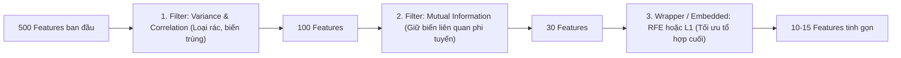

> **[Motto / Châm ngôn cốt lõi]**: Một mô hình với 10 đặc trưng sắc bén luôn thắng một mô hình nhồi nhét 1,000 đặc trưng nhiễu.

---

## Thông tin nhanh (Quick Spec)

* **Loại bài (Type):** Thực chiến (Build)
* **Ngôn ngữ & Công cụ:** Python 3.12 (Standard Library)
* **Kiến thức tiên quyết (Prerequisites):** Phase 2, Bài 01-09 (Regression, Entropy, Cross-Validation)
* **Thời gian thực hành:** ~75 phút

---

## Mục tiêu bài học (Learning Objectives)

Sau bài học này, bạn sẽ có khả năng:
- [ ] Tự tay cài đặt **Variance Threshold**, **Pearson Correlation**, **Mutual Information** và **Recursive Feature Elimination (RFE)**.
- [ ] Phân biệt 3 nhóm phương pháp: **Filter**, **Wrapper**, và **Embedded**.
- [ ] Phát hiện và loại bỏ **đa cộng tuyến (multicollinearity)** làm méo trọng số mô hình tuyến tính.
- [ ] Tích hợp Feature Selection đúng cách vào pipeline mà không gây rò rỉ dữ liệu (Data Leakage).

---

## 1. Vấn đề thực tế (The Problem)

> *Lời nguyền số chiều (Curse of Dimensionality) và cái giá của "nhồi nhét" dữ liệu.*

Bạn có bảng dữ liệu khách hàng với 500 cột: tuổi, thu nhập, 400 biến one-hot, và 98 biến tổng hợp. Khi đưa tất cả vào mô hình:
1. **Overfitting:** Mô hình học thuộc cả những cột nhiễu ngẫu nhiên, điểm Train 99% nhưng Test tụt xuống 65%.
2. **Đa cộng tuyến:** Hai cột `doanh_thu_vnd` và `doanh_thu_usd` giống hệt nhau về thông tin khiến trọng số Linear Regression nhảy loạn xạ, không thể giải thích.
3. **Chi phí Serving:** Mỗi feature thừa là thêm độ trễ (latency), thêm bug pipeline và thêm chi phí lưu trữ trên Feature Store.

---

## 2. Mô hình tư duy & Bản chất (The Concept)

> *Chọn đặc trưng là sự đánh đổi giữa tốc độ (Filter) và khả năng bắt tương tác biến (Wrapper/Embedded).*



### Toán học cốt lõi

1. **Pearson Correlation ($r$):** Đo tương quan tuyến tính giữa 2 biến $X, Y \in [-1, 1]$:
   $$r = \frac{\sum (x_i - \bar{x})(y_i - \bar{y})}{\sqrt{\sum (x_i - \bar{x})^2 \sum (y_i - \bar{y})^2}}$$
   Nếu $|r_{ij}| > 0.95$ giữa 2 feature, ta có thể bỏ bớt 1.

2. **Mutual Information (MI):** Đo lượng thông tin chia sẻ giữa $X$ và nhãn $Y$ (bắt được cả quan hệ phi tuyến):
   $$I(X; Y) = \sum_{y \in Y} \sum_{x \in X} p(x, y) \log \left( \frac{p(x, y)}{p(x)p(y)} \right)$$
   Nếu $I(X; Y) = 0$, $X$ và $Y$ độc lập hoàn toàn.

---

## 3. Tự tay xây dựng từ đầu (Build It: From Scratch)

```python
import math
import random
from collections import Counter
from typing import List


def pearson_corr(x: List[float], y: List[float]) -> float:
    n = len(x)
    mx, my = sum(x) / n, sum(y) / n
    num = sum((a - mx) * (b - my) for a, b in zip(x, y))
    den_x = math.sqrt(sum((a - mx) ** 2 for a in x))
    den_y = math.sqrt(sum((b - my) ** 2 for b in y))
    return num / (den_x * den_y) if den_x > 0 and den_y > 0 else 0.0


def mutual_information_binned(
    x: List[float], y: List[int], bins: int = 5
) -> float:
    n = len(x)
    min_x, max_x = min(x), max(x)
    width = (max_x - min_x) / bins if max_x > min_x else 1.0
    x_binned = [min(bins - 1, int((val - min_x) / width)) for val in x]

    px = Counter(x_binned)
    py = Counter(y)
    pxy = Counter(zip(x_binned, y))

    mi = 0.0
    for (bx, by), c_xy in pxy.items():
        p_xy = c_xy / n
        p_x = px[bx] / n
        p_y = py[by] / n
        mi += p_xy * math.log2(p_xy / (p_x * p_y))
    return mi


def drop_correlated_features(
    X: List[List[float]], threshold: float = 0.9
) -> List[int]:
    n_feats = len(X[0])
    cols = [[row[j] for row in X] for j in range(n_feats)]
    kept: List[int] = []
    for j in range(n_feats):
        if all(abs(pearson_corr(cols[j], cols[k])) < threshold for k in kept):
            kept.append(j)
    return kept


def simple_rfe(
    X: List[List[float]], y: List[int], n_select: int
) -> List[int]:
    """RFE tối giản dùng độ lớn |correlation với y| làm proxy importance."""
    remaining = list(range(len(X[0])))
    while len(remaining) > n_select:
        scores = [
            (abs(pearson_corr([row[j] for row in X], [float(v) for v in y])), j)
            for j in remaining
        ]
        scores.sort(key=lambda t: t[0])
        worst_feat = scores[0][1]
        remaining.remove(worst_feat)
    return remaining


if __name__ == "__main__":
    random.seed(42)
    n = 100
    f0 = [random.gauss(0, 1) for _ in range(n)]
    f1 = [v * 2.0 + random.gauss(0, 0.05) for v in f0]  # Trùng f0
    f2 = [random.gauss(0, 1) for _ in range(n)]         # Nhiễu
    y = [1 if v > 0 else 0 for v in f0]                 # Phụ thuộc f0

    X = [[f0[i], f1[i], f2[i]] for i in range(n)]
    print("Kept after corr filter:", drop_correlated_features(X, threshold=0.9))
    for j in range(3):
        mi = mutual_information_binned([row[j] for row in X], y)
        print(f"Feature {j} MI: {mi:.3f}")
    print("RFE top 1:", simple_rfe(X, y, n_select=1))
```

---

## 4. Ứng dụng thực tế & So sánh Framework (Use It)

| Nhóm phương pháp | Công cụ / API tiêu biểu | Bắt tương tác biến? | Chi phí tính toán | Khi nào dùng? |
|---|---|---|---|---|
| **Filter** | `VarianceThreshold`, `mutual_info_classif`, `SelectKBest` (`sklearn`) | Không (chấm từng biến độc lập) | Rất thấp | Bước lọc thô đầu tiên khi có hàng trăm đến hàng nghìn cột. |
| **Wrapper** | `RFE`, `RFECV`, `SequentialFeatureSelector` (`sklearn`) | Có | Cao (phải train lại nhiều lần) | Bước tinh chỉnh cuối cùng khi còn 20–50 biến ứng viên. |
| **Embedded** | `LassoCV` (L1), `SelectFromModel` (`LightGBM`/`XGBoost`) | Có | Trung bình | Cân bằng tốt giữa tốc độ và chất lượng cho mô hình tuyến tính & cây. |
| **Post-hoc / Permutation** | `permutation_importance` (`sklearn`), `SHAP`, `Boruta` | Có | Trung bình – Cao | Đánh giá đóng góp thực sự trên tập Validation và loại bỏ biến nhiễu ngụy trang. |

**Production Tips:**
1. **Phễu 3 bước thực chiến:** Với dữ liệu > 200 cột, hãy lọc theo phễu: `Variance/Missing > 90%` → `Correlation > 0.95` → `Permutation Importance / SHAP` trên tập validation.
2. **Đừng tin Tree Importance (MDI) mù quáng:** Random Forest / XGBoost thường thiên vị các biến có nhiều giá trị phân biệt (high cardinality như `user_id`, `zipcode`). Hãy dùng **Permutation Importance** trên tập Validation để đo mức giảm metric thực sự khi xáo trộn từng cột.
3. **Domain Knowledge luôn thắng thuật toán:** Một biến có MI thấp một mình nhưng khi kết hợp với biến khác (ví dụ `nợ / thu nhập`) lại cực kỳ mạnh. Đừng xóa vội trước khi kiểm tra tương tác nghiệp vụ.

---

## 5. Đóng gói & Tái sử dụng (Ship It)

### Checklist phễu lọc Feature chuẩn Production

- [ ] **Đóng gói trong Pipeline:** Bước chọn lọc feature nằm hoàn toàn bên trong Cross-Validation (chỉ `fit` trên tập Train của từng fold)?
- [ ] **Loại rác chi phí thấp:** Đã bỏ các cột hằng số (variance = 0), tỷ lệ missing > 90%, và cột trùng lặp gần tuyệt đối ($|r| > 0.95$)?
- [ ] **Kiểm chứng trên Validation:** Đã chạy Permutation Importance (hoặc ablation test: bỏ từng nhóm feature) để chứng minh tập biến tinh gọn không làm tụt metric?
- [ ] **Đo độ ổn định (Stability):** Các feature được chọn có nhất quán giữa các fold CV hay nhảy loạn xạ theo từng lần chia dữ liệu?
- [ ] **Cân nhắc chi phí Serving:** Nếu một feature tốn thêm 15ms tra cứu DB nhưng chỉ tăng PR-AUC thêm 0.0005, sẵn sàng **loại bỏ** để giữ hệ thống tinh gọn?

---

## 6. Giải ngố thuật ngữ (Key Terms & Misconceptions)

| Thuật ngữ (Term) | Người ta thường nghĩ là... | Bản chất kỹ thuật thực sự là... |
|---|---|---|
| **Feature Selection vs PCA** | PCA cũng là một cách chọn lọc đặc trưng. | PCA là **Dimensionality Reduction** (trộn các cột gốc thành tổ hợp tuyến tính mới, mất khả năng giải thích). Feature Selection giữ nguyên tập con các cột gốc, giúp giảm chi phí thu thập & serving. |
| **Tree Importance (MDI)** | Cột đứng top `feature_importances_` chắc chắn là cột dự đoán tốt nhất. | Mean Decrease in Impurity được tính trên tập **Train** và thiên vị nặng các biến liên tục / nhiều giá trị phân biệt; kể cả cột số ngẫu nhiên cũng có thể xếp hạng cao. |
| **Multicollinearity (Đa cộng tuyến)** | Luôn làm hỏng mọi thuật toán Machine Learning. | Phá vỡ trọng số và khả năng diễn giải của mô hình tuyến tính (Linear/Logistic Regression), nhưng ít ảnh hưởng đến độ chính xác dự đoán của cây quyết định (GBDT) — tuy vẫn chia loãng importance. |
| **Selection trước Cross-Validation** | Chọn top 20 cột trên toàn bộ dataset rồi mới chạy 5-Fold CV cho tiện. | Là lỗi **Data Leakage** kinh điển: nhãn của tập validation đã tham gia chọn cột, khiến điểm CV cao giả tạo ngay cả trên dữ liệu nhiễu ngẫu nhiên. |

---

## 7. Bài tập thử thách (Hands-on Challenges)

1. 🟢 **Cơ bản (Easy):** Viết hàm `variance_threshold(X, min_var=0.01)` bằng Python thuần để loại bỏ các cột gần như hằng số trước khi chạy tương quan.
2. 🟡 **Trung bình (Medium):** Cài đặt **Permutation Importance** cho một mô hình phân loại đơn giản: đo độ giảm Accuracy khi xáo trộn ngẫu nhiên từng cột trên tập Validation (lặp 5 lần và lấy trung bình).
3. 🔴 **Nâng cao (Hard):** Thay proxy correlation trong `simple_rfe` bằng trọng số $|w_j|$ của Logistic Regression (dùng Gradient Descent thuần Python, có chuẩn hóa dữ liệu) để thấy RFE thực thụ loại bỏ biến yếu qua từng vòng lặp thế nào.

---

## 8. Tài liệu đọc thêm (Further Reading)

- [Scikit-learn: Feature Selection User Guide](https://scikit-learn.org/stable/modules/feature_selection.html) — *Tổng quan đầy đủ API chuẩn cho Filter, Wrapper và Embedded trong Python.*
- [Scikit-learn: Permutation Feature Importance](https://scikit-learn.org/stable/modules/permutation_importance.html) — *Giải thích rõ vì sao Permutation Importance khắc phục được thiên vị của Tree Importance và cách xử lý biến đa cộng tuyến.*
- [An Introduction to Variable and Feature Selection — Guyon & Elisseeff (JMLR 2003)](https://www.jmlr.org/papers/v3/guyon03a.html) — *Bài báo nền tảng phân tích sâu nguyên lý và cạm bẫy khi chọn đặc trưng.*
