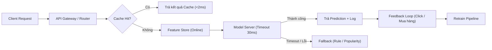

> **[Motto / Châm ngôn cốt lõi]**: Trước khi chọn thuật toán, hãy thiết kế vòng lặp dữ liệu, hợp đồng độ trễ (SLA) và phương án dự phòng khi mô hình sai.

---

## Thông tin nhanh (Quick Spec)

* **Loại bài (Type):** System Design & Thực chiến (Build)
* **Ngôn ngữ & Công cụ:** Python 3.12 (Standard Library)
* **Kiến thức tiên quyết (Prerequisites):** Phase 2, Bài 01-18
* **Thời gian thực hành:** ~90 phút

---

## Mục tiêu bài học (Learning Objectives)

Sau bài học này, bạn sẽ có khả năng:
- [ ] Áp dụng khung **4 bước ML System Design** cho mọi bài toán phỏng vấn và thực tế.
- [ ] Phân biệt và chọn đúng giữa **Batch Prediction**, **Online Serving**, và **Streaming**.
- [ ] Thiết kế kiến trúc **Two-stage Retrieval + Ranking** và phân bổ **Latency Budget** cho hệ thống quy mô lớn.
- [ ] Tự tay viết một **ML Serving Router** có Fallback, Caching và Shadow Mode bằng Python thuần.

---

## 1. Vấn đề thực tế (The Problem)

> *Mô hình AUC 0.95 trên Jupyter Notebook nhưng không thể chạy trên Production.*

Bạn train xong một mô hình gợi ý sản phẩm cực chuẩn. Nhưng khi đem đi tích hợp:
- Độ trễ p99 là **800ms**, trong khi API trang chủ chỉ cho phép tối đa **50ms**.
- Khi database feature bị nghẽn, toàn bộ trang web trả về lỗi `500 Internal Server Error`.
- Bạn không biết phiên bản model mới có thực sự tăng doanh thu hay chỉ tăng CTR ảo.

Bài học: **Model tốt chưa đủ; hệ thống phải nhanh, bền bỉ (resilient) và đo lường được.**

---

## 2. Mô hình tư duy & Bản chất (The Concept)

> *Khung thiết kế chuẩn: Clarify → Metrics → Architecture → Serving & Feedback.*



### Công thức ước lượng tải (Back-of-the-envelope)

Trước khi chọn phần cứng, luôn tính QPS (Queries Per Second):
$$\text{QPS}_{\text{avg}} = \frac{\text{DAU} \times \text{Requests/User}}{86400}, \quad \text{QPS}_{\text{peak}} \approx 3 \times \text{QPS}_{\text{avg}}$$

Nếu $\text{QPS}_{\text{peak}} = 1,000$ và mỗi request mất $20\text{ms}$ trên 1 CPU core (tối đa $50$ req/s/core), bạn cần tối thiểu $\lceil 1000 / 50 \rceil = 20$ cores (chưa tính dự phòng 30–50% cho auto-scaling).

### Bảng phân bổ ngân sách độ trễ (Latency Budget Breakdown)

Với một API Online Serving có SLA `p99 <= 50ms` (ví dụ hệ thống gợi ý / tìm kiếm Two-stage), thời gian xử lý phải được chia ngân sách rõ ràng cho từng tầng thay vì để model ăn hết:

| Giai đoạn (Stage) | Ngân sách p99 | Tỷ trọng | Thành phần chính & Mục tiêu tối ưu |
|---|---|---|---|
| **Network & Gateway** | 5 ms | 10% | TLS, routing, serialize/deserialize (gRPC/Protobuf thay vì JSON nặng). |
| **Feature Lookup** | 8 ms | 16% | Đọc batch feature từ Online Store (Redis/DynamoDB) bằng 1 lần MGET. |
| **Retrieval (Stage 1)** | 10 ms | 20% | Lọc từ 10M items xuống ~500 ứng viên bằng ANN (FAISS/HNSW) hoặc BM25. |
| **Ranking (Stage 2)** | 18 ms | 36% | Chấm điểm 500 ứng viên bằng GBDT/DNN đã tối ưu (ONNX Runtime / TensorRT). |
| **Post-processing** | 4 ms | 8% | Áp dụng business rules (còn hàng, đa dạng hóa, lọc đã xem) + đẩy log bất đồng bộ. |
| **Buffer / Dự phòng** | 5 ms | 10% | Hấp thụ GC pause, jitter mạng và tail latency đột biến. |
| **Tổng cộng (End-to-End)** | **50 ms** | **100%** | Vượt ngưỡng ở bất kỳ khâu nào → cắt timeout & chuyển về Fallback. |

---

## 3. Tự tay xây dựng từ đầu (Build It: From Scratch)

Dưới đây là mô phỏng một **Serving Router** thực chiến hỗ trợ: Cache, Timeout/Fallback, và Shadow Deployment (chạy ngầm model mới để so sánh mà không ảnh hưởng user).

```python
import random
import time
from typing import Callable, Dict, Any


class MLServingRouter:
    def __init__(
        self,
        primary_model: Callable[[Dict[str, Any]], float],
        fallback_fn: Callable[[Dict[str, Any]], float],
        shadow_model: Callable[[Dict[str, Any]], float] | None = None,
        timeout_ms: float = 30.0,
    ):
        self.primary = primary_model
        self.fallback = fallback_fn
        self.shadow = shadow_model
        self.timeout_ms = timeout_ms
        self.cache: Dict[str, float] = {}
        self.logs: list[dict[str, Any]] = []

    def predict(self, user_id: str, features: Dict[str, Any]) -> float:
        if user_id in self.cache:
            return self.cache[user_id]

        start = time.perf_counter()
        try:
            score = self.primary(features)
            elapsed_ms = (time.perf_counter() - start) * 1000
            if elapsed_ms > self.timeout_ms:
                raise TimeoutError(f"Model took {elapsed_ms:.1f}ms")
            source = "primary"
        except Exception:
            score = self.fallback(features)
            source = "fallback"

        self.cache[user_id] = score

        shadow_score = self.shadow(features) if self.shadow else None
        self.logs.append(
            {
                "user_id": user_id,
                "score": round(score, 4),
                "source": source,
                "shadow_score": round(shadow_score, 4) if shadow_score is not None else None,
            }
        )
        return score


if __name__ == "__main__":
    random.seed(42)

    def slow_or_flaky_model(feats: Dict[str, Any]) -> float:
        if random.random() < 0.2:
            raise RuntimeError("Model server OOM")
        return min(1.0, max(0.0, 0.3 * feats["clicks"] + 0.1))

    def rule_fallback(feats: Dict[str, Any]) -> float:
        return 0.5  # Điểm mặc định an toàn

    def v2_shadow_model(feats: Dict[str, Any]) -> float:
        return min(1.0, max(0.0, 0.35 * feats["clicks"] + 0.05))

    router = MLServingRouter(slow_or_flaky_model, rule_fallback, v2_shadow_model)
    for i in range(5):
        s = router.predict(f"u_{i}", {"clicks": i})
        print(f"User u_{i} -> score={s:.3f} | log={router.logs[-1]}")
```

---

## 4. Ứng dụng thực tế & So sánh Framework (Use It)

| Mô hình Serving | Công cụ tiêu biểu | Độ trễ (Latency) | Khi nào nên chọn? | Trade-off |
|---|---|---|---|---|
| **Batch Prediction** | Airflow / Spark + Postgres / Redis | Đọc < 5ms (tính trước) | Gợi ý email hàng ngày, chấm điểm churn/tín dụng định kỳ, tập user cố định. | Đơn giản, rẻ nhất; nhưng không phản ứng với hành vi tức thời trong phiên. |
| **Online Serving (REST/gRPC)** | FastAPI, BentoML, Ray Serve, NVIDIA Triton | 10 – 100 ms | Gian lận giao dịch, ranking tìm kiếm, dynamic pricing cần ngữ cảnh tức thời. | Đòi hỏi SLA nghiêm ngặt, auto-scaling, Online Feature Store và Fallback. |
| **Streaming Inference** | Kafka + Apache Flink / Bytewax | 50 ms – vài giây | Phát hiện bất thường log/IoT, cập nhật feature cửa sổ trượt liên tục. | Vận hành phức tạp (state management, exactly-once, backpressure). |
| **Edge / On-device** | ONNX Runtime, TensorFlow Lite, CoreML | < 10 ms (không mạng) | Camera nhận diện khuôn mặt, gợi ý bàn phím, ứng dụng cần hoạt động offline. | Bị giới hạn RAM/pin, khó cập nhật phiên bản model đồng loạt. |

**Production Tips:**
1. **Bắt đầu bằng Heuristic/Rule-based trước:** Nếu chưa có baseline, hãy ship một rule đơn giản (ví dụ: top sản phẩm bán chạy) để xây dựng xong đường ống dữ liệu, logging và A/B testing trước khi train Deep Learning.
2. **Shadow Mode trước A/B Testing:** Chạy model mới song song (ghi log bất đồng bộ, không trả về user) để kiểm tra lỗi crash, độ trễ p99 và phân phối điểm dự đoán trước khi chia traffic thật.
3. **Tách Retrieval và Ranking:** Với 10 triệu sản phẩm, đừng chạy model nặng trên cả 10 triệu. Dùng **Retrieval** (lọc nhanh còn ~500 ứng viên bằng ANN/BM25) rồi mới dùng **Ranking** (model nặng chấm điểm 500 ứng viên đó).

---

## 5. Đóng gói & Tái sử dụng (Ship It)

### Architecture Review Checklist trước khi Go-Live

- [ ] **Business & ML Metric:** Đã khóa rõ Business KPI (doanh thu, conversion, tỷ lệ gian lận) và chứng minh Offline Metric (PR-AUC, NDCG, RMSE) đồng biến với KPI đó?
- [ ] **Serving Pattern:** Đã xác nhận thực sự cần Online Serving hay Batch Prediction là đủ rẻ và an toàn hơn?
- [ ] **Capacity & Latency Budget:** Đã ước lượng $\text{QPS}_{\text{peak}}$, phân bổ rõ Latency Budget cho từng tầng và load-test đạt p99 dưới SLA?
- [ ] **Resilience & Fallback:** Đã cấu hình hard timeout, Circuit Breaker và Fallback (cache / rule-based) đảm bảo API không bao giờ trả `500` khi model server gặp sự cố?
- [ ] **Safe Rollout:** Đã có kế hoạch phát hành theo bậc thang: Shadow Mode → Canary (1%–5%) → A/B Test (50/50) kèm nút rollback trong < 1 phút?
- [ ] **Logging & Feedback Loop:** Đã log bất đồng bộ `(request_id, feature_vector, model_version, prediction)` để phục vụ điều tra sự cố, chống skew và retrain?

---

## 6. Giải ngố thuật ngữ (Key Terms & Misconceptions)

| Thuật ngữ (Term) | Người ta thường nghĩ là... | Bản chất kỹ thuật thực sự là... |
|---|---|---|
| **Latency trung bình vs p99** | API trung bình 15ms nghĩa là hệ thống đã rất nhanh. | Nếu 1% request mất 2 giây (p99 = 2000ms), một trang web gọi 10 microservice song song sẽ có xác suất bị chậm lên tới ~10% người dùng. Production luôn cam kết theo **p95/p99**. |
| **Shadow Deployment vs Canary** | Hai tên gọi khác nhau của việc chia nhỏ traffic thử nghiệm. | **Shadow** nhân bản 100% hoặc một phần request sang model mới nhưng **bỏ qua kết quả** (an toàn tuyệt đối cho UX). **Canary** trả kết quả thật của model mới cho 1%–5% người dùng. |
| **Two-stage Architecture** | Chạy 2 model độc lập rồi lấy trung bình kết quả (Ensemble). | Là phễu nối tiếp: **Retrieval** tối ưu tốc độ & Recall (lọc triệu → trăm), **Ranking** tối ưu độ chính xác & Precision (xếp hạng trăm → top 10). |
| **Fallback Mechanism** | Gọi lại (retry) model server cho đến khi thành công. | Retry liên tiếp khi server quá tải gây bão request (retry storm). Fallback chuẩn là cắt timeout nhanh và trả về kết quả dự phòng nhẹ (cache, popularity hoặc rule-based). |

---

## 7. Bài tập thử thách (Hands-on Challenges)

1. 🟢 **Cơ bản (Easy):** Thêm cơ chế **TTL (Time-To-Live)** cho `self.cache` trong `MLServingRouter` để kết quả cache tự động hết hạn sau `N` giây.
2. 🟡 **Trung bình (Medium):** Cài đặt **Canary Routing** (chia 90% traffic cho `primary_model` và 10% traffic cho `canary_model` nhất quán theo hash của `user_id` để cùng một user không bị nhảy qua lại giữa 2 phiên bản).
3. 🔴 **Nâng cao (Hard):** Mô phỏng hệ thống **Two-stage Recommender**: Stage 1 lọc top-20 ứng viên từ 1,000 items bằng Cosine Similarity, Stage 2 xếp hạng lại top-5 bằng một hàm chấm điểm phi tuyến và đo riêng thời gian (ms) từng stage.

---

## 8. Tài liệu đọc thêm (Further Reading)

- [Designing Machine Learning Systems — Chip Huyen (O'Reilly)](https://www.oreilly.com/library/view/designing-machine-learning/9781098107956/) — *Cuốn sách toàn diện nhất về kiến trúc hệ thống ML, từ data pipeline, serving pattern đến monitoring.*
- [System Design for Recommendations and Search — Eugene Yan](https://eugeneyan.com/writing/system-design-for-discovery/) — *Phân tích sâu kiến trúc Two-stage Retrieval + Ranking tại các hệ thống quy mô lớn (Amazon, Alibaba, Pinterest).*
- [Rules of Machine Learning — Google Developers](https://developers.google.com/machine-learning/guides/rules-of-ml) — *43 nguyên tắc thực chiến về việc xây dựng hạ tầng, baseline và vòng lặp phản hồi trước khi phức tạp hóa thuật toán.*
