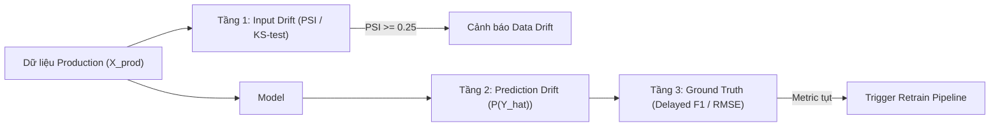

> **[Motto / Châm ngôn cốt lõi]**: Đừng đợi người dùng phàn nàn mới biết mô hình đã hỏng; hãy đo phân phối đầu vào trước khi nhãn thật kịp về.

---

## Thông tin nhanh (Quick Spec)

* **Loại bài (Type):** Thực chiến (Build)
* **Ngôn ngữ & Công cụ:** Python 3.12 (Standard Library)
* **Kiến thức tiên quyết (Prerequisites):** Phase 2, Bài 01-19
* **Thời gian thực hành:** ~75 phút

---

## Mục tiêu bài học (Learning Objectives)

Sau bài học này, bạn sẽ có khả năng:
- [ ] Phân biệt rạch ròi **Data Drift** ($P(X)$ đổi), **Concept Drift** ($P(Y|X)$ đổi), và **Prediction Drift**.
- [ ] Tự tay cài đặt **PSI (Population Stability Index)** và **KS-statistic (Kolmogorov-Smirnov)** từ đầu.
- [ ] Thiết kế chiến lược cảnh báo nhiều tầng (Input → Prediction → Ground Truth) và định tuyến xử lý sự cố.
- [ ] Quyết định khi nào cần **Retrain**, khi nào cần sửa **Data Quality**, và khi nào chỉ cần **Calibrate lại ngưỡng**.

---

## 1. Vấn đề thực tế (The Problem)

> *Mô hình không báo lỗi `500`, nó chỉ âm thầm dự đoán sai.*

Một mô hình dự đoán giá nhà train trên dữ liệu năm 2022 hoạt động hoàn hảo. Sang năm 2024, lãi suất tăng vọt và thị trường đóng băng. Server vẫn trả về HTTP `200 OK` trong 15ms, CPU ổn định, không có bất kỳ exception nào — nhưng sai số dự đoán tăng gấp 3 lần.

Tệ hơn: với bài toán tín dụng hay gian lận, phải mất **30–90 ngày** bạn mới có nhãn thật (khách hàng có bùng nợ hay không). Nếu đợi có nhãn mới biết mô hình hỏng, công ty đã mất tiền tỷ.

---

## 2. Mô hình tư duy & Bản chất (The Concept)

> *Giám sát 3 tầng: Đầu vào ($X$) → Đầu ra ($\hat{Y}$) → Nhãn thật ($Y$).*



### Toán học cốt lõi

1. **PSI (Population Stability Index):** Chia phân phối chuẩn (Baseline/Train) và phân phối hiện tại (Production) thành $B$ khoảng (bins), rồi đo độ lệch:
   $$\text{PSI} = \sum_{i=1}^{B} (p_i - q_i) \cdot \ln\left(\frac{p_i}{q_i}\right)$$

2. **KS-statistic (Kolmogorov-Smirnov):** Khoảng cách lớn nhất giữa hai hàm phân phối tích lũy (CDF):
   $$D = \sup_x |F_{\text{train}}(x) - F_{\text{prod}}(x)|$$

### Bảng quyết định theo ngưỡng PSI (PSI Threshold Decision Table)

| Ngưỡng PSI | Mức độ biến động | Ý nghĩa thực tế | Hành động khuyến nghị |
|---|---|---|---|
| **$\text{PSI} < 0.1$** | Ổn định (Insignificant) | Phân phối production khớp với tập baseline/train. | Không cần can thiệp; tiếp tục ghi log định kỳ. |
| **$0.1 \le \text{PSI} < 0.25$** | Dịch chuyển nhẹ (Moderate) | Bắt đầu có biến động (mùa vụ, chiến dịch marketing mới). | Đưa vào danh sách theo dõi (Warning), kiểm tra thêm Prediction Drift và Top Features. |
| **$\text{PSI} \ge 0.25$** | Dịch chuyển nghiêm trọng (Significant) | Phân phối đã lệch mạnh so với lúc huấn luyện. | Bật cảnh báo (Alert): kiểm tra Data Quality trước → đánh giá tác động KPI → trigger Retrain nếu metric giảm. |

---

## 3. Tự tay xây dựng từ đầu (Build It: From Scratch)

```python
import math
import random
from typing import List


def calculate_psi(
    expected: List[float], actual: List[float], bins: int = 10
) -> float:
    min_v = min(min(expected), min(actual))
    max_v = max(max(expected), max(actual))
    width = (max_v - min_v) / bins if max_v > min_v else 1.0

    def _bin_probs(data: List[float]) -> List[float]:
        counts = [0] * bins
        for x in data:
            idx = min(bins - 1, max(0, int((x - min_v) / width)))
            counts[idx] += 1
        n = len(data)
        # Thêm epsilon 1e-6 để tránh chia cho 0 hoặc log(0)
        return [max(c / n, 1e-6) for c in counts]

    p_exp = _bin_probs(expected)
    p_act = _bin_probs(actual)
    return sum((a - e) * math.log(a / e) for e, a in zip(p_exp, p_act))


def ks_statistic(sample1: List[float], sample2: List[float]) -> float:
    s1 = sorted(sample1)
    s2 = sorted(sample2)
    n1, n2 = len(s1), len(s2)
    i = j = 0
    max_diff = 0.0
    while i < n1 and j < n2:
        if s1[i] <= s2[j]:
            i += 1
        else:
            j += 1
        diff = abs(i / n1 - j / n2)
        if diff > max_diff:
            max_diff = diff
    return max_diff


if __name__ == "__main__":
    random.seed(42)
    train_age = [random.gauss(30, 5) for _ in range(500)]
    prod_stable = [random.gauss(30.2, 5.1) for _ in range(500)]
    prod_drifted = [random.gauss(40, 6) for _ in range(500)]

    print(f"Stable  -> PSI: {calculate_psi(train_age, prod_stable):.4f}, KS: {ks_statistic(train_age, prod_stable):.4f}")
    print(f"Drifted -> PSI: {calculate_psi(train_age, prod_drifted):.4f}, KS: {ks_statistic(train_age, prod_drifted):.4f}")
```

---

## 4. Ứng dụng thực tế & So sánh Framework (Use It)

| Công cụ / Nền tảng | Trọng tâm chính | Điểm mạnh | Trade-off |
|---|---|---|---|
| **Evidently AI** | Data/Prediction Drift & Model Quality (Open-source) | Báo cáo HTML trực quan, có sẵn PSI, KS, Wasserstein, chạy tốt trên batch pipeline. | Cần tự thiết lập hạ tầng lưu trữ và lịch chạy (Airflow/Prefect) ở bản open-source. |
| **WhyLabs (`whylogs`)** | Statistical Profiling siêu nhẹ cho Streaming | Chỉ lưu statistical profile (không lưu raw PII data), mở rộng tốt ở quy mô lớn. | Các tính năng alert/dashboard nâng cao nằm ở bản cloud thương mại. |
| **Great Expectations / Soda** | Data Quality & Schema Validation | Chặn sớm lỗi `null`, sai kiểu dữ liệu, lệch miền giá trị trước khi vào model. | Không thay thế được giám sát Concept Drift hay hiệu năng mô hình. |
| **Prometheus + Grafana** | System Metrics & Custom ML Exporter | Tận dụng sẵn hạ tầng DevOps/SRE (latency, error rate, tỷ lệ prediction `1`). | Không có sẵn các bài kiểm định thống kê phức tạp (KS, JS-divergence) nếu không tự viết job. |

**Production Tips:**
1. **Giám sát Feature quan trọng nhất trước:** Nếu mô hình có 100 features, đừng đặt alert cho cả 100 cột (sẽ gây bão cảnh báo / alert fatigue). Chỉ đặt alert chặt cho **Top 5–10 features** có Permutation Importance cao nhất và phân phối điểm dự đoán $\hat{Y}$.
2. **Kiểm tra Data Quality trước khi kết luận Drift:** 80% trường hợp PSI nhảy vọt là do lỗi kỹ thuật: đổi đơn vị (VNĐ sang USD), cột bị `null` hàng loạt, hoặc đổi múi giờ từ upstream API.
3. **Rolling Window + Trigger-based Retraining:** Với dữ liệu biến động theo mùa, hãy kết hợp lịch retrain định kỳ (hàng tuần/tháng) với cơ chế cảnh báo sớm khi $\text{PSI} \ge 0.25$ kéo dài qua nhiều cửa sổ liên tiếp.

---

## 5. Đóng gói & Tái sử dụng (Ship It)

### Ma trận định tuyến cảnh báo (Data Drift vs Concept Drift vs Label Delay)

| Kịch bản sự cố | Dấu hiệu kích hoạt | Cần nhãn thật ($Y$)? | Đội ngũ xử lý chính | Hành động ngay lập tức |
|---|---|---|---|---|
| **Data Quality / Schema Break** | Tỷ lệ `null` tăng vọt, giá trị âm/ngoài miền, sai kiểu dữ liệu. | Không | Data Engineering / Backend | Chặn pipeline, chuyển sang Fallback, sửa upstream ETL (tuyệt đối không retrain trên dữ liệu bẩn). |
| **Data Drift (Covariate Shift)** | $\text{PSI} \ge 0.25$ hoặc KS vượt ngưỡng trên Top features, $P(\hat{Y})$ dịch chuyển. | Không | ML Engineer | Kiểm tra xem có phải biến động mùa vụ không; thu mẫu kiểm tra thủ công và chuẩn bị retrain. |
| **Concept Drift** | $P(X)$ ổn định ($\text{PSI} < 0.1$) nhưng F1 / RMSE / Business KPI tụt mạnh. | Có (Ground Truth) | ML Engineer + Data Science | Retrain với trọng số ưu tiên dữ liệu mới nhất (recent window), bổ sung feature nắm bắt hành vi mới. |
| **Label Delay (Độ trễ nhãn 30–90 ngày)** | Chưa có nhãn thật để tính F1/AUC; chỉ có $X$ và $\hat{Y}$. | Chưa có | ML Engineer + Ops/Domain | Theo dõi **Proxy Metrics** (Prediction Drift, tỷ lệ từ chối, human-audit 50–100 mẫu/tuần) để phát hiện sớm. |

### Checklist triển khai Monitoring trên Production

- [ ] Đã tách rõ **Data Quality Gate** (null, range, schema) ra khỏi **Statistical Drift Alert** (PSI/KS)?
- [ ] Đã giới hạn alert ở Top 5–10 features quan trọng nhất + phân phối đầu ra $\hat{Y}$ để tránh Alert Fatigue?
- [ ] Đã dùng **quantile bins** từ tập Baseline làm mốc cố định khi tính PSI (tránh để biên bin tự co giãn theo outlier production)?
- [ ] Đã gắn cơ chế **Proxy Metric / Human Sampling** cho các bài toán có Label Delay > 7 ngày?

---

## 6. Giải ngố thuật ngữ (Key Terms & Misconceptions)

| Thuật ngữ (Term) | Người ta thường nghĩ là... | Bản chất kỹ thuật thực sự là... |
|---|---|---|
| **Data Drift vs Concept Drift** | Cả hai đều là "dữ liệu thay đổi" nên xử lý bằng cách đo PSI là đủ. | **Data Drift** là $P(X)$ đổi (đo được bằng PSI/KS không cần nhãn). **Concept Drift** là quy luật $P(Y \mid X)$ đổi — PSI trên $X$ có thể vẫn bằng `0` dù mô hình đã dự đoán sai hoàn toàn. |
| **PSI tăng vọt ($\ge 0.25$)** | Tự động chạy job retrain model ngay lập tức là xong. | Retrain mù quáng khi gặp lỗi pipeline (VD: cột thu nhập bị `null` hết) sẽ **đầu độc mô hình**. Luôn kiểm tra Data Quality và tác động lên metric trước khi retrain. |
| **Label Delay** | Chỉ cần chờ đủ dữ liệu nhãn rồi đánh giá một thể. | Trong tín dụng/gian lận, độ trễ 30–90 ngày là quá muộn để ngăn thiệt hại. Phải kết hợp Input/Prediction Drift và kiểm toán mẫu thủ công hàng tuần. |
| **Alert Fatigue** | Càng đặt nhiều cảnh báo trên mọi cột thì hệ thống càng an toàn. | Quá nhiều cảnh báo giả khiến kỹ sư tắt thông báo hoặc bỏ qua cả cảnh báo thật nghiêm trọng. Chất lượng alert quan trọng hơn số lượng. |

---

## 7. Bài tập thử thách (Hands-on Challenges)

1. 🟢 **Cơ bản (Easy):** Viết hàm `drift_report(train_matrix, prod_matrix, feature_names)` chạy PSI cho tất cả các cột và in ra danh sách các cột có `PSI >= 0.25` kèm mức cảnh báo (`STABLE`, `WARNING`, `ALERT`).
2. 🟡 **Trung bình (Medium):** Cài đặt **Sliding Window Drift Detector** theo dõi dòng dữ liệu streaming: so sánh cửa sổ 100 điểm gần nhất với baseline và phát cảnh báo ngay khi KS-statistic vượt ngưỡng `0.25`.
3. 🔴 **Nâng cao (Hard):** Mô phỏng **Concept Drift** (hàm $y = 2x + 1$ đổi thành $y = -2x + 1$ ở nửa sau chuỗi dữ liệu trong khi phân phối $X$ giữ nguyên) và chứng minh bằng số liệu vì sao PSI trên $X$ không phát hiện được, bắt buộc phải dùng **Error Rate Monitoring** trên cửa sổ trượt.

---

## 8. Tài liệu đọc thêm (Further Reading)

- [Data Distribution Shifts and Monitoring — Chip Huyen](https://huyenchip.com/2022/02/07/data-distribution-shifts-and-monitoring.html) — *Bài viết chuyên sâu phân biệt Covariate Shift, Label Shift, Concept Drift và cách phát hiện trên production.*
- [Evidently AI: Guide to Data Drift Detection](https://www.evidentlyai.com/ml-in-production/data-drift) — *Hướng dẫn chọn đúng bài kiểm định thống kê (PSI, KS, Wasserstein, Chi-square) theo kiểu dữ liệu và kích thước mẫu.*
- [Google Cloud: MLOps Continuous Delivery and Automation Pipelines](https://cloud.google.com/architecture/mlops-continuous-delivery-and-automation-pipelines-in-machine-learning) — *Kiến trúc chuẩn về Continuous Training (CT) và trigger retrain tự động dựa trên monitoring.*
