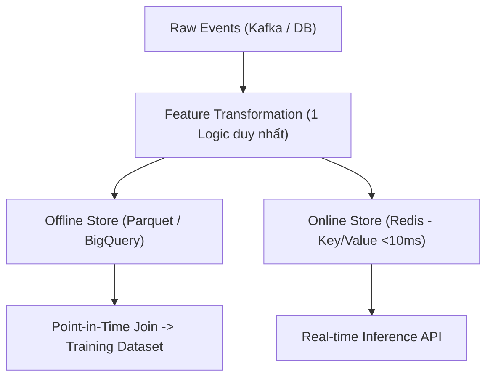

> **[Motto / Châm ngôn cốt lõi]**: Viết logic tính feature một lần duy nhất; dùng lại cho cả Offline Training và Online Serving.

---

## Thông tin nhanh (Quick Spec)

* **Loại bài (Type):** Thực chiến (Build)
* **Ngôn ngữ & Công cụ:** Python 3.12 (Standard Library)
* **Kiến thức tiên quyết (Prerequisites):** Phase 2, Bài 01-20
* **Thời gian thực hành:** ~80 phút

---

## Mục tiêu bài học (Learning Objectives)

Sau bài học này, bạn sẽ có khả năng:
- [ ] Nhận diện 3 nguyên nhân gây **Training-Serving Skew** (khác logic, khác phân phối, rò rỉ thời gian).
- [ ] Phân biệt kiến trúc và đánh đổi giữa **Offline Store** và **Online Store**.
- [ ] Tự tay cài đặt **Point-in-Time Join (As-of Join)** và một **Mini Feature Store** bằng Python thuần.
- [ ] Thiết kế chiến lược kiểm tra tính nhất quán giữa Offline và Online features trên production.

---

## 1. Vấn đề thực tế (The Problem)

> *Code chạy ở Jupyter Notebook dùng Pandas, code chạy ở Production API dùng SQL/Java — và chúng tính ra 2 con số khác nhau.*

Team Data Science viết một câu query SQL/Pandas để tính `avg_spend_7d` (chi tiêu trung bình 7 ngày) khi train model. Team Backend viết lại logic đó bằng Go/Python trên Redis để phục vụ API real-time.

Kết quả:
- Lúc train: `7 ngày` được tính theo múi giờ UTC, làm tròn 2 chữ số, bỏ qua giao dịch hoàn tiền.
- Lúc serve: `7 ngày` tính theo giờ địa phương, không bỏ giao dịch hoàn tiền.

Mô hình nhận vào dữ liệu bị lệch (skewed) và dự đoán sai hàng loạt, nhưng không hề có lỗi hệ thống nào được ghi nhận.

---

## 2. Mô hình tư duy & Bản chất (The Concept)

> *Feature Store là "Single Source of Truth" (Nguồn chân lý duy nhất) cho cả Training và Serving.*



### So sánh Offline Store vs Online Store

| Tiêu chí | Offline Store (Training & Batch) | Online Store (Real-time Serving) |
|---|---|---|
| **Storage (Lưu trữ)** | Lưu trữ cột (Columnar) trên Data Lake / Warehouse (Parquet, Iceberg). | Kho Key-Value / In-memory tối ưu đọc điểm theo `entity_id`. |
| **Latency (Độ trễ)** | Giây đến phút (tối ưu **Throughput** quét hàng tỷ dòng). | **< 10 ms** ở p99 (tối ưu độ trễ cho từng request). |
| **Access Pattern (Kiểu truy cập)** | Quét lịch sử theo dải thời gian, Point-in-Time Join tạo bảng train. | Đọc điểm (Point lookup) lấy **giá trị mới nhất** theo khóa thực thể. |
| **Phạm vi dữ liệu** | Toàn bộ lịch sử nhiều tháng / nhiều năm. | Chỉ giữ trạng thái gần nhất (có TTL để tiết kiệm RAM). |
| **Examples (Công nghệ tiêu biểu)** | BigQuery, Snowflake, S3 + Parquet/Delta Lake, Hive. | Redis, DynamoDB, Cassandra, PostgreSQL (indexed). |

### Point-in-Time Correctness (As-of Join)

Khi tạo dữ liệu train cho một sự kiện xảy ra tại thời điểm $t_{\text{event}}$, ta **chỉ được phép** lấy giá trị feature tại thời điểm $t_{\text{feat}}$ sao cho:
$$t_{\text{feat}} \le t_{\text{event}}$$
và $t_{\text{feat}}$ là **gần nhất** với $t_{\text{event}}$. Nếu lấy $t_{\text{feat}} > t_{\text{event}}$, bạn đã vô tình nhìn trộm tương lai (Time-travel Data Leakage).

---

## 3. Tự tay xây dựng từ đầu (Build It: From Scratch)

```python
from typing import Dict, List, Tuple, Any


class MiniFeatureStore:
    def __init__(self):
        # Offline store: lưu toàn bộ lịch sử (entity_id, timestamp, features)
        self.offline_history: Dict[str, List[Tuple[int, Dict[str, Any]]]] = {}
        # Online store: chỉ lưu bản ghi mới nhất để đọc O(1)
        self.online_latest: Dict[str, Tuple[int, Dict[str, Any]]] = {}

    def ingest(self, entity_id: str, timestamp: int, features: Dict[str, Any]) -> None:
        self.offline_history.setdefault(entity_id, []).append((timestamp, features))
        self.offline_history[entity_id].sort(key=lambda x: x[0])

        if entity_id not in self.online_latest or timestamp >= self.online_latest[entity_id][0]:
            self.online_latest[entity_id] = (timestamp, features)

    def get_online_features(self, entity_id: str) -> Dict[str, Any] | None:
        """Đọc cực nhanh cho Real-time Serving."""
        record = self.online_latest.get(entity_id)
        return record[1] if record else None

    def point_in_time_join(
        self, events: List[Tuple[str, int]]
    ) -> List[Dict[str, Any]]:
        """Ghép feature lịch sử đúng tại thời điểm event xảy ra (chống leak tương lai)."""
        results = []
        for entity_id, event_ts in events:
            history = self.offline_history.get(entity_id, [])
            matched_feats = None
            for feat_ts, feats in history:
                if feat_ts <= event_ts:
                    matched_feats = feats
                else:
                    break
            results.append(
                {"entity_id": entity_id, "event_ts": event_ts, "features": matched_feats}
            )
        return results


if __name__ == "__main__":
    fs = MiniFeatureStore()
    fs.ingest("user_1", timestamp=100, features={"avg_spend": 50.0})
    fs.ingest("user_1", timestamp=200, features={"avg_spend": 120.0})
    fs.ingest("user_1", timestamp=300, features={"avg_spend": 300.0})

    print("Online Serving (latest):", fs.get_online_features("user_1"))
    train_rows = fs.point_in_time_join([("user_1", 150), ("user_1", 250)])
    for row in train_rows:
        print("Offline Training (Point-in-Time):", row)
```

---

## 4. Ứng dụng thực tế & So sánh Framework (Use It)

| Giải pháp | Loại hình | Điểm mạnh | Trade-off |
|---|---|---|---|
| **Feast** | Open-source | Linh hoạt, ghép nối sẵn BigQuery/Snowflake/Redshift + Redis/DynamoDB, hỗ trợ Point-in-Time Join chuẩn. | Không tự chạy biến đổi streaming nặng; cần tự kết hợp Spark/Flink/dbt. |
| **Tecton** | Managed Platform | Quản lý trọn gói từ batch/streaming feature pipeline đến Online Store SLA thấp và monitoring. | Chi phí bản quyền cao, phụ thuộc vendor (vendor lock-in). |
| **Databricks / Vertex AI Feature Store** | Cloud-native | Tích hợp chặt với hệ sinh thái sẵn có (Unity Catalog, BigQuery, IAM). | Khó di chuyển sang cloud khác nếu chạy multi-cloud. |
| **DIY (dbt/SQL + Redis + Shared Package)** | Tự xây gọn nhẹ | Không thêm hạ tầng mới, chi phí thấp, dễ kiểm soát cho team nhỏ. | Phải tự viết logic Point-in-Time Join, TTL và kiểm thử parity giữa Offline/Online. |

**Production Tips:**
1. **Log Features ngay lúc Serve (Feature Logging):** Cách chống skew chắc chắn nhất là lưu lại chính vector feature mà mô hình đã nhận lúc serve (cùng `request_id` và `timestamp`), sau đó ghép nhãn thật để train lại phiên bản tiếp theo.
2. **Đừng dựng Feature Store quá sớm:** Nếu chỉ có 1–2 mô hình đơn giản, một bảng SQL dùng chung hoặc package Python dùng chung giữa train và serve là đủ. Chỉ đầu tư Feast/Tecton khi có nhiều team và hàng trăm features tái sử dụng.
3. **Kiểm tra Skew tự động (Online-Offline Parity):** Định kỳ lấy mẫu 1,000 request từ Online logs và tính lại từ Offline Store tại đúng mốc `event_ts`; nếu sai lệch > 1% số bản ghi, báo động ngay.

---

## 5. Đóng gói & Tái sử dụng (Ship It)

### Checklist kiểm chứng Point-in-Time Join & Chống Training-Serving Skew

- [ ] **Chống nhìn trộm tương lai:** Mọi phép ghép lịch sử đều ép chặt điều kiện $t_{\text{feat}} \le t_{\text{event}}$ (tuyệt đối không dùng `LEFT JOIN` thường theo `entity_id` hoặc theo ngày mà bỏ qua giờ/phút)?
- [ ] **Chuẩn hóa múi giờ (UTC Only):** Toàn bộ `event_timestamp` và `feature_timestamp` đều lưu ở định dạng UTC (epoch seconds/milliseconds) trước khi join?
- [ ] **Giới hạn độ cũ (TTL / Lookback Window):** Đã cấu hình cửa sổ `TTL` hợp lý (ví dụ không ghép một feature đã cũ 6 tháng cho sự kiện hôm nay; thay vào đó trả `null`/default giống hệt hành vi Online Store)?
- [ ] **Xử lý Late-arriving Events & Backfill:** Khi dữ liệu đến trễ hoặc backfill bảng lịch sử, phân biệt rõ `event_timestamp` (lúc sự kiện xảy ra) và `created_timestamp` (lúc ghi vào DB) để tránh ghi đè lịch sử sai?
- [ ] **Kiểm thử Online-Offline Parity:** Đã chạy bài test đối chiếu 1,000 request thật giữa Online Serving log và Offline Point-in-Time Join với sai số giá trị `< 1e-4` và tỷ lệ lệch bản ghi `< 1%`?

---

## 6. Giải ngố thuật ngữ (Key Terms & Misconceptions)

| Thuật ngữ (Term) | Người ta thường nghĩ là... | Bản chất kỹ thuật thực sự là... |
|---|---|---|
| **Training-Serving Skew vs Data Drift** | Cả hai đều là hiện tượng phân phối dữ liệu thay đổi theo thời gian. | **Data Drift** là do thế giới thực thay đổi. **Training-Serving Skew** là lỗi kỹ thuật do code/pipeline lúc train và lúc serve tính ra 2 giá trị khác nhau cho *cùng một thực thể ở cùng một thời điểm*. |
| **Point-in-Time Join (As-of Join)** | Chỉ là phép `JOIN` theo `user_id` và ngày `date`. | Phép nối tìm bản ghi feature gần nhất **trước hoặc bằng** mốc `event_timestamp` ($t_{\text{feat}} \le t_{\text{event}}$) trong giới hạn TTL, ngăn chặn hoàn toàn rò rỉ dữ liệu tương lai. |
| **Feature Store** | Một loại database thay thế cho Data Warehouse và Redis. | Là **lớp trừu tượng và điều phối** (registry + materialization + serving API) đặt phía trên Offline Store (Warehouse/Lake) và Online Store (Redis/DynamoDB). |
| **Feature Logging** | Ghi log để debug lỗi HTTP của API server. | Là chiến lược "Log-and-Wait": lưu nguyên trạng feature vector tại thời điểm inference để sau này ghép nhãn thật làm tập train, triệt tiêu tận gốc sự khác biệt giữa code train và code serve. |

---

## 7. Bài tập thử thách (Hands-on Challenges)

1. 🟢 **Cơ bản (Easy):** Thêm cơ chế **TTL (Time-To-Live)** vào `get_online_features(entity_id, current_ts, ttl=3600)` để trả về `None` nếu feature đã quá cũ so với `current_ts`.
2. 🟡 **Trung bình (Medium):** Tối ưu `point_in_time_join` bằng **Binary Search (`bisect`)** để đạt độ phức tạp $O(\log N)$ thay vì duyệt tuyến tính $O(N)$ trên mỗi sự kiện.
3. 🔴 **Nâng cao (Hard):** Viết hàm `detect_skew(online_logs, offline_recomputed, tol=1e-4)` để đối chiếu từng cặp `(entity_id, event_ts)` giữa Online Store và Offline Store, báo cáo tỷ lệ % bản ghi lệch, feature lệch nhiều nhất và sai số tuyệt đối lớn nhất.

---

## 8. Tài liệu đọc thêm (Further Reading)

- [Feast Documentation: Concepts & Point-in-Time Joins](https://docs.feast.dev/) — *Tài liệu chính thức hướng dẫn kiến trúc Offline/Online Store và cơ chế materialization.*
- [What Is a Feature Store? — Tecton Engineering Blog](https://www.tecton.ai/blog/what-is-a-feature-store/) — *Giải thích rõ khi nào cần Feature Store và cách giải quyết bài toán real-time streaming features.*
- [Rules of Machine Learning (Rules #32–37: Training-Serving Skew) — Google](https://developers.google.com/machine-learning/guides/rules-of-ml) — *Tài liệu kinh điển phân tích các nguồn gốc tinh vi của Training-Serving Skew và kỹ thuật Log-and-Wait.*
