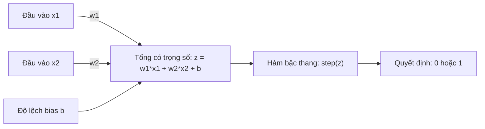
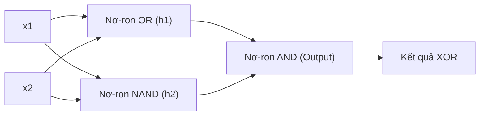

> **[Motto]**: Perceptron là nguyên tử của mạng nơ-ron: bóc tách nó ra, bạn chỉ thấy trọng số, bias và một siêu phẳng cắt đôi không gian.

---

## Thông tin nhanh (Quick Spec)

* **Loại bài (Type):** Thực chiến (Build)
* **Ngôn ngữ & Công cụ:** Python 3.12 (thuần chuẩn thư viện chuẩn, không cần thư viện ngoài)
* **Kiến thức tiên quyết (Prerequisites):** Phase 01 (Tích vô hướng, Siêu phẳng), Phase 02 (Phân loại nhị phân)
* **Thời gian thực hành:** ~45 phút

---

## Mục tiêu bài học (Learning Objectives)

Sau bài học này, bạn sẽ có khả năng:
- [ ] Giải thích cơ chế ra quyết định của một **Perceptron** qua trọng số (`weights`), độ lệch (`bias`) và hàm bậc thang (`Step Function`).
- [ ] Tự tay cài đặt lớp `Perceptron` từ đầu bằng Python thuần, huấn luyện thành công trên các cổng logic tuyến tính (**AND**, **OR**).
- [ ] Chứng minh cả bằng toán học lẫn thực nghiệm vì sao một Perceptron đơn lẻ **không thể** học được cổng **XOR**.
- [ ] Xây dựng mạng 2 lớp (cả bản ghép tay `OR + NAND -> AND` lẫn bản tự học bằng **Sigmoid** + cập nhật đạo hàm) để giải quyết triệt để XOR.

---

## 1. Vấn đề thực tế (The Problem)

> *Máy tính học một quy tắc phân loại từ dữ liệu như thế nào, khi bạn không muốn viết sẵn điều kiện `if-else`?*

Ở Phase 01, bạn đã biết tích vô hướng $\mathbf{w}^T \mathbf{x}$ chiếu một vector dữ liệu lên một phương nhất định. Ở Phase 02, bạn đã dùng các mô hình tuyến tính để phân tách dữ liệu. Nhưng câu hỏi nền tảng mở ra kỷ nguyên Deep Learning năm 1958 của Frank Rosenblatt lại cực kỳ thực dụng:

Làm sao thiết kế một **đơn vị tính toán tối giản** nhận đầu vào $\mathbf{x}$, tự đưa ra quyết định nhị phân `0` hoặc `1`, và mỗi lần đoán sai thì tự xoay nhẹ bộ tham số cho đến khi đoán đúng hết?

Perceptron chính là câu trả lời. Tuy nhiên, nếu chỉ hiểu Perceptron hoạt động thế nào là chưa đủ — kỹ sư AI còn phải hiểu **chính xác điểm gãy** của nó (bài toán XOR). Chính điểm gãy này từng đóng băng nghiên cứu mạng nơ-ron suốt thập niên 1970, và lời giải cho nó — xếp chồng các lớp nơ-ron — là nền móng của mọi mô hình Deep Learning hiện đại.

---

## 2. Mô hình tư duy & Bản chất (The Concept)

### Cấu trúc của một Perceptron

Một Perceptron thực hiện đúng hai bước: tổng hợp tín hiệu có trọng số (kèm `bias`), sau đó cắt ngưỡng cứng bằng **Step Function** để trả về `0` hoặc `1`.



Về mặt hình học, phương trình $\mathbf{w}^T \mathbf{x} + b = 0$ định nghĩa một **ranh giới quyết định (Decision Boundary)** dạng đường thẳng trong không gian 2D (hoặc siêu phẳng trong không gian $n$ chiều):
* Vector trọng số $\mathbf{w}$ quyết định **hướng nghiêng** (pháp tuyến) của đường thẳng.
* Tham số `bias` $b$ quyết định **khoảng dịch chuyển** của đường thẳng khỏi gốc tọa độ. Nếu thiếu `bias`, ranh giới bị khóa chết phải đi qua điểm $(0, 0)$.

### Toán học cốt lõi

**1. Hàm dự đoán và Hàm bậc thang (Heaviside Step Function):**

$$z = \mathbf{w}^T \mathbf{x} + b = \sum_{i=1}^{n} w_i x_i + b, \qquad \hat{y} = \text{step}(z) = \begin{cases} 1 & \text{nếu } z \ge 0 \\ 0 & \text{nếu } z < 0 \end{cases}$$

**2. Luật học Perceptron (Perceptron Learning Rule):**
Với mỗi mẫu huấn luyện $(\mathbf{x}, y)$, nếu dự đoán đúng ($y - \hat{y} = 0$), mô hình giữ nguyên tham số. Nếu sai, nó kéo siêu phẳng về phía sửa lỗi với tốc độ học $\eta$ (`learning_rate`):

$$e = y - \hat{y}, \qquad \mathbf{w} \leftarrow \mathbf{w} + \eta \cdot e \cdot \mathbf{x}, \qquad b \leftarrow b + \eta \cdot e$$

* Khi $y = 1, \hat{y} = 0 \Rightarrow e = +1$: cộng thêm $\eta \mathbf{x}$ vào $\mathbf{w}$ để tăng giá trị $z$.
* Khi $y = 0, \hat{y} = 1 \Rightarrow e = -1$: trừ đi $\eta \mathbf{x}$ khỏi $\mathbf{w}$ để giảm giá trị $z$.

### Chứng minh vì sao một Perceptron bất lực trước XOR

Xét bảng chân trị của cổng **XOR**: $(0, 0) \to 0$, $(0, 1) \to 1$, $(1, 0) \to 1$, $(1, 1) \to 0$. Giả sử tồn tại $(w_1, w_2, b)$ sao cho một Perceptron đơn lẻ phân tách được 4 điểm này. Khi đó cả 4 bất đẳng thức sau phải đồng thời thỏa mãn:

$$\begin{aligned} (0, 0) \to 0 &: \quad b < 0 \\ (0, 1) \to 1 &: \quad w_2 + b \ge 0 \\ (1, 0) \to 1 &: \quad w_1 + b \ge 0 \\ (1, 1) \to 0 &: \quad w_1 + w_2 + b < 0 \end{aligned}$$

Cộng hai bất đẳng thức giữa lại, ta có $w_1 + w_2 + 2b \ge 0 \Rightarrow w_1 + w_2 + b \ge -b$. Vì $b < 0$ nên $-b > 0$, suy ra $w_1 + w_2 + b > 0$ — **mâu thuẫn trực tiếp** với điều kiện thứ tư ($w_1 + w_2 + b < 0$).

Không phải mô hình học kém hay cần chạy thêm epoch: về mặt toán học, **không tồn tại** đường thẳng nào cắt được XOR.

### Lời giải: Xếp chồng thành 2 lớp (Multi-Layer Perceptron)

Ta tách XOR thành tổ hợp của các phép toán tuyến tính đơn giản hơn: $\text{XOR}(x_1, x_2) = \text{AND}(\text{OR}(x_1, x_2), \text{NAND}(x_1, x_2))$. Lớp ẩn thứ nhất biến đổi không gian 2D gốc sang không gian đặc trưng mới $(h_1, h_2)$, nơi dữ liệu trở nên phân tách tuyến tính cho lớp đầu ra.



---

## 3. Tự tay xây dựng từ đầu (Build It: From Scratch)

Toàn bộ phần cài đặt dưới đây chỉ sử dụng thư viện chuẩn của Python 3.12 (`math`, `random`) để bạn nhìn thấy trọn vẹn từng phép nhân, từng lần cập nhật trọng số mà không bị che khuất bởi bất kỳ framework nào.

### Bước 1: Cài đặt lớp Perceptron đơn lẻ

```python
import math
import random
from typing import List, Sequence, Tuple


class Perceptron:
    """Bộ phân loại tuyến tính nhị phân dùng Step Function và luật học Rosenblatt."""

    def __init__(self, n_inputs: int, learning_rate: float = 0.1) -> None:
        self.weights: List[float] = [0.0] * n_inputs
        self.bias: float = 0.0
        self.lr: float = learning_rate

    def linear_score(self, inputs: Sequence[float]) -> float:
        return sum(w * x for w, x in zip(self.weights, inputs)) + self.bias

    def predict(self, inputs: Sequence[float]) -> int:
        return 1 if self.linear_score(inputs) >= 0.0 else 0

    def train(
        self,
        dataset: Sequence[Tuple[Sequence[float], int]],
        max_epochs: int = 100,
    ) -> Tuple[bool, int]:
        """Huấn luyện Perceptron. Trả về (đã_hội_tụ, số_epoch_đã_chạy)."""
        for epoch in range(1, max_epochs + 1):
            errors = 0
            for x, target in dataset:
                pred = self.predict(x)
                error = target - pred
                if error != 0:
                    errors += 1
                    for i in range(len(self.weights)):
                        self.weights[i] += self.lr * error * x[i]
                    self.bias += self.lr * error
            if errors == 0:
                return True, epoch
        return False, max_epochs
```

### Bước 2: Giải XOR bằng mạng 2 lớp (Ghép tay và Tự học bằng Sigmoid)

Vì **Step Function** có đạo hàm bằng 0 ở hầu hết mọi nơi (và không khả vi tại 0), ta không thể dùng Gradient Descent để tự động huấn luyện trọng số cho mạng nhiều lớp nếu giữ Step Function. Khi thay Step bằng **Sigmoid**, đạo hàm mượt xuất hiện và mạng 2 lớp tự học được XOR hoàn toàn từ trọng số ngẫu nhiên.

```python
def xor_handwired(x1: float, x2: float) -> int:
    """Mạng 2 lớp ghép tay từ 3 Perceptron: AND(OR(x1, x2), NAND(x1, x2))."""
    or_gate = Perceptron(2)
    or_gate.weights, or_gate.bias = [1.0, 1.0], -0.5

    nand_gate = Perceptron(2)
    nand_gate.weights, nand_gate.bias = [-1.0, -1.0], 1.5

    and_gate = Perceptron(2)
    and_gate.weights, and_gate.bias = [1.0, 1.0], -1.5

    h1 = or_gate.predict([x1, x2])
    h2 = nand_gate.predict([x1, x2])
    return and_gate.predict([h1, h2])


class TwoLayerXORNet:
    """Mạng 2 lớp (2 -> 2 -> 1) dùng Sigmoid để tự học XOR từ đầu."""

    def __init__(self, learning_rate: float = 1.5, seed: int = 42) -> None:
        rng = random.Random(seed)
        self.w_hidden: List[List[float]] = [
            [rng.uniform(-1.0, 1.0), rng.uniform(-1.0, 1.0)] for _ in range(2)
        ]
        self.b_hidden: List[float] = [rng.uniform(-1.0, 1.0) for _ in range(2)]
        self.w_out: List[float] = [rng.uniform(-1.0, 1.0) for _ in range(2)]
        self.b_out: float = rng.uniform(-1.0, 1.0)
        self.lr: float = learning_rate
        self._last_hidden: List[float] = [0.0, 0.0]

    @staticmethod
    def _sigmoid(z: float) -> float:
        z_clamped = max(-500.0, min(500.0, z))
        return 1.0 / (1.0 + math.exp(-z_clamped))

    def forward(self, inputs: Sequence[float]) -> float:
        self._last_hidden = [
            self._sigmoid(
                self.w_hidden[i][0] * inputs[0]
                + self.w_hidden[i][1] * inputs[1]
                + self.b_hidden[i]
            )
            for i in range(2)
        ]
        z_out = (
            self.w_out[0] * self._last_hidden[0]
            + self.w_out[1] * self._last_hidden[1]
            + self.b_out
        )
        return self._sigmoid(z_out)

    def train(
        self,
        dataset: Sequence[Tuple[Sequence[float], int]],
        epochs: int = 4000,
    ) -> Tuple[float, float]:
        """Huấn luyện bằng MSE + đạo hàm chuỗi (preview của Backpropagation)."""
        first_loss = 0.0
        last_loss = 0.0

        for epoch in range(epochs):
            total_loss = 0.0
            for x, target in dataset:
                y_hat = self.forward(x)
                error = target - y_hat
                total_loss += error * error

                # Gradient tại lớp đầu ra
                d_out = error * y_hat * (1.0 - y_hat)
                saved_w_out = self.w_out[:]

                # Gradient lan truyền ngược về lớp ẩn
                d_hidden = [
                    d_out * saved_w_out[i] * h * (1.0 - h)
                    for i, h in enumerate(self._last_hidden)
                ]

                # Cập nhật trọng số lớp đầu ra
                for i in range(2):
                    self.w_out[i] += self.lr * d_out * self._last_hidden[i]
                self.b_out += self.lr * d_out

                # Cập nhật trọng số lớp ẩn
                for i in range(2):
                    for j in range(2):
                        self.w_hidden[i][j] += self.lr * d_hidden[i] * x[j]
                    self.b_hidden[i] += self.lr * d_hidden[i]

            avg_loss = total_loss / len(dataset)
            if epoch == 0:
                first_loss = avg_loss
            last_loss = avg_loss

        return first_loss, last_loss
```

### Bước 3: Chạy thực nghiệm AND, OR, chứng minh lỗi XOR và mạng 2 lớp

```python
if __name__ == "__main__":
    and_data = [([0, 0], 0), ([0, 1], 0), ([1, 0], 0), ([1, 1], 1)]
    or_data = [([0, 0], 0), ([0, 1], 1), ([1, 0], 1), ([1, 1], 1)]
    xor_data = [([0, 0], 0), ([0, 1], 1), ([1, 0], 1), ([1, 1], 0)]

    for name, data in [("AND", and_data), ("OR", or_data), ("XOR (1 lớp)", xor_data)]:
        p = Perceptron(n_inputs=2, learning_rate=0.1)
        converged, epochs = p.train(data, max_epochs=200)
        correct = sum(1 for x, y in data if p.predict(x) == y)
        acc = correct / len(data) * 100.0
        print(
            f"[{name:11s}] Hội tụ: {str(converged):5s} (epoch={epochs:3d}) | "
            f"Accuracy: {acc:5.1f}% | w={[round(w, 2) for w in p.weights]}, b={p.bias:.2f}"
        )

    hw_correct = sum(1 for x, y in xor_data if xor_handwired(x[0], x[1]) == y)
    print(f"\n[XOR Ghép tay 2 lớp] Accuracy: {hw_correct / len(xor_data) * 100.0:.1f}%")

    net = TwoLayerXORNet(learning_rate=2.0, seed=0)
    start_loss, end_loss = net.train(xor_data, epochs=6000)
    preds = [(x, net.forward(x), y) for x, y in xor_data]
    net_acc = sum(1 for _, p_val, y in preds if (p_val >= 0.5) == bool(y)) / len(xor_data) * 100.0
    print(
        f"[XOR Tự học 2 lớp ] Loss: {start_loss:.4f} -> {end_loss:.6f} | Accuracy: {net_acc:.1f}%"
    )
    for x, prob, y in preds:
        print(f"  input={x} -> prob={prob:.4f} (pred={int(prob >= 0.5)}, target={y})")
```

---

## 4. Ứng dụng thực tế & So sánh Framework (Use It)

Trong thực tế sản xuất, gần như không ai triển khai `Perceptron` cổ điển dùng Step Function cho dữ liệu phức tạp. Tuy nhiên, **phép chiếu tuyến tính $z = Wx + b$** của nó vẫn là trái tim của mọi lớp `Linear` trong PyTorch và mọi khối Attention/FFN của LLM hiện đại (GPT, Llama, Claude).

| Tiêu chí | Perceptron tự viết (Step) | `sklearn.linear_model.Perceptron` | `torch.nn.Linear` trong MLP / Transformer |
|---|---|---|---|
| **Hàm kích hoạt** | Step Function cứng (0 hoặc 1) | Ngưỡng dấu (`sign`), hỗ trợ margin/penalty | Tách rời: kết hợp ReLU, GELU, SwiGLU |
| **Cơ chế học** | Chỉ cập nhật khi dự đoán sai | Online SGD với L1/L2, shuffle, early stopping | Backpropagation (Autograd) trên batch lớn |
| **Giải bài toán phi tuyến** | Không thể (chỉ vẽ 1 siêu phẳng) | Không thể (trừ khi tự tạo feature phi tuyến) | Có — bằng cách xếp chồng nhiều lớp phi tuyến |
| **Ứng dụng Production** | Học thuật, minh họa cơ chế nền tảng | Baseline phân loại văn bản cực nhanh trên dữ liệu thưa | Nền tảng của Vision, Tabular Deep Learning và toàn bộ LLM |

### Ví dụ nhanh trong Production (Scikit-learn & PyTorch)

```python
# 1. Scikit-learn: Baseline tuyến tính nhanh
from sklearn.linear_model import Perceptron as SkPerceptron
clf = SkPerceptron(max_iter=1000, tol=1e-3, random_state=42)

# 2. PyTorch: Phép chiếu tuyến tính là phiên bản tổng quát hóa của Perceptron
import torch.nn as nn
mlp_xor = nn.Sequential(nn.Linear(2, 4), nn.GELU(), nn.Linear(4, 1))
```

**Production Tips:**
* **Luôn kiểm tra Linear Baseline trước:** Nếu `LogisticRegression` hoặc Linear SVM đã đạt 95% trên bài toán phân loại dữ liệu bảng, đừng vội kéo mạng nơ-ron sâu vào làm tăng độ trễ và chi phí vận hành.
* **Khởi tạo đối xứng là cái bẫy chết người:** Với 1 Perceptron đơn lẻ, khởi tạo `weights = [0.0, 0.0]` vẫn chạy được. Nhưng với mạng nhiều lớp, khởi tạo toàn 0 khiến mọi nơ-ron trong lớp ẩn học giống hệt nhau (Symmetry Problem) — bắt buộc phải khởi tạo ngẫu nhiên.

---

## 5. Đóng gói & Tái sử dụng (Ship It)

**Checklist chẩn đoán khả năng phân tách tuyến tính trước khi chọn kiến trúc:**
- [ ] **Thử mô hình tuyến tính làm Baseline:** Huấn luyện Logistic Regression / Linear SVM trước; nếu độ chính xác trên tập **train** (không phải chỉ tập test) vẫn thấp, dữ liệu của bạn gần như chắc chắn mang tính phi tuyến mạnh (Underfitting do mô hình tuyến tính).
- [ ] **Kiểm tra hiện tượng dao động (Oscillation):** Nếu Perceptron không hội tụ và số lỗi nhảy qua lại sau nhiều epoch, dữ liệu không phân tách tuyến tính hoàn toàn (hoặc có nhãn nhiễu) — cần chuyển sang Loss mượt (Log Loss / Hinge Loss) hoặc thêm lớp ẩn.
- [ ] **Luôn giữ tham số `bias`:** Chỉ tắt `bias=False` trong PyTorch khi ngay phía sau lớp `Linear` có `BatchNorm` hoặc `LayerNorm` (như trong các block Transformer hiện đại) vì lớp chuẩn hóa đã triệt tiêu hằng số cộng.
- [ ] **Chuẩn hóa thang đo đầu vào:** Luật cập nhật $\mathbf{w} \leftarrow \mathbf{w} + \eta e \mathbf{x}$ phụ thuộc trực tiếp vào độ lớn của $\mathbf{x}$; đặc trưng có biên độ $10^4$ sẽ áp đảo hoàn toàn đặc trưng biên độ $10^{-1}$.

**Cheatsheet các cổng logic và ranh giới tuyến tính:**

| Cổng logic | Phân tách tuyến tính? | Một Perceptron giải được? | Bộ trọng số mẫu $(w_1, w_2, b)$ |
|---|---|---|---|
| **AND** | Có | Có | $(1.0, 1.0, -1.5)$ |
| **OR** | Có | Có | $(1.0, 1.0, -0.5)$ |
| **NAND** | Có | Có | $(-1.0, -1.0, 1.5)$ |
| **XOR** | Không | Không (cần ít nhất 2 lớp) | Kết hợp `OR` + `NAND` qua `AND` |

---

## 6. Giải ngố thuật ngữ (Key Terms & Misconceptions)

| Thuật ngữ (Term) | Người ta thường nghĩ là... | Bản chất kỹ thuật thực sự là... |
|---|---|---|
| **Perceptron** | Một mô phỏng chính xác của tế bào thần kinh sinh học trong não người. | Một bộ phân loại tuyến tính rất đơn giản: tích vô hướng $\mathbf{w}^T\mathbf{x} + b$ đi qua hàm bậc thang để chia đôi không gian bằng một siêu phẳng. |
| **Bias** | Sự thiên vị hay lỗi sai lệch dữ liệu (Data Bias) cần phải loại bỏ. | Tham số dịch chuyển (offset) cho phép ranh giới quyết định không bị ép đi qua gốc tọa độ $(0, 0)$, giúp mô hình linh hoạt hơn hẳn. |
| **Linear Separability** | Dữ liệu phải xếp thành một đường thẳng thì mới tuyến tính. | Dữ liệu thuộc hai lớp có thể được ngăn cách hoàn toàn không nhầm điểm nào chỉ bằng **một** siêu phẳng duy nhất. |
| **Step Function** | Hàm kích hoạt chuẩn dùng cho mọi mạng nơ-ron sâu. | Hàm cắt ngưỡng cứng có đạo hàm bằng 0 ở hầu khắp nơi, khiến Gradient Descent bất lực — các mạng hiện đại buộc phải thay bằng ReLU, GELU hoặc SiLU. |

---

## 7. Bài tập thử thách (Hands-on Challenges)

1. 🟢 **Cơ bản (Easy):** Dùng lớp `Perceptron` trong Phần 3 để huấn luyện cổng **NAND** (`[0,0]->1, [0,1]->1, [1,0]->1, [1,1]->0`). In ra phương trình đường thẳng phân tách $w_1 x_1 + w_2 x_2 + b = 0$ sau mỗi epoch để quan sát đường thẳng xoay dần cho đến khi hội tụ.
2. 🟡 **Trung bình (Medium):** Xây dựng một Perceptron 3 đầu vào học hàm **Bỏ phiếu đa số (Majority Vote)**: trả về `1` khi có ít nhất 2 trong 3 đầu vào bằng `1`, ngược lại trả về `0`. Hãy kiểm tra bằng thực nghiệm xem bài toán này có phân tách tuyến tính hay không và giải thích vì sao.
3. 🔴 **Nâng cao (Hard):** Khi dữ liệu bị nhiễu (1–2 điểm bị gắn sai nhãn), `Perceptron` thuần sẽ không bao giờ hội tụ và trọng số ở epoch cuối có thể rất tệ. Hãy cài đặt **Pocket Algorithm**: lưu lại bản sao `(best_weights, best_bias)` đạt ít lỗi nhất trên toàn tập dữ liệu trong quá trình huấn luyện và so sánh độ chính xác trên tập dữ liệu XOR có thêm nhiễu.

---

## 8. Tài liệu đọc thêm (Further Reading)

- [Frank Rosenblatt (1958) — The Perceptron: A Probabilistic Model for Information Storage and Organization in the Brain](https://psycnet.apa.org/record/1959-09865-001) — *Bài báo lịch sử đặt nền móng cho toàn bộ lĩnh vực mạng nơ-ron nhân tạo và thuật toán học lặp từ dữ liệu.*
- [Michael Nielsen — Neural Networks and Deep Learning, Chapter 1](http://neuralnetworksanddeeplearning.com/chap1.html) — *Giải thích trực quan nhất về cách ghép nối Perceptron thành mạch tính toán và lý do chuyển từ Step sang Sigmoid.*
- [Marvin Minsky & Seymour Papert (1969) — Perceptrons (MIT Press)](https://mitpress.mit.edu/9780262630221/perceptrons/) — *Công trình toán học kinh điển chứng minh giới hạn của mạng đơn lớp trên bài toán XOR và parity.*
