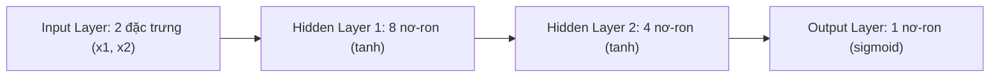
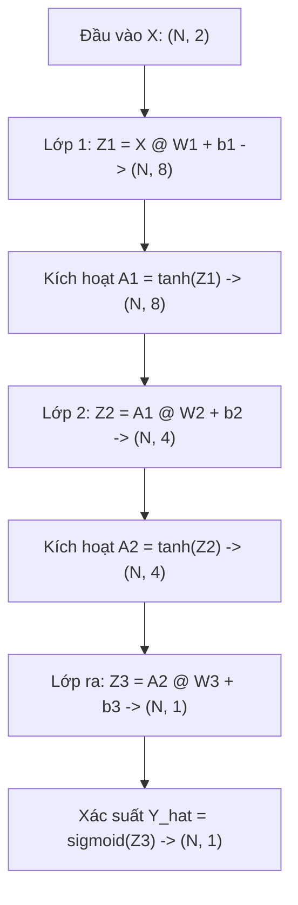

> **[Motto]**: Một nơ-ron chỉ vẽ được một đường thẳng; xếp chồng chúng thành nhiều lớp phi tuyến, bạn có thể uốn không gian để vẽ mọi đường cong.

---

## Thông tin nhanh (Quick Spec)

* **Loại bài (Type):** Thực chiến (Build)
* **Ngôn ngữ & Công cụ:** Python 3.12, NumPy
* **Kiến thức tiên quyết (Prerequisites):** Bài 01 (Perceptron & XOR), Phase 01 (Nhân ma trận)
* **Thời gian thực hành:** ~60 phút

---

## Mục tiêu bài học (Learning Objectives)

Sau bài học này, bạn sẽ có khả năng:
- [ ] Xây dựng một **Multi-Layer Perceptron (MLP)** vector hóa thuần NumPy hỗ trợ danh sách kích thước lớp bất kỳ (như `[2, 8, 4, 1]`).
- [ ] Kiểm soát và truy vết chính xác **kích thước ma trận (Matrix Shapes)** của đầu vào, trọng số, bias và kích hoạt qua toàn bộ Forward Pass.
- [ ] Giải thích trực quan cách các lớp ẩn liên tiếp bẻ cong không gian đặc trưng và ý nghĩa thực tiễn của **Định lý Xấp xỉ Vạn năng**.
- [ ] Huấn luyện thành công mạng MLP đa lớp trên cả hai bài toán phi tuyến kinh điển: **XOR** và **phân loại điểm trong/ngoài hình tròn**.

---

## 1. Vấn đề thực tế (The Problem)

> *Nếu mỗi nơ-ron chỉ là một nhát cắt thẳng, làm thế nào để mạng nơ-ron nhận diện được hình tròn, khuôn mặt hay ngữ nghĩa của một câu văn?*

Ở Bài 01, ta đã thấy một Perceptron đơn lẻ bó tay trước 4 điểm XOR. Trong thực tế, dữ liệu còn phức tạp gấp vạn lần: các điểm thuộc lớp `1` nằm gọn bên trong một vòng tròn, bao quanh bởi lớp `0` ở bên ngoài; hoặc ảnh chữ số viết tay nằm trên những mặt cong phức tạp trong không gian hàng nghìn chiều.

Nếu viết vòng lặp `for` duyệt từng nơ-ron và từng mẫu dữ liệu bằng Python thuần, mô hình sẽ chậm hơn hàng trăm lần khi tăng số chiều và kích thước tập dữ liệu. Giải pháp kỹ thuật của Deep Learning nằm ở hai trụ cột:
1. **Chiều sâu kiến trúc:** Xếp chồng nhiều lớp nơ-ron (**Input -> Hidden Layers -> Output**) để biến đổi dần dữ liệu thành không gian dễ phân tách.
2. **Vector hóa ma trận (Batch Vectorization):** Gom $N$ mẫu dữ liệu vào một ma trận $X \in \mathbb{R}^{N \times d}$ để thực hiện toàn bộ Forward Pass bằng các phép nhân ma trận tối ưu trên CPU/GPU.

---

## 2. Mô hình tư duy & Bản chất (The Concept)

### Kiến trúc mạng đa lớp (MLP)

Một mạng đa lớp gồm 3 phần rõ rệt: **Input Layer** (chỉ giữ dữ liệu thô, không có trọng số), các **Hidden Layers** (nơi học các đặc trưng trừu tượng trung gian — gọi là *Hidden State*), và **Output Layer** (đưa ra dự đoán phù hợp với bài toán: 1 nút Sigmoid cho nhị phân, $K$ nút Softmax cho đa lớp, hoặc tuyến tính cho hồi quy).



### Luồng Forward Pass và Quy tắc kích thước Ma trận

Trong **Forward Pass**, dữ liệu chảy một chiều từ đầu vào tới đầu ra — chưa có việc học nào diễn ra ở bước này. Hãy theo dõi kích thước Tensor cho một batch gồm $N$ mẫu đi qua mạng `[2, 8, 4, 1]`:



| Bước | Phép toán | Kích thước tham số | Kích thước kết quả |
|---|---|---|---|
| Đầu vào | $A^{[0]} = X$ | — | $(N, 2)$ |
| Lớp ẩn 1 | $Z^{[1]} = A^{[0]} W^{[1]} + \mathbf{b}^{[1]}$ | $W^{[1]}: (2, 8)$, $\mathbf{b}^{[1]}: (1, 8)$ | $(N, 8)$ |
| Lớp ẩn 2 | $Z^{[2]} = A^{[1]} W^{[2]} + \mathbf{b}^{[2]}$ | $W^{[2]}: (8, 4)$, $\mathbf{b}^{[2]}: (1, 4)$ | $(N, 4)$ |
| Lớp đầu ra | $Z^{[3]} = A^{[2]} W^{[3]} + \mathbf{b}^{[3]}$ | $W^{[3]}: (4, 1)$, $\mathbf{b}^{[3]}: (1, 1)$ | $(N, 1)$ |

### Toán học cốt lõi

**1. Phương trình Forward Pass vector hóa cho lớp thứ $l$:**

$$Z^{[l]} = A^{[l-1]} W^{[l]} + \mathbf{b}^{[l]}, \qquad A^{[l]} = \phi^{[l]}\!\left(Z^{[l]}\right)$$

trong đó $A^{[0]} = X \in \mathbb{R}^{N \times d_0}$, ma trận trọng số $W^{[l]} \in \mathbb{R}^{d_{l-1} \times d_l}$, và vector độ lệch $\mathbf{b}^{[l]} \in \mathbb{R}^{1 \times d_l}$ được tự động mở rộng (broadcast) dọc theo trục batch $N$.

**2. Tổng số tham số khả huấn (Parameter Budget):**

$$\text{Params} = \sum_{l=1}^{L} \left(d_{l-1} \cdot d_l + d_l\right)$$

Với kiến trúc `[2, 8, 4, 1]`, tổng số tham số là $(2 \cdot 8 + 8) + (8 \cdot 4 + 4) + (4 \cdot 1 + 1) = 24 + 36 + 5 = 65$ tham số.

**3. Hàm mất mát Binary Cross-Entropy (BCE) cho lớp ra Sigmoid:**

$$\mathcal{L} = -\frac{1}{N} \sum_{i=1}^{N} \left[ y_i \log(\hat{y}_i) + (1 - y_i) \log(1 - \hat{y}_i) \right]$$

### Định lý Xấp xỉ Vạn năng (Universal Approximation Theorem)

Năm 1989, George Cybenko chứng minh rằng một mạng chỉ cần **một lớp ẩn duy nhất** với hàm kích hoạt phi tuyến và đủ số nơ-ron có thể xấp xỉ bất kỳ hàm liên tục nào trên miền bị chặn với sai số nhỏ tùy ý.

Tuy nhiên, trong kỹ thuật thực chiến, **"đủ rộng"** có thể đòi hỏi hàng tỷ nơ-ron ở một lớp phẳng, trong khi xếp thành **nhiều lớp sâu** (ví dụ 2–100 lớp) học cấu trúc phân cấp (cạnh $\to$ hình khối $\to$ vật thể) với số tham số ít hơn theo cấp số nhân. Đó là lý do gọi là *Deep Learning* chứ không phải *Wide Learning*.

---

## 3. Tự tay xây dựng từ đầu (Build It: From Scratch)

Ta cài đặt một `VectorizedMLP` thuần NumPy cho phép truyền danh sách kích thước lớp bất kỳ (demo với `[2, 8, 4, 1]`), có công cụ in vết kích thước (`trace_shapes`), khởi tạo Xavier/Glorot để giữ phương sai tín hiệu ổn định, và vòng lặp huấn luyện vector hóa hoàn chỉnh.

### Bước 1: Cài đặt lớp Dense và mạng MLP vector hóa

```python
import numpy as np
from typing import List, Tuple


def sigmoid(z: np.ndarray) -> np.ndarray:
    z_clipped = np.clip(z, -500.0, 500.0)
    return 1.0 / (1.0 + np.exp(-z_clipped))


class DenseLayer:
    """Một lớp kết nối đầy đủ (Fully-Connected) vector hóa bằng NumPy."""

    def __init__(
        self,
        in_features: int,
        out_features: int,
        activation: str,
        rng: np.random.Generator,
    ) -> None:
        # Khởi tạo Xavier/Glorot giúp tín hiệu không bị bão hòa qua nhiều lớp
        scale = np.sqrt(2.0 / (in_features + out_features))
        self.W: np.ndarray = rng.normal(0.0, scale, size=(in_features, out_features))
        self.b: np.ndarray = np.zeros((1, out_features), dtype=np.float64)
        self.activation: str = activation

        # Bộ đệm lưu trạng thái trung gian cho bước lan truyền ngược
        self._last_input: np.ndarray = np.empty(0)
        self._last_output: np.ndarray = np.empty(0)

    def forward(self, X: np.ndarray) -> np.ndarray:
        if X.shape[1] != self.W.shape[0]:
            raise ValueError(
                f"Lệch kích thước ma trận: nhận {X.shape}, nhưng W có dạng {self.W.shape}"
            )
        self._last_input = X
        Z = X @ self.W + self.b
        if self.activation == "tanh":
            A = np.tanh(Z)
        elif self.activation == "sigmoid":
            A = sigmoid(Z)
        else:
            raise ValueError(f"Hàm kích hoạt không hỗ trợ: {self.activation}")
        self._last_output = A
        return A

    def param_count(self) -> int:
        return int(self.W.size + self.b.size)


class VectorizedMLP:
    """Multi-Layer Perceptron hỗ trợ cấu hình kích thước lớp tùy ý."""

    def __init__(self, layer_sizes: List[int], seed: int = 42) -> None:
        if len(layer_sizes) < 2:
            raise ValueError("Mạng phải có ít nhất lớp đầu vào và lớp đầu ra.")
        rng = np.random.default_rng(seed)
        self.layer_sizes = layer_sizes
        self.layers: List[DenseLayer] = []

        for idx in range(len(layer_sizes) - 1):
            is_last = idx == len(layer_sizes) - 2
            act = "sigmoid" if is_last else "tanh"
            self.layers.append(
                DenseLayer(layer_sizes[idx], layer_sizes[idx + 1], act, rng)
            )

    def forward(self, X: np.ndarray) -> np.ndarray:
        out = X
        for layer in self.layers:
            out = layer.forward(out)
        return out

    def trace_shapes(self, X: np.ndarray) -> None:
        """In kích thước Tensor sau mỗi lớp để kiểm chứng kiến trúc."""
        print(f"  Input X          : {X.shape}")
        out = X
        for i, layer in enumerate(self.layers, start=1):
            out = layer.forward(out)
            print(
                f"  Layer {i} ({layer.activation:7s}): "
                f"W={layer.W.shape}, b={layer.b.shape} -> Output={out.shape}"
            )

    def count_parameters(self) -> int:
        return sum(layer.param_count() for layer in self.layers)

    def train(
        self,
        X: np.ndarray,
        y: np.ndarray,
        lr: float = 0.5,
        epochs: int = 1200,
    ) -> Tuple[float, float]:
        """Huấn luyện bằng Binary Cross-Entropy và Batch Gradient Descent."""
        n_samples = X.shape[0]
        eps = 1e-12
        first_loss = 0.0
        last_loss = 0.0

        for epoch in range(epochs):
            y_hat = self.forward(X)
            y_safe = np.clip(y_hat, eps, 1.0 - eps)
            loss = float(-np.mean(y * np.log(y_safe) + (1.0 - y) * np.log(1.0 - y_safe)))
            if epoch == 0:
                first_loss = loss
            last_loss = loss

            # Đạo hàm BCE + Sigmoid rút gọn thành (y_hat - y) / N
            dZ = (y_hat - y) / n_samples

            for idx in reversed(range(len(self.layers))):
                layer = self.layers[idx]
                dW = layer._last_input.T @ dZ
                db = np.sum(dZ, axis=0, keepdims=True)

                if idx > 0:
                    dA_prev = dZ @ layer.W.T
                    prev_out = self.layers[idx - 1]._last_output
                    # Đạo hàm của tanh(z) là 1 - tanh(z)^2
                    dZ = dA_prev * (1.0 - prev_out ** 2)

                layer.W -= lr * dW
                layer.b -= lr * db

        return first_loss, last_loss

    def accuracy(self, X: np.ndarray, y: np.ndarray) -> float:
        preds = (self.forward(X) >= 0.5).astype(np.float64)
        return float(np.mean(preds == y) * 100.0)
```

### Bước 2: Chạy thực nghiệm Shape Tracking, XOR và phân loại hình tròn phi tuyến

```python
def make_circle_dataset(
    n_samples: int = 240, radius: float = 1.0, seed: int = 7
) -> Tuple[np.ndarray, np.ndarray]:
    """Tạo dữ liệu phi tuyến: nhãn 1 nếu điểm nằm trong hình tròn bán kính r."""
    rng = np.random.default_rng(seed)
    X = rng.uniform(-1.5, 1.5, size=(n_samples, 2))
    y = ((X[:, 0] ** 2 + X[:, 1] ** 2) < radius ** 2).astype(np.float64).reshape(-1, 1)
    return X, y


if __name__ == "__main__":
    arch = [2, 8, 4, 1]

    # 1. Kiểm tra Shape Tracking và bài toán XOR
    X_xor = np.array([[0.0, 0.0], [0.0, 1.0], [1.0, 0.0], [1.0, 1.0]])
    y_xor = np.array([[0.0], [1.0], [1.0], [0.0]])

    xor_mlp = VectorizedMLP(layer_sizes=arch, seed=42)
    print(f"=== Kiến trúc MLP {arch} (Tổng tham số: {xor_mlp.count_parameters()}) ===")
    xor_mlp.trace_shapes(X_xor)

    xor_l0, xor_l1 = xor_mlp.train(X_xor, y_xor, lr=0.5, epochs=1000)
    print(
        f"\n[XOR]    Loss: {xor_l0:.4f} -> {xor_l1:.6f} | "
        f"Accuracy: {xor_mlp.accuracy(X_xor, y_xor):.1f}%"
    )

    # 2. Huấn luyện ranh giới cong trên bài toán hình tròn
    X_circle, y_circle = make_circle_dataset(n_samples=240, radius=1.0, seed=7)
    circle_mlp = VectorizedMLP(layer_sizes=arch, seed=42)
    acc_before = circle_mlp.accuracy(X_circle, y_circle)
    c_l0, c_l1 = circle_mlp.train(X_circle, y_circle, lr=0.6, epochs=1500)
    acc_after = circle_mlp.accuracy(X_circle, y_circle)
    print(
        f"[Circle] Loss: {c_l0:.4f} -> {c_l1:.4f} | "
        f"Accuracy: {acc_before:.1f}% -> {acc_after:.1f}%"
    )
```

---

## 4. Ứng dụng thực tế & So sánh Framework (Use It)

Cấu trúc `VectorizedMLP` bạn vừa viết ánh xạ 1-1 sang `torch.nn.Sequential`, và quan trọng hơn: nó chính là khối **Feed-Forward Network (FFN)** chiếm khoảng **2/3 tổng số tham số** trong mọi mô hình Transformer/LLM hiện đại (GPT-4, Llama 3, Claude). Trong Transformer, sau mỗi lớp Self-Attention trộn thông tin giữa các token, một mạng MLP 2 lớp mở rộng chiều đặc trưng (ví dụ từ $d_{\text{model}} = 4096$ lên $14336$ với SwiGLU rồi chiếu ngược về $4096$) để lưu trữ tri thức phi tuyến.

| Khía cạnh | Vectorized MLP (NumPy tự viết) | PyTorch (`nn.Linear` + `nn.Sequential`) | FFN trong LLM / Transformer |
|---|---|---|---|
| **Quy ước ma trận trọng số $W$** | `(in_features, out_features)` tính $X W + b$ | Lưu `(out_features, in_features)`, tính $X W^T + b$ | Kết hợp 2–3 phép chiếu tuyến tính (`W_gate`, `W_up`, `W_down`) |
| **Tăng tốc phần cứng** | CPU (BLAS qua NumPy) | GPU CUDA / Apple MPS / TorchCompile | Tensor Cores FP16/BF16, Flash/Fused Kernels |
| **Hàm kích hoạt phổ biến** | `tanh` / `sigmoid` | `ReLU`, `GELU`, `SiLU` | `GELU` (GPT/BERT), `SwiGLU` (Llama/Mistral) |
| **Quản lý Gradient** | Viết tay từng công thức `dW`, `db` | Tự động qua `torch.autograd` | Tự động + Activation Checkpointing tiết kiệm VRAM |

### Đối chiếu 4 dòng code tương đương trong PyTorch

```python
import torch.nn as nn

model = nn.Sequential(
    nn.Linear(2, 8), nn.Tanh(),
    nn.Linear(8, 4), nn.Tanh(),
    nn.Linear(4, 1), nn.Sigmoid(),
)
```

**Production Tips:**
* **Cảnh giác chiều `W` giữa NumPy và PyTorch:** Trong `nn.Linear(in_features=2, out_features=8)`, thuộc tính `layer.weight.shape` là `(8, 2)` chứ không phải `(2, 8)` — PyTorch lưu chuyển vị sẵn để tối ưu truy cập bộ nhớ khi tính `X @ W.T`.
* **Luôn kiểm tra bằng Dummy Tensor:** Trước khi đưa dữ liệu thật vào train, hãy chạy một batch giả `torch.randn(4, in_dim)` qua mạng để bắt sớm mọi lỗi lệch shape (`RuntimeError: mat1 and mat2 shapes cannot be multiplied`).

---

## 5. Đóng gói & Tái sử dụng (Ship It)

**Checklist kiểm soát Matrix Shape khi thiết kế và debug MLP:**
- [ ] **Quy tắc 2D bắt buộc:** Đầu vào của lớp Dense/Linear luôn phải có trục Batch ở vị trí đầu tiên: `(batch_size, n_features)`. Với một mẫu đơn lẻ, nhớ `reshape(1, -1)` hoặc `unsqueeze(0)`.
- [ ] **Khớp chiều nhãn `y` với đầu ra `y_hat`:** Nếu `y_hat` có shape `(N, 1)` mà `y` có shape `(N,)`, phép trừ `y_hat - y` trong NumPy sẽ âm thầm broadcast thành ma trận `(N, N)` gây sai hoàn toàn gradient mà không báo lỗi! Luôn ép `y.reshape(-1, 1)`.
- [ ] **Kiểm tra số tham số với dữ liệu:** Nếu tổng số tham số vượt xa số mẫu huấn luyện trên dữ liệu bảng đơn giản, mô hình sẽ dễ ghi nhớ nhiễu (Overfitting) — cần thu nhỏ bề rộng hoặc thêm Regularization.
- [ ] **Tách rời Inference khỏi Gradient:** Khi suy luận (Inference) trên production, không lưu `_last_input` hay xây đồ thị đạo hàm để tránh tràn RAM/VRAM.

**Cheatsheet quy ước kích thước Tensor trong một lớp Dense:**

| Thành phần | Ký hiệu | Kích thước chuẩn (NumPy) | Ý nghĩa kiểm tra nhanh |
|---|---|---|---|
| Batch đầu vào | $X$ | `(N, D_in)` | `N` = số mẫu, `D_in` = số đặc trưng vào |
| Ma trận trọng số | $W$ | `(D_in, D_out)` | Chiều đầu khớp `X.shape[1]`, chiều sau là số nơ-ron |
| Vector độ lệch | $b$ | `(1, D_out)` | Broadcast cộng vào mọi hàng trong batch `N` |
| Gradient trọng số | $dW$ | `(D_in, D_out)` | Luôn có **cùng shape y hệt** với `W` |
| Gradient độ lệch | $db$ | `(1, D_out)` | Luôn có **cùng shape y hệt** với `b` |

---

## 6. Giải ngố thuật ngữ (Key Terms & Misconceptions)

| Thuật ngữ (Term) | Người ta thường nghĩ là... | Bản chất kỹ thuật thực sự là... |
|---|---|---|
| **Forward Pass** | Quá trình mô hình học từ dữ liệu. | Chỉ là phép tính xuôi thuần túy ($Z = XW + b \to A = \phi(Z)$) để tạo dự đoán; **không có trọng số nào thay đổi** trong Forward Pass. |
| **Hidden State** | Trạng thái bí mật mà kỹ sư không được phép đọc. | Vector kích hoạt đầu ra của một lớp ẩn — đóng vai trò là biểu diễn đặc trưng mới (representation) mà mạng tự học ra từ dữ liệu thô. |
| **Universal Approximation** | Chỉ cần 1 lớp ẩn là đủ giải quyết mọi bài toán AI trong thực tế. | Định lý chỉ chứng minh *sự tồn tại* về mặt lý thuyết với số nơ-ron có thể cực lớn; thực tế luôn cần mạng sâu để học hiệu quả và tổng quát hóa tốt. |
| **Batch Vectorization** | Chạy song song nhiều mô hình độc lập cùng lúc. | Gom $N$ mẫu vào một ma trận duy nhất để tận dụng lệnh SIMD/GPU tính phép nhân ma trận `X @ W` một lần thay vì vòng lặp Python. |

---

## 7. Bài tập thử thách (Hands-on Challenges)

1. 🟢 **Cơ bản (Easy):** Dùng `VectorizedMLP` để khởi tạo kiến trúc kinh điển cho bộ dữ liệu chữ số viết tay MNIST `[784, 256, 128, 10]`, gọi `trace_shapes` trên một batch giả kích thước `(32, 784)` và in ra tổng số tham số. Giải thích vì sao lớp đầu tiên chiếm hơn 80% tổng số tham số.
2. 🟡 **Trung bình (Medium):** Cải tiến hàm `train()` của `VectorizedMLP` từ Full-Batch sang **Mini-Batch SGD** (tham số `batch_size=32` kèm xáo trộn dữ liệu mỗi epoch bằng `rng.permutation`). So sánh tốc độ hội tụ trên bài toán hình tròn với 1.000 mẫu dữ liệu.
3. 🔴 **Nâng cao (Hard):** Mở rộng `VectorizedMLP` hỗ trợ phân loại **3 lớp** (ví dụ 3 vòng tròn đồng tâm với bán kính $0.6, 1.1, 1.6$): thay hàm kích hoạt lớp cuối bằng **Softmax** ổn định số học, chuyển hàm mất mát sang **Categorical Cross-Entropy** và chứng minh độ chính xác vượt 95%.

---

## 8. Tài liệu đọc thêm (Further Reading)

- [Goodfellow, Bengio & Courville — Deep Learning, Chapter 6: Deep Feedforward Networks](https://www.deeplearningbook.org/contents/mlp.html) — *Tài liệu chuẩn mực giải thích sâu về MLP, biểu diễn ẩn và phân tích toán học của thiết kế kiến trúc.*
- [3Blue1Brown — But what is a neural network?](https://www.youtube.com/watch?v=aircAruvnKk) — *Video trực quan hóa tốt nhất về cách các lớp ẩn phân tách bài toán nhận diện hình ảnh thành các đặc trưng trung gian.*
- [George Cybenko (1989) — Approximation by Superpositions of a Sigmoidal Function](https://link.springer.com/article/10.1007/BF02551274) — *Bài báo gốc chứng minh Định lý Xấp xỉ Vạn năng cho mạng nơ-ron một lớp ẩn.*
