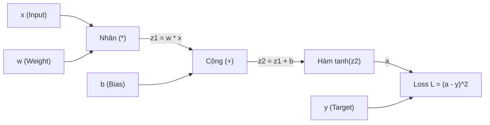
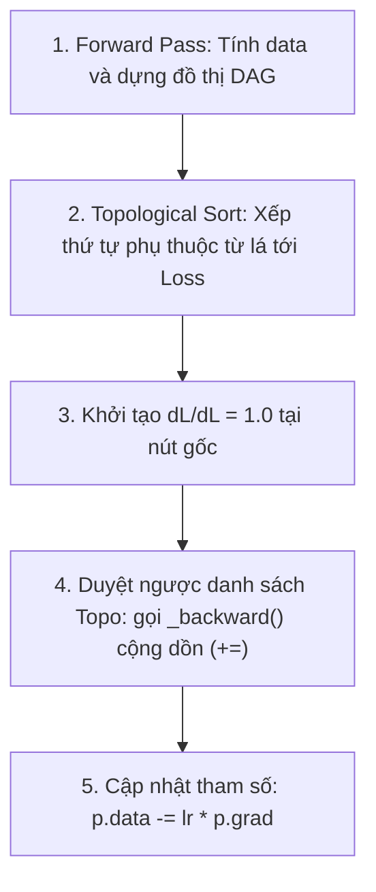

> **[Motto]**: Backpropagation không phải phép màu — nó chỉ là Quy tắc Chuỗi (Chain Rule) chạy ngược trên một đồ thị có hướng không chu trình (DAG), đổi bộ nhớ lấy tốc độ.

---

## Thông tin nhanh (Quick Spec)

* **Loại bài (Type):** Thực chiến (Build)
* **Ngôn ngữ & Công cụ:** Python 3.12 (thuần thư viện chuẩn `math`, `random` — không cần NumPy hay PyTorch)
* **Kiến thức tiên quyết (Prerequisites):** Bài 02 (Multi-Layer Networks), Phase 01 (Đạo hàm & Chain Rule)
* **Thời gian thực hành:** ~75 phút

---

## Mục tiêu bài học (Learning Objectives)

Sau bài học này, bạn sẽ có khả năng:
- [ ] Giải thích vì sao **Reverse-mode Autodiff (Backpropagation)** nhanh hơn hàng triệu lần so với tính đạo hàm số cho mạng nhiều tham số.
- [ ] Tự tay xây dựng một **Scalar Autograd Engine (`Value`)** thuần Python hỗ trợ `+`, `*`, `-`, `**`, `tanh`, `relu` và lan truyền ngược qua **Topological Sort**.
- [ ] Viết bộ kiểm thử **Finite-Difference Gradient Checking** để xác minh độ chính xác của Autograd với sai số dưới $10^{-6}$.
- [ ] Dùng chính động cơ `Value` tự viết để xây dựng và huấn luyện một mạng MLP giải quyết hoàn toàn bài toán **XOR**.

---

## 1. Vấn đề thực tế (The Problem)

> *Một lớp Linear nhỏ trong LLM có 768 đầu vào và 3072 đầu ra — tức hơn 2,35 triệu trọng số. Khi mô hình đoán sai, làm thế nào biết từng trọng số trong 2,35 triệu con số đó phải tăng hay giảm bao nhiêu?*

Cách ngây thơ nhất là dùng định nghĩa đạo hàm số: nhích nhẹ trọng số thứ nhất lên $\epsilon = 10^{-6}$, chạy lại toàn bộ mạng (Forward Pass) để xem Loss đổi bao nhiêu, rồi lặp lại cho 2,35 triệu trọng số còn lại. Kết quả: chỉ để đi **đúng 1 bước cập nhật**, bạn tốn 2,35 triệu lần Forward Pass. Huấn luyện một mô hình thực tế sẽ mất hàng nghìn năm.

**Backpropagation** đảo ngược hoàn toàn bài toán tính toán này: chỉ cần **1 lần Forward Pass** (lưu lại các giá trị trung gian trên đồ thị) và **1 lần Backward Pass**, ta thu được đạo hàm chính xác $\frac{\partial \mathcal{L}}{\partial w_i}$ cho **toàn bộ** hàng triệu (thậm chí hàng trăm tỷ) trọng số cùng một lúc.

---

## 2. Mô hình tư duy & Bản chất (The Concept)

### Đồ thị tính toán (Computational Graph)

Mọi biểu thức toán học trong mạng nơ-ron đều có thể tách thành các phép toán sơ cấp (`+`, `*`, `**`, `tanh`, `relu`) nối với nhau thành một **Đồ thị có hướng không chu trình (DAG)**. Mỗi nút giữ hai thông số: giá trị tính xuôi (`data`) và độ nhạy của hàm mất mát đối với nút đó (`grad` $= \frac{\partial \mathcal{L}}{\partial v}$).



### Quy trình Reverse-mode Autodiff

Trong lượt xuôi (Forward), dữ liệu đi từ trái sang phải và mỗi nút ghi nhớ các nút con tạo ra nó. Trong lượt ngược (Backward), ta sắp xếp đồ thị theo thứ tự Topo (**Topological Sort**) rồi đi ngược từ nút Loss về các lá. Mỗi nút chỉ làm đúng một việc: lấy `upstream grad` từ trên đổ xuống, nhân với `local derivative` của chính nó, rồi **cộng dồn (`+=`)** vào `grad` của các nút con.



### Toán học cốt lõi

**1. Quy tắc Chuỗi đa nhánh (Multivariate Chain Rule):**
Nếu một biến $u$ được sử dụng ở nhiều nhánh khác nhau trong đồ thị (ví dụ xuất hiện đồng thời trong hai phép tính $v_1$ và $v_2$), đạo hàm tổng của nó là **tổng** các đóng góp từ mọi nút cha — đây là lý do trong code bắt buộc dùng `+=` thay vì `=`:

$$\frac{\partial \mathcal{L}}{\partial u} = \sum_{v \in \text{parents}(u)} \frac{\partial \mathcal{L}}{\partial v} \cdot \frac{\partial v}{\partial u}$$

**2. Kiểm chứng Gradient bằng Sai phân hữu hạn trung tâm (Central Finite Difference):**
Mỗi khi cài đặt một phép toán mới (custom kernel hoặc custom autograd), chuẩn vàng để kiểm chứng đạo hàm giải tích là so sánh với xấp xỉ sai phân bậc hai:

$$\frac{\partial \mathcal{L}}{\partial \theta} \approx \frac{\mathcal{L}(\theta + \epsilon) - \mathcal{L}(\theta - \epsilon)}{2\epsilon}, \qquad \epsilon = 10^{-6}$$

**3. Nguyên nhân toán học của Vanishing Gradient:**
Khi lan truyền ngược qua $L$ lớp kích hoạt liên tiếp, gradient bị nhân chuỗi qua $L$ đạo hàm cục bộ:

$$\frac{\partial \mathcal{L}}{\partial z^{[1]}} = \frac{\partial \mathcal{L}}{\partial a^{[L]}} \cdot \sigma'(z^{[L]}) \prod_{l=1}^{L-1} W^{[l+1]T} \sigma'(z^{[l]})$$

Nếu dùng Sigmoid (có cực đại $\sigma'(z) \le 0.25$), sau 10 lớp tích đạo hàm bị thu nhỏ ít nhất $0.25^{10} \approx 9.5 \times 10^{-7}$ lần — các lớp đầu gần như đóng băng không thể học.

---

## 3. Tự tay xây dựng từ đầu (Build It: From Scratch)

Dưới đây là toàn bộ động cơ **Autograd Engine (`Value`)** thuần Python 3.12 (không dùng thư viện ngoài), theo kiến trúc tương tự *micrograd* nhưng được chuẩn hóa rõ ràng, kèm kiểm thử gradient bằng sai phân hữu hạn và huấn luyện mạng MLP giải XOR.

### Bước 1: Cài đặt Scalar `Value` Autograd Engine

```python
import math
import random
from typing import Callable, List, Sequence, Set, Tuple, Union

Number = Union[int, float]


class Value:
    """Nút vô hướng trong đồ thị tính toán hỗ trợ Reverse-mode Autodiff."""

    def __init__(
        self,
        data: float,
        children: Tuple["Value", ...] = (),
        op: str = "",
    ) -> None:
        self.data: float = float(data)
        self.grad: float = 0.0
        self._backward: Callable[[], None] = lambda: None
        self._prev: Set["Value"] = set(children)
        self._op: str = op

    def __repr__(self) -> str:
        return f"Value(data={self.data:.6f}, grad={self.grad:.6f})"

    def __add__(self, other: Union["Value", Number]) -> "Value":
        rhs = other if isinstance(other, Value) else Value(float(other))
        out = Value(self.data + rhs.data, (self, rhs), "+")

        def _backward() -> None:
            self.grad += 1.0 * out.grad
            rhs.grad += 1.0 * out.grad

        out._backward = _backward
        return out

    def __mul__(self, other: Union["Value", Number]) -> "Value":
        rhs = other if isinstance(other, Value) else Value(float(other))
        out = Value(self.data * rhs.data, (self, rhs), "*")

        def _backward() -> None:
            self.grad += rhs.data * out.grad
            rhs.grad += self.data * out.grad

        out._backward = _backward
        return out

    def __pow__(self, exponent: Number) -> "Value":
        if not isinstance(exponent, (int, float)):
            raise TypeError("Số mũ chỉ hỗ trợ int hoặc float.")
        out = Value(self.data ** exponent, (self,), f"**{exponent}")

        def _backward() -> None:
            self.grad += (exponent * (self.data ** (exponent - 1))) * out.grad

        out._backward = _backward
        return out

    def __neg__(self) -> "Value":
        return self * -1.0

    def __sub__(self, other: Union["Value", Number]) -> "Value":
        return self + (-other if isinstance(other, Value) else Value(-float(other)))

    def __radd__(self, other: Number) -> "Value":
        return self + other

    def __rmul__(self, other: Number) -> "Value":
        return self * other

    def __rsub__(self, other: Number) -> "Value":
        return Value(float(other)) + (-self)

    def tanh(self) -> "Value":
        t = math.tanh(self.data)
        out = Value(t, (self,), "tanh")

        def _backward() -> None:
            self.grad += (1.0 - t * t) * out.grad

        out._backward = _backward
        return out

    def relu(self) -> "Value":
        out = Value(self.data if self.data > 0.0 else 0.0, (self,), "relu")

        def _backward() -> None:
            self.grad += (1.0 if self.data > 0.0 else 0.0) * out.grad

        out._backward = _backward
        return out

    def backward(self) -> None:
        """Sắp xếp Topo và lan truyền gradient ngược từ nút hiện tại về mọi lá."""
        topo: List[Value] = []
        visited: Set[Value] = set()

        def build_topo(node: Value) -> None:
            if node not in visited:
                visited.add(node)
                for child in node._prev:
                    build_topo(child)
                topo.append(node)

        build_topo(self)
        self.grad = 1.0
        for node in reversed(topo):
            node._backward()
```

### Bước 2: Kiểm chứng Gradient bằng Sai phân hữu hạn (Gradient Checking)

```python
def verify_autograd_with_finite_diff(eps: float = 1e-6) -> float:
    """So sánh gradient của Value Engine với sai phân trung tâm trên biểu thức chia nhánh."""

    def forward_expr(a_val: float, b_val: float, c_val: float) -> Tuple[Value, List[Value]]:
        a, b, c = Value(a_val), Value(b_val), Value(c_val)
        # Biểu thức cố tình tái sử dụng biến a, b ở nhiều nhánh để kiểm tra phép cộng dồn +=
        branch1 = (a * b + a ** 2 - c).tanh()
        branch2 = (b * 1.5 - a * 0.5 + c).relu()
        loss = (branch1 + branch2 * 0.4) ** 2
        return loss, [a, b, c]

    base_vals = [1.25, -0.8, 0.45]
    loss, params = forward_expr(*base_vals)
    loss.backward()

    max_abs_err = 0.0
    print("=== Kiểm chứng Gradient (Autograd vs Finite Difference) ===")
    for idx, name in enumerate(["a", "b", "c"]):
        plus = base_vals[:]
        minus = base_vals[:]
        plus[idx] += eps
        minus[idx] -= eps
        f_plus = forward_expr(*plus)[0].data
        f_minus = forward_expr(*minus)[0].data
        num_grad = (f_plus - f_minus) / (2.0 * eps)
        ana_grad = params[idx].grad
        err = abs(ana_grad - num_grad)
        max_abs_err = max(max_abs_err, err)
        print(
            f"  dL/d{name}: autograd={ana_grad:+.8f} | numeric={num_grad:+.8f} | err={err:.2e}"
        )

    assert max_abs_err < 1e-6, f"Gradient lệch quá ngưỡng: {max_abs_err}"
    return max_abs_err
```

### Bước 3: Xây dựng MLP trên `Value` và huấn luyện bài toán XOR

```python
class Neuron:
    def __init__(self, n_inputs: int, nonlin: bool, rng: random.Random) -> None:
        scale = (1.0 / n_inputs) ** 0.5
        self.w: List[Value] = [Value(rng.uniform(-scale, scale)) for _ in range(n_inputs)]
        self.b: Value = Value(0.0)
        self.nonlin: bool = nonlin

    def __call__(self, x: Sequence[Value]) -> Value:
        act = sum((wi * xi for wi, xi in zip(self.w, x)), self.b)
        return act.tanh() if self.nonlin else act

    def parameters(self) -> List[Value]:
        return self.w + [self.b]


class Layer:
    def __init__(
        self, n_inputs: int, n_outputs: int, nonlin: bool, rng: random.Random
    ) -> None:
        self.neurons: List[Neuron] = [
            Neuron(n_inputs, nonlin=nonlin, rng=rng) for _ in range(n_outputs)
        ]

    def __call__(self, x: Sequence[Value]) -> List[Value]:
        return [n(x) for n in self.neurons]

    def parameters(self) -> List[Value]:
        return [p for n in self.neurons for p in n.parameters()]


class AutogradMLP:
    """Mạng MLP xây dựng hoàn toàn trên Scalar Value Autograd Engine."""

    def __init__(self, sizes: Sequence[int], seed: int = 42) -> None:
        rng = random.Random(seed)
        self.layers: List[Layer] = [
            Layer(sizes[i], sizes[i + 1], nonlin=(i < len(sizes) - 2), rng=rng)
            for i in range(len(sizes) - 1)
        ]

    def __call__(self, x: Sequence[float]) -> Value:
        vals: List[Value] = [Value(v) for v in x]
        for layer in self.layers:
            vals = layer(vals)
        return vals[0]

    def parameters(self) -> List[Value]:
        return [p for layer in self.layers for p in layer.parameters()]

    def zero_grad(self) -> None:
        for p in self.parameters():
            p.grad = 0.0


if __name__ == "__main__":
    max_err = verify_autograd_with_finite_diff()
    print(f"-> Gradient Check PASSED (max_err = {max_err:.2e})\n")

    xor_data = [
        ([0.0, 0.0], 0.0),
        ([0.0, 1.0], 1.0),
        ([1.0, 0.0], 1.0),
        ([1.0, 1.0], 0.0),
    ]

    mlp = AutogradMLP([2, 4, 1], seed=13)
    lr = 0.15
    start_loss = 0.0
    end_loss = 0.0

    for epoch in range(250):
        total_loss = Value(0.0)
        for inputs, target in xor_data:
            pred = mlp(inputs)
            total_loss = total_loss + (pred - target) ** 2
        mean_loss = total_loss * (1.0 / len(xor_data))

        if epoch == 0:
            start_loss = mean_loss.data
        end_loss = mean_loss.data

        mlp.zero_grad()
        mean_loss.backward()
        for p in mlp.parameters():
            p.data -= lr * p.grad

    print(
        f"=== Huấn luyện MLP [2, 4, 1] trên XOR ({len(mlp.parameters())} tham số) ===\n"
        f"  MSE Loss: {start_loss:.4f} -> {end_loss:.6f}"
    )
    for inputs, target in xor_data:
        out = mlp(inputs).data
        pred_cls = 1 if out >= 0.5 else 0
        print(f"  {inputs} -> {out:+.4f} (pred={pred_cls}, target={int(target)})")
```

---

## 4. Ứng dụng thực tế & So sánh Framework (Use It)

Động cơ `Value` 90 dòng bạn vừa cài đặt có cùng triết lý thiết kế với **PyTorch Autograd** (Define-by-Run / Dynamic Graph): mỗi phép toán trong Forward Pass tự ghi lại hàm `_backward` vào đồ thị động. Điểm khác biệt duy nhất là quy mô: PyTorch vận hành trên **Tensor đa chiều** với nhân tính toán C++/CUDA thay vì số vô hướng Python.

| Tiêu chí | Scalar `Value` (Tự viết) | PyTorch (`torch.autograd`) | JAX (`jax.grad` + `jit`) |
|---|---|---|---|
| **Đơn vị dữ liệu** | Số thực đơn `float` | `torch.Tensor` (CPU/CUDA) | `jax.Array` bất biến (XLA) |
| **Cách dựng đồ thị** | Động theo từng lệnh chạy | Động (Dynamic Graph) + `torch.compile` | Truy vết hàm thuần (Functional Tracing) |
| **Tối ưu bộ nhớ VRAM** | Lưu mọi nút trung gian | Hỗ trợ `checkpoint` & `no_grad()` | Tự động tối ưu hóa đồ thị qua XLA |
| **Ứng dụng chính** | Hiểu tận gốc bản chất Backprop | Chuẩn công nghiệp cho LLM, Vision, Research | Huấn luyện quy mô lớn trên TPU/GPU Cluster |

### Đối chiếu 4 dòng cốt lõi trong PyTorch

```python
loss = criterion(model(X), y)  # Forward Pass + dựng đồ thị động
optimizer.zero_grad()          # Tương đương mlp.zero_grad()
loss.backward()                # Tương đương mean_loss.backward()
optimizer.step()               # Tương đương p.data -= lr * p.grad
```

**Production Tips:**
* **Không bao giờ quên `zero_grad()`:** PyTorch cố tình dùng cơ chế cộng dồn `+=` giống hệt `Value` để hỗ trợ kỹ thuật **Gradient Accumulation** (mô phỏng batch size lớn khi VRAM nhỏ). Quên xóa gradient giữa các bước sẽ làm gradient phình to và mô hình phân kỳ.
* **Bọc `with torch.no_grad():` (hoặc `torch.inference_mode()`) khi Serving:** Khi phục vụ người dùng (LLM inference), tắt Autograd giúp giảm 50–70% lượng VRAM vì hệ thống không cần giữ lại các activation trung gian cho Backward Pass.
* **Activation Checkpointing cho mô hình lớn:** Khi train LLM hàng tỷ tham số, lưu toàn bộ activation của mọi lớp sẽ tràn VRAM; kỹ thuật Gradient Checkpointing chỉ lưu vài mốc quan trọng và tính lại Forward cục bộ lúc Backward — đánh đổi ~30% thời gian tính để tiết kiệm tới 70% bộ nhớ.

---

## 5. Đóng gói & Tái sử dụng (Ship It)

**Checklist kiểm tra & debug Gradient trong huấn luyện mạng nơ-ron:**
- [ ] **Kiểm tra thứ tự 3 bước chuẩn:** `zero_grad()` $\to$ `loss.backward()` $\to$ `optimizer.step()` (hoặc `zero_grad(set_to_none=True)` trong PyTorch để tối ưu hiệu năng).
- [ ] **Chạy Gradient Check khi viết Custom Op:** Mọi lớp toán học viết tay (custom CUDA kernel hay custom `autograd.Function`) đều phải qua kiểm thử sai phân hữu hạn với sai số tương đối dưới $10^{-6}$ trên `float64`.
- [ ] **Giám sát Gradient Norm theo lớp:** Nếu lớp đầu có độ lớn gradient nhỏ hơn $10^{-5}$ so với lớp cuối $\to$ dấu hiệu **Vanishing Gradient**; nếu xuất hiện `NaN` hoặc `> 100` $\to$ bật **Gradient Clipping** (`clip_grad_norm_`).
- [ ] **Kiểm tra bài test Overfit 1 Batch:** Trước khi train cả triệu mẫu, cho mạng chạy 200 bước trên đúng 4–8 mẫu; nếu Loss không giảm sát 0 thì đường truyền gradient của bạn đang bị đứt (ví dụ vô tình dùng `.detach()` hoặc phép gán không khả vi).

**Cheatsheet đạo hàm cục bộ (Local Gradients) cốt lõi:**

| Phép toán Forward | Công thức Backward (nhân với `out.grad`) | Hành vi trực quan trên đồ thị |
|---|---|---|
| $z = a + b$ | $\frac{\partial z}{\partial a} = 1,\; \frac{\partial z}{\partial b} = 1$ | **Bộ phân phối (Distributor):** chia đều `out.grad` về hai nhánh |
| $z = a \cdot b$ | $\frac{\partial z}{\partial a} = b,\; \frac{\partial z}{\partial b} = a$ | **Bộ tráo đổi (Swapper):** mỗi nhánh nhận giá trị nhánh kia nhân `out.grad` |
| $z = a^n$ | $\frac{\partial z}{\partial a} = n \cdot a^{n-1}$ | Quy tắc lũy thừa chuẩn |
| $z = \tanh(a)$ | $\frac{\partial z}{\partial a} = 1 - z^2$ | Tái sử dụng ngay kết quả `z` đã tính lúc Forward |
| $z = \text{ReLU}(a)$ | $\frac{\partial z}{\partial a} = \mathbb{1}(a > 0)$ | **Cổng định tuyến (Router):** cho đi thẳng nếu $a > 0$, chặn hẳn về 0 nếu $a \le 0$ |

---

## 6. Giải ngố thuật ngữ (Key Terms & Misconceptions)

| Thuật ngữ (Term) | Người ta thường nghĩ là... | Bản chất kỹ thuật thực sự là... |
|---|---|---|
| **Backpropagation** | Toàn bộ thuật toán huấn luyện (bao gồm cả cập nhật trọng số). | Chỉ là thuật toán **tính gradient** hiệu quả bằng Chain Rule ngược; việc cập nhật trọng số là nhiệm vụ của **Optimizer** (SGD, AdamW). |
| **Computational Graph** | Sơ đồ kiến trúc tĩnh vẽ sẵn trên giấy trước khi chạy. | Đồ thị DAG các phép toán sơ cấp được tạo ra trong quá trình Forward để ghi vết phụ thuộc dữ liệu phục vụ cho lượt Backward. |
| **Topological Sort** | Thuật toán sắp xếp dữ liệu đầu vào theo thứ tự tăng dần. | Cách duyệt đồ thị đảm bảo mọi nút cha được xử lý xong trước nút con, nhờ đó tổng gradient của mỗi nút được cộng dồn đầy đủ trước khi truyền tiếp. |
| **Autograd** | Một kỹ thuật tính gần đúng đạo hàm bằng sai phân hữu hạn. | Hệ thống **vi phân tự động chính xác đến độ chính xác dấu phẩy động** bằng cách tổ hợp đạo hàm giải tích của từng phép toán nguyên tử. |

---

## 7. Bài tập thử thách (Hands-on Challenges)

1. 🟢 **Cơ bản (Easy):** Bổ sung phương thức `exp()` và `sigmoid()` (sử dụng trực tiếp công thức đạo hàm $s(1 - s)$) vào lớp `Value`. Viết test so sánh kết quả với `verify_autograd_with_finite_diff` và xác nhận sai số nhỏ hơn $10^{-6}$.
2. 🟡 **Trung bình (Medium):** Cài đặt hàm `clip_grad_norm(parameters, max_norm=1.0)` cho `AutogradMLP`: tính chuẩn L2 toàn cục $\|\mathbf{g}\|_2 = \sqrt{\sum_p p.\text{grad}^2}$; nếu lớn hơn `max_norm` thì chia tỷ lệ toàn bộ gradient theo hệ số `max_norm / total_norm`.
3. 🔴 **Nâng cao (Hard):** Xây dựng một mạng sâu 6 lớp `[2, 4, 4, 4, 4, 4, 1]` trên `Value` với hai cấu hình: dùng toàn bộ `sigmoid` vs dùng `relu`. Chạy 1 bước `backward()` và in tỷ lệ trung bình $|p.\text{grad}|$ giữa lớp 1 và lớp 6 để trực tiếp chứng kiến hiện tượng **Vanishing Gradient**.

---

## 8. Tài liệu đọc thêm (Further Reading)

- [Rumelhart, Hinton & Williams (1986) — Learning representations by back-propagating errors (Nature)](https://www.nature.com/articles/323533a0) — *Bài báo bước ngoặt đưa Backpropagation trở thành xương sống của huấn luyện mạng nơ-ron đa lớp.*
- [Andrej Karpathy — micrograd (GitHub)](https://github.com/karpathy/micrograd) — *Kho mã nguồn tối giản kinh điển (~100 dòng Python) minh họa trọn vẹn cách hoạt động của Scalar Autograd Engine.*
- [Baydin et al. (2018) — Automatic Differentiation in Machine Learning: a Survey (JMLR)](https://jmlr.org/papers/v18/17-468.html) — *Tổng quan học thuật chuẩn mực phân biệt rõ Numerical Differentiation, Symbolic Differentiation và Forward/Reverse-mode Autodiff.*
