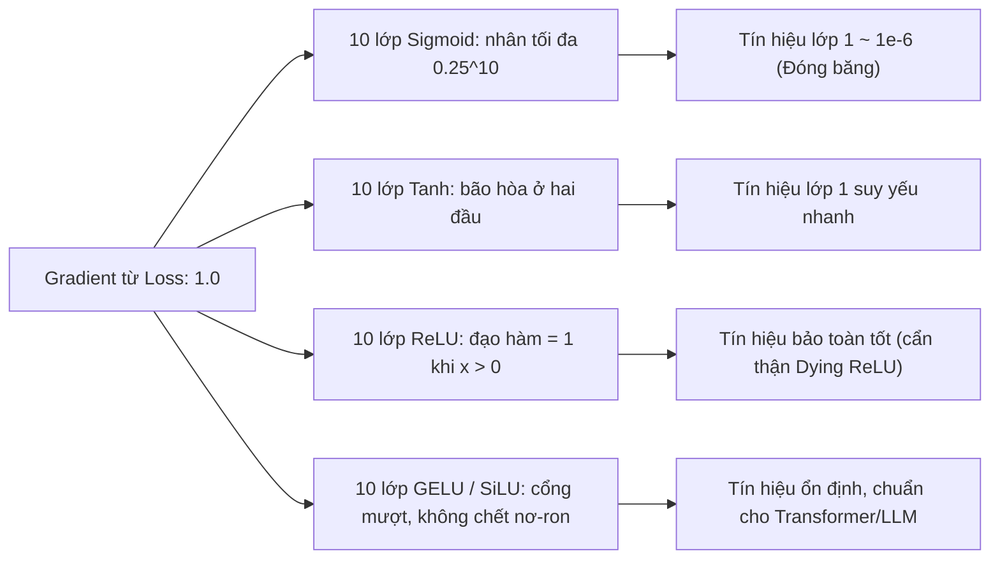
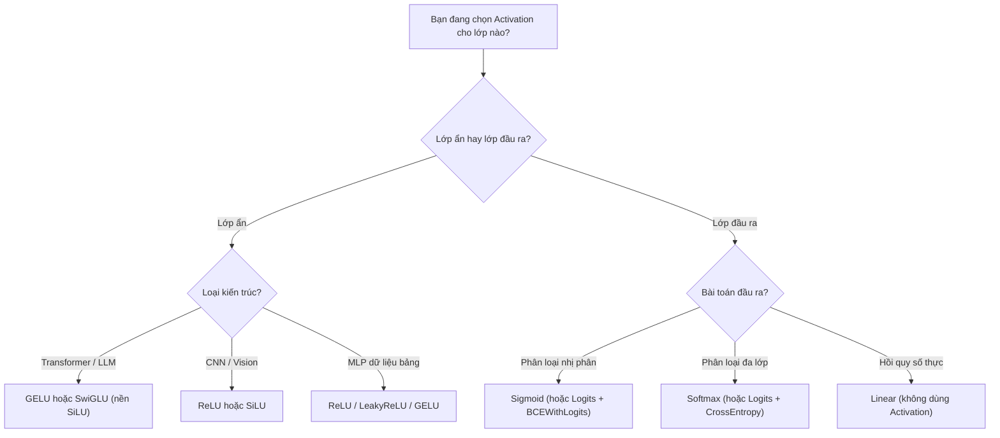

> **[Motto]**: Không có hàm kích hoạt phi tuyến, mạng sâu 100 lớp chỉ là một phép nhân ma trận cồng kềnh; chọn sai hàm kích hoạt, mạng sâu sẽ chết lặng vì gradient biến mất.

---

## Thông tin nhanh (Quick Spec)

* **Loại bài (Type):** Thực chiến (Build)
* **Ngôn ngữ & Công cụ:** Python 3.12 (thuần thư viện chuẩn `math`, `random`)
* **Kiến thức tiên quyết (Prerequisites):** Bài 03 (Backpropagation & Chain Rule)
* **Thời gian thực hành:** ~60 phút

---

## Mục tiêu bài học (Learning Objectives)

Sau bài học này, bạn sẽ có khả năng:
- [ ] Chứng minh vì sao thiếu **tính phi tuyến (Nonlinearity)** khiến mạng nơ-ron sâu sụp đổ về một lớp tuyến tính đơn nhất.
- [ ] Tự tay cài đặt đầy đủ 7 hàm kích hoạt cốt lõi (**Sigmoid, Tanh, ReLU, LeakyReLU, GELU, SiLU, Softmax ổn định số học**) kèm đạo hàm giải tích chính xác.
- [ ] Thực nghiệm đo độ suy giảm luồng gradient qua **10 lớp** để thấy tận mắt cơ chế **Vanishing Gradient** của Sigmoid so với ReLU và GELU.
- [ ] Nhận diện hiện tượng **Dying ReLU** và chọn đúng hàm kích hoạt (bao gồm **SwiGLU**) cho từng kiến trúc mạng và lớp đầu ra trong thực tế.

---

## 1. Vấn đề thực tế (The Problem)

> *Điều gì xảy ra nếu bạn tốn hàng triệu USD thuê GPU huấn luyện một mạng 100 lớp `Linear`, nhưng quên không chèn hàm kích hoạt vào giữa?*

Câu trả lời phũ phàng: toàn bộ 100 lớp đó có sức biểu diễn **y hệt một lớp Linear duy nhất**. Phép nhân ma trận có tính kết hợp: nhân liên tiếp 100 ma trận chỉ tạo ra 1 ma trận duy nhất. Chiều sâu trở thành ảo giác tốn kém.

Hàm kích hoạt (**Activation Function**) phá vỡ tính tuyến tính đó, giúp mạng uốn cong không gian đặc trưng. Nhưng chọn sai hàm kích hoạt lại kéo theo những lỗi chết người trong quá trình huấn luyện:
* Dùng **Sigmoid** cho mạng sâu $\to$ gradient tắt lịm về `0` ở các lớp đầu (**Vanishing Gradient**).
* Dùng **ReLU** với learning rate lớn hoặc bias âm sâu $\to$ 20–40% nơ-ron tắt vĩnh viễn không bao giờ hồi phục (**Dying ReLU**).
* Viết **Softmax** ngây thơ `exp(x) / sum(exp(x))` $\to$ gặp logit lớn (`1000.0`) lập tức nổ `OverflowError` / `NaN`.

---

## 2. Mô hình tư duy & Bản chất (The Concept)

### Chứng minh sự sụp đổ tuyến tính

Xét hai lớp tuyến tính xếp chồng không có hàm kích hoạt: $h = W_1 x + b_1$ và $y = W_2 h + b_2$. Thay $h$ vào $y$:

$$y = W_2(W_1 x + b_1) + b_2 = (W_2 W_1)x + (W_2 b_1 + b_2) = A x + c$$

Dù bạn xếp 2 lớp hay 100 lớp, kết quả vẫn rút gọn về $Ax + c$. Khi chèn hàm phi tuyến $g(\cdot)$ ở giữa ($y = W_2 g(W_1 x + b_1) + b_2$), phép rút gọn lập tức bị chặn lại — mỗi lớp mới thực sự bổ sung thêm nếp gấp phi tuyến cho ranh giới quyết định.

### So sánh luồng Gradient qua 10 lớp



### Toán học cốt lõi của các họ hàm kích hoạt

**1. Họ bão hòa cổ điển (Sigmoid & Tanh):**

$$\sigma(x) = \frac{1}{1 + e^{-x}}, \quad \sigma'(x) = \sigma(x)(1 - \sigma(x)) \le 0.25 \qquad | \qquad \tanh'(x) = 1 - \tanh^2(x) \le 1$$

**2. Họ ReLU và các hàm cổng mượt hiện đại (GELU, SiLU):**

$$\text{ReLU}(x) = \max(0, x), \qquad \text{LeakyReLU}(x) = \max(\alpha x, x), \qquad \text{SiLU}(x) = x \cdot \sigma(x)$$

$$\text{GELU}(x) = x \cdot \Phi(x) = \frac{x}{2}\left(1 + \text{erf}\!\left(\frac{x}{\sqrt{2}}\right)\right), \qquad \text{GELU}'(x) = \Phi(x) + x \cdot \frac{1}{\sqrt{2\pi}} e^{-x^2/2}$$

Khác với ReLU cắt cụt cứng tại 0 (gây nơ-ron chết khi đầu vào âm), **GELU** và **SiLU** (còn gọi là Swish) cho phép một phần nhỏ giá trị âm đi qua với đường cong trơn khắp mọi nơi, giữ gradient mượt ngay quanh vùng $x \approx 0$.

**3. Numerically Stable Softmax (Lớp đầu ra đa lớp):**
Trừ giá trị lớn nhất $m = \max_k x_k$ trước khi lấy hàm mũ giữ nguyên tuyệt đối kết quả toán học nhưng chặn triệt để lỗi tràn số (`exp(1000) -> inf`):

$$\text{Softmax}(x_i) = \frac{e^{x_i - m}}{\sum_{j=1}^{K} e^{x_j - m}}, \qquad m = \max_k x_k$$

### Cây quyết định chọn hàm kích hoạt



---

## 3. Tự tay xây dựng từ đầu (Build It: From Scratch)

Toàn bộ 7 hàm kích hoạt, đạo hàm giải tích, bộ kiểm thử sai phân hữu hạn, mô phỏng luồng gradient qua 10 lớp và bộ phát hiện Dying ReLU dưới đây đều chạy thuần bằng Python 3.12 stdlib.

### Bước 1: Cài đặt 7 hàm kích hoạt và đạo hàm giải tích

```python
import math
import random
from typing import Callable, Dict, List, Sequence, Tuple


def sigmoid(x: float) -> float:
    x_clamped = max(-500.0, min(500.0, x))
    return 1.0 / (1.0 + math.exp(-x_clamped))


def sigmoid_grad(x: float) -> float:
    s = sigmoid(x)
    return s * (1.0 - s)


def tanh_act(x: float) -> float:
    return math.tanh(x)


def tanh_grad(x: float) -> float:
    t = math.tanh(x)
    return 1.0 - t * t


def relu(x: float) -> float:
    return x if x > 0.0 else 0.0


def relu_grad(x: float) -> float:
    return 1.0 if x > 0.0 else 0.0


def leaky_relu(x: float, alpha: float = 0.01) -> float:
    return x if x > 0.0 else alpha * x


def leaky_relu_grad(x: float, alpha: float = 0.01) -> float:
    return 1.0 if x > 0.0 else alpha


def gelu(x: float) -> float:
    """GELU chính xác dùng hàm lỗi Gauss erf(x / sqrt(2))."""
    return 0.5 * x * (1.0 + math.erf(x / math.sqrt(2.0)))


def gelu_grad(x: float) -> float:
    phi = 0.5 * (1.0 + math.erf(x / math.sqrt(2.0)))
    pdf = math.exp(-0.5 * x * x) / math.sqrt(2.0 * math.pi)
    return phi + x * pdf


def silu(x: float) -> float:
    """SiLU / Swish: x * sigmoid(x) — lõi của SwiGLU trong các LLM hiện đại."""
    return x * sigmoid(x)


def silu_grad(x: float) -> float:
    s = sigmoid(x)
    return s * (1.0 + x * (1.0 - s))


def softmax_stable(logits: Sequence[float]) -> List[float]:
    """Softmax ổn định số học chống overflow với logits biên độ lớn."""
    max_val = max(logits)
    exps = [math.exp(v - max_val) for v in logits]
    denom = sum(exps)
    return [e / denom for e in exps]
```

### Bước 2: Kiểm chứng đạo hàm, thực nghiệm luồng Gradient 10 lớp và Dying ReLU

```python
def verify_derivatives(
    activations: Dict[str, Tuple[Callable[[float], float], Callable[[float], float]]],
    eps: float = 1e-6,
) -> None:
    """Đối chiếu đạo hàm giải tích với sai phân trung tâm tại các điểm không gãy."""
    test_points = [-2.5, -0.7, 0.4, 1.8]
    print("=== 1. Kiểm chứng đạo hàm giải tích ===")
    for name, (fn, grad_fn) in activations.items():
        max_err = 0.0
        for x in test_points:
            num = (fn(x + eps) - fn(x - eps)) / (2.0 * eps)
            ana = grad_fn(x)
            max_err = max(max_err, abs(ana - num))
        assert max_err < 1e-6, f"{name} sai lệch đạo hàm: {max_err}"
        print(f"  {name:10s}: max_err = {max_err:.2e} [PASS]")


def ten_layer_gradient_flow(
    fn: Callable[[float], float],
    grad_fn: Callable[[float], float],
    n_layers: int = 10,
    width: int = 16,
    trials: int = 40,
    seed: int = 42,
) -> Tuple[float, float]:
    """Mô phỏng độ lớn gradient truyền ngược qua 10 lớp (từ lớp 10 về lớp 1)."""
    rng = random.Random(seed)
    # Chuẩn phương sai trọng số theo fan-in: std = sqrt(2 / width) cho họ ReLU/GELU
    std = math.sqrt(2.0 / width)
    layer10_mags: List[float] = []
    layer1_mags: List[float] = []

    for _ in range(trials):
        # Forward: lưu pre-activation z của từng lớp
        act = [rng.gauss(0.0, 1.0) for _ in range(width)]
        weights_all: List[List[List[float]]] = []
        z_all: List[List[float]] = []

        for _layer in range(n_layers):
            W = [[rng.gauss(0.0, std) for _ in range(width)] for _ in range(width)]
            z = [sum(W[i][j] * act[j] for j in range(width)) for i in range(width)]
            act = [fn(v) for v in z]
            weights_all.append(W)
            z_all.append(z)

        # Backward: khởi tạo dL/da_last = 1 / sqrt(width) (chuẩn L2 = 1.0)
        d_act = [1.0 / math.sqrt(width) for _ in range(width)]
        for layer_idx in reversed(range(n_layers)):
            d_z = [d_act[i] * grad_fn(z_all[layer_idx][i]) for i in range(width)]
            norm_dz = math.sqrt(sum(v * v for v in d_z))
            if layer_idx == n_layers - 1:
                layer10_mags.append(norm_dz)
            if layer_idx == 0:
                layer1_mags.append(norm_dz)
            W = weights_all[layer_idx]
            d_act = [
                sum(W[i][j] * d_z[i] for i in range(width)) for j in range(width)
            ]

    avg_l10 = sum(layer10_mags) / len(layer10_mags)
    avg_l1 = sum(layer1_mags) / len(layer1_mags)
    return avg_l10, avg_l1


def detect_dying_neurons(
    act_fn: Callable[[float], float],
    n_inputs: int = 8,
    n_neurons: int = 50,
    n_samples: int = 200,
    bias_shift: float = -2.5,
    seed: int = 7,
) -> float:
    """Đo tỷ lệ phần trăm nơ-ron có đầu ra luôn bằng 0 trên toàn bộ tập mẫu."""
    rng = random.Random(seed)
    W = [[rng.gauss(0.0, 0.5) for _ in range(n_inputs)] for _ in range(n_neurons)]
    # Mô phỏng trường hợp bias bị đẩy xuống âm sâu sau một bước cập nhật mạnh
    b = [rng.gauss(bias_shift, 1.0) for _ in range(n_neurons)]
    samples = [[rng.gauss(0.0, 1.0) for _ in range(n_inputs)] for _ in range(n_samples)]

    dead_count = 0
    for i in range(n_neurons):
        active = False
        for x in samples:
            z = sum(w * xi for w, xi in zip(W[i], x)) + b[i]
            if abs(act_fn(z)) > 1e-12:
                active = True
                break
        if not active:
            dead_count += 1
    return dead_count / n_neurons * 100.0


if __name__ == "__main__":
    activations = {
        "Sigmoid": (sigmoid, sigmoid_grad),
        "Tanh": (tanh_act, tanh_grad),
        "ReLU": (relu, relu_grad),
        "LeakyReLU": (leaky_relu, leaky_relu_grad),
        "GELU": (gelu, gelu_grad),
        "SiLU": (silu, silu_grad),
    }

    verify_derivatives(activations)

    print("\n=== 2. Thực nghiệm luồng Gradient qua 10 lớp ===")
    print(f"  {'Activation':10s} | {'Grad Lớp 10':>12s} | {'Grad Lớp 1':>12s} | {'Tỷ lệ L1/L10':>12s}")
    for name, (fn, grad_fn) in activations.items():
        g10, g1 = ten_layer_gradient_flow(fn, grad_fn)
        ratio = g1 / g10 if g10 > 0 else 0.0
        print(f"  {name:10s} | {g10:12.6f} | {g1:12.6e} | {ratio:12.6e}")

    print("\n=== 3. Kiểm tra Dying Neuron (bias lệch âm) ===")
    for name in ["ReLU", "LeakyReLU", "GELU", "SiLU"]:
        dead_pct = detect_dying_neurons(activations[name][0])
        print(f"  {name:10s}: {dead_pct:5.1f}% nơ-ron chết hoàn toàn")

    extreme_logits = [1000.0, 1001.0, 999.0]
    probs = softmax_stable(extreme_logits)
    print("\n=== 4. Numerically Stable Softmax trên logits cực lớn ===")
    print(f"  logits={extreme_logits} -> probs={[round(p, 4) for p in probs]} (sum={sum(probs):.4f})")
```

---

## 4. Ứng dụng thực tế & So sánh Framework (Use It)

Trong thế hệ LLM hiện đại (Llama 3, Mistral, Gemma, Qwen), các hàm kích hoạt đơn lẻ như ReLU đã dần nhường chỗ cho **GELU** và đặc biệt là cơ chế cổng nhân **SwiGLU** ($\text{SwiGLU}(x) = \text{SiLU}(x W_{\text{gate}}) \odot (x W_{\text{up}})$), giúp tăng chất lượng mô hình ngôn ngữ rõ rệt trên cùng ngân sách tính toán FLOPs.

| Hàm kích hoạt | Miền giá trị | PyTorch API | Điểm mạnh & Vị trí dùng phổ biến nhất |
|---|---|---|---|
| **Sigmoid** | $(0, 1)$ | `nn.Sigmoid()` / `F.sigmoid` | Lớp đầu ra phân loại nhị phân, cổng quên/nhớ trong LSTM; **tránh dùng ở lớp ẩn sâu** |
| **Tanh** | $(-1, 1)$ | `nn.Tanh()` / `F.tanh` | Đối xứng quanh 0; dùng trong RNN/LSTM và bài toán RL đầu ra giới hạn $[-1, 1]$ |
| **ReLU** | $[0, +\infty)$ | `nn.ReLU()` / `F.relu` | Cực nhanh, không bão hòa miền dương; chuẩn mực cho CNN (ResNet) và MLP tốc độ cao |
| **LeakyReLU** | $(-\infty, +\infty)$ | `nn.LeakyReLU(0.01)` | Chống Dying ReLU đơn giản trong GAN và các mạng dễ gặp gradient âm |
| **GELU** | $\approx (-0.17, +\infty)$ | `nn.GELU()` / `F.gelu` | Trơn khắp nơi, mặc định cho BERT, GPT-2/3, Vision Transformer (ViT) |
| **SiLU / SwiGLU** | $\approx (-0.28, +\infty)$ | `nn.SiLU()` / `F.silu` | Mượt, hiệu suất cao nhất trong khối FFN của Llama 2/3, Mistral, DeepSeek, EfficientNet |
| **Softmax** | $(0, 1)^K$, tổng $= 1$ | `F.softmax(x, dim=-1)` | Lớp đầu ra phân loại đa lớp và tính trọng số Attention trong Transformer |

**Production Tips:**
* **Không bao giờ gắn `Softmax` cuối mạng khi dùng `nn.CrossEntropyLoss`:** PyTorch `CrossEntropyLoss` (và `BCEWithLogitsLoss`) nhận **logits thô** trực tiếp và gộp Log-Sum-Exp vào một kernel duy nhất để vừa nhanh hơn vừa tránh sai số làm tròn `log(softmax(x))`.
* **Đồng bộ Activation với Weight Initialization:** Dùng **Xavier/Glorot Init** cho Sigmoid/Tanh, và **He/Kaiming Init** ($\sqrt{2/n_{\text{in}}}$) cho ReLU/LeakyReLU/GELU để giữ phương sai tín hiệu ổn định ngay từ bước 0.
* **Cẩn thận `inplace=True` với `ReLU`:** Dùng `nn.ReLU(inplace=True)` tiết kiệm RAM nhưng có thể gây lỗi Autograd nếu tensor đầu vào còn được dùng ở nhánh Residual Connection (Skip Connection).

---

## 5. Đóng gói & Tái sử dụng (Ship It)

**Checklist chọn Activation & xử lý sự cố trong thực chiến:**
- [ ] **Mặc định an toàn cho lớp ẩn:** Bắt đầu với `ReLU` cho CNN/MLP đơn giản hoặc `GELU`/`SiLU` cho Transformer và bài toán đòi hỏi chất lượng tối đa.
- [ ] **Đúng hàm cho lớp đầu ra:** Nhị phân $\to$ trả về logits + `BCEWithLogitsLoss`; Đa lớp $\to$ trả về logits + `CrossEntropyLoss`; Hồi quy $\to$ không dùng activation.
- [ ] **Bắt bệnh Dying ReLU:** Theo dõi tỷ lệ phần tử bằng 0 sau mỗi lớp ReLU; nếu trên 30–50% nơ-ron tắt vĩnh viễn, hãy giảm Learning Rate, kiểm tra khởi tạo trọng số hoặc chuyển sang `GELU` / `LeakyReLU`.
- [ ] **Không bao giờ viết `exp(x)` trần cho Softmax:** Luôn trừ `max(x)` theo chiều phân loại (hoặc dùng `log_softmax` của framework).

**Cheatsheet công thức, đạo hàm cực đại và Failure Modes:**

| Hàm | Đạo hàm $\phi'(x)$ | Cực đại $\phi'(x)$ | Failure Mode chính |
|---|---|---|---|
| **Sigmoid** | $s(1 - s)$ | `0.25` (tại $x=0$) | Vanishing Gradient cực nặng; đầu ra không đối xứng quanh 0 |
| **Tanh** | $1 - t^2$ | `1.0` (tại $x=0$) | Vẫn bão hòa (Vanishing) khi $|x| > 3$ |
| **ReLU** | $1$ nếu $x > 0$, ngược lại $0$ | `1.0` | Dying ReLU (nơ-ron chết khi $z \le 0$ trên toàn tập train) |
| **LeakyReLU** | $1$ nếu $x > 0$, ngược lại $\alpha$ | `1.0` | Thêm siêu tham số $\alpha$; không trơn tại $x = 0$ |
| **GELU** | $\Phi(x) + x \cdot \mathcal{N}(x;0,1)$ | $\approx 1.08$ | Chi phí tính toán cao hơn ReLU đôi chút trên thiết bị biên (Edge) |
| **SiLU** | $s(1 + x(1 - s))$ | $\approx 1.10$ | Tương tự GELU: tốn tính toán hơn ReLU nhưng cực mạnh trên GPU |

---

## 6. Giải ngố thuật ngữ (Key Terms & Misconceptions)

| Thuật ngữ (Term) | Người ta thường nghĩ là... | Bản chất kỹ thuật thực sự là... |
|---|---|---|
| **Vanishing Gradient** | Lỗi lập trình làm mất biến gradient trong code. | Hệ quả toán học khi nhân liên tiếp các đạo hàm nhỏ hơn 1 (như Sigmoid $\le 0.25$) qua nhiều lớp, khiến gradient lớp đầu nhỏ đến mức trọng số đứng yên. |
| **Dying ReLU** | Nơ-ron bị xóa khỏi bộ nhớ sau khi huấn luyện xong. | Trạng thái một nơ-ron ReLU luôn nhận tổng $z \le 0$ trên mọi mẫu dữ liệu, khiến cả đầu ra lẫn đạo hàm đều bằng 0 và không thể tự cập nhật lại được nữa. |
| **Logits** | Xác suất nằm trong đoạn $[0, 1]$ mà mô hình dự đoán. | Điểm số thô chưa chuẩn hóa ở lớp cuối cùng có miền $(-\infty, +\infty)$, **trước khi** đi qua Sigmoid hay Softmax. |
| **SwiGLU** | Một hàm kích hoạt đơn biến thay thế trực tiếp cho ReLU. | Một khối tuyến tính có cổng (Gated Linear Unit) gồm hai nhánh chiếu song song $\text{SiLU}(xW_1) \odot (xW_2)$, dùng rộng rãi trong FFN của LLM hiện đại. |

---

## 7. Bài tập thử thách (Hands-on Challenges)

1. 🟢 **Cơ bản (Easy):** Cài đặt hàm kích hoạt **ELU** ($\text{ELU}(x) = x$ nếu $x > 0$, ngược lại $\alpha(e^x - 1)$ với $\alpha = 1.0$) cùng đạo hàm giải tích của nó, thêm vào `verify_derivatives` và chạy kiểm chứng với sai số dưới $10^{-6}$.
2. 🟡 **Trung bình (Medium):** Nâng cấp hàm `softmax_stable(logits, temperature=1.0)` bằng cách chia `logits` cho tham số **Temperature** $T > 0$ trước khi chuẩn hóa. Chạy thử trên `[2.0, 1.0, 0.1]` với $T \in \{0.2, 1.0, 3.0\}$ để quan sát cách LLM kiểm soát mức độ "tự tin" hay "sáng tạo" khi chọn token tiếp theo.
3. 🔴 **Nâng cao (Hard):** Tự cài đặt một khối **SwiGLU** thuần Python nhận đầu vào chiều $d$ và chiều ẩn $h$: $\text{SwiGLU}(x) = (\text{SiLU}(x W_{\text{gate}}) \odot (x W_{\text{up}})) W_{\text{down}}$. Tính tỷ lệ chiều ẩn $h$ cần thiết (gợi ý: $\frac{2}{3} \cdot 4d$) để SwiGLU có tổng số tham số tương đương với FFN 2 lớp truyền thống dùng ReLU có chiều ẩn $4d$.

---

## 8. Tài liệu đọc thêm (Further Reading)

- [Nair & Hinton (2010) — Rectified Linear Units Improve Restricted Boltzmann Machines (ICML)](https://www.cs.toronto.edu/~fritz/absps/reluICML.pdf) — *Bài báo đưa ReLU vào kỷ nguyên Deep Learning hiện đại và phá vỡ rào cản huấn luyện mạng sâu.*
- [Hendrycks & Gimpel (2016) — Gaussian Error Linear Units (GELUs)](https://arxiv.org/abs/1606.08415) — *Giới thiệu hàm GELU và giải thích nền tảng xác suất đằng sau hiệu quả vượt trội của nó trên Transformer.*
- [Noam Shazeer (2020) — GLU Variants Improve Transformer](https://arxiv.org/abs/2002.05202) — *Nghiên cứu thực nghiệm chứng minh sức mạnh của SwiGLU và GeGLU — chuẩn kiến trúc FFN của hầu hết LLM ngày nay.*
