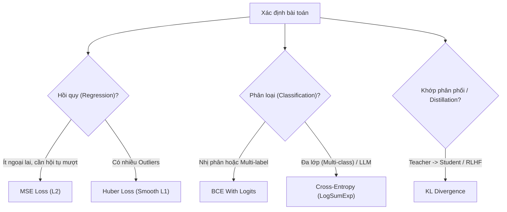

> **[Motto]**: Mô hình không tối ưu Accuracy hay F1 của bạn — nó chỉ tối ưu duy nhất hàm Loss; chọn sai Loss đồng nghĩa với dạy mô hình đi sai hướng.

---

## Thông tin nhanh (Quick Spec)

* **Loại bài (Type):** Thực chiến (Build)
* **Ngôn ngữ & Công cụ:** Python 3.12 (Standard Library)
* **Kiến thức tiên quyết (Prerequisites):** Bài 03 (Backpropagation), Bài 04 (Activation Functions)
* **Thời gian thực hành:** ~60 phút

---

## Mục tiêu bài học (Learning Objectives)

Sau bài học này, bạn sẽ có khả năng:
- [ ] Giải thích tại sao **MSE** thất bại trên bài toán phân loại và khi nào cần thay bằng **Huber Loss** trong bài toán hồi quy có ngoại lai (outliers).
- [ ] Tự tay cài đặt **MSE**, **Huber Loss**, **Binary Cross-Entropy (từ logits)**, **Cross-Entropy (LogSumExp trick)** và **KL Divergence** kèm đạo hàm chính xác thuần Python.
- [ ] Chứng minh và kiểm chứng bằng sai phân hữu hạn rằng đạo hàm của Softmax + Cross-Entropy rút gọn về đúng $\text{softmax}(z) - y$.
- [ ] Tránh lỗi tràn số `NaN`/`Inf` khi huấn luyện mạng sâu bằng cách thao tác trực tiếp trên logits thay vì xác suất đã qua Sigmoid/Softmax.

---

## 1. Vấn đề thực tế (The Problem)

> *Tại sao Accuracy của mô hình phân loại cứ đứng im ở mức 50% dù Loss đã giảm xuống gần đáy?*

Trong thực tế, Optimizer không hề biết Accuracy, F1-score hay doanh thu của bạn là gì. Thứ duy nhất Optimizer nhìn thấy là **một con số vô hướng từ hàm Loss** và vector đạo hàm của nó. Nếu hàm Loss không phản ánh đúng bản chất sai lỗi của bài toán, mạng Neural sẽ luôn tìm con đường toán học rẻ nhất để "gian lận" thước đo đó.

Xét hai sự cố kinh điển ngoài production:

1. **Dùng MSE cho bài toán phân loại nhị phân (50/50):** Khi mô hình đoán xác suất `0.5` cho mọi mẫu, MSE trung bình chỉ còn `0.25` — trông khá nhỏ nhưng mô hình hoàn toàn vô dụng. Tệ hơn, khi đầu ra qua Sigmoid bị sai nặng ($y = 1$ nhưng $\hat{p} = 0.001$), đạo hàm của Sigmoid là $\hat{p}(1-\hat{p}) \approx 0.001$ triệt tiêu luôn tín hiệu cập nhật trọng số. Mô hình bị "kẹt" ngay tại vùng sai lầm tự tin nhất.
2. **Dùng MSE cho hồi quy khi dữ liệu có Outlier:** Trong dự đoán giá nhà, 99 căn lệch khoảng 10.000 USD nhưng 1 căn biệt thự bị lỗi nhập liệu lệch 500.000 USD. Vì MSE bình phương sai số, riêng 1 mẫu lỗi đó tạo ra Gradient lớn gấp 2.500 lần mẫu thường, kéo lệch toàn bộ mô hình.
3. **Tính `log(softmax(z))` ngây thơ:** Khi logit $z_k = 1000$, phép tính `exp(1000)` lập tức tràn số thành `inf`, kéo theo `inf / inf = NaN`, phá hủy toàn bộ trọng số sau 1 bước huấn luyện.

---

## 2. Mô hình tư duy & Bản chất (The Concept)

### Cây quyết định chọn hàm Loss



### Toán học cốt lõi (KaTeX)

#### 1. MSE và Huber Loss (Hồi quy)

Với sai số $e_i = \hat{y}_i - y_i$, **Mean Squared Error (MSE)** phạt bình phương sai số, còn **Huber Loss** kết hợp MSE cho sai số nhỏ ($|e| \le \delta$) và MAE tuyến tính cho sai số lớn ($|e| > \delta$) để chặn đứng ảnh hưởng của Outliers:

$$\mathcal{L}_{\text{MSE}} = \frac{1}{N} \sum_{i=1}^{N} (\hat{y}_i - y_i)^2, \qquad \mathcal{L}_{\text{Huber}}(e; \delta) = \begin{cases} \frac{1}{2} e^2 & \text{nếu } |e| \le \delta \\ \delta \left(|e| - \frac{1}{2}\delta\right) & \text{nếu } |e| > \delta \end{cases}$$

Đạo hàm của Huber Loss bị giới hạn trong đoạn $[-\delta, +\delta]$ nên một điểm ngoại lai không bao giờ gây bùng nổ Gradient.

#### 2. Binary Cross-Entropy ổn định từ Logits

Thay vì tính $p = \sigma(z)$ rồi mới lấy $-\log(p)$ (dễ gây `log(0)` hoặc `exp(1000)`), ta biến đổi đại số trực tiếp từ raw logit $z$:

$$\mathcal{L}_{\text{BCE}}(z, y) = \max(z, 0) - z \cdot y + \log\left(1 + e^{-|z|}\right)$$

Bởi vì $-|z| \le 0$ với mọi $z \in \mathbb{R}$, giá trị $e^{-|z|}$ luôn nằm an toàn trong $(0, 1]$, tuyệt đối không bao giờ tràn số. Và đạo hàm theo logit $z$ triệt tiêu hoàn toàn thành phần bão hòa của Sigmoid:

$$\frac{\partial \mathcal{L}_{\text{BCE}}}{\partial z} = \sigma(z) - y$$

#### 3. Cross-Entropy với LogSumExp Trick

Với vector raw logits $z \in \mathbb{R}^K$ và nhãn thật one-hot $y$ (tại chỉ số lớp đúng $c$), đặt $m = \max_k z_k$. Áp dụng **LogSumExp trick**:

$$\mathcal{L}_{\text{CE}}(z, c) = -z_c + m + \log \sum_{k=1}^{K} e^{z_k - m}$$

Khi lấy đạo hàm theo từng logit $z_i$, kết quả rút gọn cực đẹp và không bị triệt tiêu ở vùng tự tin sai:

$$\frac{\partial \mathcal{L}_{\text{CE}}}{\partial z_i} = \text{softmax}(z)_i - y_i$$

#### 4. KL Divergence và mối liên hệ với Cross-Entropy

**Kullback-Leibler (KL) Divergence** đo lượng thông tin bị mất khi dùng phân phối dự đoán $Q$ để xấp xỉ phân phối mục tiêu $P$:

$$D_{\mathrm{KL}}(P \Vert Q) = \sum_{i=1}^{K} P(i) \log \frac{P(i)}{Q(i)} = \underbrace{-\sum_{i=1}^{K} P(i) \log Q(i)}_{H(P, Q)\text{ (Cross-Entropy)}} - \underbrace{\left(-\sum_{i=1}^{K} P(i) \log P(i)\right)}_{H(P)\text{ (Entropy của }P\text{)}}$$

Vì $H(P)$ là hằng số đối với tham số mô hình, tối thiểu hóa Cross-Entropy chính là tối thiểu hóa $D_{\mathrm{KL}}(P \Vert Q)$. Lưu ý quan trọng: KL Divergence **không đối xứng** ($D_{\mathrm{KL}}(P \Vert Q) \neq D_{\mathrm{KL}}(Q \Vert P)$).

---

## 3. Tự tay xây dựng từ đầu (Build It: From Scratch)

Toàn bộ phần cài đặt dưới đây chỉ sử dụng thư viện chuẩn Python 3.12 (`math`), không phụ thuộc thư viện ngoài, nhưng bảo đảm ổn định số học như cài đặt cấp framework.

### Bước 1: MSE và Huber Loss kèm đạo hàm

```python
import math
from typing import Sequence


def mse_loss(y_pred: Sequence[float], y_true: Sequence[float]) -> float:
    """Mean Squared Error: trung bình bình phương sai số."""
    n = len(y_pred)
    return sum((p - t) ** 2 for p, t in zip(y_pred, y_true)) / n


def mse_grad(y_pred: Sequence[float], y_true: Sequence[float]) -> list[float]:
    """Đạo hàm của MSE theo từng dự đoán y_pred."""
    n = len(y_pred)
    return [2.0 * (p - t) / n for p, t in zip(y_pred, y_true)]


def huber_loss(
    y_pred: Sequence[float], y_true: Sequence[float], delta: float = 1.0
) -> float:
    """Huber Loss: bậc hai khi |e| <= delta, tuyến tính khi |e| > delta."""
    n = len(y_pred)
    total = 0.0
    for p, t in zip(y_pred, y_true):
        err = abs(p - t)
        if err <= delta:
            total += 0.5 * err * err
        else:
            total += delta * (err - 0.5 * delta)
    return total / n


def huber_grad(
    y_pred: Sequence[float], y_true: Sequence[float], delta: float = 1.0
) -> list[float]:
    """Đạo hàm của Huber Loss, bị chặn trong [-delta/n, +delta/n]."""
    n = len(y_pred)
    grads: list[float] = []
    for p, t in zip(y_pred, y_true):
        diff = p - t
        if abs(diff) <= delta:
            grads.append(diff / n)
        else:
            grads.append(math.copysign(delta, diff) / n)
    return grads
```

### Bước 2: Binary Cross-Entropy ổn định từ Logits

```python
def stable_sigmoid(z: float) -> float:
    """Sigmoid không tràn số cho cả logit dương rất lớn lẫn âm rất lớn."""
    if z >= 0.0:
        exp_neg = math.exp(-z)
        return 1.0 / (1.0 + exp_neg)
    exp_pos = math.exp(z)
    return exp_pos / (1.0 + exp_pos)


def bce_with_logits(logits: Sequence[float], targets: Sequence[float]) -> float:
    """Binary Cross-Entropy ổn định: max(z, 0) - z*y + log(1 + exp(-|z|))."""
    n = len(logits)
    total = 0.0
    for z, y in zip(logits, targets):
        total += max(z, 0.0) - z * y + math.log1p(math.exp(-abs(z)))
    return total / n


def bce_with_logits_grad(
    logits: Sequence[float], targets: Sequence[float]
) -> list[float]:
    """Đạo hàm dL/dz = (sigmoid(z) - y) / n."""
    n = len(logits)
    return [(stable_sigmoid(z) - y) / n for z, y in zip(logits, targets)]
```

### Bước 3: Cross-Entropy (LogSumExp Trick) và KL Divergence

```python
def log_sum_exp(logits: Sequence[float]) -> float:
    """Tính log(sum(exp(z_i))) an toàn không tràn số."""
    m = max(logits)
    return m + math.log(sum(math.exp(z - m) for z in logits))


def softmax(logits: Sequence[float]) -> list[float]:
    """Softmax ổn định bằng cách trừ đi max(logits)."""
    m = max(logits)
    exps = [math.exp(z - m) for z in logits]
    denom = sum(exps)
    return [e / denom for e in exps]


def cross_entropy_from_logits(logits: Sequence[float], target_idx: int) -> float:
    """Cross-Entropy cho 1 mẫu dùng trực tiếp LogSumExp trick."""
    return -logits[target_idx] + log_sum_exp(logits)


def cross_entropy_grad(logits: Sequence[float], target_idx: int) -> list[float]:
    """Đạo hàm dL/dz = softmax(z) - y_onehot."""
    probs = softmax(logits)
    probs[target_idx] -= 1.0
    return probs


def kl_divergence(
    p: Sequence[float], q: Sequence[float], eps: float = 1e-12
) -> float:
    """Tính D_KL(P || Q) = sum(P_i * log(P_i / Q_i))."""
    total = 0.0
    for pi, qi in zip(p, q):
        if pi > 0.0:
            q_safe = max(qi, eps)
            total += pi * math.log(pi / q_safe)
    return total
```

### Bước 4: Kiểm chứng ổn định số học, Outlier và Gradient Check

```python
if __name__ == "__main__":
    print("=== 1. MSE vs Huber trước Outlier ===")
    y_true = [10.0, 10.5, 9.8, 10.2, 100.0]  # Mẫu cuối là Outlier cực mạnh
    y_pred = [10.1, 10.4, 9.9, 10.0, 10.0]
    print(f"MSE Loss   : {mse_loss(y_pred, y_true):.4f} | Max |grad|: {max(abs(g) for g in mse_grad(y_pred, y_true)):.4f}")
    print(f"Huber Loss : {huber_loss(y_pred, y_true, delta=1.0):.4f} | Max |grad|: {max(abs(g) for g in huber_grad(y_pred, y_true, delta=1.0)):.4f}")

    print("\n=== 2. BCE With Logits ở giá trị cực đoan ===")
    extreme_logits = [1000.0, -1000.0, 0.0]
    targets = [1.0, 0.0, 1.0]
    print(f"BCE Loss (z=+/-1000): {bce_with_logits(extreme_logits, targets):.6f}")
    print(f"BCE Grads           : {[round(g, 4) for g in bce_with_logits_grad(extreme_logits, targets)]}")

    print("\n=== 3. Cross-Entropy (LogSumExp) & Finite-Difference Grad Check ===")
    logits = [1002.0, 1005.0, 1001.0]  # exp(1005) sẽ tràn số nếu không dùng LogSumExp
    target_idx = 1
    ce_val = cross_entropy_from_logits(logits, target_idx)
    analytic_grad = cross_entropy_grad(logits, target_idx)

    eps = 1e-6
    numeric_grad = []
    for i in range(len(logits)):
        plus = list(logits)
        minus = list(logits)
        plus[i] += eps
        minus[i] -= eps
        numeric_grad.append(
            (cross_entropy_from_logits(plus, target_idx) - cross_entropy_from_logits(minus, target_idx))
            / (2.0 * eps)
        )
    max_diff = max(abs(a - b) for a, b in zip(analytic_grad, numeric_grad))
    print(f"CE Loss (logits ~1000): {ce_val:.6f}")
    print(f"Analytic grad         : {[round(g, 6) for g in analytic_grad]}")
    print(f"Max grad check error  : {max_diff:.2e}")

    print("\n=== 4. KL Divergence: Tính bất đối xứng & Liên hệ Cross-Entropy ===")
    p_dist = [0.7, 0.2, 0.1]
    q_dist = [0.4, 0.4, 0.2]
    kl_pq = kl_divergence(p_dist, q_dist)
    kl_qp = kl_divergence(q_dist, p_dist)
    entropy_p = -sum(pi * math.log(pi) for pi in p_dist)
    ce_pq = -sum(pi * math.log(qi) for pi, qi in zip(p_dist, q_dist))
    print(f"D_KL(P || Q) = {kl_pq:.6f} != D_KL(Q || P) = {kl_qp:.6f}")
    print(f"H(P) + D_KL(P || Q) = {entropy_p + kl_pq:.6f} == CE(P, Q) = {ce_pq:.6f}")
```

---

## 4. Ứng dụng thực tế & So sánh Framework (Use It)

| Hàm Loss | PyTorch Equivalent | Đầu vào yêu cầu | Ứng dụng thực tế (Production / LLM) |
|---|---|---|---|
| **MSE Loss** | `nn.MSELoss()` | Raw prediction | Hồi quy chuẩn, Diffusion Models (dự đoán nhiễu $\epsilon$) |
| **Huber Loss** | `nn.HuberLoss(delta)` / `nn.SmoothL1Loss()` | Raw prediction | Object Detection (bounding box regression), RL (DQN TD-error) |
| **BCE With Logits** | `nn.BCEWithLogitsLoss()` | Raw logits (chưa qua Sigmoid) | Phân loại nhị phân, Multi-label tagging |
| **Cross-Entropy** | `nn.CrossEntropyLoss(label_smoothing=...)` | Raw logits (chưa qua Softmax) | Phân loại đa lớp, **LLM Next-Token Prediction** |
| **KL Divergence** | `nn.KLDivLoss(reduction="batchmean")` | `log_probs` (Q) và `probs` (P) | Knowledge Distillation, **RLHF / GRPO** (phạt lệch khỏi Reference Model) |

**Production Tips:**
- **Không bao giờ** tách `Sigmoid` + `nn.BCELoss()` hay `Softmax` + `nn.NLLLoss()` một cách thủ công nếu có sẵn bản nhận logits (`BCEWithLogitsLoss`, `CrossEntropyLoss`). Bản gộp dùng LogSumExp ở tầng C++/CUDA nhanh hơn và miễn nhiễm lỗi `NaN` khi train `FP16`/`BF16`.
- Trong **LLM Pre-training**, Cross-Entropy tính trên kích thước từ vựng lớn ($V = 128.000$ token ở Llama 3). Chú ý truyền `ignore_index=-100` để bỏ qua padding token và prompt token khi SFT.
- Khi dùng `nn.KLDivLoss` trong PyTorch, đối số đầu tiên **bắt buộc phải là log-probabilities** (`F.log_softmax(logits, dim=-1)`), nếu truyền xác suất thường Loss sẽ ra âm và sai hoàn toàn.

---

## 5. Đóng gói & Tái sử dụng (Ship It)

**Checklist kiểm duyệt hàm Loss trước khi chạy Training:**
- [ ] **Kiểm tra đầu ra lớp cuối:** Lớp `Linear` cuối cùng trả về **raw logits** (không kẹp `Sigmoid` hoặc `Softmax` ở cuối `forward()` khi dùng `BCEWithLogitsLoss`/`CrossEntropyLoss`).
- [ ] **Kiểm tra Baseline Loss ở bước 0:** Với bài toán phân loại $K$ lớp cân bằng, Loss ngay lúc khởi tạo ngẫu nhiên phải xấp xỉ $\ln(K)$ (ví dụ: 10 lớp $\approx 2.30$, 50.000 từ vựng $\approx 10.82$). Nếu lệch xa, kiểm tra lại khởi tạo trọng số hoặc cách truyền nhãn.
- [ ] **Xử lý mất cân bằng lớp:** Nếu lớp hiếm chỉ chiếm 1–5%, truyền `pos_weight` vào `BCEWithLogitsLoss` hoặc cân nhắc Focal Loss thay vì để Loss bị áp đảo bởi mẫu âm dễ đoán.
- [ ] **Tắt/bật Reduction đúng chỗ:** Khi cần tính trọng số từng mẫu hoặc mask token trong sequence, đặt `reduction="none"`, nhân với mask rồi tự chia cho tổng số phần tử hợp lệ.

**Cheatsheet chọn Loss nhanh:**

| Tín hiệu dữ liệu | Loss mặc định khuyên dùng | Ghi chú quan trọng |
|---|---|---|
| Số thực liên tục, ít nhiễu | MSE | Chuẩn hóa target $y$ trước khi train |
| Số thực liên tục, có Outliers | Huber (`delta=1.0`) | Chặn Gradient ngoại lai |
| 2 lớp / nhiều nhãn độc lập | `BCEWithLogitsLoss` | Hỗ trợ `pos_weight` cho dữ liệu lệch |
| $K$ lớp loại trừ nhau | `CrossEntropyLoss` | Thêm `label_smoothing=0.1` nếu overconfident |
| Khớp phân phối xác suất | `KLDivLoss` | Nhớ hướng $D_{\mathrm{KL}}(P_{\text{target}} \Vert Q_{\text{model}})$ |

---

## 6. Giải ngố thuật ngữ (Key Terms & Misconceptions)

| Thuật ngữ (Term) | Người ta thường nghĩ là... | Bản chất kỹ thuật thực sự là... |
|---|---|---|
| **Logits** | Xác suất dự đoán từ 0 đến 1. | Đầu ra tuyến tính thô trong $(-\infty, +\infty)$ **trước khi** đi qua Sigmoid hoặc Softmax. |
| **LogSumExp Trick** | Một thủ thuật tối ưu tốc độ nhỏ lẻ. | Phép dịch trục $\max(z)$ giúp tính $\log\sum e^{z_i}$ chính xác ở cấp độ dấu phẩy động mà không bao giờ tràn số `inf`/`NaN`. |
| **KL Divergence** | Khoảng cách hình học giữa hai phân phối. | Độ đo bất đối xứng ($D_{\mathrm{KL}}(P \Vert Q) \neq D_{\mathrm{KL}}(Q \Vert P)$); Forward KL có xu hướng phủ rộng (mode-covering), Reverse KL có xu hướng co cụm (mode-seeking). |
| **Cross-Entropy** | Công thức riêng biệt chỉ dành cho phân loại. | Chính là tổng Entropy nội tại của nhãn $H(P)$ cộng với $D_{\mathrm{KL}}(P \Vert Q)$ — nền tảng của cả bài toán phân loại lẫn huấn luyện LLM. |

---

## 7. Bài tập thử thách (Hands-on Challenges)

1. 🟢 **Cơ bản (Easy):** Mở rộng hàm `cross_entropy_from_logits` ở Mục 3 để nhận một mini-batch gồm $B$ vector logits và $B$ chỉ số nhãn, trả về Loss trung bình và ma trận Gradient kích thước $B \times K$.
2. 🟡 **Trung bình (Medium):** Cài đặt **Focal Loss** từ raw logits cho bài toán nhị phân với $\gamma = 2.0$, sau đó so sánh giá trị Loss và độ lớn Gradient với BCE thường khi $y = 1$ tại hai điểm: mẫu dễ ($p = 0.95$) và mẫu khó ($p = 0.05$).
3. 🔴 **Nâng cao (Hard):** Cài đặt hàm **InfoNCE (Contrastive Loss)** cho một batch gồm $N$ cặp vector embedding dương `(anchor_i, positive_i)` dùng cosine similarity và hệ số nhiệt độ $\tau = 0.07$, sử dụng chính hàm `cross_entropy_from_logits` vừa viết để tính loss đối xứng hai chiều như trong CLIP.

---

## 8. Tài liệu đọc thêm (Further Reading)

- [PyTorch Loss Functions Documentation](https://pytorch.org/docs/stable/nn.html#loss-functions) — *Tài liệu chính thức liệt kê công thức chính xác, hành vi của `reduction`, `pos_weight` và yêu cầu đầu vào (logits vs log-probs) của mọi hàm Loss.*
- [Visual Information Theory (Christopher Olah)](https://colah.github.io/posts/2015-09-Visual-Information/) — *Bài giải thích trực quan xuất sắc nhất về Entropy, Cross-Entropy và KL Divergence từ góc độ lý thuyết thông tin.*
- [Focal Loss for Dense Object Detection (Lin et al., 2017)](https://arxiv.org/abs/1708.02002) — *Bài báo kinh điển giải thích vì sao Cross-Entropy tiêu chuẩn thất bại khi mất cân bằng lớp cực đoan và cách giảm trọng số mẫu dễ.*
