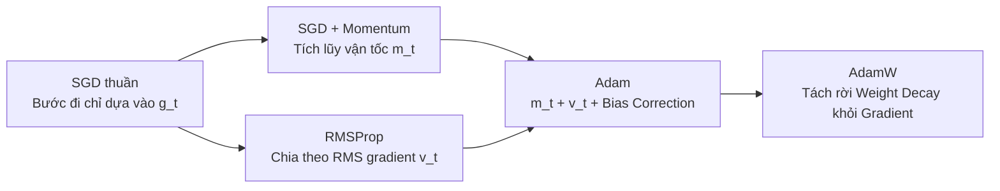

> **[Motto]**: Gradient chỉ cho biết hướng dốc nhất ngay dưới chân — Optimizer mới quyết định cách bạn vượt qua thung lũng hẹp, điểm yên ngựa và hội tụ tới nghiệm tổng quát tốt.

---

## Thông tin nhanh (Quick Spec)

* **Loại bài (Type):** Thực chiến (Build)
* **Ngôn ngữ & Công cụ:** Python 3.12 (Standard Library)
* **Kiến thức tiên quyết (Prerequisites):** Bài 03 (Backpropagation), Bài 05 (Loss Functions)
* **Thời gian thực hành:** ~65 phút

---

## Mục tiêu bài học (Learning Objectives)

Sau bài học này, bạn sẽ có khả năng:
- [ ] Giải thích 3 điểm yếu chí tử của **SGD thuần**: dao động trên bề mặt ill-conditioned, dùng chung một learning rate cho mọi tham số và kẹt tại điểm yên ngựa (saddle points).
- [ ] Tự tay cài đặt đầy đủ 5 bộ tối ưu: **SGD**, **SGD + Momentum**, **RMSProp**, **Adam** và **AdamW** thuần Python 3.12.
- [ ] Chứng minh bằng thực nghiệm tại sao **AdamW (Decoupled Weight Decay)** thu nhỏ trọng số đồng đều hơn **Adam + L2** khi các tham số có độ lớn Gradient khác nhau.
- [ ] Chọn đúng Optimizer và bộ siêu tham số khởi đầu chuẩn cho từng kiến trúc (LLM/Transformer, CNN/ResNet, Fine-tuning).

---

## 1. Vấn đề thực tế (The Problem)

> *Bạn đã có Gradient chính xác từ Backpropagation. Vậy tại sao chỉ trừ đi `lr * grad` lại khiến mạng sâu mất hàng ngàn epoch vẫn chưa hội tụ?*

Bề mặt hàm Loss của mạng Neural hàng triệu tham số không bao giờ tròn trịa như một cái bát parabol. Nó giống một **hẻm núi dài và cực hẹp** (ill-conditioned landscape): rất dốc theo chiều ngang nhưng lại thoai thoải theo chiều dọc dẫn tới đáy.

Khi dùng **Vanilla SGD** ($\theta \leftarrow \theta - \eta g$), bạn lập tức vướng 3 nút thắt:

1. **Dao động zíc-zắc (Oscillation):** Gradient luôn vuông góc với đường đồng mức, nghĩa là nó chỉ thẳng sang hai vách núi thay vì chỉ dọc theo hẻm núi. Nếu đặt `lr` lớn, điểm tối ưu bật qua bật lại hai bên vách rồi nổ thành `NaN`; nếu đặt `lr` nhỏ, nó bò như rùa dọc theo đáy.
2. **Thang đo Gradient lệch nhau hàng nghìn lần:** Trong Transformer, trọng số của lớp Embedding (chỉ cập nhật khi token xuất hiện) có Gradient thưa và nhỏ hơn rất nhiều so với lớp Linear dày đặc. Một `lr` duy nhất không thể vừa vặn cho cả hai.
3. **Điểm yên ngựa (Saddle points):** Ở không gian nhiều chiều, hầu hết điểm có Gradient gần bằng 0 không phải cực tiểu mà là điểm yên ngựa phẳng lì. SGD thuần gần như đứng yên tại đây.

---

## 2. Mô hình tư duy & Bản chất (The Concept)

### Lộ trình tiến hóa của các Optimizer



### Toán học cốt lõi (KaTeX)

#### 1. SGD + Momentum và RMSProp

**Momentum** duy trì vận tốc tích lũy các Gradient quá khứ ($\beta \approx 0.9$): các thành phần dao động ngược dấu triệt tiêu nhau, còn hướng nhất quán dọc thung lũng được cộng hưởng tăng tốc:

$$m_t = \beta m_{t-1} + g_t, \qquad \theta_t = \theta_{t-1} - \eta m_t$$

**RMSProp** giải quyết bài toán thang đo khác nhau bằng cách chia Gradient của từng tham số cho căn bậc hai trung bình trượt của bình phương Gradient:

$$v_t = \beta v_{t-1} + (1 - \beta) g_t^2, \qquad \theta_t = \theta_{t-1} - \frac{\eta}{\sqrt{v_t} + \epsilon} g_t$$

#### 2. Adam và cơ chế Bias Correction

**Adam (Adaptive Moment Estimation)** kết hợp cả mô-men bậc nhất $m_t$ (kỳ vọng) và bậc hai $v_t$ (phương sai chưa trừ trung bình), mặc định $\beta_1 = 0.9$, $\beta_2 = 0.999$:

$$m_t = \beta_1 m_{t-1} + (1 - \beta_1) g_t, \qquad v_t = \beta_2 v_{t-1} + (1 - \beta_2) g_t^2$$

Vì $m_0 = 0, v_0 = 0$, ở các bước đầu tiên $m_t$ và $v_t$ bị kéo lệch mạnh về 0 (ví dụ bước 1 với $\beta_2 = 0.999$, $v_1$ nhỏ hơn thực tế tới 1.000 lần). **Bias Correction** khử độ lệch khởi tạo này:

$$\hat{m}_t = \frac{m_t}{1 - \beta_1^t}, \qquad \hat{v}_t = \frac{v_t}{1 - \beta_2^t}$$

#### 3. AdamW: Tại sao phải tách rời Weight Decay?

Với SGD thuần, thêm L2 Regularization $\frac{\lambda}{2}\|\theta\|^2$ vào Loss cho ra kết quả giống hệt Weight Decay. Nhưng trong **Adam + L2**, thành phần $\lambda \theta_{t-1}$ bị cộng thẳng vào $g_t$, rồi bị **chia cho $\sqrt{\hat{v}_t}$**! Hệ quả là tham số nào có Gradient lớn sẽ bị phạt L2 ít đi, còn tham số Gradient nhỏ bị phạt mạnh hơn — hoàn toàn ngược ý định điều chuẩn đồng đều.

**AdamW (Loshchilov & Hutter, 2017)** tách hẳn bước thu nhỏ trọng số ra ngoài mẫu số thích ứng:

$$\theta_t = \theta_{t-1} - \eta \frac{\hat{m}_t}{\sqrt{\hat{v}_t} + \epsilon} - \eta \lambda \theta_{t-1}$$

Mọi trọng số đều được thu nhỏ cùng tỷ lệ $\eta \lambda$ bất kể lịch sử độ lớn Gradient của nó.

---

## 3. Tự tay xây dựng từ đầu (Build It: From Scratch)

Ta cài đặt cả 5 Optimizer thuần Python 3.12 (`math`), sau đó thực hiện 2 bài benchmark:
1. Đua tốc độ hội tụ trên **thung lũng bậc hai lệch trục (condition number = 100)** và **thung lũng cong Rosenbrock**.
2. Kiểm chứng trực tiếp sự khác biệt giữa **Adam + L2** và **AdamW** khi hai tham số có biên độ Gradient chênh lệch 100 lần.

### Bước 1: Cài đặt 5 lớp Optimizer chuẩn

```python
import math
from typing import Sequence


class SGD:
    """Stochastic Gradient Descent cơ bản."""

    def __init__(self, lr: float = 0.01) -> None:
        self.lr = lr

    def step(self, params: list[float], grads: Sequence[float]) -> None:
        for i in range(len(params)):
            params[i] -= self.lr * grads[i]


class SGDMomentum:
    """SGD tích hợp vận tốc Momentum."""

    def __init__(self, lr: float = 0.01, beta: float = 0.9) -> None:
        self.lr = lr
        self.beta = beta
        self.v: list[float] | None = None

    def step(self, params: list[float], grads: Sequence[float]) -> None:
        if self.v is None:
            self.v = [0.0] * len(params)
        for i in range(len(params)):
            self.v[i] = self.beta * self.v[i] + grads[i]
            params[i] -= self.lr * self.v[i]


class RMSProp:
    """Adaptive learning rate dựa trên trung bình trượt bình phương gradient."""

    def __init__(
        self, lr: float = 0.01, beta: float = 0.99, eps: float = 1e-8
    ) -> None:
        self.lr = lr
        self.beta = beta
        self.eps = eps
        self.s: list[float] | None = None

    def step(self, params: list[float], grads: Sequence[float]) -> None:
        if self.s is None:
            self.s = [0.0] * len(params)
        for i in range(len(params)):
            self.s[i] = self.beta * self.s[i] + (1.0 - self.beta) * (grads[i] ** 2)
            params[i] -= self.lr * grads[i] / (math.sqrt(self.s[i]) + self.eps)


class Adam:
    """Adam chuẩn kèm tùy chọn L2 regularization (coupled vào gradient)."""

    def __init__(
        self,
        lr: float = 0.01,
        beta1: float = 0.9,
        beta2: float = 0.999,
        eps: float = 1e-8,
        l2_reg: float = 0.0,
    ) -> None:
        self.lr = lr
        self.beta1 = beta1
        self.beta2 = beta2
        self.eps = eps
        self.l2_reg = l2_reg
        self.m: list[float] | None = None
        self.v: list[float] | None = None
        self.t = 0

    def step(self, params: list[float], grads: Sequence[float]) -> None:
        if self.m is None or self.v is None:
            self.m = [0.0] * len(params)
            self.v = [0.0] * len(params)
        self.t += 1

        for i in range(len(params)):
            # Coupled L2: cộng trực tiếp vào gradient trước khi qua m_t, v_t
            g = grads[i] + self.l2_reg * params[i]
            self.m[i] = self.beta1 * self.m[i] + (1.0 - self.beta1) * g
            self.v[i] = self.beta2 * self.v[i] + (1.0 - self.beta2) * (g * g)

            m_hat = self.m[i] / (1.0 - self.beta1 ** self.t)
            v_hat = self.v[i] / (1.0 - self.beta2 ** self.t)
            params[i] -= self.lr * m_hat / (math.sqrt(v_hat) + self.eps)


class AdamW:
    """AdamW: tách rời Weight Decay khỏi bước thích ứng gradient."""

    def __init__(
        self,
        lr: float = 0.01,
        beta1: float = 0.9,
        beta2: float = 0.999,
        eps: float = 1e-8,
        weight_decay: float = 0.01,
    ) -> None:
        self.lr = lr
        self.beta1 = beta1
        self.beta2 = beta2
        self.eps = eps
        self.weight_decay = weight_decay
        self.m: list[float] | None = None
        self.v: list[float] | None = None
        self.t = 0

    def step(self, params: list[float], grads: Sequence[float]) -> None:
        if self.m is None or self.v is None:
            self.m = [0.0] * len(params)
            self.v = [0.0] * len(params)
        self.t += 1

        for i in range(len(params)):
            g = grads[i]
            self.m[i] = self.beta1 * self.m[i] + (1.0 - self.beta1) * g
            self.v[i] = self.beta2 * self.v[i] + (1.0 - self.beta2) * (g * g)

            m_hat = self.m[i] / (1.0 - self.beta1 ** self.t)
            v_hat = self.v[i] / (1.0 - self.beta2 ** self.t)

            # Decoupled Weight Decay: thu nhỏ trọng số trực tiếp theo lr * wd
            params[i] -= self.lr * self.weight_decay * params[i]
            params[i] -= self.lr * m_hat / (math.sqrt(v_hat) + self.eps)
```

### Bước 2: Đua trực diện trên thung lũng Ill-conditioned & Rosenbrock

```python
def ill_conditioned_quad(p: Sequence[float]) -> tuple[float, list[float]]:
    """f(x, y) = 0.5*x^2 + 50*y^2 (độ dốc trục y gấp 100 lần trục x, đáy tại (0, 0))."""
    x, y = p
    loss = 0.5 * x * x + 50.0 * y * y
    grad = [x, 100.0 * y]
    return loss, grad


def rosenbrock(p: Sequence[float]) -> tuple[float, list[float]]:
    """Thung lũng cong kinh điển: f(x, y) = (1 - x)^2 + 100*(y - x^2)^2, đáy tại (1, 1)."""
    x, y = p
    loss = (1.0 - x) ** 2 + 100.0 * (y - x * x) ** 2
    dx = -2.0 * (1.0 - x) - 400.0 * x * (y - x * x)
    dy = 200.0 * (y - x * x)
    return loss, [dx, dy]


def run_benchmark(name: str, fn, start: list[float], optimizers: dict, steps: int) -> None:
    print(f"\n=== {name} (start={start}, steps={steps}) ===")
    print(f"{'Optimizer':<18} {'Final Loss':>14} {'Final Params':>24}")
    print("-" * 58)
    for opt_name, opt in optimizers.items():
        params = list(start)
        loss = float("inf")
        for _ in range(steps):
            loss, grads = fn(params)
            opt.step(params, grads)
        p_str = f"({params[0]:+.4f}, {params[1]:+.4f})"
        print(f"{opt_name:<18} {loss:>14.6f} {p_str:>24}")


if __name__ == "__main__":
    # 1. Thung lũng bậc 2 lệch trục (condition number = 100)
    run_benchmark(
        "Ill-Conditioned Quadratic",
        ill_conditioned_quad,
        start=[5.0, 2.0],
        optimizers={
            "SGD (lr=0.015)": SGD(lr=0.015),
            "Momentum (0.01)": SGDMomentum(lr=0.01, beta=0.9),
            "RMSProp (0.1)": RMSProp(lr=0.1, beta=0.9),
            "Adam (0.2)": Adam(lr=0.2),
            "AdamW (0.2)": AdamW(lr=0.2, weight_decay=0.01),
        },
        steps=150,
    )

    # 2. Thung lũng cong Rosenbrock
    run_benchmark(
        "Rosenbrock Valley",
        rosenbrock,
        start=[-1.2, 1.0],
        optimizers={
            "SGD (lr=0.001)": SGD(lr=0.001),
            "Momentum (0.001)": SGDMomentum(lr=0.001, beta=0.9),
            "RMSProp (0.01)": RMSProp(lr=0.01, beta=0.9),
            "Adam (0.05)": Adam(lr=0.05),
            "AdamW (0.05)": AdamW(lr=0.05, weight_decay=1e-4),
        },
        steps=500,
    )

    # 3. Chứng minh Adam + L2 vs AdamW khi độ lớn gradient chênh lệch 100x
    print("\n=== Adam + L2 vs AdamW: Hiệu ứng thu nhỏ trọng số (wd=0.1) ===")
    w_adam_l2 = [5.0, 5.0]
    w_adamw = [5.0, 5.0]
    opt_l2 = Adam(lr=0.05, l2_reg=0.1)
    opt_w = AdamW(lr=0.05, weight_decay=0.1)

    for step in range(1, 201):
        # Gradient nhiễu dao động đối xứng quanh 0: w0 có biên độ lớn 100.0, w1 có biên độ nhỏ 0.1
        sign = 1.0 if step % 2 == 0 else -1.0
        noisy_grads = [100.0 * sign, 0.1 * sign]
        opt_l2.step(w_adam_l2, noisy_grads)
        opt_w.step(w_adamw, noisy_grads)

    print(f"Adam + L2  (ban đầu [5.0, 5.0]) -> w0 (grad lớn)={w_adam_l2[0]:.4f}, w1 (grad nhỏ)={w_adam_l2[1]:.4f}")
    print(f"AdamW      (ban đầu [5.0, 5.0]) -> w0 (grad lớn)={w_adamw[0]:.4f}, w1 (grad nhỏ)={w_adamw[1]:.4f}")
```

Khi chạy đoạn kiểm chứng số 3, bạn sẽ thấy ngay bằng chứng rõ ràng: với `Adam + L2`, trọng số `w0` (có gradient lớn) hầu như **không bị thu nhỏ** vì $\lambda w_0$ bị chia nhỏ bởi $\sqrt{\hat{v}_0} \approx 100$, trong khi `w1` bị ép co mạnh. Trái lại, `AdamW` thu nhỏ cả `w0` và `w1` gần như đồng đều nhau!

---

## 4. Ứng dụng thực tế & So sánh Framework (Use It)

| Kiến trúc / Tác vụ | Optimizer chuẩn | PyTorch API | Công thức khởi đầu khuyên dùng |
|---|---|---|---|
| **Transformer / LLM Pre-training** | **AdamW** | `torch.optim.AdamW` | `lr=3e-4`, `betas=(0.9, 0.95)`, `weight_decay=0.1` |
| **LLM Fine-tuning (SFT / LoRA)** | **AdamW** | `torch.optim.AdamW` | `lr=2e-5` (full) hoặc `2e-4` (LoRA), `weight_decay=0.01` |
| **CNN / ResNet (Vision)** | **SGD + Momentum** | `torch.optim.SGD` | `lr=0.1`, `momentum=0.9`, `weight_decay=1e-4` |
| **Mạng bộ nhớ giới hạn (GPU VRAM thấp)** | **8-bit AdamW / Adafactor** | `bitsandbytes.optim.AdamW8bit` | Giảm ~75% bộ nhớ trạng thái Optimizer (m, v) |

**Production Tips:**
- **Không áp dụng Weight Decay cho Bias và Normalization layers (LayerNorm/RMSNorm/BatchNorm):** Luôn tách `param_groups` trong PyTorch sao cho `weight_decay=0.0` với các tensor 1D (bias, norm gain). Phạt bias hoặc norm scale làm méo phân phối đầu ra và giảm chất lượng hội tụ.
- **Nhớ đúng thứ tự vòng lặp chuẩn:** `optimizer.zero_grad(set_to_none=True)` $\rightarrow$ `forward` $\rightarrow$ `loss.backward()` $\rightarrow$ `clip_grad_norm_(..., 1.0)` $\rightarrow$ `optimizer.step()` $\rightarrow$ `scheduler.step()`. Dùng `set_to_none=True` nhanh hơn và tiết kiệm VRAM hơn gán 0.
- **Chi phí VRAM của AdamW:** Với mỗi tham số FP32 (4 bytes), AdamW phải lưu thêm 2 trạng thái `m` và `v` (thêm 8 bytes). Đây là lý do huấn luyện mô hình 7B tham số bằng AdamW cần bộ nhớ Optimizer lớn gấp đôi trọng số mô hình!

---

## 5. Đóng gói & Tái sử dụng (Ship It)

**Checklist cấu hình Optimizer chuẩn Production:**
- [ ] **Mặc định an toàn:** Chưa có lý do đo đạc cụ thể? Bắt đầu ngay bằng `AdamW(lr=3e-4, betas=(0.9, 0.95), weight_decay=0.01)` kết hợp Gradient Clipping (`max_norm=1.0`).
- [ ] **Tách nhóm Weight Decay:** Chỉ bật `weight_decay` cho ma trận trọng số 2D trở lên (`Linear`, `Conv`, `Embedding`), tắt (`0.0`) cho `bias` và `LayerNorm`/`RMSNorm`.
- [ ] **Kiểm soát bùng nổ ở LLM:** Khi train mô hình lớn, hạ `beta2` từ `0.999` xuống `0.95` giúp AdamW phản ứng nhanh hơn trước các đợt spike gradient bất thường.
- [ ] **Kết hợp Warmup:** Adam/AdamW luôn cần giai đoạn LR Warmup ngắn (1–5% tổng số bước) để ổn định ước lượng phương sai $v_t$ trước khi tăng tốc tối đa.

**Cheatsheet chẩn đoán nhanh khi tối ưu hóa:**

| Hiện tượng quan sát | Nguyên nhân khả dĩ | Hành động khắc phục |
|---|---|---|
| Loss nhảy vọt lên `NaN` sau vài bước | `lr` quá cao hoặc thiếu Gradient Clipping | Giảm `lr` 3–10x, bật `clip_grad_norm_(1.0)` và thêm Warmup |
| Loss giảm nhanh rồi dao động quanh đáy | Không có LR Decay hoặc `lr` cố định quá lớn | Ghép với Cosine Annealing schedule |
| Train Loss thấp nhưng Val Loss cao hơn SGD | Dùng `Adam + L2` nhầm chỗ hoặc `weight_decay` quá nhỏ | Chuyển hẳn sang `AdamW` và tăng `weight_decay` (`0.01` $\rightarrow$ `0.1`) |

---

## 6. Giải ngố thuật ngữ (Key Terms & Misconceptions)

| Thuật ngữ (Term) | Người ta thường nghĩ là... | Bản chất kỹ thuật thực sự là... |
|---|---|---|
| **Bias Correction** | Sửa lỗi của tham số bias $b$ trong lớp Linear. | Phép chia cho $(1 - \beta^t)$ để bù độ lệch thống kê do bộ đệm $m_0, v_0$ của Adam được khởi tạo bằng 0 ở các bước đầu. |
| **Weight Decay vs L2** | Hai cách gọi khác nhau của cùng một phép toán. | Chỉ tương đương trong SGD thuần; với Adam, L2 bị chia bởi $\sqrt{\hat{v}_t}$ nên sai lệch, còn Weight Decay tách rời (AdamW) mới thu nhỏ trọng số đồng đều. |
| **Adaptive Learning Rate** | Optimizer tự tìm `lr` tối ưu nên không cần chỉnh `lr`. | Chỉ tự điều chỉnh tỷ lệ bước nhảy tương đối giữa từng tham số theo phương sai gradient; `base_lr` vẫn là siêu tham số quan trọng nhất cần tinh chỉnh. |
| **Gradient Clipping** | Cắt bỏ hoàn toàn những gradient lớn. | Thu nhỏ toàn bộ vector gradient cùng tỷ lệ khi chuẩn L2 vượt ngưỡng `max_norm`, giữ nguyên hướng đi nhưng giới hạn độ dài bước nhảy. |

---

## 7. Bài tập thử thách (Hands-on Challenges)

1. 🟢 **Cơ bản (Easy):** Tắt bước Bias Correction trong lớp `Adam` ở Mục 3 (dùng trực tiếp `m[i]` và `v[i]` thay vì `m_hat`, `v_hat`). Quan sát kích thước bước cập nhật ở 10 bước đầu tiên và giải thích tại sao mô hình khởi động chậm hoặc nhảy sai biên độ.
2. 🟡 **Trung bình (Medium):** Cài đặt **Nesterov Accelerated Gradient (NAG)** — tính gradient tại điểm "nhìn trước" $\theta - \eta \beta v$ — và bổ sung vào bảng đua Rosenbrock ở Mục 3 để so sánh với `SGDMomentum` truyền thống.
3. 🔴 **Nâng cao (Hard):** Cài đặt hàm `clip_grad_norm(grads, max_norm)` (cắt theo chuẩn L2 toàn cục) và thử nghiệm trên hàm Rosenbrock với `lr` lớn gấp 5 lần bình thường. Ghi nhận tỷ lệ hội tụ thành công khi bật và tắt Gradient Clipping.

---

## 8. Tài liệu đọc thêm (Further Reading)

- [Adam: A Method for Stochastic Optimization (Kingma & Ba, 2014)](https://arxiv.org/abs/1412.6980) — *Bài báo gốc giới thiệu Adam và chứng minh toán học cho cơ chế Bias Correction.*
- [Decoupled Weight Decay Regularization (Loshchilov & Hutter, 2017)](https://arxiv.org/abs/1711.05101) — *Bài báo khai sinh AdamW, chứng minh L2 và Weight Decay không tương đương trong các thuật toán thích ứng.*
- [An Overview of Gradient Descent Optimization Algorithms (Sebastian Ruder)](https://www.ruder.io/optimizing-gradient-descent/) — *Tài liệu tổng hợp trực quan, dễ tra cứu nhất về toàn bộ hệ sinh thái các thuật toán tối ưu.*
