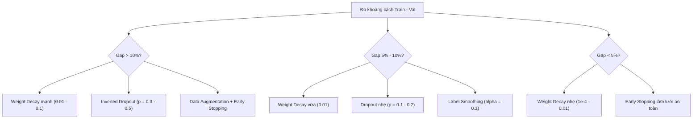

> **[Motto]**: Mạng Neural đủ lớn có thể học thuộc lòng cả nhãn ngẫu nhiên — Regularization là khoản thuế đánh vào độ phức tạp để buộc mô hình phải tổng quát hóa.

---

## Thông tin nhanh (Quick Spec)

* **Loại bài (Type):** Thực chiến (Build)
* **Ngôn ngữ & Công cụ:** Python 3.12 (Standard Library)
* **Kiến thức tiên quyết (Prerequisites):** Bài 05 (Loss Functions), Bài 06 (Optimizers)
* **Thời gian thực hành:** ~60 phút

---

## Mục tiêu bài học (Learning Objectives)

Sau bài học này, bạn sẽ có khả năng:
- [ ] Phân biệt cơ chế tác động lên trọng số của **L1 (tạo độ thưa)** và **L2 Weight Decay (làm mượt trọng số)**.
- [ ] Tự tay cài đặt **Inverted Dropout** đúng chuẩn (kèm cả `forward`/`backward` và chế độ `train`/`eval`) và kiểm chứng thực nghiệm tính bảo toàn giá trị kỳ vọng.
- [ ] Cài đặt **Label Smoothing** để ngăn mạng đẩy logit lên vô cực và xây dựng bộ điều khiển **Early Stopping** có khôi phục trọng số tốt nhất.
- [ ] Phối hợp đúng bộ kỹ thuật Regularization và Normalization (`BatchNorm`, `LayerNorm`, `RMSNorm`) theo từng loại kiến trúc thực tế.

---

## 1. Vấn đề thực tế (The Problem)

> *Mô hình của bạn đạt 99.8% độ chính xác trên tập Train nhưng tụt thảm hại xuống 62% trên tập Test. Nó đã học hay chỉ đang chép bài?*

Năm 2017, Zhang et al. làm chấn động cộng đồng Deep Learning bằng một thí nghiệm đơn giản: họ lấy tập ImageNet, **trộn ngẫu nhiên hoàn toàn nhãn ảnh** (ảnh con chó gán nhãn máy bay, ảnh chiếc xe gán nhãn quả táo) rồi huấn luyện mạng sâu chuẩn. Kết quả? Mạng vẫn đạt **Train Loss gần bằng 0**. Nó học thuộc lòng hàng triệu cặp nhiễu vô nghĩa mà không học bất kỳ quy luật nào.

Trong kỷ nguyên mô hình hàng tỷ tham số, năng lực ghi nhớ (memorization capacity) luôn dư thừa so với cấu trúc thực của dữ liệu. Nếu không đặt rào cản, mạng Neural sẽ:
- Đẩy một vài trọng số lên rất lớn để bám sát từng điểm nhiễu nhỏ lẻ.
- Tạo ra các cặp nơ-ron "đồng thích ứng" (co-adaptation): nơ-ron A chỉ hoạt động đúng nếu nơ-ron B sửa sai hộ nó.
- Đẩy logit lên $+\infty$ để ép xác suất nhãn đúng thành `1.0000`, trở nên tự tin thái quá và dễ gãy khi gặp dữ liệu ngoài phân phối.

**Regularization** tấn công từng lỗ hổng này từ nhiều hướng khác nhau để thu hẹp khoảng cách Train–Test.

---

## 2. Mô hình tư duy & Bản chất (The Concept)

### Chiến lược chọn Regularization theo độ rộng Overfitting Gap



### Toán học cốt lõi (KaTeX)

#### 1. L1 và L2 Regularization (Weight Decay)

Cộng trực tiếp hàm phạt lên độ lớn trọng số vào hàm mất mát:

$$\mathcal{L}_{\text{L2}} = \mathcal{L}_{\text{task}} + \frac{\lambda}{2} \sum_i w_i^2 \implies \frac{\partial \mathcal{L}_{\text{L2}}}{\partial w_i} = \frac{\partial \mathcal{L}_{\text{task}}}{\partial w_i} + \lambda w_i$$

$$\mathcal{L}_{\text{L1}} = \mathcal{L}_{\text{task}} + \lambda \sum_i |w_i| \implies \frac{\partial \mathcal{L}_{\text{L1}}}{\partial w_i} = \frac{\partial \mathcal{L}_{\text{task}}}{\partial w_i} + \lambda \, \text{sign}(w_i)$$

- **L2** phạt mạnh trọng số lớn và co dần về gần 0 nhưng hiếm khi bằng 0 tuyệt đối $\rightarrow$ tạo trọng số nhỏ, đều, mượt.
- **L1** trừ một hằng số $\lambda$ đều đặn bất kể $w_i$ lớn hay nhỏ $\rightarrow$ ép các trọng số không quan trọng về đúng `0.0` (tạo mô hình thưa — sparsity).

#### 2. Inverted Dropout và bảo toàn kỳ vọng

Trong quá trình huấn luyện, ta tắt ngẫu nhiên mỗi nơ-ron với xác suất $p$ bằng mặt nạ $m_i \sim \text{Bernoulli}(1 - p)$. Nếu chỉ nhân $h \odot m$, tổng tín hiệu đầu ra sẽ giảm đi hệ số $(1 - p)$ so với lúc Inference (khi tất cả nơ-ron đều bật). **Inverted Dropout** chia ngay cho $(1 - p)$ ở pha Train:

$$\tilde{h}_i = \begin{cases} \dfrac{h_i \cdot m_i}{1 - p} & \text{khi Train } (m_i \sim \text{Bernoulli}(1-p)) \\[8pt] h_i & \text{khi Eval (không cần nhân chia)} \end{cases}$$

Kiểm tra kỳ vọng toán học ở pha Train:

$$\mathbb{E}[\tilde{h}_i] = \frac{h_i \cdot \mathbb{E}[m_i]}{1 - p} = \frac{h_i \cdot (1 - p)}{1 - p} = h_i$$

Nhờ đó, kỳ vọng tín hiệu giữa Train và Eval khớp nhau hoàn hảo mà code Inference không tốn thêm một phép nhân nào.

#### 3. Label Smoothing

Thay vì ép nhãn one-hot cứng `[0, 0, 1, 0]` (buộc logit phải tiến tới $\infty$ để Softmax ra đúng 1.0), ta phân bổ lại một phần khối lượng xác suất $\alpha$ (thường `0.1`) đều cho toàn bộ $K$ lớp:

$$y_i^{\text{smooth}} = (1 - \alpha) y_i + \frac{\alpha}{K}$$

Với $K = 4, \alpha = 0.1$, mục tiêu trở thành `[0.025, 0.025, 0.925, 0.025]` — giữ logit trong vùng lành mạnh, hiệu chỉnh xác suất (calibration) tốt hơn và chống nhiễu nhãn hiệu quả.

---

## 3. Tự tay xây dựng từ đầu (Build It: From Scratch)

Ta sẽ cài đặt trọn bộ 4 thành phần Regularization kinh điển thuần Python 3.12 (`math`, `random`) và kiểm chứng định lượng từng cơ chế.

### Bước 1: L1 và L2 Regularization (Penalty + Gradient)

```python
import math
import random
from typing import Sequence


def l1_penalty_and_grad(
    weights: Sequence[float], lam: float
) -> tuple[float, list[float]]:
    """Tính L1 penalty và sub-gradient theo trọng số."""
    penalty = lam * sum(abs(w) for w in weights)
    grads = [lam * (1.0 if w > 0 else (-1.0 if w < 0 else 0.0)) for w in weights]
    return penalty, grads


def l2_penalty_and_grad(
    weights: Sequence[float], lam: float
) -> tuple[float, list[float]]:
    """Tính L2 penalty (0.5 * lam * sum(w^2)) và gradient lam * w."""
    penalty = 0.5 * lam * sum(w * w for w in weights)
    grads = [lam * w for w in weights]
    return penalty, grads
```

### Bước 2: Inverted Dropout (Train vs Eval Mode & Backward)

```python
class InvertedDropout:
    """Inverted Dropout: scale 1/(1-p) lúc train để bảo toàn kỳ vọng ở pha eval."""

    def __init__(self, p: float = 0.5, seed: int = 42) -> None:
        if not 0.0 <= p < 1.0:
            raise ValueError("Xác suất dropout p phải nằm trong [0.0, 1.0).")
        self.p = p
        self.rng = random.Random(seed)
        self.training = True
        self.last_mask: list[float] = []

    def forward(self, x: Sequence[float]) -> list[float]:
        if not self.training or self.p == 0.0:
            self.last_mask = [1.0] * len(x)
            return list(x)

        scale = 1.0 / (1.0 - self.p)
        self.last_mask = [
            0.0 if self.rng.random() < self.p else scale for _ in x
        ]
        return [xi * mi for xi, mi in zip(x, self.last_mask)]

    def backward(self, grad_out: Sequence[float]) -> list[float]:
        """Truyền gradient ngược qua đúng mặt nạ đã sinh ở lượt forward."""
        return [g * m for g, m in zip(grad_out, self.last_mask)]
```

### Bước 3: Label Smoothing Cross-Entropy

```python
def smooth_one_hot(
    target_idx: int, num_classes: int, alpha: float = 0.1
) -> list[float]:
    """Chuyển nhãn cứng thành phân phối mục tiêu đã làm mượt."""
    base = alpha / num_classes
    dist = [base] * num_classes
    dist[target_idx] += 1.0 - alpha
    return dist


def smoothed_cross_entropy(
    logits: Sequence[float], target_idx: int, alpha: float = 0.1
) -> float:
    """Cross-Entropy ổn định (LogSumExp) kết hợp Label Smoothing."""
    m = max(logits)
    lse = m + math.log(sum(math.exp(z - m) for z in logits))
    log_probs = [z - lse for z in logits]
    targets = smooth_one_hot(target_idx, len(logits), alpha=alpha)
    return -sum(t * lp for t, lp in zip(targets, log_probs))
```

### Bước 4: Bộ điều khiển Early Stopping kèm Snapshot Trọng Số

```python
class EarlyStopping:
    """Theo dõi Validation Loss, lưu snapshot trọng số tốt nhất và dừng sớm khi hết patience."""

    def __init__(self, patience: int = 3, min_delta: float = 1e-4) -> None:
        self.patience = patience
        self.min_delta = min_delta
        self.best_loss = float("inf")
        self.best_epoch = -1
        self.best_weights: list[float] | None = None
        self.bad_epochs = 0
        self.should_stop = False

    def step(self, epoch: int, val_loss: float, weights: Sequence[float]) -> bool:
        if val_loss < self.best_loss - self.min_delta:
            self.best_loss = val_loss
            self.best_epoch = epoch
            self.best_weights = list(weights)  # Deep copy snapshot
            self.bad_epochs = 0
        else:
            self.bad_epochs += 1
            if self.bad_epochs >= self.patience:
                self.should_stop = True
        return self.should_stop
```

### Bước 5: Chạy thực nghiệm kiểm chứng toàn bộ 4 kỹ thuật

```python
if __name__ == "__main__":
    print("=== 1. L1 vs L2 Weight Decay trên vector trọng số ===")
    w = [2.0, -0.05, 0.01, -3.5]
    p_l1, g_l1 = l1_penalty_and_grad(w, lam=0.1)
    p_l2, g_l2 = l2_penalty_and_grad(w, lam=0.1)
    print(f"Weights : {w}")
    print(f"L1 pen={p_l1:.4f}, grad={[round(g, 4) for g in g_l1]} (đẩy trọng số nhỏ về đúng 0)")
    print(f"L2 pen={p_l2:.4f}, grad={[round(g, 4) for g in g_l2]} (phạt mạnh trọng số lớn)")

    print("\n=== 2. Inverted Dropout: Kiểm chứng bảo toàn kỳ vọng (10.000 lượt) ===")
    x = [1.0, 2.0, 3.0, 4.0]
    dropout = InvertedDropout(p=0.5, seed=7)
    dropout.training = True
    n_trials = 10_000
    acc = [0.0] * len(x)
    for _ in range(n_trials):
        out = dropout.forward(x)
        for i, val in enumerate(out):
            acc[i] += val
    mean_train_out = [round(v / n_trials, 3) for v in acc]
    dropout.training = False
    eval_out = dropout.forward(x)
    print(f"Kỳ vọng pha Train (p=0.5): {mean_train_out}")
    print(f"Đầu ra pha Eval          : {eval_out}")

    print("\n=== 3. Label Smoothing: Phạt logit quá tự tin ===")
    moderate_logits = [2.5, 0.2, 0.1, 0.0]
    extreme_logits = [20.0, 0.0, 0.0, 0.0]
    print(f"Hard CE     (moderate vs extreme): {smoothed_cross_entropy(moderate_logits, 0, alpha=0.0):.4f} vs {smoothed_cross_entropy(extreme_logits, 0, alpha=0.0):.4f}")
    print(f"Smoothed CE (moderate vs extreme): {smoothed_cross_entropy(moderate_logits, 0, alpha=0.1):.4f} vs {smoothed_cross_entropy(extreme_logits, 0, alpha=0.1):.4f}")

    print("\n=== 4. Early Stopping Controller ===")
    val_curve = [0.85, 0.62, 0.48, 0.41, 0.42, 0.44, 0.49, 0.55]
    stopper = EarlyStopping(patience=3, min_delta=1e-3)
    for epoch, v_loss in enumerate(val_curve, start=1):
        fake_weights = [round(1.0 / epoch, 3), round(v_loss, 3)]
        stopped = stopper.step(epoch, v_loss, fake_weights)
        print(f"Epoch {epoch}: val_loss={v_loss:.2f}, bad_epochs={stopper.bad_epochs}, stop={stopped}")
        if stopped:
            print(f"-> Dừng sớm! Khôi phục trọng số tốt nhất tại Epoch {stopper.best_epoch} (val_loss={stopper.best_loss:.2f}, weights={stopper.best_weights})")
            break
```

Chú ý kết quả mục 3: với Hard CE (`alpha=0.0`), đẩy logit từ `2.5` lên `20.0` làm Loss tụt về `0.0000` (khuyến khích mô hình tự tin cực đoan). Với Label Smoothing (`alpha=0.1`), đẩy logit lên `20.0` lại làm Loss **tăng vọt lên 1.5000** — chặn đứng hiện tượng overconfidence ngay từ hàm mục tiêu!

---

## 4. Ứng dụng thực tế & So sánh Framework (Use It)

| Kỹ thuật | PyTorch Equivalent | Mục đích chính | Chuẩn mực trên CNN vs Transformer / LLM |
|---|---|---|---|
| **Weight Decay** | `AdamW(..., weight_decay=0.01)` | Kiểm soát biên độ trọng số | CNN: `1e-4` (SGD); LLM Pre-train: `0.1` (AdamW) |
| **Inverted Dropout** | `nn.Dropout(p)` / `nn.Dropout2d(p)` | Phá vỡ đồng thích ứng nơ-ron | MLP: `0.3–0.5`; Transformer cũ: `0.1`; LLM hiện đại: **`0.0`** khi pre-train 1 epoch |
| **Label Smoothing** | `nn.CrossEntropyLoss(label_smoothing=0.1)` | Chống overconfidence, tăng calibration | Phổ biến trong ImageNet (CNN/ViT) và Machine Translation |
| **Normalization** | `nn.BatchNorm2d` / `nn.LayerNorm` / `nn.RMSNorm` | Làm mượt Loss landscape, ổn định phân phối | CNN dùng **BatchNorm**; Transformer dùng **LayerNorm**; Llama/Mistral dùng **RMSNorm** |
| **Early Stopping** | Callback (`Lightning`, `HF Trainer`) | Chặn overfitting theo thời gian | Bắt buộc cho Fine-tuning dữ liệu nhỏ và tabular/CV |

**Production Tips:**
- **Bẫy kinh điển nhất trong PyTorch:** Quên gọi `model.eval()` trước khi chạy đánh giá hoặc phục vụ Inference. Khi quên, `Dropout` vẫn tắt ngẫu nhiên nơ-ron và `BatchNorm` vẫn dùng thống kê mini-batch hiện tại — khiến kết quả dự đoán nhảy loạn giữa hai lần gọi giống hệt nhau!
- **Tại sao LLM nghìn tỷ token (Llama 3, Mistral) thường tắt Dropout (`p = 0.0`) khi pre-training?** Vì dữ liệu lớn đến mức mô hình chỉ nhìn mỗi token đúng 1 lần (single-epoch training), gần như không có nguy cơ học thuộc lòng dữ liệu lặp. Nhưng khi **Fine-tuning (SFT)** trên tập vài nghìn mẫu lặp 3–5 epoch, bật lại Dropout (`0.05–0.1`) và Early Stopping lại cực kỳ cần thiết.
- **Data Augmentation là Regularizer rẻ và mạnh nhất:** Trước khi nhồi thêm Dropout làm giảm dung lượng mạng, hãy ưu tiên tăng cường dữ liệu (crop/flip/MixUp cho ảnh, đa dạng hóa prompt cho NLP).

---

## 5. Đóng gói & Tái sử dụng (Ship It)

**Checklist kiểm soát Overfitting trước khi triển khai:**
- [ ] **Luôn gọi cặp bài trùng khi đánh giá:** `model.eval()` kết hợp `with torch.no_grad():` cho toàn bộ vòng lặp Validation và Inference.
- [ ] **Đặt thứ tự chuẩn trong một Block:** Với CNN truyền thống là `Conv -> BatchNorm -> ReLU -> Dropout`; với Transformer hiện đại (Pre-LN) là `RMSNorm -> Attention/FFN -> Residual Add`.
- [ ] **Lưu Checkpoint theo Validation Metric, không theo Epoch cuối:** Thiết lập `EarlyStopping` lưu `state_dict` khi `val_loss` (hoặc metric mục tiêu) đạt đỉnh mới.
- [ ] **Kiểm chứng Overfit một batch nhỏ trước:** Trước khi bật Regularization mạnh, hãy tắt Dropout/Weight Decay và kiểm tra mô hình có thể overfit 100% một batch 16 mẫu hay không — nếu không overfit nổi nghĩa là code hoặc kiến trúc đang có bug!

**Cheatsheet cấu hình mặc định:**

| Bối cảnh dự án | Bộ Regularization khuyên dùng |
|---|---|
| **Tabular / MLP dữ liệu nhỏ** | `Weight Decay=1e-2` + `Dropout(0.3)` + `EarlyStopping(patience=10)` |
| **Vision (ResNet / ViT)** | `Augmentation (RandAugment/MixUp)` + `Weight Decay=0.05` + `Label Smoothing=0.1` |
| **Fine-tuning LLM (SFT / LoRA)** | `AdamW(wd=0.01)` + `LoRA Dropout=0.05` + `EarlyStopping` theo `eval_loss` |

---

## 6. Giải ngố thuật ngữ (Key Terms & Misconceptions)

| Thuật ngữ (Term) | Người ta thường nghĩ là... | Bản chất kỹ thuật thực sự là... |
|---|---|---|
| **Dropout** | Xóa bỏ bớt nơ-ron thừa để làm nhẹ mô hình. | Kỹ thuật huấn luyện ngầm một quần thể (ensemble) $2^N$ mạng con dùng chung trọng số; lúc Inference vẫn chạy đủ 100% nơ-ron. |
| **Inverted Dropout** | Bật Dropout lúc test thay vì lúc train. | Vẫn tắt nơ-ron lúc Train, nhưng nhân bù $\frac{1}{1-p}$ ngay lúc Train để lúc Eval không cần chỉnh sửa phép tính nào. |
| **Label Smoothing** | Làm bẩn nhãn đúng khiến mô hình học kém chính xác hơn. | Ngăn mạng đẩy logit tới vô cực bằng cách chia một phần nhỏ $\alpha$ cho các lớp khác, giúp xác suất dự đoán tin cậy hơn và tổng quát hóa tốt hơn. |
| **BatchNorm vs RMSNorm** | Đều giống nhau, dùng cái nào cũng được. | BatchNorm chuẩn hóa theo trục Batch (hỏng khi batch nhỏ hoặc độ dài chuỗi biến thiên); RMSNorm chuẩn hóa theo trục Feature từng mẫu và bỏ bước trừ trung bình giúp nhanh hơn ~10% trên LLM. |

---

## 7. Bài tập thử thách (Hands-on Challenges)

1. 🟢 **Cơ bản (Easy):** Kiểm tra phương thức `InvertedDropout.backward()` ở Mục 3 bằng cách so sánh gradient qua những nơ-ron bị tắt (`mask == 0`) và những nơ-ron còn sống (`mask > 0`). Giải thích tại sao cần nhân cùng hệ số `1 / (1 - p)` ở pha Backward.
2. 🟡 **Trung bình (Medium):** Cài đặt thêm lớp `RMSNorm` thuần Python theo công thức $y_j = \gamma_j \frac{x_j}{\sqrt{\frac{1}{D}\sum x_i^2 + \epsilon}}$ và so sánh đầu ra của nó với `LayerNorm` trên cùng một vector đầu vào có trung bình khác 0.
3. 🔴 **Nâng cao (Hard):** Viết một mạng MLP 2 lớp nhỏ huấn luyện trên dữ liệu phân loại có 15% nhãn nhiễu. Chạy 4 cấu hình: không điều chuẩn, chỉ Dropout (`p=0.3`), chỉ Label Smoothing (`alpha=0.1`), và kết hợp cả hai + `EarlyStopping`. So sánh Val Loss và độ chính xác trên tập Test sạch.

---

## 8. Tài liệu đọc thêm (Further Reading)

- [Dropout: A Simple Way to Prevent Neural Networks from Overfitting (Srivastava et al., 2014)](https://jmlr.org/papers/v15/srivastava14a.html) — *Bài báo nền tảng về Dropout với góc nhìn xấp xỉ Ensemble và phân tích lý thuyết sắc bén.*
- [Understanding Deep Learning Requires Rethinking Generalization (Zhang et al., 2017)](https://arxiv.org/abs/1611.03530) — *Công trình kinh điển chứng minh mạng sâu có thể ghi nhớ hoàn toàn nhãn ngẫu nhiên.*
- [Root Mean Square Layer Normalization (Zhang & Sennrich, 2019)](https://arxiv.org/abs/1910.07467) — *Lý giải vì sao bỏ phép trừ trung bình trong LayerNorm vẫn giữ nguyên độ chính xác mà tăng tốc đáng kể cho các LLM hiện đại.*
