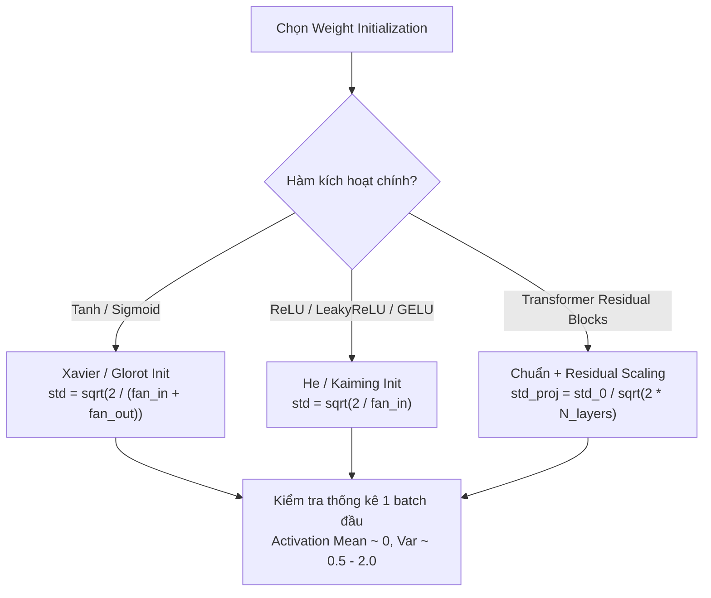

> **[Motto]**: Khởi tạo sai thì mạng 50 lớp sụp đổ ngay ở Forward đầu tiên; khởi tạo đúng theo phương sai thì tín hiệu đi xuyên hàng chục lớp mượt mà như 3 lớp.

---

## Thông tin nhanh (Quick Spec)

* **Loại bài (Type):** Thực chiến (Build)
* **Ngôn ngữ & Công cụ:** Python 3.12 (Standard Library)
* **Kiến thức tiên quyết (Prerequisites):** Bài 04 (Activation Functions), Bài 07 (Regularization)
* **Thời gian thực hành:** ~55 phút

---

## Mục tiêu bài học (Learning Objectives)

Sau bài học này, bạn sẽ có khả năng:
- [ ] Chứng minh bằng thực nghiệm hiện tượng **Symmetry Failure** khi khởi tạo trọng số bằng 0.
- [ ] Xây dựng công thức lan truyền phương sai $\mathrm{Var}(z) = n_{\text{in}} \cdot \mathrm{Var}(w) \cdot \mathrm{Var}(x)$ để giải thích vì sao `N(0, 1)` làm tín hiệu nổ hoặc triệt tiêu chỉ sau vài lớp.
- [ ] Tự tay cài đặt và đối chiếu **Zero Init**, **Naive `N(0, 1)`**, **Xavier/Glorot** và **He/Kaiming** bằng cách theo dõi Mean và Variance kích hoạt qua mạng 10 lớp thuần Python.
- [ ] Áp dụng đúng chiến lược khởi tạo tương ứng với từng hàm kích hoạt (`Tanh`/`Sigmoid`, `ReLU`/`GELU`) và quy tắc Residual Scaling trong Transformer sâu.

---

## 1. Vấn đề thực tế (The Problem)

> *Tại sao cùng một kiến trúc mạng, cùng Optimizer và dữ liệu, chỉ đổi một dòng khởi tạo trọng số lại quyết định mạng hội tụ mượt mà hay đứng im ở Loss ngẫu nhiên?*

Weight Initialization là bước ít được nhắc tới nhất nhưng lại có khả năng "giết chết" toàn bộ quá trình huấn luyện ngay trước khi bước SGD đầu tiên kịp diễn ra:

1. **Khởi tạo tất cả trọng số bằng 0:** Mọi nơ-ron trong cùng một lớp ẩn đều tính ra cùng một giá trị, nhận về cùng một đạo hàm trong Backpropagation và cập nhật cùng một lượng. Sau 10.000 epoch, lớp ẩn 512 nơ-ron của bạn vẫn chỉ là 512 bản sao y hệt nhau của **1 nơ-ron duy nhất**.
2. **Khởi tạo ngẫu nhiên chuẩn $\mathcal{N}(0, 1)$:** Nghe có vẻ hợp lý, nhưng nếu lớp có `fan_in = 64` đầu vào với phương sai bằng 1, tổng có trọng số sau lớp đầu tiên đã có phương sai là `64`! Qua 10 lớp tuyến tính/ReLU, phương sai phình thành $32^{10} \approx 10^{15}$ dẫn đến `OverflowError`/`NaN`. Nếu dùng `Tanh`/`Sigmoid`, mọi giá trị đều bị đẩy ra vùng bão hòa $\pm 1$, nơi đạo hàm bằng 0.
3. **Khởi tạo quá nhỏ $\mathcal{N}(0, 0.01)$:** Tín hiệu co lại dần sau mỗi lớp rồi biến mất về 0 trước khi chạm được tới lớp cuối.

Mục tiêu của khởi tạo trọng số hiện đại không chỉ là "ngẫu nhiên để phá đối xứng", mà là **giữ phương sai tín hiệu và Gradient ổn định xấp xỉ 1.0 xuyên suốt chiều sâu của mạng**.

---

## 2. Mô hình tư duy & Bản chất (The Concept)

### Cây quyết định chọn chiến lược Weight Initialization



### Toán học cốt lõi (KaTeX)

#### 1. Định luật lan truyền phương sai

Xét một nơ-ron nhận $n_{\text{in}}$ đầu vào độc lập có kỳ vọng 0: $z = \sum_{j=1}^{n_{\text{in}}} w_j x_j$. Khi $w_j$ và $x_j$ độc lập và đều có trung bình bằng 0:

$$\mathrm{Var}(z) = \sum_{j=1}^{n_{\text{in}}} \mathrm{Var}(w_j x_j) = n_{\text{in}} \cdot \mathrm{Var}(w) \cdot \mathrm{Var}(x)$$

Để tín hiệu không phình to hay teo nhỏ qua nhiều lớp, ta cần $\mathrm{Var}(z) = \mathrm{Var}(x)$, nghĩa là $\mathrm{Var}(w) = \frac{1}{n_{\text{in}}}$ cho chiều Forward và $\mathrm{Var}(w) = \frac{1}{n_{\text{out}}}$ cho chiều Backward.

#### 2. Xavier / Glorot Initialization (Tanh & Sigmoid)

Glorot & Bengio (2010) lấy trung bình điều hòa hai điều kiện Forward và Backward cho các hàm kích hoạt gần tuyến tính quanh 0 (như `Tanh`, `Sigmoid`):

$$\mathrm{Var}(w) = \frac{2}{n_{\text{in}} + n_{\text{out}}} \implies w \sim \mathcal{N}\left(0, \sqrt{\frac{2}{n_{\text{in}} + n_{\text{out}}}}\right)$$

#### 3. He / Kaiming Initialization (ReLU & GELU)

Hàm `ReLU(z) = max(0, z)` cắt bỏ hoàn toàn một nửa phân phối đối xứng ở miền âm, khiến phương sai đầu ra bị **giảm đi đúng một nửa** sau mỗi lớp: $\mathrm{Var}(\text{ReLU}(z)) \approx \frac{1}{2}\mathrm{Var}(z)$. He et al. (2015) nhân thêm hệ số 2 để bù lại đúng phần bị cắt:

$$\mathrm{Var}(w) = \frac{2}{n_{\text{in}}} \implies w \sim \mathcal{N}\left(0, \sqrt{\frac{2}{n_{\text{in}}}}\right)$$

#### 4. Residual Scaling trong Transformer sâu (GPT-2 / Llama)

Trong kiến trúc Residual $x_{l+1} = x_l + f_l(x_l)$, phương sai trên luồng residual tăng tuyến tính theo số lớp $N$. Để ổn định mạng 32–126 lớp, GPT-2 và nhiều LLM hiện đại nhân thu nhỏ độ lệch chuẩn của các lớp chiếu đầu ra residual (output projection của Attention và FFN) theo hệ số:

$$\sigma_{\text{res}} = \frac{\sigma_0}{\sqrt{2N}}$$

---

## 3. Tự tay xây dựng từ đầu (Build It: From Scratch)

Ta sẽ cài đặt 4 chiến lược khởi tạo thuần Python 3.12 (`math`, `random`) và chạy 2 thí nghiệm trực quan:
1. **Chứng minh lỗi đối xứng (Symmetry Failure):** Huấn luyện 1 bước SGD trên mạng 2 lớp với `zero_init` so với `he_normal_init`.
2. **Theo dõi Mean và Variance qua 10 lớp:** Đo chính xác giá trị trung bình và phương sai kích hoạt tại các lớp 1, 3, 5, 7, 10 để thấy `N(0, 1)` nổ tung, `Xavier + ReLU` suy giảm, còn `Xavier + Tanh` và `He + ReLU` giữ ổn định hoàn hảo.

### Bước 1: Cài đặt 4 chiến lược khởi tạo và hàm kích hoạt

```python
import math
import random
from typing import Callable


def zero_init(
    fan_in: int, fan_out: int, rng: random.Random
) -> list[list[float]]:
    """Khởi tạo toàn bộ trọng số bằng 0.0 (gây lỗi đối xứng)."""
    return [[0.0 for _ in range(fan_in)] for _ in range(fan_out)]


def naive_normal_init(
    fan_in: int, fan_out: int, rng: random.Random, std: float = 1.0
) -> list[list[float]]:
    """Khởi tạo phân phối chuẩn N(0, std^2) không phụ thuộc fan_in."""
    return [[rng.gauss(0.0, std) for _ in range(fan_in)] for _ in range(fan_out)]


def xavier_normal_init(
    fan_in: int, fan_out: int, rng: random.Random
) -> list[list[float]]:
    """Xavier/Glorot Normal: std = sqrt(2 / (fan_in + fan_out))."""
    std = math.sqrt(2.0 / (fan_in + fan_out))
    return [[rng.gauss(0.0, std) for _ in range(fan_in)] for _ in range(fan_out)]


def he_normal_init(
    fan_in: int, fan_out: int, rng: random.Random
) -> list[list[float]]:
    """He/Kaiming Normal cho ReLU: std = sqrt(2 / fan_in)."""
    std = math.sqrt(2.0 / fan_in)
    return [[rng.gauss(0.0, std) for _ in range(fan_in)] for _ in range(fan_out)]


def relu(x: float) -> float:
    return x if x > 0.0 else 0.0


def tanh_act(x: float) -> float:
    return math.tanh(x)
```

### Bước 2: Thí nghiệm chứng minh lỗi đối xứng (Symmetry Failure)

```python
def demo_symmetry_failure() -> None:
    """Chứng minh Zero Init làm mọi nơ-ron cập nhật giống hệt nhau sau Backprop."""
    rng = random.Random(42)
    x = [0.8, -0.5]
    target = 1.0
    lr = 0.1

    print("=== 1. Symmetry Failure: Zero Init vs He Init (sau 1 bước SGD) ===")
    for name, init_fn in [("Zero Init", zero_init), ("He Init", he_normal_init)]:
        # Lớp ẩn 4 nơ-ron (fan_in=2, fan_out=4) + lớp ra 1 nơ-ron
        w1 = init_fn(2, 4, rng)
        b1 = [0.1] * 4  # Cho bias dương nhỏ để ReLU mở, dễ thấy lỗi đối xứng trọng số
        w2 = [0.5] * 4

        # Forward
        z1 = [w1[i][0] * x[0] + w1[i][1] * x[1] + b1[i] for i in range(4)]
        h1 = [relu(z) for z in z1]
        y_pred = sum(w2[i] * h1[i] for i in range(4))

        # Backward (MSE = 0.5 * (y_pred - target)^2)
        d_out = y_pred - target
        for i in range(4):
            d_h = d_out * w2[i] * (1.0 if z1[i] > 0.0 else 0.0)
            w1[i][0] -= lr * d_h * x[0]
            w1[i][1] -= lr * d_h * x[1]

        unique_rows = len({(round(row[0], 6), round(row[1], 6)) for row in w1})
        print(f"{name:<10} -> Trọng số 4 nơ-ron sau update: {[[round(v, 4) for v in r] for r in w1]}")
        print(f"{'':<10}    Số nơ-ron khác biệt thực sự: {unique_rows}/4")
```

### Bước 3: Theo dõi Mean & Variance qua mạng 10 lớp

```python
def compute_mean_var(matrix: list[list[float]]) -> tuple[float, float]:
    """Tính trung bình và phương sai của toàn bộ giá trị kích hoạt trong batch."""
    flat = [val for row in matrix for val in row]
    n = len(flat)
    mean = sum(flat) / n
    var = sum((val - mean) ** 2 for val in flat) / n
    return mean, var


def track_layer_stats(
    init_fn: Callable[[int, int, random.Random], list[list[float]]],
    act_fn: Callable[[float], float],
    n_layers: int = 10,
    width: int = 64,
    n_samples: int = 48,
    seed: int = 42,
) -> list[tuple[float, float]]:
    """Đẩy dữ liệu chuẩn N(0, 1) qua 10 lớp và ghi lại (mean, var) từng lớp."""
    rng = random.Random(seed)
    activations = [[rng.gauss(0.0, 1.0) for _ in range(width)] for _ in range(n_samples)]
    stats: list[tuple[float, float]] = []

    for _ in range(n_layers):
        weights = init_fn(width, width, rng)
        next_act: list[list[float]] = []
        exploded = False

        for sample in activations:
            out_row: list[float] = []
            for row_w in weights:
                z = sum(wj * xj for wj, xj in zip(row_w, sample))
                if not math.isfinite(z) or abs(z) > 1e12:
                    exploded = True
                    out_row.append(float("inf"))
                else:
                    out_row.append(act_fn(z))
            next_act.append(out_row)

        activations = next_act
        if exploded:
            stats.append((float("inf"), float("inf")))
            # Nếu đã nổ ở lớp hiện tại, các lớp sau cũng tràn số
            while len(stats) < n_layers:
                stats.append((float("inf"), float("inf")))
            break
        stats.append(compute_mean_var(activations))

    return stats


def fmt_stat(mean: float, var: float) -> str:
    if not math.isfinite(var) or var > 1e6:
        return "EXPLODED"
    if var < 1e-6:
        return "0.0 (DEAD)"
    return f"{mean:+.2f}/{var:.3f}"


if __name__ == "__main__":
    demo_symmetry_failure()

    print("\n=== 2. Theo dõi Activation (Mean/Var) qua mạng 10 lớp (width=64) ===")
    configs = [
        ("Zero + ReLU", zero_init, relu),
        ("Naive N(0,1) + ReLU", naive_normal_init, relu),
        ("Naive N(0,1) + Tanh", naive_normal_init, tanh_act),
        ("Xavier + Tanh", xavier_normal_init, tanh_act),
        ("Xavier + ReLU", xavier_normal_init, relu),
        ("He/Kaiming + ReLU", he_normal_init, relu),
    ]

    checkpoints = [0, 2, 4, 6, 9]  # Lớp 1, 3, 5, 7, 10
    header = f"{'Chiến lược':<22} " + " ".join(f"{'L' + str(i + 1):>12}" for i in checkpoints)
    print(header)
    print("-" * len(header))

    for name, init_fn, act_fn in configs:
        layer_stats = track_layer_stats(init_fn, act_fn, n_layers=10, width=64, n_samples=48)
        cols = " ".join(f"{fmt_stat(*layer_stats[i]):>12}" for i in checkpoints)
        print(f"{name:<22} {cols}")
```

Nhìn bảng đầu ra ở Bước 3, mọi định lý lý thuyết hiện lên rõ mồn một:
- `Zero + ReLU`: chết hoàn toàn ngay tại lớp 1 (`0.0 (DEAD)`).
- `Naive N(0, 1) + ReLU`: bùng nổ lên vô cực chỉ sau 4–5 lớp (`EXPLODED`); còn với `Tanh`, mọi đầu ra bị ép bão hòa về hai cực $\pm 1$ (`var ~ 0.9`, nơi đạo hàm $\approx 0$).
- `Xavier + ReLU`: phương sai giảm khoảng một nửa sau mỗi lớp (từ `~0.34` tụt về `0.001` ở lớp 10).
- `Xavier + Tanh` giữ tín hiệu ở vùng tuyến tính lành mạnh quanh 0 suốt 10 lớp, và `He/Kaiming + ReLU` giữ phương sai ổn định quanh `0.5–0.7` từ lớp 1 tới tận lớp 10!

---

## 4. Ứng dụng thực tế & So sánh Framework (Use It)

| Chiến lược | PyTorch API | Mặc định ở lớp nào? | Khuyên dùng trong Production |
|---|---|---|---|
| **Xavier / Glorot** | `nn.init.xavier_uniform_` / `xavier_normal_` | Attention projections (nhiều bản cài đặt cũ) | Lớp đi kèm `Tanh`, `Sigmoid`, hoặc tuyến tính thuần |
| **He / Kaiming** | `nn.init.kaiming_uniform_` / `kaiming_normal_` | Mặc định của `nn.Linear`, `nn.Conv2d` | Mạng CNN, MLP dùng `ReLU`, `LeakyReLU`, `GELU`, `SiLU` |
| **Truncated Normal** | `nn.init.trunc_normal_(..., std=0.02)` | **BERT, ViT, GPT-2, Llama** | Chuẩn mực cho Transformer hiện đại (cắt bỏ các mẫu vượt quá $2\sigma$) |
| **Residual Scaling** | Nhân thêm `1 / math.sqrt(2 * n_layers)` | Output projection (`c_proj`, `o_proj`, `down_proj`) | Bắt buộc khi train Transformer sâu từ đầu (12–126 lớp) |
| **Bias Init** | `nn.init.zeros_(layer.bias)` | Hầu hết các lớp tuyến tính | Khởi tạo bias bằng 0 (ngoại trừ lớp cuối bài toán mất cân bằng lớp) |

**Production Tips:**
- **Đừng chủ quan với mặc định của PyTorch khi viết kiến trúc tùy chỉnh:** `nn.Linear` mặc định dùng Kaiming Uniform với `a=sqrt(5)` (kế thừa lịch sử từ Lua Torch), vẫn ổn cho mạng nông nhưng khi xây dựng Transformer sâu từ đầu bạn nên viết hàm `_init_weights()` tường minh dùng `normal_(0, 0.02)` và Residual Scaling như GPT-2/Llama.
- **Khởi tạo lớp cuối cho dữ liệu mất cân bằng:** Với bài toán phát hiện gian lận có 1% mẫu dương, khởi tạo bias lớp cuối $b_0 = \log\left(\frac{0.01}{0.99}\right) \approx -4.59$ giúp Loss ngay bước 0 lập tức thấp và tránh cú sốc gradient khổng lồ ở những epoch đầu.
- **Normalization không thay thế hoàn toàn Weight Initialization:** LayerNorm/RMSNorm cứu được độ lớn kích hoạt ở chiều Forward, nhưng khởi tạo sai scale vẫn làm lệch chuẩn Gradient và làm chậm quá trình Warmup của AdamW.

---

## 5. Đóng gói & Tái sử dụng (Ship It)

**Checklist kiểm định Weight Initialization trước khi chạy Training:**
- [ ] **Phá đối xứng:** Đảm bảo không một ma trận trọng số 2D nào bị khởi tạo hằng số (trừ lớp chiếu cuối của adapter như LoRA `B = 0` có chủ đích để khởi đầu từ hàm đồng nhất).
- [ ] **Kiểm tra Activation & Gradient ở Step 0:** Chạy 1 batch ngẫu nhiên (chưa `optimizer.step()`), in ra `mean` và `std` đầu ra của lớp đầu, lớp giữa và lớp cuối. Mục tiêu lành mạnh: `std` nằm trong khoảng `0.3 – 2.0`.
- [ ] **Kiểm tra Initial Loss:** Loss ở bước 0 phải sát với dự đoán lý thuyết (ví dụ $\ln(K)$ cho phân loại $K$ lớp). Nếu Loss bước 0 cao bất thường (ví dụ 15.0 thay vì 2.3), trọng số lớp cuối đang khởi tạo quá lớn.
- [ ] **Kiểm tra Residual Stream ở Transformer:** Nếu độ sâu $N \ge 12$, áp dụng hệ số $1/\sqrt{2N}$ cho lớp chiếu đầu ra của Attention và MLP.

**Cheatsheet công thức độ lệch chuẩn ($\sigma$):**

| Hàm kích hoạt / Kiến trúc | Công thức $\sigma$ | Tên gọi |
|---|---|---|
| `Sigmoid` / `Tanh` | $\sqrt{2 / (n_{\text{in}} + n_{\text{out}})}$ | Xavier / Glorot |
| `ReLU` / `GELU` / `SiLU` | $\sqrt{2 / n_{\text{in}}}$ | He / Kaiming |
| `SELU` | $\sqrt{1 / n_{\text{in}}}$ | LeCun Normal |
| Transformer Residual Projection | $0.02 / \sqrt{2N}$ | GPT-2 Residual Scaling |

---

## 6. Giải ngố thuật ngữ (Key Terms & Misconceptions)

| Thuật ngữ (Term) | Người ta thường nghĩ là... | Bản chất kỹ thuật thực sự là... |
|---|---|---|
| **Zero Initialization** | Không sao với mọi tham số, kể cả trọng số lẫn bias. | **Tuyệt đối tránh** cho ma trận trọng số (gây symmetry failure), nhưng lại là chuẩn mực an toàn cho **bias** (và cho ma trận B của LoRA để giữ nguyên mô hình gốc lúc bắt đầu). |
| **Fan-in / Fan-out** | Số lượng lớp trước và lớp sau. | Số kết nối đầu vào (`fan_in`) và số kết nối đầu ra (`fan_out`) của **một lớp** — quyết định tốc độ tích lũy phương sai trong phép nhân ma trận. |
| **He vs Xavier** | Hai công thức ngẫu nhiên do tác giả thử nghiệm mò ra. | Xuất phát trực tiếp từ giải tích phương sai: He hơn Xavier hệ số $\sqrt{2}$ chính xác để bù lại 50% miền âm bị ReLU gán bằng 0. |
| **Dead Network** | Do dữ liệu huấn luyện quá ít hoặc quá khó. | Mạng có thể "chết lâm sàng" ngay từ bước 0 do khởi tạo sai khiến mọi ReLU rơi vào vùng âm (gradient = 0) hoặc Tanh bão hòa ở $\pm 1$. |

---

## 7. Bài tập thử thách (Hands-on Challenges)

1. 🟢 **Cơ bản (Easy):** Thêm chiến lược **LeCun Normal** ($\sigma = \sqrt{1 / n_{\text{in}}}$) vào script ở Mục 3 và chạy kiểm chứng trên mạng 10 lớp với `tanh_act` và `relu`. So sánh độ suy giảm phương sai của LeCun so với Xavier và He.
2. 🟡 **Trung bình (Medium):** Mở rộng `track_layer_stats` để hỗ trợ kết nối Residual ($x_{l+1} = x_l + f_l(x_l)$) cho mạng 30 lớp. So sánh sự tăng trưởng phương sai của luồng residual khi **không** có hệ số $1/\sqrt{2N}$ và khi **có** hệ số $1/\sqrt{2N}$.
3. 🔴 **Nâng cao (Hard):** Viết thêm lượt kiểm tra phương sai của **Gradient ở chiều Backward** (từ lớp 10 truyền ngược về lớp 1) cho cả 4 chiến lược khởi tạo. Kiểm chứng rằng `He Init + ReLU` giữ ổn định phương sai cho cả hai chiều Forward và Backward.

---

## 8. Tài liệu đọc thêm (Further Reading)

- [Understanding the Difficulty of Training Deep Feedforward Neural Networks (Glorot & Bengio, 2010)](https://proceedings.mlr.press/v9/glorot10a.html) — *Bài báo nền tảng khai sinh Xavier Initialization và phân tích lan truyền phương sai.*
- [Delving Deep into Rectifiers (He et al., 2015)](https://arxiv.org/abs/1502.01852) — *Đề xuất Kaiming/He Initialization giúp huấn luyện thành công các mạng sâu dùng ReLU vượt trình độ con người trên ImageNet.*
- [Language Models are Unsupervised Multitask Learners (Radford et al., 2019)](https://cdn.openai.com/better-language-models/language_models_are_unsupervised_multitask_learners.pdf) — *Bài báo GPT-2 giới thiệu quy tắc khởi tạo Residual Scaling $1/\sqrt{2N}$ cho Transformer sâu.*
