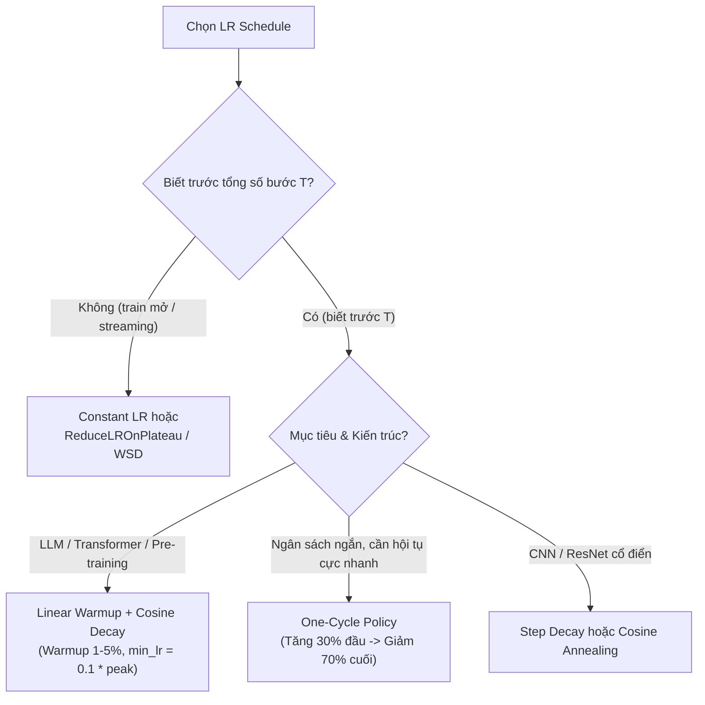

> **[Motto]**: Learning Rate là siêu tham số quan trọng nhất trong Deep Learning — và giá trị tối ưu của nó không bao giờ là hằng số suốt quá trình huấn luyện.

---

## Thông tin nhanh (Quick Spec)

* **Loại bài (Type):** Thực chiến (Build)
* **Ngôn ngữ & Công cụ:** Python 3.12 (Standard Library — 0 thư viện ngoài)
* **Kiến thức tiên quyết (Prerequisites):** Bài 06 (Optimizers), Bài 08 (Weight Initialization)
* **Thời gian thực hành:** ~50 phút

---

## Mục tiêu bài học (Learning Objectives)

Sau bài học này, bạn sẽ có khả năng:
- [ ] Giải thích tại sao **Learning Rate cố định** không bao giờ đạt tối ưu ở cả đầu lẫn cuối quá trình huấn luyện.
- [ ] Phân tích cơ chế **Linear Warmup** giúp ổn định trạng thái phương sai của Adam/AdamW và tránh Loss spike ở giai đoạn đầu.
- [ ] Tự tay xây dựng 5 lớp Scheduler hoàn chỉnh thuần Python 3.12: **Step Decay**, **Exponential Decay**, **Cosine Annealing**, **Linear Warmup + Cosine Decay** và **One-Cycle LR**.
- [ ] Chọn đúng lịch trình và tỷ lệ `warmup_steps`, `min_lr` cho cả bài toán Pre-training dài hơi lẫn Fine-tuning ngân sách nhỏ.

---

## 1. Vấn đề thực tế (The Problem)

> *Bạn đã chọn kiến trúc chuẩn, dùng AdamW, khởi tạo He/Xavier đúng sách giáo khoa — nhưng Loss giảm mạnh 20 epoch đầu rồi cứ nhấp nhô mãi ở mức 0.35 không chịu xuống nữa.*

Sự khác biệt giữa một mô hình đạt 90% và một mô hình đạt 95% độ chính xác thường không nằm ở việc thay đổi kiến trúc, mà nằm ở **Learning Rate Schedule**.

Nhu cầu về kích thước bước nhảy thay đổi hoàn toàn qua 3 giai đoạn huấn luyện:

1. **Giai đoạn khởi động (0–5% đầu):** Trọng số còn ngẫu nhiên, ước lượng phương sai $v_t$ trong AdamW mới chỉ dựa trên vài mini-batch nhiễu. Nếu thả ngay `peak_lr` lớn, mô hình dễ thực hiện vài bước nhảy thô bạo làm hỏng luôn cấu trúc biểu diễn ban đầu (đặc biệt trên Transformer sâu).
2. **Giai đoạn khám phá (5–60% giữa):** Mô hình cần tốc độ học đủ lớn để vượt qua các vùng phẳng, thoát khỏi cực tiểu sắc nhọn (sharp minima) và tiến nhanh vào thung lũng rộng (flat minima) có khả năng tổng quát hóa tốt.
3. **Giai đoạn tinh chỉnh (60–100% cuối):** Khi đã ở gần đáy thung lũng, bước nhảy lớn sẽ làm mô hình bật qua bật lại hai bên sườn dốc. Lúc này cần giảm dần Learning Rate về mức nhỏ (`lr_min`) để đáp êm xuống đúng điểm cực tiểu.

Mọi mô hình nền tảng hiện đại (GPT-3, Llama 3, Mistral, ViT) đều đầu tư hàng triệu đô-la compute để tinh chỉnh lịch trình Learning Rate — trong đó **Linear Warmup + Cosine Decay** đã trở thành chuẩn công nghiệp.

---

## 2. Mô hình tư duy & Bản chất (The Concept)

### Cây quyết định chọn Learning Rate Schedule



### Toán học cốt lõi (KaTeX)

#### 1. Step Decay và Exponential Decay

**Step Decay** cắt giảm tốc độ học theo bậc thang sau mỗi chu kỳ $s$ bước với hệ số $\gamma \in (0, 1)$, trong khi **Exponential Decay** giảm đều theo hàm mũ ở mọi bước:

$$\eta_{\text{step}}(t) = \eta_0 \cdot \gamma^{\lfloor t / s \rfloor}, \qquad \eta_{\text{exp}}(t) = \eta_0 \cdot \gamma^t$$

Nhược điểm của Step Decay là cú rơi đột ngột dễ gây xáo trộn động lượng, và phải dò tay các mốc giảm; còn Exponential Decay thường giảm quá gắt ở đầu hoặc tụt quá nhanh về 0 ở giữa chừng.

#### 2. Cosine Annealing

**Cosine Annealing** giảm mượt từ $\eta_{\max}$ xuống $\eta_{\min}$ theo nửa chu kỳ hàm cosin trên tổng $T$ bước:

$$\eta_{\text{cos}}(t) = \eta_{\min} + \frac{1}{2}(\eta_{\max} - \eta_{\min})\left(1 + \cos\left(\frac{\pi t}{T}\right)\right)$$

Đường cong cosin giảm rất chậm lúc đầu (giữ sức khám phá), dốc dần ở đoạn giữa (giai đoạn học nhanh nhất) và lại thoai thoải ở cuối (tinh chỉnh mịn quanh đáy).

#### 3. Linear Warmup + Cosine Decay (Chuẩn LLM)

Kết hợp pha tăng tuyến tính trong $T_w$ bước đầu tiên rồi chuyển mượt sang giảm cosin trong $(T - T_w)$ bước còn lại:

$$\eta(t) = \begin{cases} \eta_{\max} \cdot \dfrac{t + 1}{T_w} & \text{nếu } t < T_w \\[10pt] \eta_{\min} + \dfrac{1}{2}(\eta_{\max} - \eta_{\min})\left(1 + \cos\left(\pi \cdot \dfrac{t - T_w}{T - T_w}\right)\right) & \text{nếu } t \ge T_w \end{cases}$$

#### 4. One-Cycle Policy

Đề xuất bởi Leslie Smith (2018): trong `pct_start` (thường 30%) bước đầu, tăng mượt từ $\eta_{\max}/\text{div}$ lên $\eta_{\max}$ (đóng vai trò điều chuẩn động giúp thoát cực tiểu hẹp), sau đó giảm cosin suốt 70% bước cuối xuống $\eta_{\max}/(\text{div} \cdot \text{final\_div})$.

---

## 3. Tự tay xây dựng từ đầu (Build It: From Scratch)

Toàn bộ 5 lớp LR Scheduler dưới đây được viết **100% thuần Python 3.12 Standard Library (`math`)**, thiết kế sạch theo giao diện `get_lr(step)` và `step()` tương tự PyTorch.

### Bước 1: Lớp nền và 5 bộ điều phối Learning Rate

```python
import math


class LRScheduler:
    """Lớp cơ sở cho các Learning Rate Scheduler."""

    def __init__(self, base_lr: float) -> None:
        self.base_lr = base_lr
        self.current_step = 0

    def get_lr(self, step: int) -> float:
        raise NotImplementedError

    def step(self) -> float:
        """Lấy LR cho bước hiện tại và tự tăng bộ đếm bước."""
        lr = self.get_lr(self.current_step)
        self.current_step += 1
        return lr


class StepDecayLR(LRScheduler):
    """Giảm LR theo hệ số gamma sau mỗi step_size bước."""

    def __init__(
        self, base_lr: float, step_size: int, gamma: float = 0.1
    ) -> None:
        super().__init__(base_lr)
        self.step_size = max(1, step_size)
        self.gamma = gamma

    def get_lr(self, step: int) -> float:
        return self.base_lr * (self.gamma ** (step // self.step_size))


class ExponentialDecayLR(LRScheduler):
    """Giảm LR liên tục theo hàm mũ: base_lr * (gamma ** step)."""

    def __init__(self, base_lr: float, gamma: float = 0.995) -> None:
        super().__init__(base_lr)
        self.gamma = gamma

    def get_lr(self, step: int) -> float:
        return self.base_lr * (self.gamma ** step)


class CosineAnnealingLR(LRScheduler):
    """Giảm mượt theo đường cong cosin từ base_lr xuống min_lr."""

    def __init__(
        self, base_lr: float, total_steps: int, min_lr: float = 0.0
    ) -> None:
        super().__init__(base_lr)
        self.total_steps = max(1, total_steps)
        self.min_lr = min_lr

    def get_lr(self, step: int) -> float:
        progress = min(1.0, max(0.0, step / self.total_steps))
        return self.min_lr + 0.5 * (self.base_lr - self.min_lr) * (
            1.0 + math.cos(math.pi * progress)
        )


class WarmupCosineLR(LRScheduler):
    """Chuẩn mực cho LLM/Transformer: Linear Warmup -> Cosine Decay."""

    def __init__(
        self,
        base_lr: float,
        warmup_steps: int,
        total_steps: int,
        min_lr: float = 0.0,
    ) -> None:
        super().__init__(base_lr)
        self.warmup_steps = max(0, warmup_steps)
        self.total_steps = max(self.warmup_steps + 1, total_steps)
        self.min_lr = min_lr

    def get_lr(self, step: int) -> float:
        if self.warmup_steps > 0 and step < self.warmup_steps:
            # Tăng tuyến tính từ base_lr/warmup_steps lên đúng base_lr
            return self.base_lr * (step + 1) / self.warmup_steps
        decay_steps = self.total_steps - self.warmup_steps
        progress = min(1.0, max(0.0, (step - self.warmup_steps) / decay_steps))
        return self.min_lr + 0.5 * (self.base_lr - self.min_lr) * (
            1.0 + math.cos(math.pi * progress)
        )


class OneCycleLR(LRScheduler):
    """1cycle Policy: tăng cosin tới max_lr trong pct_start đầu rồi hạ sâu."""

    def __init__(
        self,
        max_lr: float,
        total_steps: int,
        pct_start: float = 0.3,
        div_factor: float = 25.0,
        final_div_factor: float = 1000.0,
    ) -> None:
        super().__init__(max_lr)
        self.total_steps = max(2, total_steps)
        self.up_steps = max(1, int(self.total_steps * pct_start))
        self.init_lr = max_lr / div_factor
        self.final_lr = self.init_lr / final_div_factor

    def get_lr(self, step: int) -> float:
        if step < self.up_steps:
            progress = step / self.up_steps
            return self.init_lr + 0.5 * (self.base_lr - self.init_lr) * (
                1.0 - math.cos(math.pi * progress)
            )
        down_steps = max(1, self.total_steps - self.up_steps)
        progress = min(1.0, (step - self.up_steps) / down_steps)
        return self.final_lr + 0.5 * (self.base_lr - self.final_lr) * (
            1.0 + math.cos(math.pi * progress)
        )
```

### Bước 2: In bảng đối chiếu lịch trình từng bước và kiểm chứng hội tụ

```python
def simulate_noisy_quadratic(
    scheduler: LRScheduler | None,
    const_lr: float = 0.08,
    total_steps: int = 1000,
) -> float:
    """Tối ưu f(x) = 0.5 * x^2 với mini-batch gradient có nhiễu đối xứng."""
    x = 10.0
    for step in range(total_steps):
        lr = scheduler.step() if scheduler is not None else const_lr
        # Giả lập nhiễu mini-batch có biên độ 0.8 (nhiễu không biến mất quanh đáy)
        noise = 0.8 * math.sin(step * 1.7)
        grad = x + noise
        x -= lr * grad
    return 0.5 * x * x


if __name__ == "__main__":
    TOTAL = 1000
    PEAK = 3e-4
    MIN_LR = 3e-5

    schedulers: dict[str, LRScheduler] = {
        "StepDecay": StepDecayLR(base_lr=PEAK, step_size=300, gamma=0.3),
        "ExpDecay": ExponentialDecayLR(base_lr=PEAK, gamma=0.9977),
        "Cosine": CosineAnnealingLR(base_lr=PEAK, total_steps=TOTAL, min_lr=MIN_LR),
        "WarmupCos": WarmupCosineLR(base_lr=PEAK, warmup_steps=100, total_steps=TOTAL, min_lr=MIN_LR),
        "OneCycle": OneCycleLR(max_lr=PEAK, total_steps=TOTAL, pct_start=0.3),
    }

    checkpoints = [0, 25, 50, 99, 200, 300, 500, 750, 999]
    print("=== 1. Bảng diễn biến Learning Rate theo Step (peak=3.0e-4, T=1000) ===")
    header = f"{'Step':>6} " + " ".join(f"{name:>12}" for name in schedulers)
    print(header)
    print("-" * len(header))
    for s in checkpoints:
        vals = " ".join(f"{sched.get_lr(s):>12.2e}" for sched in schedulers.values())
        print(f"{s:>6} {vals}")

    print("\n=== 2. Kiểm chứng hội tụ trên hàm mục tiêu có nhiễu mini-batch ===")
    loss_const = simulate_noisy_quadratic(None, const_lr=0.15, total_steps=500)
    loss_wc = simulate_noisy_quadratic(
        WarmupCosineLR(base_lr=0.15, warmup_steps=40, total_steps=500, min_lr=0.002),
        total_steps=500,
    )
    loss_1c = simulate_noisy_quadratic(
        OneCycleLR(max_lr=0.15, total_steps=500, pct_start=0.3),
        total_steps=500,
    )
    print(f"Constant LR (0.15)       -> Final Loss = {loss_const:.2e} (dao động quanh đáy vì nhiễu)")
    print(f"Warmup + Cosine (0.15)   -> Final Loss = {loss_wc:.2e} (đáp êm sát đáy)")
    print(f"One-Cycle LR (0.15)      -> Final Loss = {loss_1c:.2e} (hội tụ sâu nhất)")
```

---

## 4. Ứng dụng thực tế & So sánh Framework (Use It)

| Lịch trình (Schedule) | PyTorch / HuggingFace API | Thông số thực chiến tiêu biểu | Ví dụ mô hình ngoài đời thực |
|---|---|---|---|
| **Step Decay** | `optim.lr_scheduler.StepLR` / `MultiStepLR` | `gamma=0.1` tại epoch 30, 60, 90 | ResNet-50 trên ImageNet |
| **Cosine Annealing** | `optim.lr_scheduler.CosineAnnealingLR` | `T_max=total_steps`, `eta_min=0.1 * peak` | ViT, ConvNeXt, Diffusion Models |
| **Linear Warmup + Cosine** | `transformers.get_cosine_schedule_with_warmup` hoặc `SequentialLR(LinearLR, CosineAnnealingLR)` | `warmup = 1–5%` tổng bước, giảm về `10%` peak LR | **Llama 3** (`peak=3e-4`, `warmup=2000`, `min=3e-5`), **GPT-3** |
| **One-Cycle LR** | `optim.lr_scheduler.OneCycleLR` | `pct_start=0.3`, `div_factor=25` | Fast.ai Vision, huấn luyện ngân sách GPU hạn chế |
| **WSD (Warmup-Stable-Decay)** | Tự viết bằng `LambdaLR` | Warmup $\rightarrow$ giữ phẳng $\rightarrow$ giảm nhanh 10–20% cuối | **MiniCPM, Qwen, DeepSeek** (dễ train tiếp mà không cần biết trước $T$) |

**Production Tips:**
- **Cẩn thận đơn vị Step vs Epoch:** `CosineAnnealingLR` hay `get_cosine_schedule_with_warmup` trong huấn luyện Transformer/LLM phải gọi `scheduler.step()` **sau mỗi bước cập nhật Optimizer** (chú ý: sau khi đã cộng dồn `gradient_accumulation_steps`, không phải sau mỗi micro-batch!).
- **Luôn giữ `min_lr` bằng 5–10% `peak_lr` thay vì giảm về đúng 0:** Thực nghiệm từ Chinchilla và Llama cho thấy giảm về `0.1 * peak_lr` giữ cho mô hình tiếp tục học hiệu quả ở giai đoạn cuối mà không bị đóng băng sớm.
- **Mở rộng bài toán không biết trước tổng bước $T$:** Điểm yếu lớn nhất của Cosine Decay là nếu bạn muốn huấn luyện thêm dữ liệu sau khi LR đã tụt đáy, phải hâm nóng lại gây sốc Loss. Đó là lý do nhiều phòng lab LLM gần đây chuyển sang **WSD (Warmup–Stable–Decay)**: giữ LR ổn định ở pha chính, chỉ hạ dốc ở giai đoạn cooldown cuối cùng.

---

## 5. Đóng gói & Tái sử dụng (Ship It)

**Checklist thiết lập LR Scheduler không lỗi:**
- [ ] **Đúng thứ tự gọi hàm:** Luôn gọi `optimizer.step()` **trước** `scheduler.step()`. Gọi ngược sẽ khiến PyTorch cảnh báo và bỏ qua bước LR đầu tiên.
- [ ] **Đúng tổng số bước khi dùng Gradient Accumulation:** `total_steps = (len(train_loader) // grad_accum_steps) * num_epochs`. Tính sai `total_steps` là nguyên nhân số 1 khiến LR tụt về `min_lr` khi mới đi được 1/4 quá trình huấn luyện!
- [ ] **Log LR lên TensorBoard/W&B:** Luôn vẽ biểu đồ `lr` theo `global_step` trong 5 phút chạy đầu tiên để mắt thường xác nhận đường cong tăng Warmup và giảm Decay đúng kỳ vọng.
- [ ] **Lưu trạng thái khi Checkpoint:** Khi lưu checkpoint để resume training, nhớ lưu kèm `scheduler.state_dict()` cùng với `model` và `optimizer`.

**Cheatsheet công thức LR nhanh theo tác vụ:**

| Tác vụ | Peak LR | Warmup | Decay Schedule |
|---|---|---|---|
| **Pre-train Transformer nhỏ (< 1B)** | `3e-4` – `6e-4` | 2% – 5% tổng bước | Cosine về `0.1 * peak` |
| **Full Fine-tuning LLM** | `1e-5` – `5e-5` | 3% – 10% tổng bước | Cosine về `0` hoặc `0.1 * peak` |
| **LoRA / QLoRA Fine-tuning** | `1e-4` – `3e-4` | 3% – 5% tổng bước | Cosine về `0` |
| **Huấn luyện CNN từ đầu (SGD)** | `0.1` | 0% – 5% (nếu batch > 256) | Cosine hoặc Step Decay |

---

## 6. Giải ngố thuật ngữ (Key Terms & Misconceptions)

| Thuật ngữ (Term) | Người ta thường nghĩ là... | Bản chất kỹ thuật thực sự là... |
|---|---|---|
| **Warmup** | Làm nóng GPU hoặc tải dữ liệu vào cache trước khi train. | Tăng dần Learning Rate từ gần 0 lên `peak_lr` để ổn định ước lượng bậc 2 ($v_t$) của Adam/AdamW và ngăn bước nhảy phá hỏng trọng số ban đầu. |
| **Cosine Annealing** | Một thuật toán tối ưu mới thay thế cho Adam. | Chỉ là hàm điều chỉnh con số `lr` theo thời gian; nó luôn phải chạy **bên trên** một Optimizer như AdamW hay SGD. |
| **One-Cycle Policy** | Giảm Learning Rate một lần duy nhất rồi dừng. | Chu kỳ **tăng trước, giảm sau**: pha tăng LR đóng vai trò điều chuẩn động giúp mô hình thoát khỏi hố cực tiểu hẹp trước khi hạ sâu vào hố phẳng. |
| **LR Range Test** | Thử vài giá trị LR ngẫu nhiên như `1e-3`, `1e-4` rồi chọn bằng cảm tính. | Chạy ngắn khoảng vài trăm bước trong khi tăng LR theo cấp số nhân từ `1e-7` đến `1.0` để tìm điểm ngay trước khi Loss bắt đầu bùng nổ. |

---

## 7. Bài tập thử thách (Hands-on Challenges)

1. 🟢 **Cơ bản (Easy):** Cài đặt thêm lớp `WarmupStableDecayLR` (WSD) kế thừa từ `LRScheduler` ở Mục 3: 5% đầu tăng tuyến tính, 75% giữa giữ cố định `base_lr`, và 20% cuối giảm tuyến tính (hoặc cosin) về `min_lr`. In bảng so sánh với `WarmupCosineLR`.
2. 🟡 **Trung bình (Medium):** Cài đặt **Cosine Annealing with Warm Restarts (SGDR)** — cứ sau $T_0$ bước lại đặt lại LR lên `base_lr` và nhân đôi chu kỳ $T_{\text{cur}} = T_0 \cdot 2^k$. Kiểm tra đường cong LR qua 1.000 bước.
3. 🔴 **Nâng cao (Hard):** Kết hợp `AdamW` từ Bài 06 và `WarmupCosineLR` từ bài này để xây dựng một **LR Range Test** tự động trên hàm mục tiêu có nhiễu: quét LR theo thang log từ `1e-5` đến `1.0` trong 200 bước, phát hiện tự động ngưỡng LR nơi Loss bắt đầu phân kỳ và đề xuất `peak_lr = lr_diverge / 10`.

---

## 8. Tài liệu đọc thêm (Further Reading)

- [SGDR: Stochastic Gradient Descent with Warm Restarts (Loshchilov & Hutter, 2017)](https://arxiv.org/abs/1608.03983) — *Bài báo giới thiệu Cosine Annealing và cơ chế Warm Restarts, đặt nền móng cho các lịch trình hiện đại.*
- [Super-Convergence: Very Fast Training of Neural Networks Using Large Learning Rates (Smith & Topin, 2018)](https://arxiv.org/abs/1708.07120) — *Giải thích sâu sắc về 1cycle Policy và hiện tượng siêu hội tụ khi tăng LR ở pha đầu.*
- [Accurate, Large Minibatch SGD: Training ImageNet in 1 Hour (Goyal et al., 2017)](https://arxiv.org/abs/1706.02677) — *Quy tắc nhân tuyến tính Learning Rate theo Batch Size và vai trò sống còn của Linear Warmup ở quy mô lớn.*
