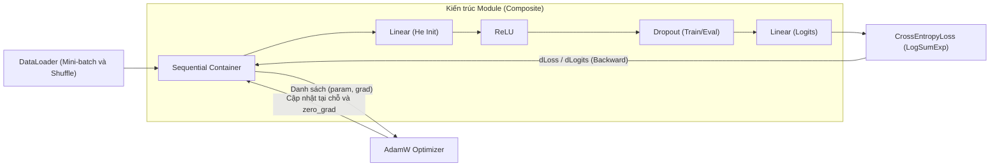

> **[Motto]**: PyTorch không phải phép màu — nó chỉ là kiến trúc phần mềm tốt bao bọc phép nhân ma trận, quy tắc chuỗi và vòng lặp tối ưu mà bạn hoàn toàn có thể tự tay xây dựng.

---

## Thông tin nhanh (Quick Spec)

* **Loại bài (Type):** Thực chiến (Build)
* **Ngôn ngữ & Công cụ:** Python 3.12, NumPy
* **Kiến thức tiên quyết (Prerequisites):** Toàn bộ Phase 03 (Bài 01 đến 09: Backpropagation, Activation, Loss, AdamW, Regularization, Weight Init)
* **Thời gian thực hành:** ~90 phút

---

## Mục tiêu bài học (Learning Objectives)

Sau bài học này, bạn sẽ có khả năng:
- [ ] Thiết kế và cài đặt kiến trúc **Module** cơ sở (`forward`, `backward`, `parameters`, `train`, `eval`) theo mẫu Composite Pattern.
- [ ] Tự tay xây dựng trọn bộ các thành phần lõi thuần NumPy: `Linear` (He init), `ReLU`, `Dropout` (Inverted Dropout), `Sequential`, `CrossEntropyLoss` (ổn định bằng LogSumExp), `AdamW` và `DataLoader`.
- [ ] Giải thích chính xác lý do `model.train()`, `model.eval()` và `optimizer.zero_grad()` tồn tại trong mọi framework hiện đại.
- [ ] Huấn luyện thành công mạng MLP nhiều tầng trên tập dữ liệu phi tuyến hai vòng tròn đồng tâm (concentric circles) đạt độ chính xác kiểm thử >95%.

---

## 1. Vấn đề thực tế (The Problem)

> *Sau 9 bài học, bạn đã viết rời rạc từng mảnh: khởi tạo He, hàm kích hoạt ReLU, hàm mất mát Cross-Entropy, bộ tối ưu AdamW, Dropout. Làm sao ghép tất cả thành một hệ thống không vỡ nát mỗi khi đổi kiến trúc mạng?*

Nếu bạn cứ copy-paste mã nguồn từ 5 file khác nhau để nối thành một mạng 4 tầng, chuyện gì sẽ xảy ra khi sếp yêu cầu: *"Thử thêm tầng ẩn 64 nút, chèn Dropout 0.2 và đổi sang AdamW xem sao"*? Bạn sẽ phải sửa lại toàn bộ chuỗi đạo hàm `backward` bằng tay, tự quản lý danh sách ma trận trọng số `W1, b1, W2, b2...`, và rất dễ quên tắt Dropout khi đánh giá tập test.

Đó chính xác là lý do các Deep Learning Framework ra đời. PyTorch, Keras hay Flax không phát minh lại phép nhân ma trận; chúng cung cấp **bộ khung trừu tượng hóa (abstraction)** chuẩn mực để:
1. Định nghĩa mọi tầng mạng theo cùng một giao diện (`Module`).
2. Gom tham số và đạo hàm tự động để Optimizer không cần biết kiến trúc mạng trông ra sao.
3. Quản lý trạng thái huấn luyện (`train`) và suy luận (`eval`) xuyên suốt toàn bộ cây mô hình.

Khi tự tay viết một Mini Framework trong khoảng 200 dòng NumPy sạch sẽ, bạn sẽ không bao giờ còn nhìn PyTorch như một "hộp đen" nữa.

---

## 2. Mô hình tư duy & Bản chất (The Concept)

Toàn bộ một Deep Learning Framework xoay quanh 4 trụ cột độc lập nhưng khớp nối chặt chẽ với nhau qua giao diện dữ liệu:



### Bốn nguyên lý thiết kế cốt lõi

1. **Giao diện `Module` thống nhất (Composite Pattern):** Mọi tầng (`Linear`, `ReLU`, `Dropout`) và cả container chứa nhiều tầng (`Sequential`) đều kế thừa từ `Module`. Khi `Sequential.forward(x)` chạy xuôi từ trái sang phải, `Sequential.backward(grad)` đơn giản chỉ đảo ngược danh sách tầng và đẩy gradient chạy ngược từ phải sang trái.
2. **Tách trạng thái Train/Eval:** Trong Inverted Dropout, lúc huấn luyện ta nhân mặt nạ giữ lại với hệ số $\frac{1}{1 - p}$ để kỳ vọng giá trị kích hoạt không đổi; lúc đánh giá (`eval`), mặt nạ bị vô hiệu hóa hoàn toàn. Gọi `model.eval()` phải lan truyền đệ quy xuống mọi module con.
3. **Tách biệt Optimizer khỏi kiến trúc mạng:** `AdamW` không hề biết mạng có bao nhiêu tầng hay dùng `ReLU` hay `GELU`. Nó chỉ nhận một danh sách phẳng các cặp `(param, grad)` từ `model.parameters()`.
4. **Ổn định số học ở tầng Loss:** Kết hợp `Softmax` và `Cross-Entropy` vào cùng một khối giúp vừa tránh tràn số `exp(1000) = inf` nhờ kỹ thuật trừ cực đại (LogSumExp), vừa rút gọn công thức đạo hàm ở đầu ra xuống mức tối giản.

### Toán học cốt lõi (KaTeX)

**1. Tầng Linear (Forward và Backward cho mini-batch kích thước $B$):**

Với đầu vào $X \in \mathbb{R}^{B \times D_{\text{in}}}$, trọng số $W \in \mathbb{R}^{D_{\text{in}} \times D_{\text{out}}}$, bias $b \in \mathbb{R}^{D_{\text{out}}}$ và gradient truyền ngược $dY = \frac{\partial \mathcal{L}}{\partial Y} \in \mathbb{R}^{B \times D_{\text{out}}}$:

$$Y = XW + b$$

$$\frac{\partial \mathcal{L}}{\partial W} = X^T \, dY, \qquad \frac{\partial \mathcal{L}}{\partial b} = \sum_{i=1}^{B} dY_i, \qquad \frac{\partial \mathcal{L}}{\partial X} = dY \, W^T$$

Để giữ phương sai tín hiệu ổn định qua ReLU, trọng số khởi tạo theo **He Initialization**: $W \sim \mathcal{N}\!\left(0, \frac{2}{D_{\text{in}}}\right)$.

**2. CrossEntropyLoss ổn định với LogSumExp và đạo hàm gộp:**

Cho vector logits $z \in \mathbb{R}^{C}$ và $m = \max_k z_k$, hàm mất mát trung bình trên batch $B$ mẫu là:

$$\mathcal{L} = -\frac{1}{B} \sum_{i=1}^{B} \left[ (z_{i, y_i} - m_i) - \ln \sum_{k=1}^{C} e^{z_{i, k} - m_i} \right], \qquad \frac{\partial \mathcal{L}}{\partial z_{i, k}} = \frac{p_{i, k} - \mathbb{I}(k = y_i)}{B}$$

Trong đó $p_{i, k} = \text{softmax}(z_i)_k$. Công thức đạo hàm này hoàn toàn không có phép chia cho $p_{i,k}$ nên không bao giờ nổ gradient khi $p \to 0$.

**3. Cập nhật AdamW (Decoupled Weight Decay):**

Tại bước $t$, khác với L2 regularization trộn vào gradient, AdamW tách rời bước suy giảm trọng số (weight decay $\lambda$) trực tiếp lên tham số $\theta$:

$$\theta_t = \theta_{t-1} - \eta \lambda \theta_{t-1} - \eta \frac{\hat{m}_t}{\sqrt{\hat{v}_t} + \epsilon}$$

---

## 3. Tự tay xây dựng từ đầu (Build It: From Scratch)

Toàn bộ Mini Framework bên dưới chỉ sử dụng **Python chuẩn + NumPy** (tuyệt đối không dùng PyTorch/JAX/scikit-learn), được vector hóa hoàn toàn theo mini-batch để chạy nhanh gấp hàng trăm lần vòng lặp từng mẫu.

```python
from __future__ import annotations

from dataclasses import dataclass
from typing import Iterator, List, Tuple
import numpy as np


@dataclass
class Parameter:
    """Bọc mảng trọng số và mảng gradient tương ứng để Optimizer cập nhật tại chỗ."""

    data: np.ndarray
    grad: np.ndarray
    weight_decay: bool = True

    @classmethod
    def create(cls, data: np.ndarray, weight_decay: bool = True) -> "Parameter":
        arr = data.astype(np.float64, copy=False)
        return cls(data=arr, grad=np.zeros_like(arr), weight_decay=weight_decay)


class Module:
    """Lớp cơ sở cho mọi tầng mạng và container."""

    def __init__(self) -> None:
        self.training: bool = True

    def forward(self, x: np.ndarray) -> np.ndarray:
        raise NotImplementedError

    def backward(self, grad_output: np.ndarray) -> np.ndarray:
        raise NotImplementedError

    def __call__(self, x: np.ndarray) -> np.ndarray:
        return self.forward(x)

    def parameters(self) -> List[Parameter]:
        return []

    def train(self) -> "Module":
        self.training = True
        return self

    def eval(self) -> "Module":
        self.training = False
        return self


class Linear(Module):
    """Tầng kết nối đầy đủ Y = XW + b với He Initialization."""

    def __init__(self, in_features: int, out_features: int, rng: np.random.Generator) -> None:
        super().__init__()
        scale = np.sqrt(2.0 / in_features)
        self.weight = Parameter.create(
            rng.normal(0.0, scale, size=(in_features, out_features)),
            weight_decay=True,
        )
        self.bias = Parameter.create(
            np.zeros(out_features, dtype=np.float64),
            weight_decay=False,
        )
        self._cache_x: np.ndarray | None = None

    def forward(self, x: np.ndarray) -> np.ndarray:
        self._cache_x = x
        return x @ self.weight.data + self.bias.data

    def backward(self, grad_output: np.ndarray) -> np.ndarray:
        assert self._cache_x is not None, "Phải gọi forward() trước backward()."
        self.weight.grad += self._cache_x.T @ grad_output
        self.bias.grad += np.sum(grad_output, axis=0)
        return grad_output @ self.weight.data.T

    def parameters(self) -> List[Parameter]:
        return [self.weight, self.bias]


class ReLU(Module):
    """Hàm kích hoạt ReLU: max(0, x)."""

    def __init__(self) -> None:
        super().__init__()
        self._mask: np.ndarray | None = None

    def forward(self, x: np.ndarray) -> np.ndarray:
        self._mask = (x > 0.0).astype(np.float64)
        return x * self._mask

    def backward(self, grad_output: np.ndarray) -> np.ndarray:
        assert self._mask is not None
        return grad_output * self._mask


class Dropout(Module):
    """Inverted Dropout: tắt ngẫu nhiên xác suất p khi train, giữ nguyên khi eval."""

    def __init__(self, p: float, rng: np.random.Generator) -> None:
        super().__init__()
        if not 0.0 <= p < 1.0:
            raise ValueError("Xác suất Dropout p phải nằm trong [0, 1).")
        self.p = p
        self.rng = rng
        self._mask: np.ndarray | None = None

    def forward(self, x: np.ndarray) -> np.ndarray:
        if not self.training or self.p == 0.0:
            self._mask = None
            return x
        keep_prob = 1.0 - self.p
        self._mask = (self.rng.random(x.shape) < keep_prob).astype(np.float64) / keep_prob
        return x * self._mask

    def backward(self, grad_output: np.ndarray) -> np.ndarray:
        if not self.training or self._mask is None:
            return grad_output
        return grad_output * self._mask


class Sequential(Module):
    """Container nối chuỗi các Module theo đúng thứ tự forward và đảo ngược khi backward."""

    def __init__(self, *modules: Module) -> None:
        super().__init__()
        self.modules: List[Module] = list(modules)

    def forward(self, x: np.ndarray) -> np.ndarray:
        for module in self.modules:
            x = module.forward(x)
        return x

    def backward(self, grad_output: np.ndarray) -> np.ndarray:
        for module in reversed(self.modules):
            grad_output = module.backward(grad_output)
        return grad_output

    def parameters(self) -> List[Parameter]:
        params: List[Parameter] = []
        for module in self.modules:
            params.extend(module.parameters())
        return params

    def train(self) -> "Sequential":
        self.training = True
        for module in self.modules:
            module.train()
        return self

    def eval(self) -> "Sequential":
        self.training = False
        for module in self.modules:
            module.eval()
        return self


class CrossEntropyLoss:
    """Softmax + Negative Log-Likelihood dùng kỹ thuật LogSumExp ổn định số học."""

    def __init__(self) -> None:
        self._probs: np.ndarray | None = None
        self._targets: np.ndarray | None = None

    def __call__(self, logits: np.ndarray, targets: np.ndarray) -> float:
        shifted = logits - np.max(logits, axis=1, keepdims=True)
        log_sum_exp = np.log(np.sum(np.exp(shifted), axis=1, keepdims=True))
        log_probs = shifted - log_sum_exp
        self._probs = np.exp(log_probs)
        self._targets = targets.astype(np.int64)

        batch_size = logits.shape[0]
        correct_log_probs = log_probs[np.arange(batch_size), self._targets]
        return float(-np.mean(correct_log_probs))

    def backward(self) -> np.ndarray:
        assert self._probs is not None and self._targets is not None
        batch_size = self._probs.shape[0]
        grad = self._probs.copy()
        grad[np.arange(batch_size), self._targets] -= 1.0
        return grad / batch_size


class AdamW:
    """Bộ tối ưu AdamW với decoupled weight decay (không áp decay lên bias)."""

    def __init__(
        self,
        params: List[Parameter],
        lr: float = 1e-2,
        betas: Tuple[float, float] = (0.9, 0.999),
        eps: float = 1e-8,
        weight_decay: float = 1e-2,
    ) -> None:
        self.params = params
        self.lr = lr
        self.beta1, self.beta2 = betas
        self.eps = eps
        self.weight_decay = weight_decay
        self.t = 0
        self.m = [np.zeros_like(p.data) for p in params]
        self.v = [np.zeros_like(p.data) for p in params]

    def zero_grad(self) -> None:
        for p in self.params:
            p.grad.fill(0.0)

    def step(self) -> None:
        self.t += 1
        bc1 = 1.0 - self.beta1 ** self.t
        bc2 = 1.0 - self.beta2 ** self.t
        for i, p in enumerate(self.params):
            if p.weight_decay and self.weight_decay > 0.0:
                p.data -= self.lr * self.weight_decay * p.data

            g = p.grad
            self.m[i] = self.beta1 * self.m[i] + (1.0 - self.beta1) * g
            self.v[i] = self.beta2 * self.v[i] + (1.0 - self.beta2) * (g * g)

            m_hat = self.m[i] / bc1
            v_hat = self.v[i] / bc2
            p.data -= self.lr * m_hat / (np.sqrt(v_hat) + self.eps)


class DataLoader:
    """Cắt mảng dữ liệu thành mini-batch và xáo trộn ngẫu nhiên mỗi epoch."""

    def __init__(
        self,
        features: np.ndarray,
        labels: np.ndarray,
        batch_size: int = 32,
        shuffle: bool = True,
        rng: np.random.Generator | None = None,
    ) -> None:
        self.features = features
        self.labels = labels
        self.batch_size = batch_size
        self.shuffle = shuffle
        self.rng = rng or np.random.default_rng(0)

    def __iter__(self) -> Iterator[Tuple[np.ndarray, np.ndarray]]:
        indices = np.arange(len(self.features))
        if self.shuffle:
            self.rng.shuffle(indices)
        for start in range(0, len(indices), self.batch_size):
            batch_idx = indices[start : start + self.batch_size]
            yield self.features[batch_idx], self.labels[batch_idx]


def make_concentric_circles(
    n_samples: int = 800, noise: float = 0.08, seed: int = 42
) -> Tuple[np.ndarray, np.ndarray]:
    """Tạo bài toán phân loại phi tuyến 2 vòng tròn đồng tâm (thuần NumPy)."""
    rng = np.random.default_rng(seed)
    n_half = n_samples // 2

    angles_outer = rng.uniform(0.0, 2.0 * np.pi, size=n_half)
    outer = np.column_stack([np.cos(angles_outer), np.sin(angles_outer)])

    angles_inner = rng.uniform(0.0, 2.0 * np.pi, size=n_samples - n_half)
    inner = 0.45 * np.column_stack([np.cos(angles_inner), np.sin(angles_inner)])

    x = np.vstack([outer, inner]) + rng.normal(0.0, noise, size=(n_samples, 2))
    y = np.concatenate([np.zeros(n_half, dtype=np.int64), np.ones(n_samples - n_half, dtype=np.int64)])

    perm = rng.permutation(n_samples)
    return x[perm], y[perm]


def compute_accuracy(model: Module, x: np.ndarray, y: np.ndarray) -> float:
    model.eval()
    logits = model(x)
    preds = np.argmax(logits, axis=1)
    return float(np.mean(preds == y))


def main() -> None:
    rng = np.random.default_rng(42)
    x_all, y_all = make_concentric_circles(n_samples=800, noise=0.08, seed=42)

    split = int(0.8 * len(x_all))
    x_train, y_train = x_all[:split], y_all[:split]
    x_test, y_test = x_all[split:], y_all[split:]

    model = Sequential(
        Linear(2, 32, rng),
        ReLU(),
        Dropout(0.1, rng),
        Linear(32, 32, rng),
        ReLU(),
        Dropout(0.1, rng),
        Linear(32, 2, rng),
    )

    criterion = CrossEntropyLoss()
    optimizer = AdamW(model.parameters(), lr=1e-2, weight_decay=1e-2)
    train_loader = DataLoader(x_train, y_train, batch_size=32, shuffle=True, rng=rng)

    for epoch in range(1, 61):
        model.train()
        total_loss = 0.0
        total_samples = 0

        for xb, yb in train_loader:
            optimizer.zero_grad()
            logits = model(xb)
            loss = criterion(logits, yb)
            grad_logits = criterion.backward()
            model.backward(grad_logits)
            optimizer.step()

            total_loss += loss * len(xb)
            total_samples += len(xb)

        if epoch == 1 or epoch % 15 == 0:
            avg_loss = total_loss / total_samples
            train_acc = compute_accuracy(model, x_train, y_train)
            test_acc = compute_accuracy(model, x_test, y_test)
            print(
                f"Epoch {epoch:2d} | Loss: {avg_loss:.4f} | "
                f"Train Acc: {train_acc:.2%} | Test Acc: {test_acc:.2%}"
            )


if __name__ == "__main__":
    main()
```

---

## 4. Ứng dụng thực tế & So sánh Framework (Use It)

Mọi dòng mã bạn vừa tự xây dựng đều khớp **1-đối-1** với các framework sản xuất (production). Bảng dưới đây là bản đồ ánh xạ giúp bạn chuyển thẳng sang PyTorch (Bài 11) và JAX (Bài 12) không một chút bỡ ngỡ:

| Thành phần Mini Framework | PyTorch tương đương | JAX / Flax + Optax tương đương | Vai trò cốt lõi |
|---|---|---|---|
| `Module` + `Parameter` | `nn.Module` + `nn.Parameter` | Pure function + Pytree `params` | Đóng gói tính toán và đăng ký trọng số |
| `Sequential(...)` | `nn.Sequential(...)` | Chuỗi hàm / `flax.linen.Sequential` | Xếp chồng tầng xuôi-ngược tự động |
| `model.backward(grad)` | `loss.backward()` (Autograd) | `jax.value_and_grad(loss_fn)` | Tính đạo hàm bằng reverse-mode autodiff |
| `CrossEntropyLoss` | `nn.CrossEntropyLoss()` | `optax.softmax_cross_entropy_with_integer_labels` | Nhận raw logits, tính loss ổn định số học |
| `AdamW` + `zero_grad()` | `torch.optim.AdamW` | `optax.adamw(...)` (không cần `zero_grad`) | Cập nhật trọng số với decoupled weight decay |
| `model.train()` / `eval()` | `model.train()` / `model.eval()` | Truyền cờ `training=True/False` tường minh | Bật/tắt Dropout và thống kê BatchNorm |

### Production Tips

* **Không áp Weight Decay lên Bias và Normalization:** Trong `AdamW` ở trên, ta gắn cờ `weight_decay=False` cho `bias`. Ở các hệ thống lớn (như GPT/LLaMA), áp weight decay lên bias và LayerNorm làm suy giảm chất lượng hội tụ rõ rệt.
* **Cộng dồn gradient (`+=`) thay vì gán đè (`=`):** Trong `Linear.backward`, ta viết `self.weight.grad += ...`. Đây là lý do bạn phải gọi `optimizer.zero_grad()` trước mỗi bước, đồng thời mở ra kỹ thuật **Gradient Accumulation** (gọi `backward` nhiều micro-batch trước khi `step` 1 lần) khi VRAM không đủ chứa batch lớn.
* **Không bao giờ gắn `Softmax` cuối mạng khi dùng `CrossEntropyLoss`:** Để `Linear` xuất thẳng raw logits giúp tránh sai số dấu phẩy động và giữ gradient sạch sẽ.

---

## 5. Đóng gói & Tái sử dụng (Ship It)

### Checklist tự kiểm định khi viết một `Module` tùy biến

- [ ] **Kiểm tra kích thước (Shape Contract):** Khẳng định rõ shape vào `(B, D_in)` và shape ra `(B, D_out)` trong cả `forward` lẫn `backward`.
- [ ] **Độc lập Train/Eval:** Nếu tầng có hành vi ngẫu nhiên (Dropout) hoặc thống kê theo batch (BatchNorm), bắt buộc kiểm tra cờ `self.training`.
- [ ] **Không áp Weight Decay sai chỗ:** Chỉ bật `weight_decay=True` cho ma trận trọng số 2D+, tắt cho bias 1D và tham số scale/shift.
- [ ] **Kiểm tra đạo hàm số (Gradient Check):** Luôn kiểm chứng `backward()` thủ công bằng sai phân hữu hạn (Bài 13) trước khi huấn luyện thật.

### Mẫu tái sử dụng: Lưu và nạp trọng số (Checkpoint) bằng NumPy

```python
import numpy as np


def save_weights(model: Sequential, path: str) -> None:
    payload = {f"p_{idx}": p.data for idx, p in enumerate(model.parameters())}
    np.savez(path, **payload)


def load_weights(model: Sequential, path: str) -> None:
    archive = np.load(path)
    for idx, p in enumerate(model.parameters()):
        key = f"p_{idx}"
        if p.data.shape != archive[key].shape:
            raise ValueError(f"Sai kích thước tham số {key}: {p.data.shape} vs {archive[key].shape}")
        p.data[...] = archive[key]
```

---

## 6. Giải ngố thuật ngữ (Key Terms & Misconceptions)

| Thuật ngữ (Term) | Người ta thường nghĩ là... | Bản chất kỹ thuật thực sự là... |
|---|---|---|
| `Module` | "Một tầng mạng thần kinh đơn lẻ" | Giao diện trừu tượng (Composite Pattern) đại diện cho bất kỳ khối tính toán khả vi nào — có thể là 1 tầng, 1 block Residual hay cả mô hình lớn. |
| `Inverted Dropout` | "Tắt ngẫu nhiên neuron lúc train và lúc test nhân thêm $(1-p)$" | Lúc train đã chia sẵn cho $(1-p)$ nên lúc suy luận (`eval`) không cần nhân hệ số nào nữa, giúp đường inference hoàn toàn thuần khiết và tối ưu tốc độ. |
| `zero_grad()` | "Bước thừa thãi gây phiền phức của framework" | Hệ quả chủ đích của thiết kế cộng dồn gradient (`+=`), cho phép hỗ trợ nhánh đồ thị dùng chung trọng số (weight sharing) và kỹ thuật Gradient Accumulation. |
| `Logits` | "Xác suất đầu ra của mô hình phân loại" | Điểm số thô chưa chuẩn hóa trong $(-\infty, +\infty)$ đi ra từ tầng `Linear` cuối cùng; cần qua `Softmax` mới thành phân phối xác suất. |

---

## 7. Bài tập thử thách (Hands-on Challenges)

1. 🟢 **Cơ bản (Easy):** Bổ sung tầng `LeakyReLU(alpha=0.01)` và `GELU` kế thừa từ `Module`, thay thế `ReLU` trong `Sequential` và so sánh tốc độ hội tụ trên tập `make_concentric_circles`.
2. 🟡 **Trung bình (Medium):** Cài đặt tầng `BatchNorm1d(num_features, momentum=0.1, eps=1e-5)` vector hóa hoàn toàn theo mini-batch (tính chính xác đạo hàm `backward` qua phương sai batch và duy trì `running_mean`/`running_var` cho chế độ `eval()`).
3. 🔴 **Nâng cao (Hard):** Nâng cấp vòng lặp huấn luyện để hỗ trợ **Gradient Accumulation** (`accum_steps = 4`) và **Cosine Annealing LR Schedule** tích hợp vào `AdamW`; chứng minh rằng tổng hợp gradient qua 4 micro-batch kích thước 8 cho kết quả cập nhật tương đương 1 batch kích thước 32 (khi tắt Dropout).

---

## 8. Tài liệu đọc thêm (Further Reading)

- [PyTorch: An Imperative Style, High-Performance Deep Learning Library (Paszke et al., NeurIPS 2019)](https://arxiv.org/abs/1912.01703) — *Bài báo gốc giải thích triết lý thiết kế `nn.Module`, quản lý bộ nhớ và cơ chế thực thi của PyTorch.*
- [Decoupled Weight Decay Regularization (Loshchilov & Hutter, ICLR 2019)](https://arxiv.org/abs/1711.05101) — *Lý do toán học tại sao AdamW tách weight decay khỏi gradient lại tổng quát hóa vượt trội so với Adam + L2.*
- [CS231n: Neural Networks Part 2 & 3 (Stanford)](https://cs231n.github.io/neural-networks-2/) — *Tài liệu kinh điển về He/Xavier init, BatchNorm, Inverted Dropout và cách thiết kế kiến trúc tầng mạng từ đầu.*
