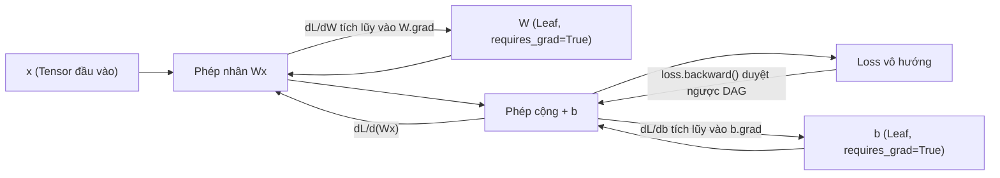

> **[Motto]**: Bạn đã tự lắp động cơ từ piston và trục khuỷu ở Bài 10; PyTorch giữ nguyên bảng điều khiển quen thuộc đó nhưng thay lõi bên dưới bằng CUDA, Autograd và trình biên dịch `torch.compile`.

---

## Thông tin nhanh (Quick Spec)

* **Loại bài (Type):** Thực chiến (Build)
* **Ngôn ngữ & Công cụ:** Python 3.12, PyTorch 2.x (`torch`, `torch.nn`)
* **Kiến thức tiên quyết (Prerequisites):** Bài 10 (Tự xây dựng Mini Deep Learning Framework)
* **Thời gian thực hành:** ~75 phút

---

## Mục tiêu bài học (Learning Objectives)

Sau bài học này, bạn sẽ có khả năng:
- [ ] Ánh xạ chính xác từng lớp trong Mini Framework Bài 10 sang `nn.Module`, `DataLoader`, `CrossEntropyLoss` và `AdamW` của PyTorch.
- [ ] Hiểu cơ chế **Tensor** (`shape`, `dtype`, `device`), **Eager Execution**, **Autograd** và vai trò của **`torch.compile`** trong PyTorch 2.x.
- [ ] Viết vòng lặp huấn luyện chuẩn production: độc lập thiết bị (`cuda`/`mps`/`cpu`), `optimizer.zero_grad(set_to_none=True)`, gradient clipping, `model.eval()` + `torch.inference_mode()` và lưu/nạp `state_dict`.
- [ ] Ứng dụng **Mixed Precision (`bf16`/`fp16`)** đúng cách để tăng tốc huấn luyện và giảm một nửa bộ nhớ VRAM.

---

## 1. Vấn đề thực tế (The Problem)

> *Mini Framework ở Bài 10 chạy rất mượt trên bài toán 800 điểm dữ liệu. Vậy tại sao ta không thể dùng nó để huấn luyện ResNet-50 hay một mô hình LLM?*

Ba giới hạn vật lý chặn đứng mọi framework tự viết bằng CPU/NumPy:
1. **Không có tăng tốc phần cứng (GPU/CUDA/MPS):** Phép nhân ma trận của một mô hình 25 triệu tham số trên CPU mất hàng giờ mỗi epoch, trong khi một GPU A100/RTX 4090 xử lý song song hàng nghìn nhân chỉ trong vài giây.
2. **Đạo hàm viết tay dễ vỡ:** Tự viết `backward()` cho một tầng `Linear` hay `ReLU` thì dễ, nhưng với Multi-Head Attention, LayerNorm lồng ghép và nhánh skip-connection phức tạp, tự đạo hàm bằng tay vừa chậm vừa đầy lỗi âm thầm.
3. **Thiếu hệ sinh thái hệ thống:** Không có `Mixed Precision`, không có nạp dữ liệu đa tiến trình (`num_workers`), không có huấn luyện phân tán (`DDP`/`FSDP`).

PyTorch giải quyết trọn vẹn cả ba vấn đề trên mà **giữ nguyên 100% mô hình tư duy** của Bài 10: `Module`, `forward`, `parameters`, `zero_grad`, `backward`, `step`, `train/eval`.

---

## 2. Mô hình tư duy & Bản chất (The Concept)

### Tại sao PyTorch thắng cuộc: Eager Execution + `torch.compile`

Trong giai đoạn đầu của Deep Learning, TensorFlow 1.x bắt kỹ sư dựng trước một đồ thị tĩnh (static graph) rồi mới biên dịch và chạy — việc đặt `breakpoint()` hay `if/else` theo dữ liệu trở thành ác mộng. PyTorch chọn **Eager Execution** (thực thi tức thì): dòng `y = model(x)` tính ngay lập tức như mã Python bình thường. Trải nghiệm debug vượt trội giúp PyTorch chiếm hơn 75% các công trình nghiên cứu và hầu hết các stack LLM mã nguồn mở (LLaMA, Hugging Face, vLLM).

Đến **PyTorch 2.x**, bài toán hiệu năng được giải quyết triệt để nhờ `torch.compile(model)`: PyTorch giữ nguyên sự tiện lợi của Eager Execution khi phát triển, nhưng tự động bắt đồ thị bằng TorchDynamo và biên dịch thành nhân Triton/C++ gộp (kernel fusion) khi chạy thật.

### Cơ chế Autograd (Đồ thị động dạng Tape)

Mỗi khi thực hiện phép toán trên Tensor có `requires_grad=True`, PyTorch ghi lại thao tác đó (`grad_fn`) vào một đồ thị có hướng không chu trình (DAG). Khi gọi `loss.backward()`, động cơ Autograd duyệt ngược đồ thị từ `loss` về các nút lá (trọng số) để điền `.grad`:



### Ba thuộc tính vàng của Tensor & Mixed Precision

Mọi `torch.Tensor` được định nghĩa bởi bộ ba `(shape, dtype, device)`. Hai Tensor khác `device` (ví dụ model trên `cuda` còn batch trên `cpu`) sẽ lập tức ném lỗi `RuntimeError`.

Trong huấn luyện hiện đại, **Mixed Precision** chạy phần lớn phép tính forward/backward ở 16-bit (`bfloat16` hoặc `float16`) để tận dụng Tensor Cores (nhanh gấp ~2x, tốn nửa VRAM), trong khi vẫn giữ bản sao trọng số chủ (master weights) ở `float32` để không mất độ chính xác khi cộng cập nhật nhỏ:

| Kiểu dữ liệu (`dtype`) | Số bit | Dải động (Dynamic Range) | Ứng dụng thực tế |
|---|---|---|---|
| `torch.float32` (`fp32`) | 32 | Rộng (~7 chữ số thập phân) | Mặc định cho master weights và bài toán nhỏ |
| `torch.float16` (`fp16`) | 16 | Hẹp (dễ underflow, cần `GradScaler`) | GPU thế hệ cũ (T4, V100, RTX 20xx) |
| `torch.bfloat16` (`bf16`) | 16 | Giống hệt `fp32`, không cần `GradScaler` | Tiêu chuẩn vàng cho GPU Ampere/Hopper (RTX 30xx/40xx, A100, H100) |

### Toán học cốt lõi (KaTeX)

**1. Giới hạn chuẩn Gradient (Gradient Clipping theo $L_2$ norm):**

Để ngăn bước cập nhật phát nổ ở các batch nhiễu hoặc mạng sâu, `clip_grad_norm_(params, max_norm)` tính chuẩn toàn cục $g_{\text{norm}}$ của toàn bộ vector gradient $g$ rồi co tỷ lệ đồng đều nếu vượt ngưỡng $c$:

$$g_{\text{norm}} = \sqrt{\sum_{i} \| g_i \|_2^2}, \qquad g \leftarrow g \cdot \min\!\left(1, \frac{c}{g_{\text{norm}} + \epsilon}\right)$$

**2. Biến đổi tỉ lệ mất mát trong FP16 Mixed Precision (`GradScaler`):**

Với hệ số khuếch đại $S$ (ví dụ $2^{16}$), ta nhân loss trước khi `backward()` để giữ gradient nhỏ khỏi bị làm tròn thành 0, sau đó chia lại $S$ trước khi `clip_grad_norm_` và `optimizer.step()`:

$$\tilde{\mathcal{L}} = S \cdot \mathcal{L} \implies \nabla_\theta \mathcal{L} = \frac{1}{S} \nabla_\theta \tilde{\mathcal{L}}$$

---

## 3. Tự tay xây dựng từ đầu (Build It: From Scratch)

Dưới đây là bản chuyển đổi **1-đối-1** trọn vẹn từ Mini Framework Bài 10 sang **PyTorch 2.x** trên đúng bài toán phân loại phi tuyến hai vòng tròn đồng tâm, tích hợp đầy đủ chuẩn mực kỹ thuật thực chiến: tự chọn thiết bị (`cuda`/`mps`/`cpu`), `MLPClassifier`, `TensorDataset`/`DataLoader`, `zero_grad(set_to_none=True)`, `clip_grad_norm_`, `torch.inference_mode()` và lưu/nạp `state_dict`.

```python
from __future__ import annotations

from pathlib import Path
from typing import Tuple
import math
import torch
import torch.nn as nn
from torch.utils.data import DataLoader, TensorDataset


def get_device() -> torch.device:
    """Tự động chọn bộ tăng tốc phần cứng tốt nhất sẵn có."""
    if torch.cuda.is_available():
        return torch.device("cuda")
    if hasattr(torch.backends, "mps") and torch.backends.mps.is_available():
        return torch.device("mps")
    return torch.device("cpu")


def make_concentric_circles_tensors(
    n_samples: int = 800, noise: float = 0.08, seed: int = 42
) -> Tuple[torch.Tensor, torch.Tensor]:
    """Tạo tập dữ liệu hai vòng tròn đồng tâm bằng thuần PyTorch Tensor."""
    gen = torch.Generator().manual_seed(seed)
    n_half = n_samples // 2

    angles_outer = torch.rand(n_half, generator=gen) * (2.0 * math.pi)
    outer = torch.stack([torch.cos(angles_outer), torch.sin(angles_outer)], dim=1)

    angles_inner = torch.rand(n_samples - n_half, generator=gen) * (2.0 * math.pi)
    inner = 0.45 * torch.stack([torch.cos(angles_inner), torch.sin(angles_inner)], dim=1)

    x = torch.cat([outer, inner], dim=0)
    x = x + torch.randn(x.shape, generator=gen) * noise
    y = torch.cat(
        [
            torch.zeros(n_half, dtype=torch.long),
            torch.ones(n_samples - n_half, dtype=torch.long),
        ]
    )

    perm = torch.randperm(n_samples, generator=gen)
    return x[perm].float(), y[perm]


class MLPClassifier(nn.Module):
    """Kiến trúc MLP tương ứng 1-1 với Mini Framework ở Bài 10."""

    def __init__(self, in_dim: int = 2, hidden_dim: int = 32, num_classes: int = 2, dropout: float = 0.1) -> None:
        super().__init__()
        self.net = nn.Sequential(
            nn.Linear(in_dim, hidden_dim),
            nn.ReLU(),
            nn.Dropout(dropout),
            nn.Linear(hidden_dim, hidden_dim),
            nn.ReLU(),
            nn.Dropout(dropout),
            nn.Linear(hidden_dim, num_classes),
        )
        self._init_weights()

    def _init_weights(self) -> None:
        for module in self.modules():
            if isinstance(module, nn.Linear):
                nn.init.kaiming_normal_(module.weight, nonlinearity="relu")
                nn.init.zeros_(module.bias)

    def forward(self, x: torch.Tensor) -> torch.Tensor:
        return self.net(x)


def train_one_epoch(
    model: nn.Module,
    loader: DataLoader[Tuple[torch.Tensor, torch.Tensor]],
    criterion: nn.Module,
    optimizer: torch.optim.Optimizer,
    device: torch.device,
    max_grad_norm: float = 1.0,
) -> Tuple[float, float]:
    model.train()
    total_loss = 0.0
    correct = 0
    total = 0

    for xb, yb in loader:
        xb = xb.to(device, non_blocking=True)
        yb = yb.to(device, non_blocking=True)

        optimizer.zero_grad(set_to_none=True)
        logits = model(xb)
        loss = criterion(logits, yb)
        loss.backward()
        torch.nn.utils.clip_grad_norm_(model.parameters(), max_norm=max_grad_norm)
        optimizer.step()

        batch_size = xb.size(0)
        total_loss += loss.item() * batch_size
        correct += (logits.argmax(dim=1) == yb).sum().item()
        total += batch_size

    return total_loss / total, correct / total


@torch.inference_mode()
def evaluate(
    model: nn.Module,
    loader: DataLoader[Tuple[torch.Tensor, torch.Tensor]],
    criterion: nn.Module,
    device: torch.device,
) -> Tuple[float, float]:
    model.eval()
    total_loss = 0.0
    correct = 0
    total = 0

    for xb, yb in loader:
        xb = xb.to(device, non_blocking=True)
        yb = yb.to(device, non_blocking=True)

        logits = model(xb)
        loss = criterion(logits, yb)

        batch_size = xb.size(0)
        total_loss += loss.item() * batch_size
        correct += (logits.argmax(dim=1) == yb).sum().item()
        total += batch_size

    return total_loss / total, correct / total


def main() -> None:
    torch.manual_seed(42)
    device = get_device()
    x_all, y_all = make_concentric_circles_tensors(n_samples=800, noise=0.08, seed=42)

    split = int(0.8 * len(x_all))
    train_ds = TensorDataset(x_all[:split], y_all[:split])
    test_ds = TensorDataset(x_all[split:], y_all[split:])

    pin = device.type == "cuda"
    train_loader = DataLoader(train_ds, batch_size=32, shuffle=True, pin_memory=pin)
    test_loader = DataLoader(test_ds, batch_size=64, shuffle=False, pin_memory=pin)

    model = MLPClassifier(in_dim=2, hidden_dim=32, num_classes=2, dropout=0.1).to(device)
    criterion = nn.CrossEntropyLoss()
    optimizer = torch.optim.AdamW(model.parameters(), lr=1e-2, weight_decay=1e-2)

    num_params = sum(p.numel() for p in model.parameters() if p.requires_grad)
    print(f"Device: {device} | Trainable params: {num_params:,}")

    for epoch in range(1, 61):
        train_loss, train_acc = train_one_epoch(model, train_loader, criterion, optimizer, device)
        if epoch == 1 or epoch % 15 == 0:
            test_loss, test_acc = evaluate(model, test_loader, criterion, device)
            print(
                f"Epoch {epoch:2d} | Train Loss: {train_loss:.4f} | Train Acc: {train_acc:.2%} | "
                f"Test Loss: {test_loss:.4f} | Test Acc: {test_acc:.2%}"
            )

    ckpt_path = Path("mlp_circles_state_dict.pt")
    torch.save(model.state_dict(), ckpt_path)

    reloaded = MLPClassifier(in_dim=2, hidden_dim=32, num_classes=2, dropout=0.1).to(device)
    reloaded.load_state_dict(torch.load(ckpt_path, map_location=device, weights_only=True))
    _, reloaded_acc = evaluate(reloaded, test_loader, criterion, device)
    print(f"Checkpoint verified ({ckpt_path}): Test Acc = {reloaded_acc:.2%}")


if __name__ == "__main__":
    main()
```

---

## 4. Ứng dụng thực tế & So sánh Framework (Use It)

### Bảng ánh xạ 1-đối-1: Mini Framework (Bài 10) sang PyTorch 2.x

| Bước thực thi | Mini Framework (Bài 10) | PyTorch 2.x (Bài 11) |
|---|---|---|
| Định nghĩa mạng | `Sequential(Linear(...), ReLU(), ...)` | `class MLPClassifier(nn.Module)` + `nn.Sequential(...)` |
| Xóa gradient | `optimizer.zero_grad()` | `optimizer.zero_grad(set_to_none=True)` |
| Lan truyền xuôi | `logits = model(xb)` | `logits = model(xb)` (tự ghi đồ thị Autograd) |
| Lan truyền ngược | `model.backward(criterion.backward())` | `loss.backward()` |
| Cắt gradient & Cập nhật | `optimizer.step()` | `clip_grad_norm_(...)` + `optimizer.step()` |
| Đánh giá (Inference) | `model.eval()` | `model.eval()` + `@torch.inference_mode()` |
| Chuyển lên GPU | Không hỗ trợ | `model.to(device)` và `xb.to(device)` |

### So sánh tổng quan vị thế kỹ thuật

| Tiêu chí | Mini Framework (NumPy) | PyTorch 2.x | JAX (Bài 12) |
|---|---|---|---|
| Mô hình lập trình | OOP tối giản | OOP + Eager Execution | Thuần hàm (Functional) |
| Tự động tính đạo hàm | Viết tay từng tầng | Tape-based Autograd | Biến đổi hàm (`jax.grad`) |
| Tối ưu biên dịch | Không | `torch.compile` (TorchInductor) | XLA gốc (`@jax.jit`) |
| Trải nghiệm Debug | Trực quan | Xuất sắc (`pdb`, `print` trực tiếp) | Khó hơn do quá trình tracing |
| Hệ sinh thái thực tế | Học thuật | Áp đảo (Hugging Face, vLLM, timm) | Chuyên sâu TPU/Large-scale (Flax, Optax) |

### Production Tips

* **Luôn dùng `optimizer.zero_grad(set_to_none=True)`:** Thay vì tốn băng thông bộ nhớ điền số `0.0` vào hàng triệu phần tử gradient, đặt chúng về `None` giúp giảm hẳn thao tác ghi bộ nhớ trên GPU.
* **Ưu tiên `torch.inference_mode()` thay cho `torch.no_grad()` khi suy luận:** `inference_mode` tắt cả việc theo dõi version counter của tensor, nhanh hơn và tiết kiệm RAM hơn khi bạn chỉ cần đọc kết quả đầu ra.
* **Bật `torch.compile(model)` trên PyTorch 2.x:** Chỉ với một dòng mã sau khi khởi tạo model (trên Linux + CUDA), trình biên dịch TorchInductor tự động gộp các phép toán element-wise (như `Linear + ReLU + Dropout`), tăng tốc độ thực thi thực tế từ 20% đến 100% mà không phải sửa kiến trúc.
* **Bật `weights_only=True` khi gọi `torch.load`:** Tránh rủi ro thực thi mã độc qua `pickle` khi nạp checkpoint từ nguồn bên ngoài.

---

## 5. Đóng gói & Tái sử dụng (Ship It)

### Mẫu tái sử dụng: Mixed Precision (`bfloat16` / `float16`) chuẩn PyTorch 2.x

Khi chuyển lên GPU thực tế, chỉ cần bọc bước forward bằng `torch.amp.autocast` và dùng `GradScaler` khi chạy `float16`:

```python
import torch

device_type = "cuda" if torch.cuda.is_available() else "cpu"
use_bf16 = device_type == "cuda" and torch.cuda.is_bf16_supported()
amp_dtype = torch.bfloat16 if use_bf16 else torch.float16
scaler = torch.amp.GradScaler(device_type, enabled=(device_type == "cuda" and not use_bf16))

optimizer.zero_grad(set_to_none=True)
with torch.amp.autocast(device_type=device_type, dtype=amp_dtype, enabled=(device_type == "cuda")):
    logits = model(xb)
    loss = criterion(logits, yb)

scaler.scale(loss).backward()
scaler.unscale_(optimizer)
torch.nn.utils.clip_grad_norm_(model.parameters(), max_norm=1.0)
scaler.step(optimizer)
scaler.update()
```

### Checklist trước khi đẩy script PyTorch lên GPU server

- [ ] Toàn bộ dữ liệu, nhãn và mô hình đã gọi `.to(device)` đồng bộ (tránh lỗi khác thiết bị).
- [ ] `DataLoader` bật `pin_memory=True` và `num_workers >= 2` (với dataset đọc từ đĩa) để GPU không phải ngồi chờ CPU.
- [ ] Gọi `loss.item()` khi cộng dồn log loss để tách khỏi đồ thị Autograd (nếu viết `total_loss += loss`, VRAM sẽ rò rỉ và OOM sau vài trăm bước).
- [ ] Checkpoint chỉ lưu `model.state_dict()` và `optimizer.state_dict()`, không bao giờ `torch.save(model)` trực tiếp.

---

## 6. Giải ngố thuật ngữ (Key Terms & Misconceptions)

| Thuật ngữ (Term) | Người ta thường nghĩ là... | Bản chất kỹ thuật thực sự là... |
|---|---|---|
| `model(x)` vs `model.forward(x)` | "Hai cách viết giống hệt nhau" | `model(x)` gọi `__call__`, giúp kích hoạt toàn bộ forward/backward hooks và cơ chế kiểm tra của `nn.Module`; gọi thẳng `.forward(x)` sẽ bỏ qua mọi hook và dễ phá vỡ công cụ debug/profiler. |
| `total_loss += loss` | "Chỉ cộng thêm một số thực để in log" | `loss` vẫn là một Tensor giữ tham chiếu tới toàn bộ đồ thị tính toán của batch đó; cộng dồn trực tiếp gây rò rỉ bộ nhớ GPU (OOM). Bắt buộc dùng `loss.item()`. |
| `state_dict` | "File nhị phân chứa toàn bộ kiến trúc và trọng số" | Chỉ là một từ điển ánh xạ tên tham số/buffer sang Tensor trọng số; bạn cần khởi tạo lại class mô hình trước rồi mới gọi `load_state_dict()`. |
| `torch.compile` | "Biến mã Python thành file thực thi C++ cố định" | Trình biên dịch JIT theo từng vùng đồ thị (TorchDynamo + TorchInductor); khi gặp nhánh điều kiện Python không tĩnh, nó tự động "graph break" và rơi về Eager an toàn. |

---

## 7. Bài tập thử thách (Hands-on Challenges)

1. 🟢 **Cơ bản (Easy):** Tách nhóm tham số trong `AdamW` thành hai `param_groups`: một nhóm bật `weight_decay=1e-2` cho ma trận trọng số 2D (`p.ndim >= 2`), và một nhóm tắt `weight_decay=0.0` cho bias/LayerNorm (`p.ndim < 2`).
2. 🟡 **Trung bình (Medium):** Tích hợp `torch.optim.lr_scheduler.CosineAnnealingLR` và lưu checkpoint tốt nhất (`best_model.pt`) dựa trên `test_loss` nhỏ nhất; bổ sung hàm khôi phục trạng thái huấn luyện giữa chừng (resume training từ `model`, `optimizer`, `scheduler` và `epoch`).
3. 🔴 **Nâng cao (Hard):** Viết một script benchmark so sánh thời gian chạy 100 bước huấn luyện của một MLP sâu 8 tầng (chiều ẩn 1024) giữa 3 cấu hình: (a) Eager `fp32`, (b) `autocast` Mixed Precision, và (c) `torch.compile(model)` + Mixed Precision trên GPU (hoặc CPU với `bfloat16`), ghi nhận mức tăng tốc và độ lệch sai số tối đa.

---

## 8. Tài liệu đọc thêm (Further Reading)

- [PyTorch 2.0: Faster Machine Learning Through Dynamic Python Bytecode Transformation and Graph Compilation (Ansel et al., ASPLOS 2024)](https://docs.pytorch.org/assets/pytorch2-2.pdf) — *Bài báo kỹ thuật chính thức mổ xẻ TorchDynamo, AOTAutograd và TorchInductor đứng sau `torch.compile`.*
- [PyTorch Performance Tuning Guide (Official)](https://pytorch.org/tutorials/recipes/recipes/tuning_guide.html) — *Bộ công thức tối ưu thực chiến từ chính đội ngũ PyTorch: `set_to_none`, `pin_memory`, Mixed Precision và fusion.*
- [Making Deep Learning Go Brrrr From First Principles (Horace He)](https://horace.io/brrr_intro.html) — *Bài viết kinh điển giúp hiểu bản chất compute-bound, memory-bandwidth-bound và overhead trên GPU khi tối ưu mô hình PyTorch.*
