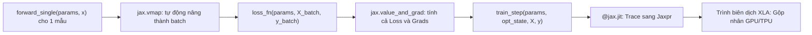

> **[Motto]**: PyTorch biến đổi trạng thái bên trong đối tượng; JAX biến đổi các hàm thuần túy rồi biên dịch thẳng xuống nhân XLA — kỷ luật bất biến ban đầu hơi gắt, nhưng mở khóa khả năng ghép nối `grad`, `vmap` và `jit` không giới hạn.

---

## Thông tin nhanh (Quick Spec)

* **Loại bài (Type):** Thực chiến (Build)
* **Ngôn ngữ & Công cụ:** Python 3.12, JAX (`jax`, `jax.numpy`)
* **Kiến thức tiên quyết (Prerequisites):** Bài 10 (Mini Framework), Bài 11 (PyTorch), quen thuộc NumPy
* **Thời gian thực hành:** ~80 phút

---

## Mục tiêu bài học (Learning Objectives)

Sau bài học này, bạn sẽ có khả năng:
- [ ] Giải thích rõ sự khác biệt nền tảng giữa lập trình hướng đối tượng có trạng thái (PyTorch) và lập trình thuần hàm bất biến (JAX).
- [ ] Quản lý số ngẫu nhiên tái lập tuyệt đối thông qua **PRNG Key** và `jax.random.split`.
- [ ] Thiết kế tham số mô hình dưới dạng **Pytree**, viết hàm dự đoán cho 1 mẫu rồi tự động vector hóa theo batch bằng **`jax.vmap`**.
- [ ] Xây dựng trọn vẹn một bước huấn luyện biên dịch XLA (`@jax.jit`) kết hợp `jax.value_and_grad` và cập nhật Adam bất biến qua `jax.tree_util.tree_map`.

---

## 1. Vấn đề thực tế (The Problem)

> *PyTorch đã quá phổ biến và dễ dùng. Tại sao Google DeepMind (Gemini, AlphaFold) hay nhiều nhóm nghiên cứu quy mô siêu lớn vẫn chọn JAX?*

Trong chế độ Eager Execution cổ điển, mỗi dòng mã Python gửi từng lệnh nhỏ xuống GPU: `x @ w` gọi một kernel, `+ b` gọi một kernel khác, `relu` gọi thêm một kernel nữa. Giữa các bước, kết quả trung gian bị ghi ra HBM (bộ nhớ chính GPU) rồi đọc lại — gây nghẽn băng thông bộ nhớ nặng nề. Khi mở rộng lên hàng nghìn chip TPU/GPU hoặc cần tính đạo hàm bậc cao, đạo hàm riêng từng mẫu (per-example gradients cho Differential Privacy), mô hình hướng đối tượng có trạng thái ẩn trở nên cực kỳ khó biên dịch tối ưu.

**JAX** chọn hướng đi hoàn toàn khác: coi mạng nơ-ron là những **hàm toán học thuần túy (Pure Functions)** trên mảng NumPy bất biến, rồi cung cấp bộ phép biến đổi hàm bậc cao có thể lồng ghép tùy ý:
- `grad`: biến hàm tính giá trị thành hàm tính đạo hàm.
- `vmap`: biến hàm xử lý 1 mẫu thành hàm xử lý cả mini-batch không cần viết vòng lặp.
- `jit`: biên dịch toàn bộ bước huấn luyện thành một chương trình **XLA (Accelerated Linear Algebra)** gộp nhân (kernel fusion) chạy ở tốc độ phần cứng tối đa.

---

## 2. Mô hình tư duy & Bản chất (The Concept)

### Đường ống ghép nối phép biến đổi hàm trong JAX

Thay vì viết class `nn.Module` chứa trạng thái ẩn, kỹ sư JAX viết hàm đơn giản nhất có thể rồi "bọc" dần bằng các phép biến đổi:



### Bốn quy tắc bất biến phải khắc cốt ghi tâm

1. **Pure Function (Hàm thuần túy):** Cùng một đầu vào luôn trả về cùng một đầu ra, không đọc/ghi biến toàn cục, không sửa mảng tại chỗ. Phép gán `a[0] = 5` bị cấm; bạn phải viết `a = a.at[0].set(5)` để tạo mảng mới (XLA sẽ tự tái sử dụng vùng nhớ bên dưới khi biên dịch nếu an toàn).
2. **PRNG Key tường minh (Không có global random seed):** Gọi `random.normal(key)` hai lần với cùng một `key` sẽ trả về **hai mảng giống hệt nhau**! Muốn sinh số mới, bạn bắt buộc tách khóa: `key, subkey = jax.random.split(key)`. Cách này đảm bảo tính tái lập 100% bất kể thứ tự song song trên hàng nghìn chip.
3. **Pytree là cấu trúc dữ liệu vạn năng:** Mọi cấu trúc lồng ghép gồm `dict`, `list`, `tuple` chứa mảng ở lá (ví dụ `[{"w": ..., "b": ...}, ...]`) đều là một **Pytree**. Mọi hàm `grad`, `jit`, `vmap` và `jax.tree_util.tree_map` đều tự động đi xuyên cấu trúc cây này mà không cần hàm `.parameters()`.
4. **Tracing và nhánh điều kiện:** Ở lần gọi đầu tiên của `@jax.jit`, JAX chạy hàm bằng các giá trị trừu tượng (Tracer) chỉ biết `shape` và `dtype` để ghi lại đồ thị `jaxpr`. Do đó `print(x)` bên trong hàm JIT chỉ in ra hình dạng Tracer lúc biên dịch (hãy dùng `jax.debug.print`), và mỗi khi thay đổi `shape` đầu vào, XLA sẽ phải **biên dịch lại (recompilation)**.

### Toán học cốt lõi (KaTeX)

**1. Tự động vector hóa (`vmap`) và đạo hàm hàm bậc cao (`grad`):**

Cho hàm thuần túy xử lý một mẫu đơn $f_\theta: \mathbb{R}^{D} \to \mathbb{R}^{C}$ với tham số $\theta$ là một Pytree. Phép nâng batch và hàm mất mát được viết gọn dưới dạng hợp hàm toán học:

$$(\operatorname{vmap}(f))(\theta, X) = \begin{bmatrix} f(\theta, x_1) \\ \vdots \\ f(\theta, x_B) \end{bmatrix}, \qquad (\mathcal{L}, g) = \operatorname{value\_and\_grad}(\mathcal{L}_{\text{batch}})(\theta, X, y)$$

**2. Cập nhật tham số bất biến trên Pytree (`tree_map`):**

Với mọi nút lá $(\theta^{(k)}, g^{(k)})$ trong Pytree tham số và trạng thái tối ưu $(m^{(k)}, v^{(k)})$, bước cập nhật AdamW trả về bộ Pytree mới $(\theta', m', v')$ hoàn toàn không đột biến trạng thái cũ:

$$m'_k = \beta_1 m_k + (1 - \beta_1) g_k, \qquad v'_k = \beta_2 v_k + (1 - \beta_2) g_k^2$$

$$\theta'_k = (1 - \eta \lambda)\theta_k - \eta \frac{m'_k / (1 - \beta_1^t)}{\sqrt{v'_k / (1 - \beta_2^t)} + \epsilon}$$

---

## 3. Tự tay xây dựng từ đầu (Build It: From Scratch)

Mã nguồn dưới đây xây dựng lại đúng mạng MLP phân loại hai vòng tròn đồng tâm theo phong cách **JAX thuần hàm 100%** (chỉ dùng `jax` và `jax.numpy`, không cần phụ thuộc ngoài): tách PRNG Key tường minh, khởi tạo Pytree `params`, viết `forward_single` cho **một mẫu duy nhất** rồi tự động vector hóa bằng `jax.vmap`, tính đạo hàm qua `jax.value_and_grad`, cập nhật AdamW bất biến bằng `jax.tree_util.tree_map` và biên dịch trọn vẹn `train_step` qua `@jax.jit`.

```python
from __future__ import annotations

from typing import Any, Dict, List, Tuple
import jax
import jax.numpy as jnp

PyTree = Any


def make_concentric_circles_jax(
    key: jax.Array, n_samples: int = 800, noise: float = 0.08
) -> Tuple[jax.Array, jax.Array]:
    """Tạo tập dữ liệu hai vòng tròn đồng tâm thuần JAX với PRNG Key tường minh."""
    k1, k2, k3, k4 = jax.random.split(key, 4)
    n_half = n_samples // 2

    angles_outer = jax.random.uniform(k1, shape=(n_half,), minval=0.0, maxval=2.0 * jnp.pi)
    outer = jnp.stack([jnp.cos(angles_outer), jnp.sin(angles_outer)], axis=1)

    angles_inner = jax.random.uniform(k2, shape=(n_samples - n_half,), minval=0.0, maxval=2.0 * jnp.pi)
    inner = 0.45 * jnp.stack([jnp.cos(angles_inner), jnp.sin(angles_inner)], axis=1)

    x = jnp.concatenate([outer, inner], axis=0)
    x = x + jax.random.normal(k3, shape=x.shape) * noise
    y = jnp.concatenate(
        [jnp.zeros(n_half, dtype=jnp.int32), jnp.ones(n_samples - n_half, dtype=jnp.int32)]
    )

    perm = jax.random.permutation(k4, n_samples)
    return x[perm], y[perm]


def init_mlp_params(key: jax.Array, layer_sizes: List[int]) -> List[Dict[str, jax.Array]]:
    """Khởi tạo Pytree trọng số MLP bằng He Initialization."""
    keys = jax.random.split(key, len(layer_sizes) - 1)
    params: List[Dict[str, jax.Array]] = []
    for k, (in_dim, out_dim) in zip(keys, zip(layer_sizes[:-1], layer_sizes[1:])):
        scale = jnp.sqrt(2.0 / in_dim)
        params.append(
            {
                "w": jax.random.normal(k, shape=(in_dim, out_dim)) * scale,
                "b": jnp.zeros((out_dim,), dtype=jnp.float32),
            }
        )
    return params


def forward_single(params: List[Dict[str, jax.Array]], x: jax.Array) -> jax.Array:
    """Hàm thuần túy dự đoán logits cho ĐÚNG MỘT mẫu x có shape (in_dim,)."""
    h = x
    for layer in params[:-1]:
        h = jax.nn.relu(jnp.dot(h, layer["w"]) + layer["b"])
    last = params[-1]
    return jnp.dot(h, last["w"]) + last["b"]


# Tự động nâng hàm 1 mẫu thành hàm xử lý mini-batch (None = chia sẻ params, 0 = batch trục 0 của x)
forward_batch = jax.vmap(forward_single, in_axes=(None, 0))


def loss_fn(params: List[Dict[str, jax.Array]], xb: jax.Array, yb: jax.Array) -> jax.Array:
    """Cross-Entropy Loss ổn định số học dùng log_softmax."""
    logits = forward_batch(params, xb)
    log_probs = jax.nn.log_softmax(logits, axis=-1)
    one_hot = jax.nn.one_hot(yb, num_classes=logits.shape[-1])
    return -jnp.mean(jnp.sum(log_probs * one_hot, axis=-1))


def init_adamw_state(params: PyTree) -> Dict[str, Any]:
    """Khởi tạo trạng thái optimizer dưới dạng Pytree bất biến."""
    return {
        "step": jnp.array(0, dtype=jnp.int32),
        "m": jax.tree_util.tree_map(jnp.zeros_like, params),
        "v": jax.tree_util.tree_map(jnp.zeros_like, params),
    }


def adamw_update(
    params: PyTree,
    grads: PyTree,
    opt_state: Dict[str, Any],
    lr: float = 1e-2,
    beta1: float = 0.9,
    beta2: float = 0.999,
    eps: float = 1e-8,
    weight_decay: float = 1e-2,
) -> Tuple[PyTree, Dict[str, Any]]:
    """Cập nhật AdamW hoàn toàn bất biến trên toàn bộ Pytree tham số."""
    step = opt_state["step"] + 1
    m = jax.tree_util.tree_map(
        lambda m_i, g_i: beta1 * m_i + (1.0 - beta1) * g_i,
        opt_state["m"],
        grads,
    )
    v = jax.tree_util.tree_map(
        lambda v_i, g_i: beta2 * v_i + (1.0 - beta2) * (g_i * g_i),
        opt_state["v"],
        grads,
    )

    bc1 = 1.0 - beta1 ** step
    bc2 = 1.0 - beta2 ** step

    def apply_leaf(p: jax.Array, m_i: jax.Array, v_i: jax.Array) -> jax.Array:
        m_hat = m_i / bc1
        v_hat = v_i / bc2
        # Chỉ áp weight decay lên ma trận trọng số 2D+, không áp lên vector bias 1D
        decay = lr * weight_decay * p if p.ndim >= 2 else 0.0
        return p - decay - lr * m_hat / (jnp.sqrt(v_hat) + eps)

    new_params = jax.tree_util.tree_map(apply_leaf, params, m, v)
    new_state = {"step": step, "m": m, "v": v}
    return new_params, new_state


@jax.jit
def train_step(
    params: PyTree, opt_state: Dict[str, Any], xb: jax.Array, yb: jax.Array
) -> Tuple[PyTree, Dict[str, Any], jax.Array]:
    """Trọn gói forward + grad + AdamW được XLA biên dịch thành 1 kernel gộp."""
    loss, grads = jax.value_and_grad(loss_fn)(params, xb, yb)
    new_params, new_opt_state = adamw_update(params, grads, opt_state)
    return new_params, new_opt_state, loss


@jax.jit
def compute_accuracy(params: PyTree, x: jax.Array, y: jax.Array) -> jax.Array:
    logits = forward_batch(params, x)
    preds = jnp.argmax(logits, axis=-1)
    return jnp.mean(preds == y)


def main() -> None:
    key = jax.random.PRNGKey(42)
    key, data_key, init_key = jax.random.split(key, 3)

    x_all, y_all = make_concentric_circles_jax(data_key, n_samples=800, noise=0.08)
    split = int(0.8 * len(x_all))
    x_train, y_train = x_all[:split], y_all[:split]
    x_test, y_test = x_all[split:], y_all[split:]

    params = init_mlp_params(init_key, layer_sizes=[2, 32, 32, 2])
    opt_state = init_adamw_state(params)

    batch_size = 32
    n_batches = len(x_train) // batch_size

    for epoch in range(1, 61):
        key, perm_key = jax.random.split(key)
        perm = jax.random.permutation(perm_key, len(x_train))
        x_shuf, y_shuf = x_train[perm], y_train[perm]

        epoch_loss = 0.0
        for i in range(n_batches):
            start = i * batch_size
            xb = x_shuf[start : start + batch_size]
            yb = y_shuf[start : start + batch_size]
            params, opt_state, loss = train_step(params, opt_state, xb, yb)
            epoch_loss += float(loss)

        if epoch == 1 or epoch % 15 == 0:
            train_acc = float(compute_accuracy(params, x_train, y_train))
            test_acc = float(compute_accuracy(params, x_test, y_test))
            print(
                f"Epoch {epoch:2d} | Loss: {epoch_loss / n_batches:.4f} | "
                f"Train Acc: {train_acc:.2%} | Test Acc: {test_acc:.2%}"
            )


if __name__ == "__main__":
    main()
```

---

## 4. Ứng dụng thực tế & So sánh Framework (Use It)

### So sánh mô hình tư duy: PyTorch vs JAX

| Khía cạnh | PyTorch (OOP + Imperative) | JAX (Functional + Composable) |
|---|---|---|
| Trạng thái trọng số | Nằm ẩn bên trong `nn.Module` (mutable) | Tách rời thành Pytree truyền vào hàm (immutable) |
| Tính đạo hàm | `loss.backward()` điền vào `p.grad` | `jax.value_and_grad(loss_fn)` trả về Pytree `grads` |
| Xóa gradient | Bắt buộc gọi `optimizer.zero_grad()` | Không cần — gradient được tính mới hoàn toàn |
| Quản lý ngẫu nhiên | Global seed (`torch.manual_seed`) | Explicit PRNG Key (`jax.random.split`) |
| Xử lý batch | Viết tầng tự hỗ trợ chiều batch `(B, ...)` | Viết cho 1 mẫu rồi bọc `jax.vmap` |
| Hỗ trợ TPU & Multi-chip | Thông qua `torch_xla` (phụ trợ) | Hỗ trợ hạng nhất (`shard_map`, `pmap`, XLA Mesh) |
| Hệ sinh thái tiêu chuẩn | `torch.nn`, Hugging Face, Lightning | **Flax NNX/Linen**, **Equinox**, **Optax**, **Orbax** |

### Production Tips

* **Dùng `Optax` và `Flax`/`Equinox` cho dự án thật:** Trong bài ta tự viết `adamw_update` để hiểu cơ chế `tree_map`, còn khi làm thực tế hãy dùng `optax.chain(optax.clip_by_global_norm(1.0), optax.adamw(...))` kết hợp **Flax** hoặc **Equinox** để không phải quản lý dict tham số thủ công.
* **Cẩn thận với batch cuối không đủ kích thước:** Nếu tổng số mẫu không chia hết cho `batch_size`, batch cuối có `shape` khác các batch trước sẽ kích hoạt XLA **biên dịch lại** gây khựng tốc độ. Hãy bỏ batch dư (`drop_last`) hoặc đệm (pad) cho đồng nhất shape.
* **Tắt cấp phát trước 75% VRAM khi dùng chung GPU:** Mặc định XLA chiếm sẵn 75% bộ nhớ GPU lúc khởi chạy. Khi cần chạy song song nhiều tiến trình hoặc debug trên máy cá nhân, đặt biến môi trường `XLA_PYTHON_CLIENT_PREALLOCATE=false`.
* **Debug trong hàm JIT:** Tuyệt đối không dùng `print()` của Python (vì chỉ chạy 1 lần lúc trace); hãy dùng `jax.debug.print("loss={x}", x=loss)` hoặc tắt JIT tạm thời bằng ngữ cảnh `with jax.disable_jit():`.

---

## 5. Đóng gói & Tái sử dụng (Ship It)

### Mẫu tái sử dụng: Tính Per-Example Gradients chỉ bằng 1 dòng mã

Một siêu năng lực mà PyTorch rất vất vả mới làm gọn được là tính **đạo hàm riêng cho từng mẫu trong batch** (cực kỳ hữu ích cho Differential Privacy DP-SGD hoặc tìm mẫu dữ liệu nhiễu/outlier):

```python
import jax

# Trả về gradient riêng lẻ cho từng mẫu trong batch (shape dẫn đầu là batch_size)
per_example_grad_fn = jax.jit(
    jax.vmap(jax.grad(lambda p, x, y: loss_fn(p, x[None, :], y[None])), in_axes=(None, 0, 0))
)
```

### Checklist kiểm soát chất lượng mã nguồn JAX

- [ ] Mọi hàm gắn `@jax.jit` đều là **Pure Function** (không thay đổi biến ngoài scope, không dùng `random` của Python/NumPy bên trong).
- [ ] Mọi PRNG Key sau khi dùng đều đã được `jax.random.split` và **không bao giờ tái sử dụng** khóa cũ.
- [ ] Các nhánh điều kiện phụ thuộc giá trị mảng đã thay `if/else` Python bằng `jax.lax.cond` hoặc `jnp.where`, vòng lặp dài thay bằng `jax.lax.scan`.
- [ ] Đã đo tốc độ thực thi bằng cách gọi `.block_until_ready()` (vì JAX thực thi bất đồng bộ — asynchronous dispatch — nên đo thời gian trực tiếp mà không block sẽ cho kết quả ảo).

---

## 6. Giải ngố thuật ngữ (Key Terms & Misconceptions)

| Thuật ngữ (Term) | Người ta thường nghĩ là... | Bản chất kỹ thuật thực sự là... |
|---|---|---|
| `Pure Function` | "Hàm ngắn không có vòng lặp" | Hàm toán học đầu ra chỉ phụ thuộc hoàn toàn vào tham số đầu vào, không có tác dụng phụ (side-effect) và không thay đổi trạng thái ngoài — điều kiện bắt buộc để trình biên dịch XLA tối ưu an toàn. |
| `Pytree` | "Một kiểu dữ liệu đặc biệt phải import từ JAX" | Bất kỳ cấu trúc lồng ghép nào của `dict`, `list`, `tuple`, `NamedTuple` (hoặc class tự đăng ký) chứa mảng ở các nút lá mà JAX có thể làm phẳng và tái tạo tự động. |
| `XLA` | "Thư viện Python tăng tốc NumPy" | Trình biên dịch miền chuyên biệt (Accelerated Linear Algebra) nhận đồ thị phép toán từ JAX, thực hiện gộp nhân (kernel fusion), tối ưu bộ nhớ và sinh mã máy cho GPU/TPU. |
| `Asynchronous Dispatch` | "Hàm JAX chạy xong trong 0.01ms nên cực nhanh" | JAX chỉ đẩy lệnh vào hàng đợi thiết bị rồi trả quyền điều khiển về Python ngay lập tức; phải gọi `result.block_until_ready()` mới đo được thời gian tính toán thực sự. |

---

## 7. Bài tập thử thách (Hands-on Challenges)

1. 🟢 **Cơ bản (Easy):** Thêm tầng **Inverted Dropout** thuần hàm vào `forward_single(params, x, rng_key, training=True)`. Chú ý cách truyền `rng_key` riêng cho từng mẫu bằng cách tách `jax.random.split(batch_key, batch_size)` và chỉnh `in_axes=(None, 0, 0, None)` trong `jax.vmap`.
2. 🟡 **Trung bình (Medium):** Đo thời gian chạy 200 bước `train_step` có và không có `@jax.jit` (nhớ chạy 1 bước warm-up và gọi `.block_until_ready()`). Tính tỷ lệ tăng tốc (speedup) và thời gian biên dịch lần đầu.
3. 🔴 **Nâng cao (Hard):** Viết lại toàn bộ vòng lặp 1 epoch (chạy qua `n_batches` mini-batch) hoàn toàn bên trong XLA bằng `jax.lax.scan` để loại bỏ nốt vòng `for` Python bên ngoài, rồi dùng `per_example_grad_fn` ở Mục 5 để tìm ra 5 điểm dữ liệu có chuẩn gradient lớn nhất trong tập huấn luyện.

---

## 8. Tài liệu đọc thêm (Further Reading)

- [JAX Official Documentation: Thinking in JAX & Sharp Bits](https://docs.jax.dev/en/latest/notebooks/Common_Gotchas_in_JAX.html) — *Tài liệu bắt buộc phải đọc để tránh 90% lỗi kinh điển về immutability, PRNG keys, NaN và JIT tracing.*
- [JAX: Composable Transformations of Python+NumPy Programs (Bradbury et al., 2018)](https://github.com/jax-ml/jax) — *Nền tảng thiết kế hệ thống biến đổi hàm `grad`, `jit`, `vmap`, `pmap`.*
- [Optax & Flax Documentation (Google DeepMind / Google Research)](https://optax.readthedocs.io/) — *Bộ đôi thư viện chuẩn công nghiệp để xây dựng mô hình và chuỗi biến đổi gradient trong hệ sinh thái JAX.*
