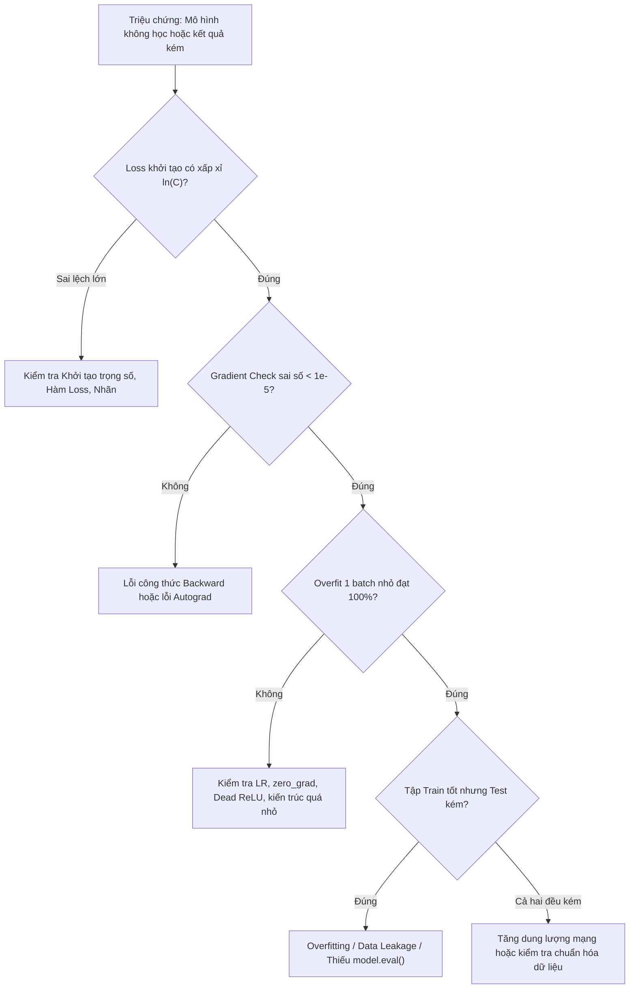

> **[Motto]**: Lỗi nguy hiểm nhất trong Deep Learning không làm chương trình crash — nó vẫn chạy trơn tru, in ra con số Loss giảm nhẹ, nhưng âm thầm dạy mô hình một thứ vô nghĩa.

---

## Thông tin nhanh (Quick Spec)

* **Loại bài (Type):** Thực chiến (Build)
* **Ngôn ngữ & Công cụ:** Python 3.12 (thuần thư viện chuẩn — không phụ thuộc ngoài, chạy trực tiếp bằng `python3`)
* **Kiến thức tiên quyết (Prerequisites):** Toàn bộ Phase 03 (Bài 01 đến 12)
* **Thời gian thực hành:** ~75 phút

---

## Mục tiêu bài học (Learning Objectives)

Sau bài học này, bạn sẽ có khả năng:
- [ ] Áp dụng quy trình gỡ lỗi khoa học gồm 4 trụ cột thay vì "thay đại Learning Rate rồi cầu nguyện".
- [ ] Tự cài đặt và vận hành **Loss Sanity Check** ($-\ln(1/C)$), **Numerical Gradient Checking** bằng sai phân trung tâm, và phép thử **Overfit-Single-Batch**.
- [ ] Đo lường chỉ số sức khỏe từng tầng mạng: phân phối kích hoạt (mean, std), tỷ lệ **Dead ReLU** và **Gradient Norm** ($L_2$) để phát hiện Vanishing/Exploding Gradients.
- [ ] Nhận diện nhanh 8 lỗi "âm thầm" phổ biến nhất trong pipeline huấn luyện thực tế (quên `zero_grad`, nhầm `eval()`, data leakage, quên chuẩn hóa đầu vào).

---

## 1. Vấn đề thực tế (The Problem)

> *Code biên dịch không một dòng cảnh báo. GPU chạy 100% suốt 4 tiếng. Kết quả: độ chính xác trên tập test đúng bằng tung đồng xu. Bạn bắt đầu tìm lỗi từ đâu?*

Trong lập trình phần mềm truyền thống, lỗi chia cho 0 hay truy cập sai kiểu dữ liệu lập tức ném Exception và chỉ thẳng số dòng. Trong Deep Learning, mạng nơ-ron có khả năng "chịu lỗi" đáng sợ: bạn quên `optimizer.zero_grad()`, truyền nhầm xác suất Softmax vào `CrossEntropyLoss`, hay gán nhầm nhãn bị lệch một vị trí — chương trình vẫn chạy bình thường và Loss thậm chí vẫn giảm!

Andrej Karpathy từng tổng kết trong bài viết kinh điển *A Recipe for Training Neural Networks*: phần lớn thời gian của kỹ sư ML không dùng để sáng tạo kiến trúc mới, mà dùng để săn những **silent bugs (lỗi âm thầm)**. Cách duy nhất để không đốt tiền GPU vô ích là biến quá trình gỡ lỗi thành một **quy trình kiểm chứng có hệ thống**, khoanh vùng chính xác lỗi nằm ở dữ liệu, hàm loss, đạo hàm, hay bộ tối ưu.

---

## 2. Mô hình tư duy & Bản chất (The Concept)

### Cây quyết định chẩn đoán nhanh (Diagnostic Decision Tree)

Khi mô hình không hội tụ hoặc kết quả bất thường, luôn đi theo trình tự cô lập biến số từ nhỏ nhất đến lớn nhất:



### Bốn trụ cột kỹ thuật gỡ lỗi cốt lõi

1. **Initial Loss Sanity Check:** Trước khi chạy bước cập nhật đầu tiên, một bộ phân loại $C$ lớp cân bằng với trọng số khởi tạo nhỏ phải dự đoán xấp xỉ phân phối đều $p_k \approx \frac{1}{C}$. Nếu $C = 10$ mà Loss khởi đầu là `8.5` thay vì `~2.3026`, chắc chắn tầng cuối khởi tạo quá lớn (gây bão hòa Softmax) hoặc bạn đang gọi sai hàm Loss.
2. **Gradient Checking (Kiểm chứng đạo hàm số):** Dùng định nghĩa đạo hàm bằng sai phân trung tâm để kiểm tra đạo hàm giải tích (`backward`). Đây là "máy nói dối" tuyệt đối khi bạn tự viết tầng mạng mới, hàm Loss mới hoặc custom CUDA/Triton kernel.
3. **Overfit-Single-Batch (Bài test quan trọng nhất):** Lấy đúng 1 mini-batch nhỏ (8–16 mẫu), tắt toàn bộ Regularization (Dropout, Weight Decay) và huấn luyện 200 bước. Nếu mô hình không thể "học thuộc lòng" 8 mẫu này để kéo Loss về gần `0.0` và Accuracy lên `100%`, **dừng ngay lập tức** — tuyệt đối không train trên toàn bộ dữ liệu.
4. **Telemetry kích hoạt và Gradient theo từng tầng:** Theo dõi đồng thời ba chỉ số: tỷ lệ phần tử bằng `0` sau ReLU (**Dead ReLU** >50% là báo động), độ lệch chuẩn đầu ra từng tầng, và chuẩn $L_2$ của gradient. Nếu chuẩn gradient tầng đầu nhỏ hơn tầng cuối hàng trăm lần, bạn đang gặp **Vanishing Gradient**; nếu tăng vọt lên hàng nghìn hay `NaN`, bạn gặp **Exploding Gradient**.

### Toán học cốt lõi (KaTeX)

**1. Kỳ vọng hàm mất mát khởi tạo cho bài toán phân loại $C$ lớp:**

$$L_0 = -\ln\!\left(\frac{1}{C}\right) = \ln(C)$$

Ví dụ: $C = 2 \implies L_0 \approx 0.6931$; $C = 3 \implies L_0 \approx 1.0986$; $C = 10 \implies L_0 \approx 2.3026$.

**2. Sai phân trung tâm (Centered Finite Difference) và sai số tương đối:**

Với nhiễu $\epsilon = 10^{-5}$ (chạy ở độ chính xác `float64`), sai số cắt cụt của sai phân trung tâm chỉ là $O(\epsilon^2)$ — chính xác gấp nhiều lần sai phân tiến $O(\epsilon)$:

$$g_{\text{num}}(\theta_i) = \frac{\mathcal{L}(\theta_i + \epsilon) - \mathcal{L}(\theta_i - \epsilon)}{2\epsilon}$$

$$\text{rel\_error} = \frac{|g_{\text{ana}} - g_{\text{num}}|}{\max(|g_{\text{ana}}|, |g_{\text{num}}|, 10^{-8})}$$

Ngưỡng chuẩn kỹ thuật: `< 1e-5` là đạt chuẩn (PASS); từ `1e-5` đến `1e-3` cần cảnh giác (có thể gặp điểm gấp khúc `x = 0` của ReLU); `> 1e-3` gần như chắc chắn có lỗi sai công thức đạo hàm (FAIL).

---

## 3. Tự tay xây dựng từ đầu (Build It: From Scratch)

Bộ công cụ gỡ lỗi bên dưới được viết **100% bằng Python chuẩn (zero external dependencies)**, chạy trực tiếp ngay trong terminal để kiểm chứng cả 4 trụ cột: (1) Initial Loss Sanity Check, (2) Numerical Gradient Checker (so sánh mạng đúng vs mạng cố tình cài lỗi chuyển vị ở `backward`), (3) Overfit-Single-Batch Verifier, và (4) Activation / Gradient Norm / Dead-ReLU Telemetry (so sánh mạng khỏe mạnh vs mạng bị Dead ReLU do khởi tạo bias âm lớn).

```python
from __future__ import annotations

from dataclasses import dataclass
from typing import Dict, List, Tuple
import math
import random


@dataclass
class LayerTelemetry:
    name: str
    act_mean: float
    act_std: float
    dead_relu_ratio: float
    grad_w_norm: float


class TinyDebugMLP:
    """Mạng MLP 2 tầng thuần Python dùng để trình diễn bộ công cụ gỡ lỗi."""

    def __init__(
        self,
        in_dim: int,
        hidden_dim: int,
        num_classes: int,
        seed: int = 42,
        bad_dead_relu_init: bool = False,
        bug_wrong_backward_sign: bool = False,
    ) -> None:
        rng = random.Random(seed)
        self.in_dim = in_dim
        self.hidden_dim = hidden_dim
        self.num_classes = num_classes
        self.bug_wrong_backward_sign = bug_wrong_backward_sign

        if bad_dead_relu_init:
            # Cố tình khởi tạo sai làm phần lớn neuron ReLU luôn nhận đầu vào âm
            self.w1 = [[-0.8 for _ in range(hidden_dim)] for _ in range(in_dim)]
            self.b1 = [-6.0 for _ in range(hidden_dim)]
        else:
            s1 = math.sqrt(2.0 / in_dim)
            self.w1 = [[rng.gauss(0.0, s1) for _ in range(hidden_dim)] for _ in range(in_dim)]
            self.b1 = [0.0 for _ in range(hidden_dim)]

        s2 = math.sqrt(1.0 / hidden_dim) * 0.25  # Logits nhỏ ban đầu để gần phân phối đều
        self.w2 = [[rng.gauss(0.0, s2) for _ in range(num_classes)] for _ in range(hidden_dim)]
        self.b2 = [0.0 for _ in range(num_classes)]

        self.last_h1: List[List[float]] = []
        self.last_logits: List[List[float]] = []
        self.grad_w1: List[List[float]] = []
        self.grad_b1: List[float] = []
        self.grad_w2: List[List[float]] = []
        self.grad_b2: List[float] = []

    def forward(self, x_batch: List[List[float]]) -> List[List[float]]:
        self.last_h1 = []
        self.last_logits = []
        for x in x_batch:
            h1 = []
            for j in range(self.hidden_dim):
                z = self.b1[j]
                for i in range(self.in_dim):
                    z += x[i] * self.w1[i][j]
                h1.append(z if z > 0.0 else 0.0)
            self.last_h1.append(h1)

            logits = []
            for k in range(self.num_classes):
                z = self.b2[k]
                for j in range(self.hidden_dim):
                    z += h1[j] * self.w2[j][k]
                logits.append(z)
            self.last_logits.append(logits)
        return self.last_logits

    def cross_entropy_loss(
        self, logits_batch: List[List[float]], y_batch: List[int]
    ) -> Tuple[float, List[List[float]]]:
        total_loss = 0.0
        probs_batch: List[List[float]] = []
        for logits, y in zip(logits_batch, y_batch):
            m = max(logits)
            exps = [math.exp(v - m) for v in logits]
            sum_exp = sum(exps)
            probs = [e / sum_exp for e in exps]
            probs_batch.append(probs)
            total_loss += -(logits[y] - m - math.log(sum_exp))
        return total_loss / len(y_batch), probs_batch

    def loss_and_backward(self, x_batch: List[List[float]], y_batch: List[int]) -> float:
        batch_size = len(x_batch)
        logits_batch = self.forward(x_batch)
        loss, probs_batch = self.cross_entropy_loss(logits_batch, y_batch)

        self.grad_w1 = [[0.0 for _ in range(self.hidden_dim)] for _ in range(self.in_dim)]
        self.grad_b1 = [0.0 for _ in range(self.hidden_dim)]
        self.grad_w2 = [[0.0 for _ in range(self.num_classes)] for _ in range(self.hidden_dim)]
        self.grad_b2 = [0.0 for _ in range(self.num_classes)]

        for x, h1, probs, y in zip(x_batch, self.last_h1, probs_batch, y_batch):
            dlogits = [(probs[k] - (1.0 if k == y else 0.0)) / batch_size for k in range(self.num_classes)]

            for k in range(self.num_classes):
                self.grad_b2[k] += dlogits[k]
                for j in range(self.hidden_dim):
                    self.grad_w2[j][k] += h1[j] * dlogits[k]

            dh1 = [0.0 for _ in range(self.hidden_dim)]
            for j in range(self.hidden_dim):
                if h1[j] > 0.0:
                    acc = 0.0
                    for k in range(self.num_classes):
                        acc += dlogits[k] * self.w2[j][k]
                    dh1[j] = -acc if self.bug_wrong_backward_sign else acc

            for j in range(self.hidden_dim):
                self.grad_b1[j] += dh1[j]
                for i in range(self.in_dim):
                    self.grad_w1[i][j] += x[i] * dh1[j]

        return loss

    def step_sgd(self, lr: float) -> None:
        for i in range(self.in_dim):
            for j in range(self.hidden_dim):
                self.w1[i][j] -= lr * self.grad_w1[i][j]
        for j in range(self.hidden_dim):
            self.b1[j] -= lr * self.grad_b1[j]
            for k in range(self.num_classes):
                self.w2[j][k] -= lr * self.grad_w2[j][k]
        for k in range(self.num_classes):
            self.b2[k] -= lr * self.grad_b2[k]


def check_initial_loss_sanity(
    model: TinyDebugMLP, x_batch: List[List[float]], y_batch: List[int], tol: float = 0.25
) -> Tuple[bool, float, float]:
    """Kiểm tra 1: Loss ban đầu phải xấp xỉ -ln(1 / C) = ln(C)."""
    logits = model.forward(x_batch)
    init_loss, _ = model.cross_entropy_loss(logits, y_batch)
    expected = math.log(model.num_classes)
    passed = abs(init_loss - expected) <= tol
    return passed, init_loss, expected


def check_numerical_gradients(
    model: TinyDebugMLP,
    x_batch: List[List[float]],
    y_batch: List[int],
    eps: float = 1e-5,
    threshold: float = 1e-5,
) -> Tuple[bool, float]:
    """Kiểm tra 2: Sai phân trung tâm (f(w+eps) - f(w-eps)) / (2*eps) vs đạo hàm giải tích."""
    model.loss_and_backward(x_batch, y_batch)
    max_rel_err = 0.0

    # Kiểm tra các ma trận w1 và w2
    targets = [
        (model.w1, model.grad_w1),
        (model.w2, model.grad_w2),
    ]
    for param_mat, grad_mat in targets:
        rows, cols = len(param_mat), len(param_mat[0])
        for r in range(rows):
            for c in range(cols):
                orig = param_mat[r][c]

                param_mat[r][c] = orig + eps
                loss_plus, _ = model.cross_entropy_loss(model.forward(x_batch), y_batch)

                param_mat[r][c] = orig - eps
                loss_minus, _ = model.cross_entropy_loss(model.forward(x_batch), y_batch)

                param_mat[r][c] = orig

                g_num = (loss_plus - loss_minus) / (2.0 * eps)
                g_ana = grad_mat[r][c]
                rel_err = abs(g_ana - g_num) / max(abs(g_ana), abs(g_num), 1e-8)
                max_rel_err = max(max_rel_err, rel_err)

    return max_rel_err < threshold, max_rel_err


def verify_overfit_single_batch(
    x_batch: List[List[float]],
    y_batch: List[int],
    num_classes: int,
    steps: int = 250,
    lr: float = 0.5,
) -> Tuple[bool, float, float]:
    """Kiểm tra 3: Mô hình khỏe phải học thuộc lòng được 1 batch nhỏ (loss < 0.05, acc = 100%)."""
    model = TinyDebugMLP(in_dim=len(x_batch[0]), hidden_dim=16, num_classes=num_classes, seed=7)
    final_loss = float("inf")
    for _ in range(steps):
        final_loss = model.loss_and_backward(x_batch, y_batch)
        model.step_sgd(lr)

    logits = model.forward(x_batch)
    correct = sum(
        1 for row, y in zip(logits, y_batch) if max(range(num_classes), key=row.__getitem__) == y
    )
    acc = correct / len(y_batch)
    return (final_loss < 0.05 and acc == 1.0), final_loss, acc


def collect_layer_telemetry(model: TinyDebugMLP) -> Dict[str, LayerTelemetry]:
    """Kiểm tra 4: Đo phân phối kích hoạt, tỷ lệ Dead ReLU và L2 Gradient Norm."""
    flat_h1 = [v for row in model.last_h1 for v in row]
    mean_h1 = sum(flat_h1) / len(flat_h1)
    var_h1 = sum((v - mean_h1) ** 2 for v in flat_h1) / len(flat_h1)
    dead_ratio = sum(1 for v in flat_h1 if v == 0.0) / len(flat_h1)
    norm_w1 = math.sqrt(sum(g * g for row in model.grad_w1 for g in row))

    flat_out = [v for row in model.last_logits for v in row]
    mean_out = sum(flat_out) / len(flat_out)
    var_out = sum((v - mean_out) ** 2 for v in flat_out) / len(flat_out)
    norm_w2 = math.sqrt(sum(g * g for row in model.grad_w2 for g in row))

    return {
        "layer1_relu": LayerTelemetry("layer1_relu", mean_h1, math.sqrt(var_h1), dead_ratio, norm_w1),
        "layer2_logits": LayerTelemetry("layer2_logits", mean_out, math.sqrt(var_out), 0.0, norm_w2),
    }


def make_toy_batch(n_samples: int = 8, in_dim: int = 4, num_classes: int = 3, seed: int = 42) -> Tuple[List[List[float]], List[int]]:
    rng = random.Random(seed)
    x_batch = [[rng.gauss(0.0, 1.0) for _ in range(in_dim)] for _ in range(n_samples)]
    y_batch = [i % num_classes for i in range(n_samples)]
    return x_batch, y_batch


def main() -> None:
    x_batch, y_batch = make_toy_batch(n_samples=8, in_dim=4, num_classes=3, seed=42)

    print("=== 1. INITIAL LOSS SANITY CHECK ===")
    healthy = TinyDebugMLP(in_dim=4, hidden_dim=12, num_classes=3, seed=42)
    ok_loss, init_loss, expected = check_initial_loss_sanity(healthy, x_batch, y_batch)
    print(f"Init Loss = {init_loss:.4f} | Expected ln(3) = {expected:.4f} -> {'PASS' if ok_loss else 'FAIL'}")

    print("\n=== 2. NUMERICAL GRADIENT CHECKING ===")
    ok_grad, err_healthy = check_numerical_gradients(healthy, x_batch, y_batch)
    print(f"Healthy backward max_rel_err = {err_healthy:.2e} -> {'PASS' if ok_grad else 'FAIL'}")

    buggy_grad = TinyDebugMLP(in_dim=4, hidden_dim=12, num_classes=3, seed=42, bug_wrong_backward_sign=True)
    ok_bug, err_bug = check_numerical_gradients(buggy_grad, x_batch, y_batch)
    print(f"Buggy backward   max_rel_err = {err_bug:.2e} -> {'PASS' if ok_bug else 'FAIL (Bug caught!)'}")

    print("\n=== 3. OVERFIT-SINGLE-BATCH TEST ===")
    ok_overfit, final_loss, acc = verify_overfit_single_batch(x_batch, y_batch, num_classes=3)
    print(f"Overfit 8 samples -> Loss = {final_loss:.5f} | Acc = {acc:.1%} -> {'PASS' if ok_overfit else 'FAIL'}")

    print("\n=== 4. ACTIVATION / GRADIENT NORM & DEAD-RELU TELEMETRY ===")
    healthy.loss_and_backward(x_batch, y_batch)
    dead_model = TinyDebugMLP(in_dim=4, hidden_dim=12, num_classes=3, seed=42, bad_dead_relu_init=True)
    dead_model.loss_and_backward(x_batch, y_batch)

    for label, mdl in [("Healthy Network", healthy), ("Broken Dead-ReLU Network", dead_model)]:
        stats = collect_layer_telemetry(mdl)
        l1 = stats["layer1_relu"]
        l2 = stats["layer2_logits"]
        alert = " [ALERT: DEAD RELU!]" if l1.dead_relu_ratio > 0.5 else " [OK]"
        print(
            f"{label:24s} | L1 mean={l1.act_mean:.3f} std={l1.act_std:.3f} "
            f"dead={l1.dead_relu_ratio:.0%} grad_norm={l1.grad_w_norm:.2e}{alert} | "
            f"L2 grad_norm={l2.grad_w_norm:.2e}"
        )


if __name__ == "__main__":
    main()
```

---

## 4. Ứng dụng thực tế & So sánh Framework (Use It)

### Bảng chẩn đoán nhanh triệu chứng và công cụ hỗ trợ trong thực tế

| Triệu chứng quan sát | Nguyên nhân khả dĩ nhất | Công cụ kiểm tra trong PyTorch / JAX | Cách xử lý ngay |
|---|---|---|---|
| Loss mắc kẹt quanh $\ln(C)$ | Dữ liệu không khớp nhãn, chưa chuẩn hóa hoặc `lr` quá nhỏ | In 5 mẫu `(x, y)` ngẫu nhiên; kiểm tra `grad_norm` | Chuẩn hóa input `(x - mean)/std`, thử `lr` tăng 10x |
| Loss nhảy `NaN` sau vài bước | `lr` quá cao, Exploding Gradients, `log(0)` | `torch.autograd.detect_anomaly()` / `jax.config.update("jax_debug_nans", True)` | Giảm `lr` 10x, bật `clip_grad_norm_(1.0)`, dùng `LogSumExp` |
| Train Acc 99%, Test Acc 55% | Overfitting hoặc quên `model.eval()` | Kiểm tra chênh lệch train/val loss và tỷ lệ Dropout | Thêm `model.eval()`, tăng Weight Decay, Data Augmentation |
| Train Acc & Test Acc đều cao bất thường | **Data Leakage** (dữ liệu test rò sang train) | So sánh hash các mẫu giữa tập train và test | Tách train/test **trước** khi tính thống kê chuẩn hóa |
| `grad_norm` tầng đầu $\ll$ tầng cuối | **Vanishing Gradients** hoặc **Dead ReLU** | Hook đo `param.grad.norm()` và `(act == 0).mean()` | Chuyển sang `GELU`/`LeakyReLU`, thêm Residual hoặc LayerNorm |

### Production Tips

* **Chỉ bật `detect_anomaly()` khi săn lỗi `NaN`:** Trong PyTorch, `torch.autograd.set_detect_anomaly(True)` làm chậm tốc độ huấn luyện đáng kể; hãy chỉ bật trên một phiên chạy tái hiện lỗi nhỏ, tuyệt đối không để quên trong production.
* **Dùng `torch.autograd.gradcheck` cho tầng tự viết:** Khi bạn tự viết `torch.autograd.Function` hoặc Triton kernel, PyTorch đã có sẵn hàm `gradcheck(fn, inputs)` dùng sai phân trung tâm trên `float64` với đúng nguyên lý bạn vừa cài đặt ở Mục 3.
* **Theo dõi tỷ lệ `update_norm / param_norm` (Karpathy Ratio):** Một mạng đang học lành mạnh thường có tỷ lệ độ lớn bước cập nhật chia cho độ lớn trọng số vào khoảng $10^{-3}$. Nếu nhỏ hơn $10^{-5}$, `lr` quá nhỏ; nếu lớn hơn $10^{-1}$, mạng sắp bất ổn.

---

## 5. Đóng gói & Tái sử dụng (Ship It)

### Checklist 7 bước vàng trước mỗi phiên huấn luyện tốn kém (Pre-Flight Check)

- [ ] **1. Soi dữ liệu thô:** In trực tiếp 5 cặp `(input, label)` sau khi qua `DataLoader` để chắc chắn không lệch nhãn hay hỏng tiền xử lý.
- [ ] **2. Khóa Seed tái lập:** Cố định seed cho Python, NumPy, PyTorch/JAX để mọi thử nghiệm so sánh công bằng.
- [ ] **3. Loss Sanity Check:** Chạy 1 bước forward không tối ưu, kiểm tra `init_loss` khớp $\ln(C)$ (hoặc phương sai nhãn với bài toán hồi quy).
- [ ] **4. Input-Independent Baseline:** Thử truyền toàn tensor `0` vào mạng; nếu Loss trên dữ liệu thật không thấp hơn hẳn dữ liệu toàn `0`, mô hình chưa khai thác được đặc trưng.
- [ ] **5. Overfit-Single-Batch:** Bắt buộc vượt qua bài test thuộc lòng 1 mini-batch (Loss $\to 0$, Acc $\to 100\%$) trước khi chạy toàn tập.
- [ ] **6. Quét Learning Rate (LR Sweep):** Thử nhanh 3–4 bậc độ lớn (`1e-4, 3e-4, 1e-3, 3e-3`) trong vài trăm bước đầu thay vì đoán mò.
- [ ] **7. Gắn Telemetry & Cảnh báo sớm:** Log `train_loss`, `val_loss`, `grad_norm` và `lr` lên Weights & Biases / TensorBoard; dừng tự động nếu gặp `NaN` hoặc Dead ReLU > 80%.

### Mẫu tái sử dụng: Hook theo dõi Gradient Norm & Dead ReLU siêu gọn cho PyTorch

```python
import torch
import torch.nn as nn


def log_model_health(model: nn.Module) -> dict[str, float]:
    total_sq = 0.0
    for p in model.parameters():
        if p.grad is not None:
            total_sq += float(p.grad.detach().pow(2).sum().item())
    return {"global_grad_norm": total_sq ** 0.5}
```

---

## 6. Giải ngố thuật ngữ (Key Terms & Misconceptions)

| Thuật ngữ (Term) | Người ta thường nghĩ là... | Bản chất kỹ thuật thực sự là... |
|---|---|---|
| `Silent Bug` | "Lỗi nhỏ không ảnh hưởng nhiều" | Dạng lỗi nguy hiểm nhất trong ML: chương trình không hề crash nhưng phá hỏng chất lượng học (ví dụ: quên `zero_grad()`, broadcasting sai chiều `(N, 1) - (N,)` tạo ma trận `(N, N)`). |
| `Gradient Checking` | "Chạy thường xuyên trong lúc train để đảm bảo an toàn" | Phép kiểm định chỉ chạy **một lần** trên mô hình nhỏ bằng `float64` lúc phát triển để xác minh công thức `backward()`; quá chậm ($O(P)$ lượt forward) để chạy trong training loop. |
| `Overfit-One-Batch` | "Mẹo làm đẹp biểu đồ Loss" | Bài kiểm tra đơn vị (unit test) kiểm chứng toàn bộ đường ống `data -> model -> loss -> backward -> optimizer` có thực sự hoạt động gắn kết hay không. |
| `Data Leakage` | "Lộ dữ liệu bảo mật ra ngoài Internet" | Thông tin từ tập validation/test lọt vào quá trình huấn luyện (như tính mean/std chuẩn hóa trên cả tập gộp trước khi chia), tạo ra điểm đánh giá ảo sụp đổ khi lên production. |

---

## 7. Bài tập thử thách (Hands-on Challenges)

1. 🟢 **Cơ bản (Easy):** Cố tình chèn một lỗi âm thầm thứ hai vào `TinyDebugMLP` (ví dụ: quên chia cho `batch_size` trong `dlogits`, hoặc quên cộng `grad_b2`) và chạy `check_numerical_gradients` để quan sát `max_rel_err` bùng lên như thế nào.
2. 🟡 **Trung bình (Medium):** Mở rộng bộ công cụ ở Mục 3 thêm hàm **Learning Rate Finder** (quét `lr` tăng theo cấp số nhân từ `1e-5` đến `10.0` qua 80 bước, tự dừng khi `loss > 4 * best_loss`, rồi trả về `lr` gợi ý nhỏ hơn 10 lần điểm có độ dốc giảm sâu nhất).
3. 🔴 **Nâng cao (Hard):** Viết một **Dead-Neuron Resurrector** tự động kiểm tra `last_h1` sau mỗi 20 bước huấn luyện: nếu phát hiện neuron $j$ có tỷ lệ kích hoạt bằng 0 đạt 100% trên cả batch, tự động khởi tạo lại cột trọng số `w1[:, j]` theo phân phối He và đặt `b1[j] = 0.05`, chứng minh mạng `bad_dead_relu_init=True` hồi sinh và hội tụ trở lại.

---

## 8. Tài liệu đọc thêm (Further Reading)

- [A Recipe for Training Neural Networks (Andrej Karpathy, 2019)](https://karpathy.github.io/2019/04/25/recipe/) — *Bản hướng dẫn gối đầu giường của mọi kỹ sư Deep Learning về quy trình tuần tự từ soi dữ liệu, Loss Sanity Check đến Overfit-One-Batch.*
- [Cyclical Learning Rates for Training Neural Networks (Leslie N. Smith, WACV 2017)](https://arxiv.org/abs/1506.01186) — *Bài báo giới thiệu kỹ thuật Learning Rate Range Test (LR Finder) để chọn nhanh dải tốc độ học tối ưu.*
- [Pervasive Label Errors in Test Sets Destabilize Machine Learning Benchmarks (Northcutt et al., NeurIPS 2021)](https://arxiv.org/abs/2103.14749) — *Bằng chứng thực nghiệm cho thấy 3–6% nhãn sai trong các tập dữ liệu chuẩn là nguyên nhân lớn gây trần độ chính xác mà chỉnh kiến trúc không thể khắc phục.*
