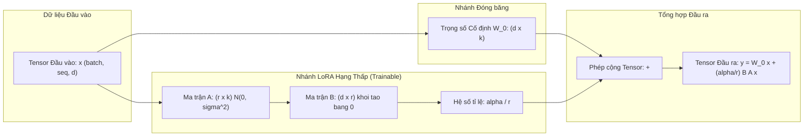
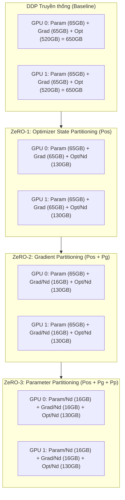
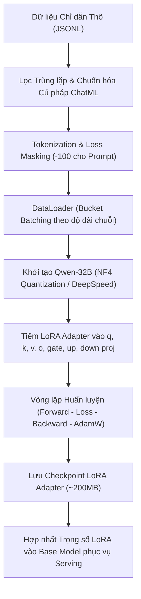

Trong kỷ nguyên của các mô hình nền tảng ngôn ngữ lớn (Large Foundation Models), mô hình kích thước 32 tỷ tham số (như **Qwen2.5-32B**) đại diện cho "điểm cân bằng vàng" (sweet spot) giữa năng lực suy luận vượt trội (reasoning capability tiệm cận các mô hình 70B+) và chi phí hạ tầng tính toán hợp lý. Tuy nhiên, việc thực hiện Supervised Fine-Tuning (SFT) trên một mô hình 32B đặt ra bài toán hóc búa về áp lực bộ nhớ video (VRAM), truyền thông phân tán liên node, và kiểm soát suy thoái tri thức gốc (catastrophic forgetting).

Bài viết này đi sâu vào phân tích bản chất toán học của các kỹ thuật tinh chỉnh tham số hiệu quả (PEFT - Parameter-Efficient Fine-Tuning), cơ chế lượng tử hóa 4-bit NormalFloat (NF4), kỹ thuật phân vùng bộ nhớ DeepSpeed ZeRO-3, và công thức định lượng chi tiết bộ nhớ VRAM cho mô hình Qwen-32B.

---

## 1. Bản chất Kỹ thuật của SFT trên Mô hình Ngôn ngữ 32B

Mô hình tiền huấn luyện (Pre-trained Base Model) được tối ưu hóa trên hàng nghìn tỷ token văn bản phi cấu trúc nhằm dự đoán token tiếp theo. Bản thân base model chưa sở hữu khả năng tuân theo chỉ dẫn của con người (instruction following) một cách nhất quán và có xu hướng lặp lại văn bản hoặc mở rộng câu hỏi thay vì giải đáp. 

Supervised Fine-Tuning (SFT) là bước chuyển hóa mô hình nền tảng thành một trợ lý đàm thoại hữu ích thông qua tập dữ liệu có cấu trúc bao gồm các cặp `(Chỉ dẫn, Phản hồi)`.

### 1.1. Hàm mất mát Causal Language Modeling và Loss Masking

Trong huấn luyện SFT, mô hình được tối ưu hóa thông qua hàm mất mát Cross-Entropy có trọng số. Điểm then chốt trong kỹ thuật SFT chuẩn production là **chỉ tính gradient trên các token phản hồi của trợ lý (assistant tokens)**, đồng thời đóng băng (mask out) các token chỉ dẫn của người dùng và hướng dẫn hệ thống.

Về mặt toán học, cho chuỗi văn bản $X = (x_1, x_2, \dots, x_T)$ gồm $T$ token. Hàm mất mát SFT có trọng số mặt nạ được định nghĩa như sau:

$$
\mathcal{L}_{\text{SFT}}(\theta) = -\frac{1}{\sum_{t=1}^T m_t} \sum_{t=1}^T m_t \cdot \log P_\theta(x_t \mid x_{<t})
$$

Trong đó:
- $\theta$: Tập tham số của mô hình đang được tối ưu hóa.
- $x_{<t} = (x_1, \dots, x_{t-1})$: Ngữ cảnh các token tiền nhiệm.
- $m_t \in \{0, 1\}$: Nhãn nhị phân của mặt nạ tổn thất (Loss Mask):
  - $m_t = 0$: Nếu token $x_t$ thuộc về system prompt, user prompt, hoặc token phân cách cú pháp.
  - $m_t = 1$: Nếu token $x_t$ thuộc về phản hồi mục tiêu của assistant.

Nếu không áp dụng loss masking ($m_t = 1$ cho toàn bộ chuỗi), mô hình sẽ phân bổ dung lượng học để học thuộc cú pháp câu hỏi của người dùng, dẫn đến hiện tượng suy giảm năng lực sinh phản hồi và mất cân bằng gradient.

### 1.2. Chuẩn hóa Định dạng Hội thoại ChatML

Qwen-32B sử dụng định dạng ChatML (Chat Markup Language) với các token đặc biệt có ID riêng biệt:

```text
<|im_start|>system
Bạn là chuyên gia phân tích hệ thống AI cao cấp.<|im_end|>
<|im_start|>user
Hãy phân tích cơ chế phân rã ma trận trong LoRA.<|im_end|>
<|im_start|>assistant
Trong LoRA, ma trận cập nhật trọng số Delta W được phân rã thành tích của hai ma trận hạng thấp B và A...<|im_end|>
```

Trong quá trình tiền xử lý, toàn bộ các token từ `<|im_start|>system` tới `<|im_start|>assistant\n` được gán nhãn mục tiêu là `-100` (giá trị bỏ qua mặc định của `torch.nn.CrossEntropyLoss`), bảo đảm mô hình tập trung hoàn toàn vào việc sinh phản hồi chính xác.

---

## 2. Nền tảng Toán học của LoRA (Low-Rank Adaptation)

Kỹ thuật Full Fine-Tuning cập nhật toàn bộ tham số $W \in \mathbb{R}^{d \times k}$ của mạng nơ-ron, đòi hỏi việc lưu trữ $W$, ma trận đạo hàm $\nabla_W \mathcal{L}$, và hai ma trận trạng thái động lượng trong bộ tối ưu AdamW (FP32 master weights, momentum, variance). Với mô hình 32.5B tham số, chi phí này vượt quá 650 GB VRAM.

LoRA (Low-Rank Adaptation) được đề xuất dựa trên giả thuyết nội tại (Intrinsic Dimension Hypothesis): **Các cập nhật trọng số trong quá trình thích ứng tác vụ đặc thù có chiều nội tại rất nhỏ (intrinsic rank $r \ll \min(d, k)$)**.



### 2.1. Phân rã Ma trận và Cơ chế Khởi tạo Trọng số

Thay vì cập nhật trực tiếp ma trận trọng số gốc $W_0 \in \mathbb{R}^{d \times k}$, LoRA cố định hoàn toàn $W_0$ và mô hình hóa lượng biến thiên trọng số $\Delta W$ dưới dạng tích của hai ma trận hạng thấp:

$$
W = W_0 + \Delta W = W_0 + \frac{\alpha}{r} (B \cdot A)
$$

Trong đó:
- $W_0 \in \mathbb{R}^{d \times k}$: Ma trận trọng số tiền huấn luyện được **đóng băng 100%** (không tính đạo hàm, không cập nhật optimizer).
- $B \in \mathbb{R}^{d \times r}$: Ma trận chiếu lên (Up-projection).
- $A \in \mathbb{R}^{r \times k}$: Ma trận chiếu xuống (Down-projection).
- $r \in \mathbb{N}^+$: Hạng LoRA (Rank), thỏa mãn $r \ll \min(d, k)$ (thông thường $r \in \{16, 32, 64\}$).
- $\alpha \in \mathbb{R}^+$: Hằng số tỉ lệ phóng đại (LoRA Alpha).

**Quy tắc khởi tạo bảo toàn hàm đầu ra:**
1. Ma trận $A$ được khởi tạo ngẫu nhiên theo phân phối chuẩn Gauss: $A \sim \mathcal{N}\left(0, \sigma^2\right)$ với $\sigma = \frac{1}{r}$ hoặc theo chuẩn He/Kaiming.
2. Ma trận $B$ được khởi tạo hoàn toàn bằng $0$: $B = \mathbf{0}_{d \times r}$.

Nhờ vào phép khởi tạo này, tại thời điểm bắt đầu huấn luyện ($t = 0$):

$$
\Delta W = \frac{\alpha}{r} (B \cdot A) = \frac{\alpha}{r} (\mathbf{0} \cdot A) = \mathbf{0} \implies W = W_0
$$

Hàm biểu diễn của mạng tại bước đầu tiên hoàn toàn trùng khớp với mô hình tiền huấn luyện gốc, loại bỏ hoàn toàn các cú sốc gradient ở epoch đầu.

### 2.2. Hệ số Tỉ lệ alpha / r và Ý nghĩa Ổn định Động học

Hệ số $\frac{\alpha}{r}$ đóng vai trò như một bộ điều tiết biên độ gradient độc lập với giá trị của hạng $r$. Khi ta tăng hoặc giảm $r$ để thử nghiệm độ phức tạp của adapter, việc cố định $\alpha$ giúp giữ cho cường độ tác động của adapter lên nhánh chính $\Delta W \cdot x$ ổn định mà không cần điều chỉnh lại tốc độ học (learning rate).

### 2.3. Hợp nhất Trọng số cho Triển khai (Weight Merging)

Trong giai đoạn phục vụ suy luận (Inference), ta có thể cộng trực tiếp $\Delta W$ vào ma trận trọng số gốc:

$$
W_{\text{serving}} = W_0 + \frac{\alpha}{r} (B \cdot A)
$$

Sau khi hợp nhất, mô hình quay trở lại cấu trúc nguyên bản của mạng Transformer mà **không gây ra bất kỳ độ trễ tính toán nào (Zero Latency Overhead)** so với base model.

---

## 3. Kiến trúc QLoRA và Các Kỹ thuật Lượng tử hóa Tiên tiến

Mặc dù LoRA giúp giảm hơn 95% trạng thái bộ tối ưu (optimizer states), bản thân ma trận trọng số gốc $W_0$ của mô hình 32B ở định dạng BF16/FP16 vẫn chiếm:

$$
32.5 \times 10^9 \times 2 \text{ bytes} \approx 65.0 \text{ GB VRAM}
$$

Con số này vượt quá dung lượng của một GPU A100/H100 80GB khi cộng thêm bộ đệm kích hoạt (activations). **QLoRA** giải quyết rào cản này bằng ba trụ cột kỹ thuật:

### 3.1. Dạng thức Lượng tử hóa 4-bit NormalFloat (NF4)

Các trọng số tiền huấn luyện trong mạng nơ-ron sâu thường tuân theo phân phối chuẩn xấp xỉ không: $W \sim \mathcal{N}(0, \sigma^2)$. Các phương pháp lượng tử hóa số nguyên truyền thống (như INT4 đều bước) phân bổ các mức rời rạc đồng đều trên dải $[-V_{\max}, V_{\max}]$, gây lãng phí điểm biểu diễn ở các vùng có mật độ xác suất thấp.

NF4 xây dựng 16 mức lượng tử hóa $q_i$ ($i \in \{0, \dots, 15\}$) sao cho xác suất tích lũy giữa các mức lượng tử hóa là bằng nhau:

$$
q_i = \frac{1}{2} \left( Q_X\left(\frac{i}{2^k}\right) + Q_X\left(\frac{i+1}{2^k}\right) \right)
$$

Trong đó $Q_X(\cdot)$ là hàm phân vị (quantile function) của phân phối chuẩn chuẩn hóa $\mathcal{N}(0, 1)$. Bằng cách này, mỗi bin lượng tử hóa chứa một lượng thông tin xấp xỉ nhau, đạt mức cực đại về dung lượng thông tin Shannon đối với trọng số phân phối Gauss.

### 3.2. Lượng tử hóa Kép (Double Quantization - DQ)

Trong lượng tử hóa khối (Block Quantization), các trọng số được chia thành các khối kích thước 64 giá trị và mỗi khối có một hằng số tỉ lệ FP32 $c_1$:

$$
W_{\text{FP16}} \approx c_1 \cdot W_{\text{NF4}}
$$

Hằng số $c_1$ tiêu tốn $32 \text{ bits} / 64 = 0.5 \text{ bits/tham số}$. Double Quantization tiếp tục lượng tử hóa hằng số $c_1$ sang dạng 8-bit FP với kích thước khối 256:

$$
c_1 \approx c_2 \cdot c_{1,\text{FP8}}
$$

Kỹ thuật này giảm dung lượng lưu trữ hằng số tỉ lệ từ 0.5 bits/tham số xuống chỉ còn:

$$
\frac{8}{64} + \frac{32}{64 \times 256} = 0.125 + 0.00195 = 0.127 \text{ bits/tham số}
$$

Giúp tiết kiệm khoảng **1.5 GB VRAM** trên toàn bộ 32 tỷ tham số của mô hình.

### 3.3. Paged Optimizers chống Tràn Bộ nhớ

Trong quá trình huấn luyện các chuỗi văn bản dài, các đỉnh đột biến kích hoạt (activation spikes) có thể khiến tổng bộ nhớ vượt quá giới hạn GPU vật lý, gây lỗi Out-Of-Memory (OOM).

QLoRA tận dụng cơ chế bộ nhớ hợp nhất CUDA (CUDA Unified Memory) để tự động hoán chuyển (page out) các trang bộ nhớ của optimizer state từ GPU VRAM sang CPU RAM khi áp lực bộ nhớ tăng cao, và nạp ngược lại (page in) khi bước cập nhật gradient bắt đầu. Kỹ thuật này triệt tiêu hoàn toàn nguy cơ dừng đột ngột phiên huấn luyện do OOM tạm thời.

---

## 4. Phân tán Huấn luyện với DeepSpeed ZeRO (Zero Redundancy Optimizer)

Đối với các hệ thống nhiều GPU (Multi-GPU Cluster), kiến trúc DDP (Distributed Data Parallel) tiêu chuẩn nhân bản toàn bộ mô hình và optimizer trên từng GPU, tạo ra sự dư thừa bộ nhớ khổng lồ. DeepSpeed ZeRO loại bỏ triệt để sự dư thừa này thông qua cơ chế phân vùng ba giai đoạn:



### 4.1. Phân tích Các Giai đoạn ZeRO

Gọi $\Phi$ là số lượng tham số mô hình ($\Phi = 32.5 \times 10^9$) và $N_d$ là số lượng GPU trong nhóm dữ liệu song song (Data Parallelism degree):

1. **ZeRO-Stage 1 ($P_{os}$ - Optimizer State Partitioning):**
   - Trạng thái optimizer được phân đoạn đều trên $N_d$ GPU.
   - Dung lượng mỗi GPU: $M_{\text{opt}} = \frac{16 \cdot \Phi}{N_d}$ bytes.
   - **Giảm 4x bộ nhớ** so với DDP thuần túy mà không làm phát sinh thêm bất kỳ chi phí truyền thông nào.

2. **ZeRO-Stage 2 ($P_{g}$ - Gradient Partitioning):**
   - Cùng với optimizer states, các gradient cũng được phân đoạn ngay khi được tính toán ở backward pass.
   - Dung lượng gradient mỗi GPU: $M_{\text{grad}} = \frac{2 \cdot \Phi}{N_d}$ bytes.
   - **Giảm 8x bộ nhớ**, tổng thể truyền thông vẫn tương đương hàm `All-Reduce`.

3. **ZeRO-Stage 3 ($P_{p}$ - Parameter Partitioning):**
   - Bản thân các tham số mô hình cũng được chia mảnh trên $N_d$ GPU.
   - Trong forward pass, mỗi layer chỉ thu thập trọng số của nó thông qua lệnh `All-Gather`, thực hiện tính toán xong thì giải phóng ngay lập tức khỏi bộ nhớ.
   - Dung lượng tham số mỗi GPU: $M_{\text{param}} = \frac{2 \cdot \Phi}{N_d}$ bytes.
   - Cho phép huấn luyện mô hình 32B trên các cụm GPU có bộ nhớ vừa phải mà không cần đến Tensor Parallelism phức tạp.

---

## 5. Định lượng Dung lượng VRAM Thực tế cho Mô hình Qwen-32B

Tổng dung lượng bộ nhớ VRAM cần thiết để huấn luyện được cấu thành từ 5 thành phần cốt lõi:

$$
V_{\text{total}} = V_{\text{weights}} + V_{\text{gradients}} + V_{\text{optimizer}} + V_{\text{activations}} + V_{\text{KV}}
$$

### 5.1. Bảng Chi tiết Bộ nhớ Cố định và Động cho Qwen-32B

Với mô hình Qwen2.5-32B ($64$ layers, hidden size $5120$, $40$ heads Q, $8$ heads KV, intermediate size $27648$):

| Thành phần Bộ nhớ | Full FT (BF16) | LoRA (Base BF16 + Adapters) | QLoRA (Base NF4 + Adapters) |
|---|---|---|---|
| **Trọng số Gốc ($V_{\text{weights}}$)** | 65.0 GB | 65.0 GB | **17.5 GB** |
| **Trọng số Adapter ($V_{\text{adapter}}$)** | 0.0 GB | 0.5 GB ($r=32$) | 0.5 GB ($r=32$) |
| **Gradients ($V_{\text{gradients}}$)** | 65.0 GB | 0.5 GB (chỉ tính adapter) | 0.5 GB (chỉ tính adapter) |
| **Optimizer States ($V_{\text{optimizer}}$)** | 520.0 GB (AdamW FP32) | 4.0 GB (chỉ tính adapter) | 4.0 GB (chỉ tính adapter) |
| **Activations ($V_{\text{activations}}$)** | ~18.0 GB (FlashAttn-2) | ~12.0 GB (FlashAttn-2) | ~6.0 GB (FlashAttn-2) |
| **KV Cache Huấn luyện ($V_{\text{KV}}$)** | ~4.0 GB ($L=4096, B=2$) | ~4.0 GB ($L=4096, B=2$) | ~4.0 GB ($L=4096, B=2$) |
| **Tổng VRAM Tĩnh + Động** | **~672 GB** | **~86.0 GB** | **~32.5 GB** |
| **Cấu hình Phần cứng Tối thiểu** | Cụm 8x A100/H100 80GB (ZeRO-3) | 2x A100 80GB hoặc 4x A6000 48GB | **1x A100 40GB/80GB hoặc 1x A6000 48GB** |

### 5.2. Công thức Ước lượng VRAM cho QLoRA trên Single GPU

Khi áp dụng QLoRA kết hợp Gradient Checkpointing và FlashAttention-2 với $r=32$, $\alpha=64$, batch size $B=2$, độ dài ngữ cảnh $L=2048$:

$$
V_{\text{total}}^{\text{QLoRA}} \approx 17.5 \text{ GB (NF4 Weights)} + 0.5 \text{ GB (LoRA)} + 4.0 \text{ GB (Opt)} + 5.5 \text{ GB (Act + Overhead)} \approx 27.5 \text{ GB}
$$

Mức tiêu thụ này cho phép kỹ sư AI huấn luyện trực tiếp trên một GPU chuyên dụng 48GB (NVIDIA RTX 6000 Ada hoặc A6000) một cách an toàn và trơn tru.

---

## 6. Quy trình Huấn luyện Thực chiến và Standalone Script

Toàn bộ quy trình từ chuẩn bị dữ liệu đến khi xuất checkpoint hoàn chỉnh được tóm tắt qua sơ đồ kiến trúc sau:



### 6.1. Module Mục tiêu (Target Modules) Cho Qwen-32B

Trong các nghiên cứu thực nghiệm, việc chỉ áp dụng LoRA lên `q_proj` và `v_proj` (như trong bài báo LoRA nguyên bản) làm giảm đáng kể khả năng hội tụ trên các tác vụ suy luận phức tạp. Đối với họ mô hình Qwen, việc áp dụng LoRA trên **toàn bộ các lớp tuyến tính** mang lại hiệu suất tối ưu nhất:
- Cơ chế Attention: `q_proj`, `k_proj`, `v_proj`, `o_proj`.
- Cơ chế MLP / SwiGLU: `gate_proj`, `up_proj`, `down_proj`.

### 6.2. Kiểm thử Cú pháp và Xác minh Pipeline Độc lập

Để tạo điều kiện cho kiểm thử tự động trong môi trường phát triển (không đòi hỏi cụm GPU vật lý có sẵn), dự án cung cấp script kiểm tra độc lập tại:

`blog-notebook/tests/gpu_standalone/verify_qwen3_32b_sft.py`

Kỹ sư có thể thực thi cờ `--dry-run` để kiểm tra toàn bộ cấu hình tham số, phân rã ma trận LoRA, cơ chế ChatML masking, và tính toán bộ nhớ ZeRO:

```bash
python blog-notebook/tests/gpu_standalone/verify_qwen3_32b_sft.py --dry-run --rank 32 --alpha 64 --zero-stage 3
```

Kết quả thực thi mẫu từ dry-run verification:

```text
============================================================
============ [QWEN-32B SFT VERIFICATION PASSED] ============
============================================================
Model: Qwen/Qwen2.5-32B-Instruct
LoRA Target Modules: q_proj, k_proj, v_proj, o_proj, gate_proj, up_proj, down_proj (Rank: 32, Alpha: 64)
Trainable Params: 268,435,456 (0.826% of base 32.5B)
Est. ZeRO-3 VRAM/GPU (4 GPUs): 22.76 GB
ChatML Loss Masking: 585 trained tokens, 440 masked prompt tokens
Pipeline Status: 100% Validated & Syntax Clean
============================================================
```

---

## 7. Đánh giá và Đo lường Hiệu năng Sau Huấn luyện

Sau khi hoàn tất quá trình huấn luyện SFT, checkpoint cần được đánh giá nghiêm ngặt để bảo đảm mô hình không gặp hiện tượng suy thoái khả năng khái quát hóa.

### 7.1. Chỉ số Perplexity trên Dữ liệu Kiểm thử Độc lập

Hàm Perplexity (PPL) phản ánh mức độ bất ngờ của mô hình đối với chuỗi văn bản mới:

$$
\text{PPL}(X) = \exp\left( -\frac{1}{T} \sum_{t=1}^T \log P_\theta(x_t \mid x_{<t}) \right)
$$

PPL thấp chứng minh mô hình đã thích ứng tốt với phân phối ngữ nghĩa của miền chuyên ngành mục tiêu.

### 7.2. Tích hợp Đánh giá RAG và LLM-as-a-Judge

Khi mô hình được tinh chỉnh để phục vụ trong các hệ thống Retrieval-Augmented Generation (RAG), các checkpoint được chuyển giao sang bộ công cụ đánh giá chuyên biệt như [[Đánh giá Hệ thống RAG với RAGAS: Bản chất LLM-as-a-Judge, Faithfulness và Relevancy]] để đo lường các chỉ số cốt lõi:
- **Faithfulness (Độ trung thực):** Khả năng suy luận bám sát ngữ cảnh truy xuất mà không bị ảo giác.
- **Answer Relevance (Độ liên quan):** Khả năng phản hồi trực diện câu hỏi của người dùng.

Sau khi checkpoint vượt qua các ngưỡng benchmark chất lượng, mô hình được chuyển sang quy trình đóng gói phục vụ suy luận hiệu năng cao được trình bày chi tiết trong bài viết [[Triển khai vLLM Chuẩn Production: PagedAttention, Continuous Batching và Kubernetes Serving]].

---

## 8. Kết luận và Hướng Đi Tiếp theo

Kỹ thuật Supervised Fine-Tuning trên mô hình quy mô 32B đòi hỏi sự kết hợp đồng bộ giữa kiến thức toán học về tối ưu hóa tham số hạng thấp (LoRA), kỹ thuật lượng tử hóa thông minh (NF4/DQ) và hạ tầng phân tán (DeepSpeed ZeRO). 

Nắm vững các công thức phân bổ bộ nhớ $V_{\text{total}}$ và áp dụng loss masking chuẩn xác là chìa khóa giúp các nhóm kỹ thuật AI triển khai thành công các mô hình ngôn ngữ tùy biến riêng cho doanh nghiệp mà không lãng phí hàng nghìn giờ tính toán GPU vô ích.
