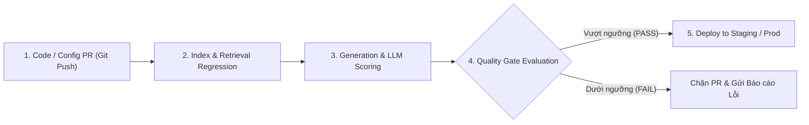
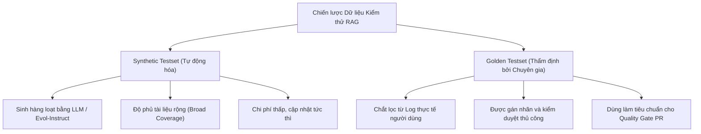
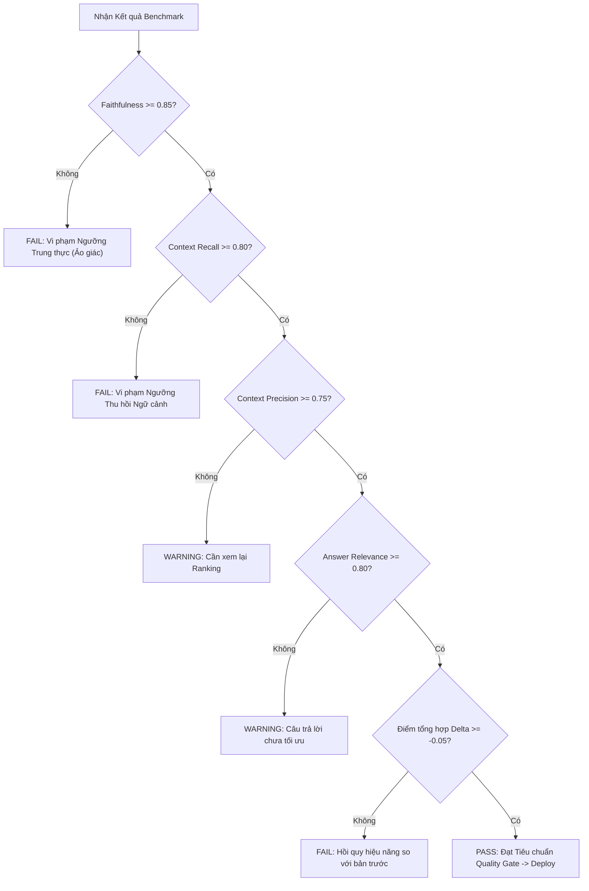
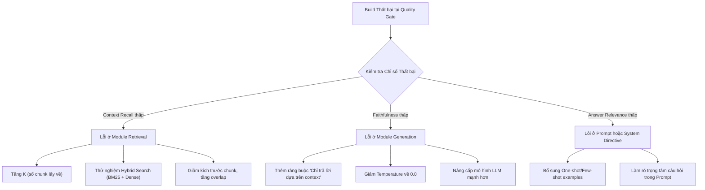

Khác với các ứng dụng phần mềm truyền thống nơi logic nghiệp vụ mang tính tất định (deterministic) và có thể bao phủ hoàn toàn bằng unit tests hoặc integration tests, các hệ thống Retrieval-Augmented Generation (RAG) mang tính ngẫu nhiên (probabilistic). Chỉ một sự thay đổi nhỏ trong tham số chunking (ví dụ chuyển từ chunk size 512 sang 256), nâng cấp mô hình embedding, hay tinh chỉnh một vài từ trong system prompt cũng có thể gây ra hiện tượng hồi quy nghiêm trọng: tăng tỷ lệ ảo giác (hallucination) hoặc làm mất mát thông tin quan trọng khi truy xuất.

Để đưa một ứng dụng RAG vào sản xuất với độ tin cậy cao, việc thiết lập một **CI/CD Pipeline Tự động Đánh giá** (Automated Evaluation Pipeline) là bắt buộc. Bài viết này trình bày chi tiết kiến trúc xây dựng pipeline kiểm thử hồi quy RAG, chiến lược quản trị tập dữ liệu kiểm thử (Golden Testset vs Synthetic Dataset), thiết lập Cổng chất lượng (Quality Gate) chặn mã nguồn lỗi và hiện thực một bộ chạy benchmark runner hoàn chỉnh bằng Python.

## 1. Thách thức Kiểm thử Phần mềm trong Kỷ nguyên RAG và LLMOps

Trong quy trình DevOps tiêu chuẩn, một đoạn code mới được đẩy lên (Git Push) sẽ kích hoạt các bước kiểm tra cú pháp, build container và chạy bộ kiểm thử đơn vị (`pytest`, `jest`). Các assertion thông thường dựa trên nguyên tắc so sánh bằng tuyệt đối:

```python
assert response.status_code == 200
assert result == expected_output
```

Tuy nhiên, với ứng dụng RAG:
- Đầu ra của LLM không bao giờ giống nhau hoàn toàn giữa các lần suy luận nếu không cố định seed hoặc nhiệt độ (temperature).
- Cơ sở tri thức (Knowledge Base) thay đổi liên tục khi người dùng thêm hoặc sửa tài liệu trong cơ sở dữ liệu vector.
- Lỗi logic thường ẩn dưới dạng suy luận sai ngữ cảnh, câu từ bịa đặt nghe có vẻ rất hợp lý, hoặc bỏ sót một chi tiết quan trọng trong hợp đồng kinh tế.

Do đó, triết lý kiểm thử RAG trong CI/CD chuyển đổi từ **Deterministic Assertion** (Khẳng định tuyệt đối) sang **Statistical Quality Gate** (Cổng chất lượng thống kê). Mỗi commit thay đổi mã nguồn hoặc cấu hình hệ thống phải được chấm điểm tự động trên một bộ testset chuẩn hóa, và chỉ được phép merge vào nhánh `main` khi vượt qua các ngưỡng chất lượng định trước.

## 2. Kiến trúc Tổng thể CI/CD Pipeline cho Hệ thống RAG

Một pipeline CI/CD hiện đại dành cho RAG bao gồm 5 giai đoạn liên hoàn, từ lúc lập trình viên tạo Pull Request (PR) cho đến khi release vào môi trường Staging/Production:



Quy trình vận hành chi tiết:
1. **Trigger Phase**: Được kích hoạt tự động qua GitHub Actions / GitLab CI khi có Pull Request thay đổi mã nguồn retriever, prompt template, phiên bản model, hoặc dữ liệu tri thức.
2. **Retrieval Regression Test**: Đánh giá độc lập module tìm kiếm ngữ cảnh dựa trên bộ câu hỏi mẫu. Đo lường tốc độ truy xuất, độ chính xác thứ hạng ($\text{Precision}@K$, mAP) và tỷ lệ bao phủ sự kiện ($\text{Context Recall}$).
3. **Generation & Evaluation Run**: Chạy hệ thống RAG end-to-end trên bộ câu hỏi kiểm thử. Thu thập câu trả lời sinh ra và kích hoạt bộ công cụ đánh giá (RAGAS Evaluator) để chấm điểm Faithfulness và Answer Relevance.
4. **Quality Gate Decision**: Đối chiếu các điểm số trung bình và điểm số của từng mẫu đơn lẻ với ngưỡng an toàn. Nếu bất kỳ chỉ số cốt lõi nào tụt dưới ngưỡng quy định, build job lập tức bị đánh dấu thất bại (`exit code 1`).
5. **Reporting & Feedback Loop**: Tự động bình luận báo cáo chi tiết trực tiếp vào Pull Request trên GitHub, chỉ rõ những câu hỏi nào bị suy giảm chất lượng và phân loại nguyên nhân lỗi.

## 3. Chiến lược Xây dựng và Quản trị Bộ Dữ liệu Kiểm thử (Testset Strategy)

Trọng tâm của một pipeline đánh giá đáng tin cậy nằm ở chất lượng của tập dữ liệu kiểm thử. Trong thực tế triển khai, hai loại testset được kết hợp song song:



### 3.1. Synthetic Testset (Tập dữ liệu giả định tự động)
- **Cơ chế**: Sử dụng một LLM mạnh (kết hợp các phương pháp như Evol-Instruct trong RAGAS) để quét qua toàn bộ các chunk trong Vector Database. LLM sẽ tự động trích xuất các khẳng định sự kiện chính và đảo ngược thành các dạng câu hỏi khác nhau: câu hỏi đơn giản (simple), câu hỏi suy luận đa bước (multi-hop reasoning), và câu hỏi điều kiện (conditional).
- **Ưu điểm**: Tạo ra hàng nghìn mẫu kiểm thử chỉ trong vài chục phút với chi phí thấp; đảm bảo không có vùng tri thức nào trong tài liệu bị bỏ quên.
- **Vai trò**: Dùng để stress-test độ phủ khi nạp tài liệu mới vào cơ sở tri thức.

### 3.2. Golden Testset (Tập dữ liệu chuẩn vàng)
- **Cơ chế**: Tập hợp từ 50 đến 200 câu hỏi mang tính then chốt, phản ánh hành vi thực tế của người dùng cuối. Mỗi mẫu trong Golden Testset bao gồm 4 trường dữ liệu bắt buộc:
  - `question`: Câu hỏi thực tế của người dùng.
  - `ground_truth_contexts`: Danh sách các đoạn văn bản chính xác cần phải tìm thấy.
  - `ground_truth_answer`: Câu trả lời mẫu chuẩn mực đã được chuyên gia nghiệp vụ (Domain Expert) thẩm định.
  - `difficulty`: Mức độ phức tạp (fact-lookup, synthesis, adversarial/jailbreak).
- **Vai trò**: Là thước đo tối thượng trong CI/CD. Mọi thay đổi code đều phải vượt qua 100% kiểm định trên Golden Testset trước khi được phê duyệt.

## 4. Thiết lập Cổng Chất lượng (Quality Gate) và Tiêu chí Đánh giá

Quality Gate là bộ quy tắc logic quyết định xem một bản build có đủ tiêu chuẩn an toàn để triển khai hay không. Dựa trên nghiên cứu lý thuyết từ [[Đánh giá Hệ thống RAG với RAGAS: Bản chất LLM-as-a-Judge, Faithfulness và Relevancy]], hệ thống quy chuẩn được chia thành hai cấp độ: **Ngưỡng Tuyệt đối (Absolute Thresholds)** và **Ngưỡng Độ dốc (Regression Delta Thresholds)**.

### Bảng 1: Bảng quy chuẩn Ngưỡng Quality Gate trong CI/CD

| Chỉ số Đánh giá | Trọng số | Mức Nguy hiểm (Blocker - Fail Build) | Mức Cảnh báo (Warning - Yêu cầu Review) | Mục tiêu Sản xuất (Production Target) | Hành động khi vi phạm |
|---|---|---|---|---|---|
| **Faithfulness** | 0.35 | $< 0.85$ | $0.85 - 0.90$ | $\ge 0.95$ | **Chặn build ngay lập tức**. Ngăn chặn phát tán thông tin ảo giác đến người dùng. |
| **Context Recall** | 0.25 | $< 0.80$ | $0.80 - 0.88$ | $\ge 0.92$ | **Chặn build**. Bộ Retriever đã bỏ sót thông tin sự kiện quan trọng trong tài liệu gốc. |
| **Context Precision** | 0.20 | $< 0.75$ | $0.75 - 0.82$ | $\ge 0.88$ | Cảnh báo. Thứ hạng văn bản bị nhiễu, cần tinh chỉnh reranker. |
| **Answer Relevance** | 0.20 | $< 0.80$ | $0.80 - 0.85$ | $\ge 0.90$ | Cảnh báo. Câu trả lời có dấu hiệu lan man, không đúng trọng tâm câu hỏi. |
| **Regression Delta ($\Delta$)** | - | Điểm tổng hợp giảm $> 0.05$ | Điểm giảm $> 0.02$ | $\Delta \ge 0.00$ | **Chặn build**. Phát hiện hiện tượng hồi quy tiêu cực so với nhánh `main`. |

### Vòng lặp Đánh giá Quality Gate



## 5. Phân loại Lỗi và Quy trình Xử lý Hồi quy (Failure Triage)

Khi một bản build bị Quality Gate chặn lại, đội ngũ kỹ sư cần một quy trình chẩn đoán có hệ thống để xác định vị trí hỏng hóc và giải quyết nhanh chóng:



### Bảng 2: Phân loại nguyên nhân gốc rễ và giải pháp kỹ thuật

| Phân loại Lỗi | Dấu hiệu trên Chỉ số | Nguyên nhân Kỹ thuật Gốc rễ | Giải pháp Kỹ thuật Triệt để |
|---|---|---|---|
| **Retrieval Miss** | Context Recall $< 0.80$, Context Precision bình thường | Kích thước chunk quá lớn làm loãng thông tin, hoặc độ dài truy xuất $K$ quá nhỏ | Chuyển sang Sentence Window Retrieval hoặc áp dụng Parent-Document Retriever |
| **Ranking Degradation** | Context Precision $< 0.75$, Context Recall cao | Thuật toán vector search bị phân tán bởi các từ khóa chung chung | Bổ sung Cohere Reranker hoặc BGE-Reranker-v2 sau bước Dense Search |
| **Hallucination Extrapolation** | Faithfulness $< 0.85$, Context Recall cao | LLM sử dụng tri thức đóng (parametric memory) thay vì đọc ngữ cảnh truyền vào | Củng cố System Prompt với chỉ thị nghiêm ngặt: *"Chỉ sử dụng ngữ cảnh, không tự suy đoán"* |
| **Verbosity Drift** | Answer Relevance $< 0.80$, Faithfulness cao | Prompt thiếu ràng buộc về cấu trúc đầu ra, khiến LLM lặp lại ngữ cảnh dài dòng | Cấu hình ép kiểu Pydantic Structured Output hoặc chỉ định độ dài tối đa |

## 6. Hiện thực Hộp công cụ Benchmark Runner Tự động bằng Python

Dưới đây là mã nguồn Python hoàn chỉnh của một bộ chạy kiểm thử tự động (**RAG Evaluation Benchmark Runner**). Script này đọc tập dữ liệu kiểm thử (Golden Testset), tính toán 4 chỉ số RAGAS, đánh giá đối chiếu với bộ ngưỡng Quality Gate, và xuất báo cáo kết quả chi tiết ở định dạng JSON cũng như bảng tổng kết trực quan.

Mã nguồn được thiết kế theo hướng module hóa cao, tương thích 100% với môi trường `blog`, sẵn sàng tích hợp trực tiếp vào GitHub Actions runner:

```python
"""
rag_eval_pipeline.py
Hệ thống CI/CD Pipeline Benchmark Runner cho RAG:
- Đọc tập dữ liệu kiểm thử (Golden Testset).
- Tính toán các chỉ số Faithfulness, Context Recall, Context Precision, Answer Relevance.
- Kiểm tra vi phạm cổng chất lượng (Quality Gate Violation).
- Xuất báo cáo cấu trúc JSON và Markdown phục vụ CI/CD Pull Request.
"""

from dataclasses import asdict, dataclass, field
import json
import re
import sys
from typing import Any, Dict, List, Optional
import numpy as np


def cosine_similarity(u: np.ndarray, v: np.ndarray) -> float:
    """Tính tương đồng cosin an toàn cho vector."""
    norm_u = np.linalg.norm(u)
    norm_v = np.linalg.norm(v)
    if norm_u == 0.0 or norm_v == 0.0:
        return 0.0
    return float(np.dot(u, v) / (norm_u * norm_v))


@dataclass
class TestCase:
    """Cấu trúc dữ liệu cho một ca kiểm thử trong Golden Testset."""
    test_id: str
    query: str
    contexts: List[str]
    generated_answer: str
    ground_truth: str
    query_vector: np.ndarray
    synthetic_query_vectors: List[np.ndarray]
    explicit_relevance_labels: Optional[List[int]] = None


@dataclass
class QualityGateConfig:
    """Cấu hình các ngưỡng an toàn của Quality Gate."""
    min_faithfulness: float = 0.85
    min_context_recall: float = 0.80
    min_context_precision: float = 0.75
    min_answer_relevance: float = 0.80
    min_overall_score: float = 0.80


@dataclass
class TestCaseMetricResult:
    """Kết quả chi tiết cho một test case."""
    test_id: str
    faithfulness: float
    context_recall: float
    context_precision: float
    answer_relevance: float
    overall_score: float
    passed: bool
    reasons: List[str] = field(default_factory=list)


@dataclass
class PipelineReport:
    """Báo cáo tổng kết toàn bộ pipeline."""
    build_status: str  # "PASSED" hoặc "FAILED"
    total_cases: int
    passed_cases: int
    failed_cases: int
    mean_faithfulness: float
    mean_context_recall: float
    mean_context_precision: float
    mean_answer_relevance: float
    mean_overall_score: float
    violations: List[str]
    detailed_results: List[TestCaseMetricResult]


class RAGEvalPipelineRunner:
    """Bộ thực thi kiểm thử và thẩm định Quality Gate cho RAG CI/CD."""

    def __init__(self, config: Optional[QualityGateConfig] = None):
        self.config = config or QualityGateConfig()

    def _extract_statements(self, text: str) -> List[str]:
        """Phân rã văn bản thành các mệnh đề sự kiện độc lập an toàn với số thập phân."""
        sentences = re.split(r"(?<=[.!?;\n])\s+", text)
        return [s.strip().rstrip(".!?;\n") for s in sentences if len(s.strip()) > 5]

    def _is_supported(self, statement: str, context: str) -> bool:
        """Kiểm tra xem câu khẳng định có căn cứ trong ngữ cảnh không."""
        words = re.findall(r"\w+", statement.lower())
        stopwords = {"là", "và", "của", "các", "những", "trong", "được", "cho", "đã", "có", "một"}
        keywords = [w for w in words if w not in stopwords and len(w) > 2]
        if not keywords:
            return True
        ctx_lower = context.lower()
        matched = sum(1 for kw in keywords if kw in ctx_lower)
        return (matched / len(keywords)) >= 0.70

    def compute_faithfulness(self, answer: str, contexts: List[str]) -> float:
        """Đo lường tính trung thực: |V| / |S|."""
        statements = self._extract_statements(answer)
        if not statements:
            return 0.0
        full_ctx = " ".join(contexts)
        verified = sum(1 for s in statements if self._is_supported(s, full_ctx))
        return float(verified / len(statements))

    def compute_context_recall(self, ground_truth: str, contexts: List[str]) -> float:
        """Đo lường tỷ lệ bao phủ của context đối với ground truth."""
        gt_statements = self._extract_statements(ground_truth)
        if not gt_statements:
            return 0.0
        full_ctx = " ".join(contexts)
        covered = sum(1 for s in gt_statements if self._is_supported(s, full_ctx))
        return float(covered / len(gt_statements))

    def compute_context_precision(
        self,
        contexts: List[str],
        ground_truth: str,
        explicit_labels: Optional[List[int]] = None
    ) -> float:
        """Tính toán Context Precision theo công thức mAP."""
        if not contexts:
            return 0.0
        if explicit_labels is not None:
            relevance = explicit_labels
        else:
            gt_words = [w for w in re.findall(r"\w+", ground_truth.lower()) if len(w) > 3]
            relevance = [
                1 if any(kw in ctx.lower() for kw in gt_words) else 0
                for ctx in contexts
            ]

        total_relevant = sum(relevance)
        if total_relevant == 0:
            return 0.0

        precisions = []
        cum_relevant = 0
        for k, rel in enumerate(relevance, start=1):
            if rel == 1:
                cum_relevant += 1
                precisions.append(cum_relevant / k)
        return float(sum(precisions) / total_relevant)

    def compute_answer_relevance(
        self,
        query_vector: np.ndarray,
        synth_vectors: List[np.ndarray]
    ) -> float:
        """Tính toán Answer Relevance qua tương đồng cosin với các câu hỏi giả lập."""
        if not synth_vectors:
            return 0.0
        sims = [cosine_similarity(query_vector, sv) for sv in synth_vectors]
        return float(np.mean(sims))

    def evaluate_test_case(self, case: TestCase) -> TestCaseMetricResult:
        """Đánh giá chi tiết cho từng ca kiểm thử."""
        faith = self.compute_faithfulness(case.generated_answer, case.contexts)
        recall = self.compute_context_recall(case.ground_truth, case.contexts)
        prec = self.compute_context_precision(case.contexts, case.ground_truth, case.explicit_relevance_labels)
        rel = self.compute_answer_relevance(case.query_vector, case.synthetic_query_vectors)

        # Trọng số tính điểm tổng hợp
        overall = 0.35 * faith + 0.25 * recall + 0.20 * prec + 0.20 * rel

        reasons = []
        passed = True

        if faith < self.config.min_faithfulness:
            passed = False
            reasons.append(f"Faithfulness {faith:.2f} < {self.config.min_faithfulness}")
        if recall < self.config.min_context_recall:
            passed = False
            reasons.append(f"Context Recall {recall:.2f} < {self.config.min_context_recall}")
        if prec < self.config.min_context_precision:
            reasons.append(f"Context Precision {prec:.2f} < {self.config.min_context_precision} (Warning)")
        if rel < self.config.min_answer_relevance:
            reasons.append(f"Answer Relevance {rel:.2f} < {self.config.min_answer_relevance} (Warning)")

        return TestCaseMetricResult(
            test_id=case.test_id,
            faithfulness=faith,
            context_recall=recall,
            context_precision=prec,
            answer_relevance=rel,
            overall_score=overall,
            passed=passed,
            reasons=reasons
        )

    def run_benchmark(self, testset: List[TestCase]) -> PipelineReport:
        """Chạy toàn bộ bộ kiểm thử và kiểm tra điều kiện Quality Gate."""
        detailed_results = [self.evaluate_test_case(case) for case in testset]

        mean_faith = float(np.mean([r.faithfulness for r in detailed_results]))
        mean_recall = float(np.mean([r.context_recall for r in detailed_results]))
        mean_prec = float(np.mean([r.context_precision for r in detailed_results]))
        mean_rel = float(np.mean([r.answer_relevance for r in detailed_results]))
        mean_overall = float(np.mean([r.overall_score for r in detailed_results]))

        passed_cases = sum(1 for r in detailed_results if r.passed)
        failed_cases = len(detailed_results) - passed_cases

        violations = []
        if mean_faith < self.config.min_faithfulness:
            violations.append(
                f"Mean Faithfulness {mean_faith:.3f} dưới ngưỡng {self.config.min_faithfulness}"
            )
        if mean_recall < self.config.min_context_recall:
            violations.append(
                f"Mean Context Recall {mean_recall:.3f} dưới ngưỡng {self.config.min_context_recall}"
            )
        if mean_prec < self.config.min_context_precision:
            violations.append(
                f"Mean Context Precision {mean_prec:.3f} dưới ngưỡng {self.config.min_context_precision}"
            )
        if mean_rel < self.config.min_answer_relevance:
            violations.append(
                f"Mean Answer Relevance {mean_rel:.3f} dưới ngưỡng {self.config.min_answer_relevance}"
            )
        if mean_overall < self.config.min_overall_score:
            violations.append(
                f"Mean Overall Score {mean_overall:.3f} dưới ngưỡng tổng quát {self.config.min_overall_score}"
            )

        build_status = "PASSED" if (len(violations) == 0 and failed_cases == 0) else "FAILED"

        return PipelineReport(
            build_status=build_status,
            total_cases=len(testset),
            passed_cases=passed_cases,
            failed_cases=failed_cases,
            mean_faithfulness=mean_faith,
            mean_context_recall=mean_recall,
            mean_context_precision=mean_prec,
            mean_answer_relevance=mean_rel,
            mean_overall_score=mean_overall,
            violations=violations,
            detailed_results=detailed_results
        )

    def generate_markdown_summary(self, report: PipelineReport) -> str:
        """Tạo bảng báo cáo tóm tắt để comment tự động vào GitHub Pull Request."""
        status_icon = "✅ PASSED" if report.build_status == "PASSED" else "❌ FAILED"
        lines = [
            f"### Kết quả RAG CI/CD Quality Gate: {status_icon}",
            "",
            f"- **Tổng số ca kiểm thử**: {report.total_cases}",
            f"- **Đạt chuẩn**: {report.passed_cases} | **Vi phạm**: {report.failed_cases}",
            "",
            "| Chỉ số | Điểm Trung bình | Ngưỡng Tối thiểu | Trạng thái |",
            "|---|---|---|---|",
            f"| **Faithfulness** | `{report.mean_faithfulness:.4f}` | `{self.config.min_faithfulness}` | {'✅' if report.mean_faithfulness >= self.config.min_faithfulness else '❌'} |",
            f"| **Context Recall** | `{report.mean_context_recall:.4f}` | `{self.config.min_context_recall}` | {'✅' if report.mean_context_recall >= self.config.min_context_recall else '❌'} |",
            f"| **Context Precision** | `{report.mean_context_precision:.4f}` | `{self.config.min_context_precision}` | {'✅' if report.mean_context_precision >= self.config.min_context_precision else '⚠️'} |",
            f"| **Answer Relevance** | `{report.mean_answer_relevance:.4f}` | `{self.config.min_answer_relevance}` | {'✅' if report.mean_answer_relevance >= self.config.min_answer_relevance else '⚠️'} |",
            f"| **Overall Score** | `{report.mean_overall_score:.4f}` | `{self.config.min_overall_score}` | {'✅' if report.mean_overall_score >= self.config.min_overall_score else '❌'} |",
            ""
        ]

        if report.violations:
            lines.append("#### Danh sách Vi phạm Ngưỡng:")
            for v in report.violations:
                lines.append(f"- 🔴 {v}")
            lines.append("")

        return "\n".join(lines)


if __name__ == "__main__":
    # Khởi tạo dữ liệu giả lập cho Golden Testset
    np.random.seed(42)
    q1_vec = np.array([0.9, 0.1, 0.0])
    synth_good = [np.array([0.88, 0.12, 0.05]), np.array([0.92, 0.08, 0.01])]

    sample_cases = [
        TestCase(
            test_id="TC-001-TRANSFORMER",
            query="Kiến trúc Transformer do ai phát minh?",
            contexts=[
                "Các nhà khoa học tại Google Brain đã công bố bài báo Attention Is All You Need vào năm 2017.",
                "Transformer thay thế cơ chế xử lý tuần tự của RNN bằng Self-Attention."
            ],
            generated_answer="Kiến trúc Transformer do các nhà khoa học tại Google Brain công bố năm 2017.",
            ground_truth="Transformer được phát minh bởi các nhà nghiên cứu Google Brain vào năm 2017.",
            query_vector=q1_vec,
            synthetic_query_vectors=synth_good,
            explicit_relevance_labels=[1, 0]
        ),
        TestCase(
            test_id="TC-002-RETRIEVAL-MISS",
            query="DeepSeek R1 sử dụng phương pháp huấn luyện nào?",
            contexts=[
                "DeepSeek là công ty AI phát triển nhiều mô hình mã nguồn mở ấn tượng.",
                "Mô hình V3 là mô hình MoE với 671 tỷ tham số."
            ],
            generated_answer="DeepSeek R1 áp dụng học tăng cường quy mô lớn không cần dữ liệu SFT trước.",
            ground_truth="DeepSeek R1 sử dụng phương pháp Pure Reinforcement Learning (GRPO) để tối ưu hóa khả năng suy luận.",
            query_vector=q1_vec,
            synthetic_query_vectors=synth_good,
            explicit_relevance_labels=[0, 0]
        )
    ]

    runner = RAGEvalPipelineRunner()
    report = runner.run_benchmark(sample_cases)
    summary_md = runner.generate_markdown_summary(report)

    print(summary_md)
    print("Mã thoát pipeline (Exit Code):", 0 if report.build_status == "PASSED" else 1)
```

## 7. Triển khai Thực tế với GitHub Actions và Giám sát Liên tục

Dưới đây là file cấu hình workflow mẫu `.github/workflows/rag-eval.yml` thể hiện cách kết nối bộ benchmark runner vào chu trình CI/CD thực tế:

```yaml
name: RAG Evaluation CI/CD Quality Gate

on:
  pull_request:
    branches: [ "main" ]
    paths:
      - "rag_service/**"
      - "prompts/**"
      - "knowledge_base/**"

jobs:
  rag-benchmark:
    runs-on: ubuntu-latest
    steps:
      - name: Checkout Code
        uses: actions/checkout@v4

      - name: Set up Python 3.12
        uses: actions/setup-python@v5
        with:
          python-version: "3.12"

      - name: Install Dependencies
        run: |
          pip install numpy pytest requests

      - name: Run RAG Evaluation Benchmark Runner
        id: run_eval
        run: |
          python -m blog_notebook.tests.standard.test_rag_pipeline > eval_summary.md || echo "BUILD_FAILED=1" >> $GITHUB_ENV

      - name: Comment PR with Evaluation Results
        uses: actions/github-script@v7
        with:
          script: |
            const fs = require('fs');
            const summary = fs.readFileSync('eval_summary.md', 'utf8');
            github.rest.issues.createComment({
              issue_number: context.issue.number,
              owner: context.repo.owner,
              repo: context.repo.repo,
              body: summary
            });

      - name: Enforce Quality Gate Status
        run: |
          if [ "$BUILD_FAILED" = "1" ]; then
            echo "Quality Gate vi phạm! Chặn Pull Request."
            exit 1
          fi
```

### Giám sát Sau Triển khai (Continuous Production Monitoring)
Sau khi vượt qua CI/CD và triển khai vào production, dữ liệu tương tác thực tế tiếp tục được thu thập vào Data Lake. Một luồng CronJob định kỳ hàng đêm sẽ lấy mẫu ngẫu nhiên 5% lưu lượng truy vấn để chạy lại qua bộ RAGAS Evaluator. Nếu chỉ số Faithfulness trên production giảm đột biến, hệ thống cảnh báo PagerDuty sẽ được kích hoạt để kỹ sư can thiệp trước khi ảnh hưởng đến trải nghiệm người dùng diện rộng.

## 8. Kết luận và Khuyến nghị Triển khai Production

Xây dựng CI/CD Pipeline tự động cho RAG là bước chuyển mình quyết định để đưa các giải pháp Generative AI từ giai đoạn thử nghiệm (PoC) lên mức độ sẵn sàng cho doanh nghiệp (Enterprise Production Ready):
1. **Thiết lập Golden Testset sớm**: Đừng đợi đến khi phát sinh lỗi mới tạo testset; hãy lưu vết các câu hỏi hay gặp của người dùng ngay từ ngày đầu tiên.
2. **Tuân thủ quy chuẩn Cổng chất lượng**: Kiên quyết không hạ ngưỡng Faithfulness xuống dưới $0.85$ vì ảo giác là rủi ro lớn nhất đối với uy tín của doanh nghiệp.
3. **Phân tích nguyên nhân gốc rễ (Root Cause Analysis)**: Sử dụng bảng phân loại lỗi để tối ưu hóa đúng bộ phận — không cố gắng sửa prompt khi vấn đề thực tế nằm ở bộ tìm kiếm context.
