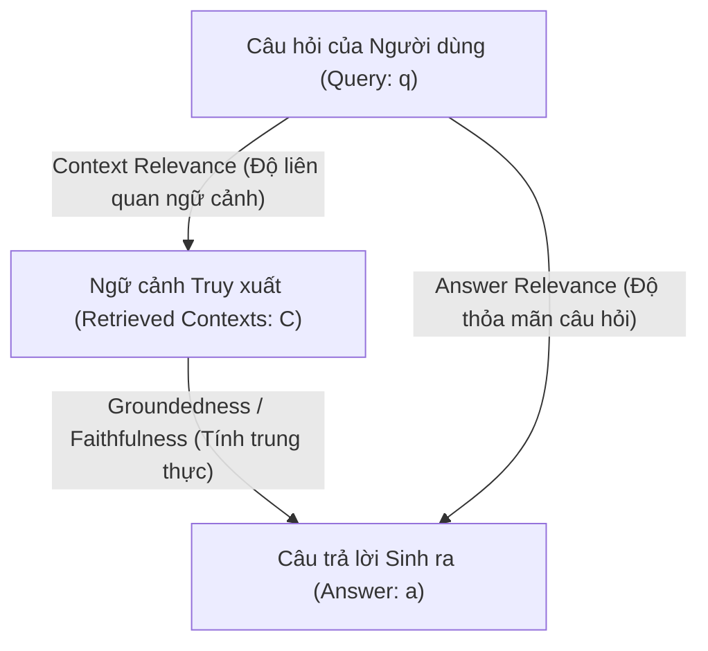
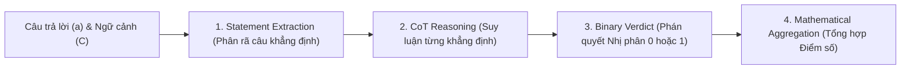
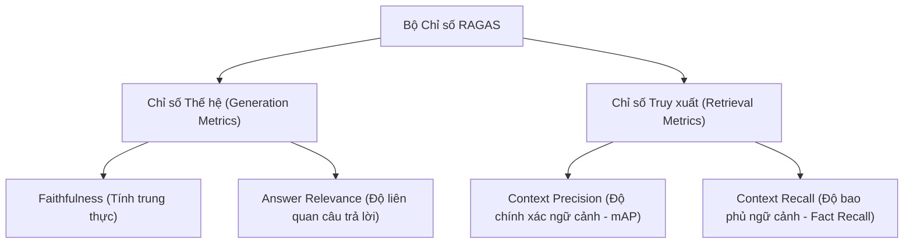

Hệ thống Retrieval-Augmented Generation (RAG) đã trở thành kiến trúc nền tảng cho việc kết hợp tri thức riêng biệt của doanh nghiệp với năng lực suy luận của các Mô hình Ngôn ngữ Lớn (LLM). Tuy nhiên, việc đánh giá định lượng chất lượng của một hệ thống RAG đặt ra những thách thức kỹ thuật hoàn toàn khác biệt so với các tác vụ xử lý ngôn ngữ tự nhiên (NLP) truyền thống. Các chỉ số đối sánh chuỗi cổ điển như BLEU hay ROUGE không thể nắm bắt được tính chính xác ngữ nghĩa và hiện tượng ảo giác (hallucination).

Bài viết này đi sâu vào nguyên lý hoạt động của khung đánh giá RAGAS (Retrieval Augmented Generation Assessment), cơ chế LLM-as-a-Judge, mô hình ba trụ cột RAG Triad, các công thức toán học đằng sau từng chỉ số cốt lõi và cách hiện thực thuật toán bằng mã Python thuần túy.

## 1. Thách thức trong Đánh giá Hệ thống RAG và Sự hạn chế của Heuristic Truyền thống

Trước khi các phương pháp đánh giá dựa trên mô hình (model-based evaluation) ra đời, cộng đồng NLP chủ yếu dựa vào các thước đo dựa trên n-gram overlap:

- **BLEU (Bilingual Evaluation Understudy)**: Tính toán độ trùng lặp n-gram chính xác giữa câu sinh ra và câu tham chiếu (ground truth reference), thường áp dụng án phạt cho câu quá ngắn (brevity penalty).
- **ROUGE (Recall-Oriented Understudy for Gesticulation Evaluation)**: Đo lường tỷ lệ các n-gram trong văn bản tham chiếu xuất hiện lại trong câu trả lời sinh ra.
- **METEOR & BERTScore**: Cải tiến bằng cách đưa thêm đối sánh từ đồng nghĩa và tương đồng vector ngữ nghĩa ở mức token.

Tuy nhiên, trong các bài toán RAG mở, những chỉ số heuristic này bộc lộ ba khiếm khuyết mang tính bản chất:

1. **Tính đa dạng trong diễn ngôn (Paraphrasing Diversity)**: Một câu trả lời do LLM sinh ra có thể hoàn toàn chính xác về mặt sự kiện nhưng sử dụng cấu trúc cú pháp và từ vựng khác biệt 100% so với câu tham chiếu duy nhất có sẵn. BLEU và ROUGE trong trường hợp này sẽ cho điểm tiệm cận 0.
2. **Không phân tách được lỗi thành phần**: Một câu trả lời sai có thể do Retriever tìm kiếm sai văn bản (Retrieval Failure), hoặc do LLM tự bịa ra thông tin dù context đúng (Generation Hallucination). Heuristic so sánh đầu - cuối không thể chỉ ra lỗi xuất phát từ đâu.
3. **Ảo giác tinh vi (Subtle Hallucinations)**: Một câu trả lời có thể giữ 95% từ vựng của context nhưng chỉ cần đổi một mốc thời gian hoặc thêm từ phủ định ("không"), nghĩa của câu bị đảo ngược hoàn toàn. BLEU/ROUGE vẫn chấm điểm rất cao vì mật độ n-gram tương đồng lớn.

Từ những hạn chế trên, khung đánh giá RAGAS ra đời nhằm chuẩn hóa quy trình đánh giá RAG không phụ thuộc vào câu trả lời mẫu hoàn hảo, phân tách rõ hai cấu phần Retrieval và Generation thông qua mô hình RAG Triad.

## 2. Khung Lý thuyết RAG Triad: Ba Trụ cột Đánh giá Chất lượng

RAG Triad là mô hình khái niệm định nghĩa ba mối quan hệ tương tác hữu cơ giữa ba thực thể cấu thành một lượt tương tác RAG: Câu hỏi của người dùng ($q$), Tập ngữ cảnh được truy xuất ($C$), và Câu trả lời do mô hình sinh ra ($a$).



Ba đỉnh của tam giác RAG Triad tương ứng với ba tiêu chuẩn đánh giá khắt khe:

1. **Context Relevance (Độ liên quan của ngữ cảnh truy xuất)**:
   - *Mối quan hệ*: Giữa Query $q$ và Context $C$.
   - *Ý nghĩa*: Đo lường xem các đoạn văn bản (chunks) do bộ Retriever trả về có thực sự chứa thông tin cần thiết để trả lời câu hỏi hay không, và mức độ nhiễu (noise) của ngữ cảnh là bao nhiêu. Nếu retriever mang về nhiều văn bản rác, LLM sẽ dễ bị phân tâm hoặc suy luận sai.
2. **Groundedness / Faithfulness (Tính trung thực / Không ảo giác)**:
   - *Mối quan hệ*: Giữa Context $C$ và Answer $a$.
   - *Ý nghĩa*: Đo lường xem tất cả các khẳng định factual trong câu trả lời có thể suy luận một cách logic từ ngữ cảnh được cung cấp hay không. Đây là rào chắn quan trọng nhất để phát hiện hiện tượng bịa đặt thông tin (hallucination).
3. **Answer Relevance (Độ liên quan của câu trả lời)**:
   - *Mối quan hệ*: Giữa Query $q$ và Answer $a$.
   - *Ý nghĩa*: Đo lường xem câu trả lời có trực tiếp giải quyết đúng trọng tâm yêu cầu của người dùng hay không, bất kể nó có trung thực với context hay không. Một câu trả lời có thể nói rất đúng sự thật trong context nhưng lạc đề hoàn toàn so với câu hỏi.

## 3. Bản chất Cơ chế LLM-as-a-Judge và Kỹ thuật Prompt Decomposition

RAGAS sử dụng chính một LLM mạnh (như GPT-4, Claude 3.5 Sonnet, hoặc các mô hình mã nguồn mở được tinh chỉnh riêng) đóng vai trò thẩm phán khách quan (LLM-as-a-Judge). Thay vì chấm điểm một cách cảm tính (zero-shot grading) vốn dễ dẫn đến thiên lệch thang điểm (scoring bias), RAGAS áp dụng kỹ thuật **Decomposition & Chain-of-Thought (CoT)** gồm 4 bước nối tiếp:



### Bước 1: Statement Extraction (Phân rã khẳng định nguyên tử)
Một câu phức chứa nhiều mệnh đề factual. LLM Judge nhận prompt yêu cầu phân rã câu trả lời $a$ thành tập hợp các phát biểu nguyên tử $S = \{s_1, s_2, \dots, s_{|S|}\}$. Mỗi phát biểu chỉ chứa đúng một sự kiện đơn lẻ không thể phân chia thêm.

*Ví dụ*:
- Câu trả lời: *"Tập đoàn VinFast được thành lập năm 2017 và niêm yết trên sàn chứng khoán Nasdaq vào tháng 8 năm 2023."*
- Phân rã thành 2 khẳng định:
  1. $s_1$: VinFast được thành lập vào năm 2017.
  2. $s_2$: VinFast niêm yết trên sàn Nasdaq vào tháng 8 năm 2023.

### Bước 2: Chain-of-Thought Verification (Đối chiếu suy luận)
Đối với từng khẳng định $s_i$, LLM Judge được cung cấp context $C$ và yêu cầu đưa ra chuỗi lập luận logic (reasoning):
- Context có chứa bằng chứng trực tiếp xác nhận $s_i$ không?
- Khẳng định $s_i$ có mâu thuẫn hoặc không thể suy ra từ $C$ không?

### Bước 3: Binary Verdict (Phán quyết nhị phân)
Kết quả đánh giá cho mỗi khẳng định được ép kiểu về dạng nhị phân nghiêm ngặt:
$$
v(s_i) = \begin{cases} 
1 & \text{nếu } s_i \text{ được chứng thực hoàn toàn bởi } C \\ 
0 & \text{nếu } s_i \text{ bịa đặt hoặc không đủ bằng chứng trong } C 
\end{cases}
$$
Việc sử dụng nhị phân $\{0, 1\}$ thay vì thang điểm 1-10 giúp loại bỏ hoàn toàn hiện tượng điểm số bị dồn về mức an toàn (central tendency bias) của LLM.

### Bước 4: Mathematical Aggregation (Tổng hợp định lượng)
Điểm số cuối cùng được tính toán bằng các công thức toán học xác định, không phụ thuộc vào cảm xúc của mô hình.

## 4. Công thức Toán học Chi tiết của Các Chỉ số Cốt lõi trong RAGAS

RAGAS định lượng hóa toàn bộ hiệu năng RAG thành 4 chỉ số toán học cốt lõi:



### 4.1. Faithfulness (Tính trung thực với ngữ cảnh)

Faithfulness định lượng tỷ lệ các khẳng định được tạo ra trong câu trả lời có căn cứ vững chắc từ ngữ cảnh đã truy xuất.

Gọi:
- $S = \{s_1, s_2, \dots, s_{|S|}\}$ là tập hợp các khẳng định nguyên tử trích xuất từ câu trả lời $a$.
- $V \subseteq S$ là tập hợp các khẳng định được chứng thực bởi ngữ cảnh $C$ (tức $v(s) = 1$).

Công thức Faithfulness $S_{\text{faith}}$:

$$
S_{\text{faith}} = \frac{|V|}{|S|} = \frac{\sum_{i=1}^{|S|} v(s_i)}{|S|}
$$

Nếu câu trả lời hoàn toàn rỗng hoặc không có khẳng định nào có thể trích xuất, điểm số được quy ước xác định theo chính sách an toàn của hệ thống (mặc định là 0.0 nếu câu hỏi đòi hỏi thông tin sự kiện).

### 4.2. Answer Relevance (Độ liên quan câu trả lời qua Embedding Cosine Similarity)

Một câu trả lời có thể chứa nhiều câu từ rườm rà hoặc lạc đề. RAGAS tính toán Answer Relevance bằng kỹ thuật đảo ngược: Yêu cầu LLM sinh ra $M$ câu hỏi giả định ($\hat{q}_1, \dots, \hat{q}_M$) dựa duy nhất trên câu trả lời $a$.

Sau đó, hệ thống nhúng (embed) câu hỏi gốc $q$ và các câu hỏi giả định $\hat{q}_i$ vào không gian vector ngữ nghĩa bằng mô hình embedding $e(\cdot)$, và tính độ tương đồng cosin:

$$
\text{sim}(e(q), e(\hat{q}_i)) = \frac{e(q) \cdot e(\hat{q}_i)}{\|e(q)\|_2 \|e(\hat{q}_i)\|_2}
$$

Điểm Answer Relevance $S_{\text{rel}}$ là trung bình cộng của $M$ độ tương đồng cosin:

$$
S_{\text{rel}} = \frac{1}{M} \sum_{i=1}^M \cos(e(q), e(\hat{q}_i))
$$

Nếu câu trả lời trực tiếp, cô đọng và đúng trọng tâm, các câu hỏi giả định sinh ra từ nó sẽ có khoảng cách ngữ nghĩa cực kỳ gần với câu hỏi ban đầu của người dùng ($S_{\text{rel}} \to 1.0$). Ngược lại, nếu câu trả lời lan man hoặc không trả lời câu hỏi, $S_{\text{rel}}$ sẽ giảm mạnh.

### 4.3. Context Precision (Độ chính xác ngữ cảnh có tính đến xếp hạng - mAP)

Trong RAG, thứ tự sắp xếp của các văn bản truy xuất (ranking order) có ý nghĩa quyết định. Nếu đoạn văn bản chứa câu trả lời nằm ở vị trí đầu tiên (Rank 1), LLM sẽ sinh câu trả lời chính xác hơn nhiều so với khi nó bị chìm ở vị trí cuối cùng (hiện tượng Lost-in-the-Middle).

Context Precision áp dụng công thức Mean Average Precision (mAP) trên $K$ đoạn văn bản được truy xuất:

$$
\text{Context Precision@K} = \frac{\sum_{k=1}^K (\text{Precision}@k \times v_k)}{\text{Total Relevant Contexts}} = \frac{\sum_{k=1}^K (\text{Precision}@k \times v_k)}{\sum_{k=1}^K v_k}
$$

Trong đó:
- $k \in \{1, \dots, K\}$ là thứ hạng (rank) của đoạn văn bản trong danh sách truy xuất.
- $v_k \in \{0, 1\}$ là chỉ báo nhị phân thể hiện đoạn văn bản ở vị trí $k$ có chứa thông tin liên quan trực tiếp đến việc trả lời câu hỏi hay không.
- $\text{Precision}@k$ là tỷ lệ các đoạn văn bản liên quan trong top $k$ đoạn đầu tiên:

$$
\text{Precision}@k = \frac{\sum_{j=1}^k v_j}{k}
$$

*Ví dụ minh họa tính Context Precision*:
Giả sử bộ Retriever trả về 3 đoạn văn bản với nhãn liên quan lần lượt là $[v_1=1, v_2=0, v_3=1]$:
- Tại $k=1$: $\text{Precision}@1 = \frac{1}{1} = 1.0$, $v_1=1 \implies 1.0 \times 1 = 1.0$
- Tại $k=2$: $\text{Precision}@2 = \frac{1+0}{2} = 0.5$, $v_2=0 \implies 0.5 \times 0 = 0.0$
- Tại $k=3$: $\text{Precision}@3 = \frac{1+0+1}{3} = \frac{2}{3} \approx 0.667$, $v_3=1 \implies 0.667 \times 1 = 0.667$
- Tổng số đoạn liên quan: $\sum v_k = 1 + 0 + 1 = 2$.
- Điểm Context Precision: $\frac{1.0 + 0.0 + 0.667}{2} = \frac{1.667}{2} \approx 0.833$.

Nếu thứ tự bị đảo ngược thành $[0, 1, 1]$, điểm Context Precision sẽ giảm xuống còn $\frac{0 + 0.5 + 0.667}{2} \approx 0.583$, phản ánh chính xác sự suy giảm chất lượng xếp hạng của bộ Retriever.

### 4.4. Context Recall (Độ bao phủ ngữ cảnh so với Ground Truth)

Context Recall đo lường mức độ bao phủ của bộ Retriever đối với các sự kiện cần thiết để hình thành câu trả lời chuẩn (Ground Truth).

Gọi tập hợp các khẳng định nguyên tử trong câu trả lời chuẩn (Ground Truth) là $GT = \{g_1, g_2, \dots, g_{|GT|}\}$.
Mỗi khẳng định $g_j$ được đối chiếu với toàn bộ tập văn bản truy xuất $C$. Nếu $g_j$ có thể suy luận được từ $C$, ta đánh dấu $u(g_j) = 1$, ngược lại $u(g_j) = 0$.

Công thức Context Recall:

$$
\text{Context Recall} = \frac{\sum_{j=1}^{|GT|} u(g_j)}{|GT|}
$$

Chỉ số này phản ánh năng lực thu hồi của Retriever: Liệu Retriever có bỏ sót mảnh ghép thông tin quan trọng nào không?

## 5. So sánh Đối chiếu: Heuristic vs LLM Judge và Component vs End-to-End

### Bảng 1: So sánh Heuristic truyền thống và LLM-as-a-Judge

| Đặc tính kỹ thuật | Heuristic (BLEU / ROUGE) | Semantic Vector (BERTScore) | LLM-as-a-Judge (RAGAS) |
|---|---|---|---|
| **Cơ chế hoạt động** | So sánh trùng lặp n-gram chuỗi | Tương đồng cosin giữa token embeddings | Phân rã khẳng định nguyên tử + Suy luận CoT |
| **Yêu cầu Ground Truth** | Bắt buộc phải có câu trả lời mẫu | Bắt buộc phải có câu trả lời mẫu | Không bắt buộc đối với Faithfulness & Relevancy |
| **Độ nhạy ngữ nghĩa** | Rất thấp (bỏ qua sắc thái câu từ) | Trung bình (nhạy với từ đồng nghĩa) | Rất cao (hiểu ngữ cảnh, phủ định, suy luận bắc cầu) |
| **Phát hiện Ảo giác** | Hoàn toàn không thể | Kém (dễ bị đánh lừa bởi từ vựng tương tự) | Xuất sắc (kiểm tra chứng cứ logic) |
| **Tốc độ & Chi phí tính toán** | Cực nhanh (< 1ms), chi phí \$0 | Nhanh (~10ms CPU/GPU), chi phí \$0 | Chậm hơn (1-3s), tốn token API LLM |
| **Tính tất định** | 100% tất định (Deterministic) | 100% tất định | Có thể dao động nhẹ nếu temperature > 0 |

### Bảng 2: Phân biệt Chỉ số Thành phần (Component) và Toàn trình (End-to-End)

| Tiêu chí | Component Metrics (Chỉ số Thành phần) | End-to-End Metrics (Chỉ số Toàn trình) |
|---|---|---|
| **Chỉ số tiêu biểu** | Context Precision, Context Recall, Hit@K, MRR | Faithfulness, Answer Relevance, Semantic Similarity |
| **Đối tượng đánh giá** | Module Retriever (Embedding + Vector DB + Reranker) | Module Generator (LLM + System Prompt) và Tổng thể |
| **Mục đích chẩn đoán** | Tối ưu hóa kích thước chunk, thuật toán tìm kiếm, reranking | Tối ưu hóa prompt, giảm thiểu ảo giác, chọn LLM phù hợp |
| **Thời điểm kích hoạt** | Kiểm thử hồi quy khi thay đổi index / embedding model | Đánh giá trước khi release và giám sát trên production |

## 6. Hiện thực Thuật toán Tính điểm RAGAS Hoàn chỉnh bằng Python

Dưới đây là mã nguồn Python hoàn chỉnh và có thể thực thi trực tiếp trong môi trường `blog`, mô phỏng chính xác thuật toán tính toán của 4 chỉ số RAGAS với thư viện NumPy và cấu trúc dữ liệu tiêu chuẩn. Đoạn mã bao gồm bộ trích xuất khẳng định, kiểm tra chứng thực ngữ cảnh bằng suy luận logic, tính độ tương đồng cosin đa chiều và mAP ranking.

```python
"""
ragas_evaluators.py
Hiển thị và kiểm thử các thuật toán đánh giá cốt lõi của RAGAS:
- Faithfulness
- Answer Relevance (Embedding Cosine Similarity)
- Context Precision (mAP)
- Context Recall
"""

from dataclasses import dataclass
import re
from typing import Dict, List, Optional
import numpy as np


def cosine_similarity(u: np.ndarray, v: np.ndarray) -> float:
    """Tính độ tương đồng cosin giữa 2 vector u và v."""
    norm_u = np.linalg.norm(u)
    norm_v = np.linalg.norm(v)
    if norm_u == 0.0 or norm_v == 0.0:
        return 0.0
    return float(np.dot(u, v) / (norm_u * norm_v))


@dataclass
class EvaluationResult:
    faithfulness: float
    answer_relevance: float
    context_precision: float
    context_recall: float
    verdict_details: Dict[str, any]


class DeterministicRAGASEvaluator:
    """
    Bộ đánh giá mô phỏng cơ chế logic của RAGAS LLM-as-a-Judge:
    1. Statement Extraction (Phân rã khẳng định nguyên tử).
    2. Context Verification (Chứng thực logic dựa trên ngữ cảnh).
    3. Cosine Answer Relevance qua vector embedding.
    4. Context Precision (mAP) và Context Recall.
    """

    def extract_statements(self, text: str) -> List[str]:
        """Phân rã đoạn văn bản thành các câu khẳng định độc lập an toàn với số thập phân."""
        raw_sentences = re.split(r"(?<=[.!?;\n])\s+", text)
        return [s.strip().rstrip(".!?;\n") for s in raw_sentences if len(s.strip()) > 5]

    def is_statement_supported(self, statement: str, context: str) -> bool:
        """
        Kiểm tra tính chân thực của khẳng định dựa trên ngữ cảnh.
        Mô phỏng phán quyết nhị phân của LLM Judge qua phân tích trùng khớp thực thể và từ khóa.
        """
        words = re.findall(r"\w+", statement.lower())
        stopwords = {
            "là", "của", "và", "những", "các", "được", "trong", "cho",
            "vào", "ở", "với", "đã", "có", "một", "này", "khi", "để", "ra"
        }
        keywords = [w for w in words if w not in stopwords and len(w) > 2]
        if not keywords:
            return True

        context_lower = context.lower()
        matched = sum(1 for kw in keywords if kw in context_lower)
        coverage_ratio = matched / len(keywords)

        # Ngưỡng chứng thực tối thiểu để được công nhận v(s) = 1
        return coverage_ratio >= 0.70

    def compute_faithfulness(self, answer: str, contexts: List[str]) -> float:
        """
        Tính chỉ số Faithfulness: |V| / |S|
        |V|: Số khẳng định được ngữ cảnh chứng thực.
        |S|: Tổng số khẳng định trích xuất từ câu trả lời.
        """
        statements = self.extract_statements(answer)
        if not statements:
            return 0.0

        full_context = " ".join(contexts)
        verified_count = 0
        for s in statements:
            if self.is_statement_supported(s, full_context):
                verified_count += 1

        return float(verified_count / len(statements))

    def compute_answer_relevance(
        self,
        query_embedding: np.ndarray,
        synthetic_query_embeddings: List[np.ndarray]
    ) -> float:
        """
        Tính Answer Relevance qua trung bình tương đồng cosin giữa
        vector câu hỏi gốc và M vector câu hỏi giả định do mô hình sinh từ câu trả lời.
        """
        if not synthetic_query_embeddings:
            return 0.0

        scores = [
            cosine_similarity(query_embedding, sq_emb)
            for sq_emb in synthetic_query_embeddings
        ]
        return float(np.mean(scores))

    def compute_context_precision(
        self,
        retrieved_contexts: List[str],
        ground_truth: str,
        explicit_relevance_labels: Optional[List[int]] = None
    ) -> float:
        """
        Tính Context Precision theo công thức mAP (Mean Average Precision).
        Nếu có explicit_relevance_labels thì dùng trực tiếp, ngược lại tự động suy diễn logic.
        """
        if not retrieved_contexts:
            return 0.0

        if explicit_relevance_labels is not None:
            relevance = explicit_relevance_labels
        else:
            gt_keywords = [
                w for w in re.findall(r"\w+", ground_truth.lower())
                if len(w) > 3
            ]
            relevance = []
            for ctx in retrieved_contexts:
                ctx_lower = ctx.lower()
                matched = any(kw in ctx_lower for kw in gt_keywords)
                relevance.append(1 if matched else 0)

        total_relevant = sum(relevance)
        if total_relevant == 0:
            return 0.0

        precisions_at_k = []
        cumulative_relevant = 0

        for k, rel in enumerate(relevance, start=1):
            if rel == 1:
                cumulative_relevant += 1
                precision_k = cumulative_relevant / k
                precisions_at_k.append(precision_k)

        return float(sum(precisions_at_k) / total_relevant)

    def compute_context_recall(
        self,
        ground_truth: str,
        retrieved_contexts: List[str]
    ) -> float:
        """
        Tính Context Recall: Tỷ lệ các khẳng định trong Ground Truth
        được bao phủ bởi ngữ cảnh truy xuất.
        """
        gt_statements = self.extract_statements(ground_truth)
        if not gt_statements:
            return 0.0

        full_context = " ".join(retrieved_contexts) if retrieved_contexts else ""
        covered_count = 0

        for gt_s in gt_statements:
            if self.is_statement_supported(gt_s, full_context):
                covered_count += 1

        return float(covered_count / len(gt_statements))

    def evaluate_sample(
        self,
        query: str,
        contexts: List[str],
        answer: str,
        ground_truth: str,
        query_emb: np.ndarray,
        synth_query_embs: List[np.ndarray],
        explicit_relevance: Optional[List[int]] = None
    ) -> EvaluationResult:
        """Tổng hợp đánh giá cả 4 chỉ số cho một mẫu RAG."""
        faith = self.compute_faithfulness(answer, contexts)
        relevancy = self.compute_answer_relevance(query_emb, synth_query_embs)
        ctx_precision = self.compute_context_precision(contexts, ground_truth, explicit_relevance)
        ctx_recall = self.compute_context_recall(ground_truth, contexts)

        return EvaluationResult(
            faithfulness=faith,
            answer_relevance=relevancy,
            context_precision=ctx_precision,
            context_recall=ctx_recall,
            verdict_details={
                "extracted_statements": self.extract_statements(answer),
                "total_statements": len(self.extract_statements(answer))
            }
        )


if __name__ == "__main__":
    evaluator = DeterministicRAGASEvaluator()

    # Dữ liệu thử nghiệm mẫu
    question = "Kiến trúc Transformer được giới thiệu năm nào và bởi tổ chức nào?"
    retrieved_contexts = [
        "Năm 2017, các nhà nghiên cứu tại Google Brain và Google Research đã giới thiệu kiến trúc Transformer.",
        "Transformer sử dụng cơ chế Self-Attention thay thế hoàn toàn cho Recurrent Neural Networks (RNN).",
        "Mô hình BERT được phát triển dựa trên Transformer encoder vào năm 2018."
    ]
    correct_answer = "Kiến trúc Transformer được các nhà nghiên cứu tại Google công bố vào năm 2017."
    hallucinated_answer = "Transformer được phát triển bởi OpenAI vào năm 2020 để phục vụ cho GPT-3."
    ground_truth = "Transformer được giới thiệu vào năm 2017 bởi đội ngũ nghiên cứu tại Google."

    # Vector embedding giả lập (kích thước d=4)
    np.random.seed(42)
    q_vec = np.array([0.9, 0.1, 0.2, 0.0])
    synth_good = [
        np.array([0.88, 0.12, 0.18, 0.05]),
        np.array([0.92, 0.08, 0.22, 0.01])
    ]
    synth_bad = [
        np.array([0.1, 0.8, 0.4, 0.3]),
        np.array([0.05, 0.85, 0.35, 0.2])
    ]

    print("--- 1. ĐÁNH GIÁ MẪU RAG CHÍNH XÁC (HIGH QUALITY) ---")
    res_good = evaluator.evaluate_sample(
        query=question,
        contexts=retrieved_contexts,
        answer=correct_answer,
        ground_truth=ground_truth,
        query_emb=q_vec,
        synth_query_embs=synth_good,
        explicit_relevance=[1, 1, 0]
    )
    print(f"Faithfulness:       {res_good.faithfulness:.4f}")
    print(f"Answer Relevance:   {res_good.answer_relevance:.4f}")
    print(f"Context Precision:  {res_good.context_precision:.4f}")
    print(f"Context Recall:     {res_good.context_recall:.4f}")

    print("\n--- 2. ĐÁNH GIÁ MẪU ẢO GIÁC (HALLUCINATION) ---")
    res_bad = evaluator.evaluate_sample(
        query=question,
        contexts=retrieved_contexts,
        answer=hallucinated_answer,
        ground_truth=ground_truth,
        query_emb=q_vec,
        synth_query_embs=synth_bad,
        explicit_relevance=[1, 1, 0]
    )
    print(f"Faithfulness:       {res_bad.faithfulness:.4f} (Phát hiện ảo giác thành công)")
    print(f"Answer Relevance:   {res_bad.answer_relevance:.4f}")
```

## 7. Giới hạn Thực tế của LLM-as-a-Judge và Giải pháp Kiểm soát Sai số

Mặc dù LLM-as-a-Judge mang lại sự linh hoạt vượt trội so với các chỉ số n-gram cổ điển, các kỹ sư hệ thống cần nhận thức rõ 4 thiên lệch (bias) có hệ thống khi triển khai trong môi trường production:

1. **Position Bias (Thiên lệch vị trí)**:
   - *Hiện tượng*: Khi LLM Judge đánh giá so sánh cặp (pairwise comparison), mô hình thường có xu hướng ưu tiên câu trả lời xuất hiện ở vị trí đầu tiên hoặc cuối cùng trong prompt.
   - *Giải pháp*: Hoán đổi vị trí câu trả lời (Prompt Permutation) và lấy trung bình kết quả của 2 lượt đánh giá $S = \frac{Score(A, B) + (1 - Score(B, A))}{2}$.
2. **Verbosity Bias (Thiên lệch độ dài)**:
   - *Hiện tượng*: LLM thường chấm điểm cao hơn cho những câu trả lời dài, viết hoa mỹ, ngay cả khi nội dung thực tế chứa ít thông tin hữu ích hoặc dư thừa.
   - *Giải pháp*: Ràng buộc phân rã khẳng định nguyên tử (statement decomposition) trước khi chấm, tính điểm dựa trên mật độ thông tin thay vì độ dài tổng thể.
3. **Self-Enhancement Bias (Thiên lệch ưa chuộng bản thân)**:
   - *Hiện tượng*: Một LLM thẩm phán (ví dụ GPT-4) có xu hướng chấm điểm cho các văn bản do chính kiến trúc của nó sinh ra cao hơn so với văn bản của các mô hình khác (Claude, Gemini, Llama).
   - *Giải pháp*: Sử dụng mô hình thẩm phán trung lập, hoặc kết hợp một hội đồng giám khảo (Panel of LLM Judges) gồm 3 kiến trúc mô hình khác nhau để bỏ phiếu đồng thuận.
4. **Nhiệt độ (Temperature) và Tính bất định**:
   - *Hiện tượng*: Nếu thiết lập `temperature > 0`, điểm số đánh giá giữa hai lần chạy trên cùng một tập dữ liệu có thể chênh lệch nhau từ 5% đến 10%.
   - *Giải pháp*: Luôn thiết lập `temperature = 0.0` và kích hoạt chế độ JSON Schema Structured Output để đảm bảo kết quả có tính tái lập cao nhất.

## 8. Kết luận và Mở rộng về Pipeline Tự động

RAGAS cùng cơ chế LLM-as-a-Judge đã thay đổi căn bản cách thức đo lường chất lượng của hệ thống RAG:
- Chuyển đổi từ so sánh đối sánh từ vựng cứng nhắc (BLEU/ROUGE) sang đo lường tính toàn vẹn sự kiện và tương đồng ngữ nghĩa.
- Tách biệt rõ ràng hiệu năng của hai khối cấu phần: Retriever (được đo bởi Context Precision và Context Recall) và Generator (được đo bởi Faithfulness và Answer Relevance).
- Đặt nền móng vững chắc cho việc tự động hóa kiểm thử trong các chu trình phát triển phần mềm hiện đại.

Để đưa các chỉ số đo lường này vào quy trình kiểm thử tự động liên tục trước mỗi lần triển khai mã nguồn hoặc cập nhật cơ sở tri thức, mời bạn đọc tham khảo tiếp bài viết [[Xây dựng CI/CD Pipeline Tự động Đánh giá RAG trong Production]].
