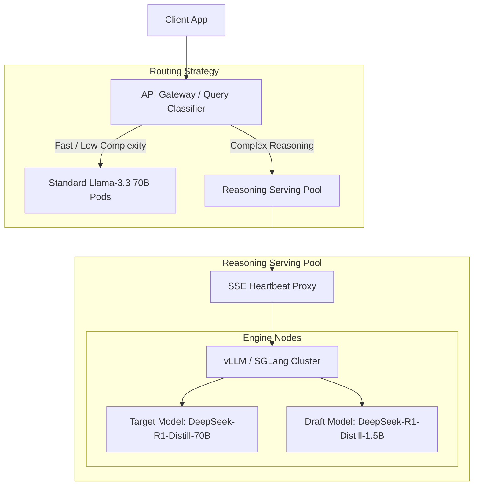

## The Paradigm Shift: Test-Time Compute

Serving standard instruction-tuned models (e.g., Llama 3 70B) is a solved problem for most engineering teams: optimize prompt caching, set continuous batching, and watch Time to First Token (TTFT).

Reasoning models (like DeepSeek-R1 or QwQ) break those assumptions. When a model outputs 4,000+ tokens inside `<think>...</think>` tags before returning a single word of the final answer:
- **Time per Output Token (TPOT)** dominates the user experience, not TTFT.
- **KV Cache memory locks up** for tens of seconds per user session, causing severe queueing delays.
- Standard client HTTP timeouts (30s) drop connections while the model is still actively "thinking".

Here is how we redesigned our inference stack to serve 671B MoE and distilled reasoning models reliably.

---

## High-Level Architecture

We separated our serving infrastructure into a **Semantic Complexity Gateway**, an **Inference Engine Cluster** utilizing RadixAttention / PagedAttention with Speculative Decoding, and a **Streaming Event Proxy** to keep downstream clients alive.



---

## 1. Slashing TPOT with Speculative Decoding

Because reasoning models spend thousands of tokens generating verbose chains-of-thought, serving without speculative decoding is economically and operationally painful.

Reasoning traces have high predictability in syntax (e.g., step-by-step formatting, mathematical deductions). By pairing our primary 70B target model with a lightweight 1.5B draft model, we observed an acceptance rate of ~68-74%.

### vLLM Production Configuration

```bash
python3 -m vllm.entrypoints.openai.api_server \
    --model deepseek-ai/DeepSeek-R1-Distill-Llama-70B \
    --speculative-model deepseek-ai/DeepSeek-R1-Distill-Qwen-1.5B \
    --num-speculative-tokens 5 \
    --speculative-disable-by-batch-size 32 \
    --tensor-parallel-size 4 \
    --gpu-memory-utilization 0.92 \
    --max-model-len 32768 \
    --enable-chunked-prefill \
    --kv-cache-dtype fp8_e5m2
```

> **Rule of thumb:** Disable speculative decoding dynamically when concurrency spikes (`--speculative-disable-by-batch-size 32`). At high batch sizes, memory bandwidth saturation flips speculative decoding from an accelerator into a performance tax.

---

## 2. KV Cache Starvation & Mitigation

A single 32k-context reasoning request can claim upwards of 4–8 GB of KV cache on a 70B parameter model. If 10 concurrent requests generate long thinking traces simultaneously, GPU VRAM runs out and requests drop into preemption (swapping KV blocks back to CPU).

To prevent cascading preemption:

1. **FP8 KV Caching:** Switching from `fp16` to `fp8_e5m2` for the KV cache halved memory footprint per token with negligible degradation in mathematical reasoning benchmarks.
2. **Chunked Prefill:** Interleaves computation of prompt prefill with token decode steps, stabilizing p99 tail latency across heterogeneous workloads.
3. **Prefix Caching (Radix Attention):** Standardized system prompts and tool definitions (e.g., Python execution sandbox schemas) stay cached in VRAM across independent requests.

```mermaid
sequenceDiagram
    autonumber
    actor Client
    participant Proxy as SSE Heartbeat Proxy
    participant Engine as Inference Engine

    Client->>Proxy: POST /v1/chat/completions (stream=true)
    Proxy->>Engine: Forward Request
    
    rect rgb(30, 30, 30)
        Note over Engine: Model thinking (0 - 15s)
        Engine-->>Proxy: Token chunk: "<think>\nLet's analyze..."
        Proxy-->>Client: data: {"reasoning_content": "Let's analyze..."}
    end

    alt Idle / Processing pause > 3s
        Proxy-->>Client: : ping (SSE comment to keep socket open)
    end

    rect rgb(20, 40, 20)
        Note over Engine: Final Answer Generation
        Engine-->>Proxy: Token chunk: "</think>\nThe final result is 42."
        Proxy-->>Client: data: {"content": "The final result is 42."}
    end
```



---

## 3. Streaming and Client-Facing Resilience

When users send a challenging logic puzzle or code generation task, the model might not emit the actual visible markdown answer for 20 seconds.

### The Heartbeat Proxy
Cloudflare, AWS ALB, and most ingress controllers drop idle HTTP connections after 15–30 seconds if zero bytes are transferred.

We deployed an intermediate FastAPI/Rust edge proxy that:
1. Translates engine SSE output into two explicit fields: `reasoning_content` and standard `content`.
2. Emits an empty SSE comment (`: keep-alive\n\n`) every 3 seconds if the model is stalled in a heavy compute prefill phase.
3. Allows frontend clients to render the `<think>` block in a collapsible accordion while actively waiting for the final response.

---

## Production Results

After rolling out FP8 KV cache, speculative draft execution, and tiered request routing:

| Metric | Baseline (vLLM, Greedy, FP16) | Optimized Stack (Speculative + FP8 KV) | Delta |
| :--- | :--- | :--- | :--- |
| **Median TPOT** | 38.2 ms/tok | 16.4 ms/tok | **-57%** |
| **Concurrent Capacity / Node** | 12 requests | 28 requests | **+133%** |
| **Gateway Timeout Errors** | 4.8% | 0.02% | **-99.5%** |
| **GPU Memory Overhead** | 91% (Preemption frequent) | 74% (Stable headroom) | **-17%** |

## Next Steps

We are currently evaluating **Disaggregated Prefill and Decode (Splitwise architecture)**—running prefill on compute-optimized compute nodes (e.g., 8x H100) and offloading long token generation to memory-bandwidth-optimized clusters (e.g., L40S or H20).
```
