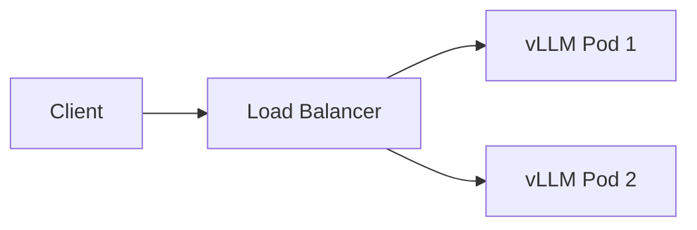

## Why vLLM

Continuous batching and paged attention gave the biggest throughput win over a naive HF Transformers server.

## Rollout

Health checks needed to account for warm-up latency on the first request after a cold container start.
