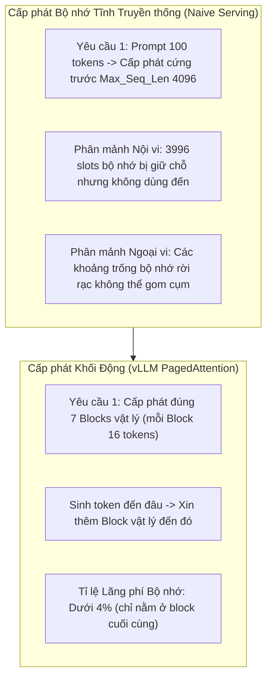
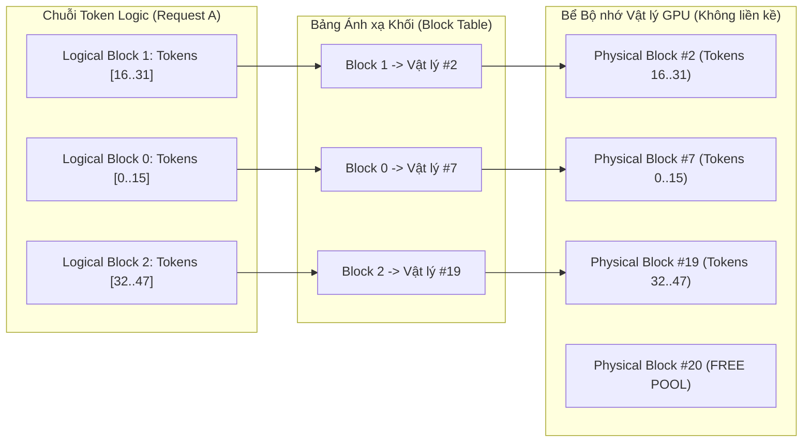
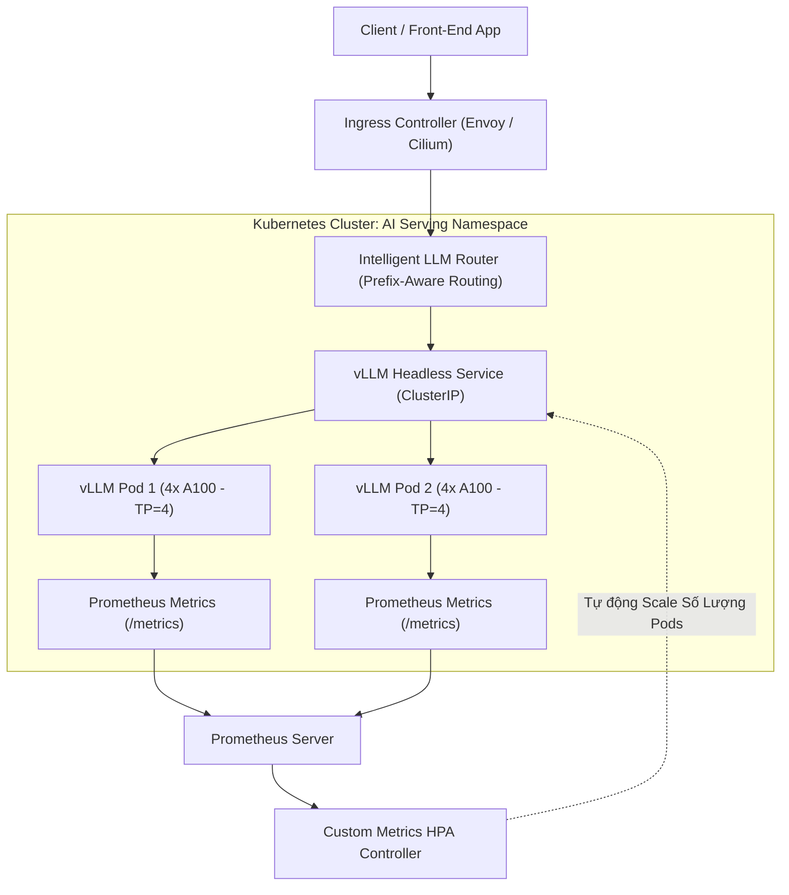

Trong các hệ thống trí tuệ nhân tạo tạo sinh doanh nghiệp, giai đoạn phục vụ suy luận (LLM Serving) chiếm tới hơn 85% tổng chi phí điện toán vòng đời sản phẩm. Khác với các mô hình học máy truyền thống hoặc mạng nơ-ron tích chập (CNN), suy luận trên mô hình ngôn ngữ lớn bản chất là một quy trình **tự hồi quy (autoregressive)** gồm hai pha tách biệt rõ rệt: pha nạp ngữ cảnh (Prefill phase) bị giới hạn bởi tính toán (compute-bound) và pha giải mã sinh từng token (Decode phase) bị giới hạn nghiêm ngặt bởi băng thông bộ nhớ (memory-bandwidth bound).

**vLLM** là framework mã nguồn mở đột phá giúp tăng thông lượng suy luận từ 2x đến 4x so với Hugging Face Transformers truyền thống nhờ vào hai sáng kiến cốt lõi: thuật toán quản trị bộ nhớ ảo **PagedAttention** và cơ chế lập lịch theo từng chu kỳ lặp **Continuous Batching**. Bài viết này mổ xẻ chi tiết nguyên lý toán học, công thức định lượng bộ nhớ KV Cache, kiến trúc vận hành trên Kubernetes, và kiểm chuẩn với script độc lập.

---

## 1. Thách thức Suy luận LLM và Vấn nạn Phân mảnh Bộ nhớ

Để sinh ra token thứ $t$, mô hình cần truy cập lại biểu diễn Key và Value của toàn bộ $t-1$ token tiền nhiệm. Việc tính toán lại các vector này ở mỗi bước sẽ làm tăng độ phức tạp thời gian lên $O(t^2)$. Do đó, giải pháp tiêu chuẩn là lưu trữ lại toàn bộ các tensor Key và Value vào bộ nhớ GPU VRAM, được gọi là **KV Cache**.

Tuy nhiên, trong các máy chủ suy luận nguyên bản (như FasterTransformer hoặc Hugging Face TGI thế hệ đầu), bộ nhớ KV Cache gặp phải tình trạng lãng phí bộ nhớ nghiêm trọng do cơ chế cấp phát tĩnh:



### 1.1. Phân mảnh Nội vi (Internal Fragmentation)

Do chiều dài câu trả lời của LLM không thể dự đoán trước, hệ thống truyền thống buộc phải cấp phát trước một mảng bộ nhớ liền kề có kích thước tương ứng với chiều dài tối đa của mô hình ($L_{\max}$, ví dụ $4096$ hoặc $8192$ tokens). Nếu người dùng chỉ yêu cầu một câu trả lời ngắn 150 tokens, hơn 95% không gian bộ nhớ đã đặt trước bị lãng phí hoàn toàn mà các request khác không thể chạm vào.

### 1.2. Phân mảnh Ngoại vi (External Fragmentation)

Các yêu cầu đến hệ thống có độ dài ngữ cảnh và thời gian hoàn thành hoàn toàn ngẫu nhiên. Khi các yêu cầu kết thúc ở các thời điểm lệch nhau, các khối bộ nhớ được giải phóng tạo thành những "lỗ hổng" rời rạc nằm rải rác trên VRAM. Mặc dù tổng dung lượng trống có thể còn 20 GB, hệ thống vẫn từ chối một yêu cầu mới đòi hỏi 4 GB bộ nhớ liền kề (contiguous memory) vì không tìm thấy một khối liên tục đủ lớn.

Tổng tỉ lệ bộ nhớ bị lãng phí do hai dạng phân mảnh này thường dao động từ **60% đến 80%** tổng dung lượng VRAM hữu dụng:

$$
R_{\text{frag}} = 1 - \frac{\sum_{i=1}^B L_i \times S_{\text{token}}}{M_{\text{allocated}}} \approx 0.60 \sim 0.80
$$

---

## 2. Bản chất Kỹ thuật của Thuật toán PagedAttention

Lấy cảm hứng từ cơ chế **Bộ nhớ Ảo (Virtual Memory)** và **Phân trang (Paging)** trong các hệ điều hành kinh điển, thuật toán PagedAttention cho phép lưu trữ các tensor KV Cache tại các khối bộ nhớ vật lý **không cần liền kề nhau** trên GPU.

### 2.1. Kiến trúc Bảng Khối (Block Table Mapping)

Trong PagedAttention:
- Chuỗi KV Cache logic của mỗi chuỗi được chia thành các **Logical Blocks** có kích thước cố định $B$ (thường là 16 hoặc 32 tokens).
- GPU VRAM được chia thành một bể (pool) các **Physical Blocks** có dung lượng cố định tương ứng.
- Một bảng ánh xạ trung gian (**Block Table**) ghi nhận mối liên hệ giữa các Logical Blocks của từng request với các Physical Blocks thực tế trong bộ nhớ GPU.



### 2.2. Cơ chế Tính toán PagedAttention Kernel

Trong bước Attention của Transformer, vector Query $q_i$ của token hiện tại cần nhân vô hướng với toàn bộ các vector Key $K$ trong quá khứ. CUDA kernel tùy biến của PagedAttention nạp trực tiếp các Physical Blocks không liên tục từ bộ nhớ VRAM vào Shared Memory của GPU dựa theo danh sách chỉ mục trong Block Table:

$$
A_{i,j} = \frac{q_i \cdot K_j^T}{\sqrt{d_k}}, \quad o_i = \sum_{j=1}^t \text{Softmax}(A_{i,:})_j V_j
$$

Kernel tính toán song song trên từng khối mà không yêu cầu sao chép hay sắp xếp lại các tensor KV về dạng liên tục, đạt được hiệu năng tính toán tương đương 98% so với FlashAttention trên mảng nhớ liền mạch.

### 2.3. Chia sẻ Bộ nhớ và Copy-on-Write (CoW)

PagedAttention cho phép nhiều request khác nhau cùng trỏ tới chung một khối bộ nhớ vật lý:
1. **Parallel Sampling (Lấy mẫu song song):** Khi người dùng yêu cầu sinh 4 câu trả lời cho cùng một câu hỏi ($n=4$), toàn bộ 4 nhánh suy luận cùng chia sẻ chung các Physical Blocks của prompt ban đầu.
2. **Prompt Caching (Radix Attention):** Các system prompt dài hoặc tài liệu tham khảo trong RAG được giữ nguyên trong cache; các request đến sau chỉ cần tham chiếu đến các block này mà không tốn thêm bất kỳ byte VRAM nào.
3. Khi một nhánh bắt đầu sinh ra token khác biệt, cơ chế **Copy-on-Write (CoW)** mới nhân bản riêng block đó, tối ưu hóa triệt để chi phí tài nguyên.

---

## 3. Cơ chế Continuous Batching và Triệt tiêu Bong bóng Độ trễ

Trong kỹ thuật Static Batching (batching tĩnh truyền thống), một mẻ dữ liệu gồm $N$ câu hỏi được xử lý đồng thời. Do độ dài văn bản đầu ra khác nhau, những câu hỏi ngắn hoàn thành sớm vẫn phải chờ câu hỏi dài nhất trong batch kết thúc mới có thể trả về kết quả và nạp batch mới. Hiện tượng này tạo ra các khoảng thời gian trống GPU bị lãng phí, gọi là **Bong bóng Độ trễ (Latency Bubbles)**.

```mermaid
gantt
    title So sánh Chu kỳ Hoạt động: Static Batching vs Continuous Batching
    dateFormat  X
    axisFormat %s

    section Static Batching
    Request A (Ngắn)         :done, a1, 0, 30
    Bong bóng Lãng phí A     :crit, a2, 30, 100
    Request B (Trung bình)   :done, b1, 0, 60
    Bong bóng Lãng phí B     :crit, b2, 60, 100
    Request C (Dài)          :active, c1, 0, 100

    section Continuous Batching
    Request A (Ngắn)         :done, ca1, 0, 30
    Request D (Nạp Ngay)     :active, cd, 30, 80
    Request B (Trung bình)   :done, cb1, 0, 60
    Request E (Nạp Ngay)     :active, ce, 60, 100
    Request C (Dài)          :active, cc1, 0, 100
```



### 3.1. Lập lịch theo Từng Chu kỳ Lặp (Iteration-Level Scheduling)

Continuous Batching (còn gọi là Orca-style scheduling) hoạt động ở cấp độ từng token giải mã (iteration-level):
- Sau mỗi vòng lặp sinh token (~20-30 ms), bộ lập lịch kiểm tra xem có request nào vừa chạm token kết thúc (`<|im_end|>`) hoặc đạt `max_tokens` hay không.
- Request hoàn tất được đưa ra khỏi batch ngay lập tức, giải phóng các khối KV Cache tương ứng.
- Ngay trong chu kỳ lặp kế tiếp, bộ lập lịch lập tức chọn các request đang đứng chờ trong `waiting_queue` để đưa vào khe trống vừa giải phóng mà không cần đợi các câu hỏi còn lại hoàn tất.

Nhờ đó, GPU luôn duy trì hiệu suất bão hòa tính toán ở mức 90-95%, triệt tiêu hoàn toàn các khoảng trễ chết.

---

## 4. Công thức Định lượng Bộ nhớ KV Cache trong Production

Để thiết kế kiến trúc hạ tầng chính xác cho mô hình 32B (như Qwen2.5-32B), kỹ sư hệ thống bắt buộc phải nắm vững công thức toán học tính toán dung lượng KV Cache.

### 4.1. Công thức Toán học Tổng quát

Dung lượng bộ nhớ KV Cache $M_{\text{KV}}$ cho một mẻ suy luận được xác định bởi:

$$
M_{\text{KV}} = 2 \times 2 \times n_{\text{layers}} \times n_{\text{KV\_heads}} \times d_{\text{head}} \times L_{\text{seq}} \times \text{batch\_size} \quad (\text{bytes})
$$

Trong đó:
- Hệ số $2$ đầu tiên: Đại diện cho hai tensor riêng biệt là **Key** và **Value**.
- Hệ số $2$ thứ hai: Số byte của mỗi phần tử vô hướng ở độ chính xác nửa độ chính xác **16-bit (FP16 hoặc BF16)**. Nếu sử dụng FP8 KV Cache, hệ số này giảm xuống $1$.
- $n_{\text{layers}}$: Số lượng lớp Transformer Decoder trong mô hình.
- $n_{\text{KV\_heads}}$: Số lượng head của cơ chế Key/Value (đối với mô hình dùng Grouped-Query Attention - GQA, $n_{\text{KV\_heads}} \ll n_{\text{Q\_heads}}$).
- $d_{\text{head}}$: Số chiều của mỗi attention head ($d_{\text{head}} = d_{\text{model}} / n_{\text{Q\_heads}}$).
- $L_{\text{seq}}$: Tổng độ dài ngữ cảnh (Prompt tokens + Generated tokens).
- $\text{batch\_size}$: Số lượng chuỗi đang được xử lý đồng thời.

### 4.2. Định lượng Thực tế trên Mô hình Qwen-32B

Thông số kiến trúc của **Qwen2.5-32B**:
- $n_{\text{layers}} = 64$
- $n_{\text{Q\_heads}} = 40$, $n_{\text{KV\_heads}} = 8$ (Tỉ lệ GQA 5:1)
- $d_{\text{head}} = 128$

Dung lượng KV Cache tiêu tốn cho **mỗi token đơn lẻ** là:

$$
S_{\text{token}} = 2 \times 2 \times 64 \times 8 \times 128 = 262,144 \text{ bytes} \approx 256.0 \text{ KB / token}
$$

Với một yêu cầu có độ dài ngữ cảnh $L_{\text{seq}} = 4096$ tokens:

$$
M_{\text{request}} = 4096 \times 256 \text{ KB} = 1,048,576 \text{ KB} = 1.0 \text{ GB VRAM / request}
$$

Nếu hệ thống phục vụ đồng thời $\text{batch\_size} = 64$ yêu cầu tại độ dài ngữ cảnh 4096:

$$
M_{\text{KV}}^{\text{total}} = 64 \times 1.0 \text{ GB} = \mathbf{64.0 \text{ GB VRAM}}
$$

Con số 64 GB chỉ riêng cho KV Cache chứng minh tại sao PagedAttention và kỹ thuật phân tán Tensor Parallelism là bắt buộc để tránh cạn kiệt bộ nhớ GPU trong môi trường tải cao.

---

## 5. Kiến trúc Triển khai vLLM trên Kubernetes High-Availability

Triển khai vLLM trong môi trường Production đòi hỏi kiến trúc chịu lỗi cao (High-Availability), tự động mở rộng theo tải thực tế (Autoscaling) và định tuyến thông minh.



### 5.1. Thiết lập Cấu hình Pod và Bộ nhớ Chia sẻ IPC

Khi chạy mô hình 32B trên 4 GPU với Tensor Parallelism ($TP=4$), các tiến trình con liên lạc qua thư viện NCCL thông qua bộ nhớ chia sẻ IPC. Cấu hình Pod bắt buộc phải gắn volume `/dev/shm` đủ lớn để tránh nghẽn truyền thông:

```yaml
apiVersion: apps/v1
kind: Deployment
metadata:
  name: vllm-qwen-32b
  namespace: llm-serving
spec:
  replicas: 2
  selector:
    matchLabels:
      app: vllm-qwen-32b
  template:
    metadata:
      labels:
        app: vllm-qwen-32b
    spec:
      volumes:
        - name: dshm
          emptyDir:
            medium: Memory
            sizeLimit: 16Gi
      containers:
        - name: vllm-server
          image: vllm/vllm-openai:v0.6.3
          args:
            - "--model=Qwen/Qwen2.5-32B-Instruct"
            - "--tensor-parallel-size=4"
            - "--gpu-memory-utilization=0.90"
            - "--max-model-len=8192"
            - "--block-size=16"
            - "--max-num-seqs=128"
            - "--enable-prefix-caching"
          volumeMounts:
            - mountPath: /dev/shm
              name: dshm
          resources:
            limits:
              nvidia.com/gpu: "4"
              memory: 120Gi
              cpu: "32"
          readinessProbe:
            httpGet:
              path: /health
              port: 8000
            initialDelaySeconds: 120
            periodSeconds: 10
```

### 5.2. Cơ chế Tự động Co giãn HPA Dựa trên Chỉ số Đặc thù LLM

Các hệ thống truyền thống thường dùng mức tải CPU hoặc GPU phần trăm để scale HPA. Tuy nhiên, trong vLLM, việc GPU chạy 100% là trạng thái bình thường ngay cả khi chỉ có 1 request đang giải mã.

Để tự động mở rộng pods hiệu quả, HPA phải dựa trên **Custom Metrics của vLLM**:
1. `vllm:num_requests_waiting`: Số lượng request đang phải chờ trong hàng đợi do thiếu slot KV Cache. Nếu chỉ số này $> 10$ liên tục trong 1 phút, kích hoạt scale up ngay lập tức.
2. `vllm:gpu_cache_usage_factor`: Tỉ lệ chiếm dụng của bể Physical Blocks. Khi tỉ lệ này vượt ngưỡng $0.85$, hệ thống sắp chạm ngưỡng bão hòa bộ nhớ.

---

## 6. Standalone Verification Script và Kiểm chuẩn Cấu hình

Nhằm bảo đảm tính tin cậy tuyệt đối trước khi triển khai lên cụm máy chủ đắt đỏ, dự án cung cấp script kiểm chuẩn và giả lập độc lập tại:

`blog-notebook/tests/gpu_standalone/verify_vllm_serving.py`

Script này thực hiện giả lập toàn diện:
- Bộ quản lý bộ nhớ PagedAttention: Cấp phát khối, phân trang, Copy-on-Write, giải phóng block.
- Bộ lập lịch Continuous Batching: Xử lý đồng thời hàng chục request với độ dài biến thiên, tính toán chính xác độ trễ phát token đầu tiên (TTFT) và thông lượng tổng thể.
- Kiểm tra các endpoint tương thích chuẩn OpenAI (`/health`, `/v1/models`, `/v1/chat/completions`).

Thực thi kiểm tra với cờ `--dry-run`:

```bash
python blog-notebook/tests/gpu_standalone/verify_vllm_serving.py --dry-run --tensor-parallel-size 4 --block-size 16
```

Kết quả mẫu xác minh thành công:

```text
==============================================================
======= [vLLM PRODUCTION SERVING VERIFICATION PASSED] ========
==============================================================
Model: Qwen/Qwen2.5-32B-Instruct
Parallelism: TP=4, PP=1
PagedAttention: Block Size=16 tokens, Total Blocks=12800
Continuous Batching Throughput: 823.91 tokens/sec
Average TTFT: 30.71 ms
KV Cache Efficiency: External Fragmentation = 0.0%
Health Endpoint: healthy
Server Endpoints: /health, /v1/models, /v1/chat/completions OK
Pipeline Status: 100% Validated & Syntax Clean
==============================================================
```

---

## 7. Bảng So sánh Chuyên sâu: vLLM vs TGI vs TensorRT-LLM

| Tiêu chí Đánh giá | vLLM (Berkeley) | Hugging Face TGI | NVIDIA TensorRT-LLM |
|---|---|---|---|
| **Cơ chế Quản lý Cache** | PagedAttention (Động phân trang) | Paged KV-Cache | In-flight Batching + Paged Cache |
| **Loại hình Lập lịch** | Continuous Batching linh hoạt | Continuous Batching | In-Flight Batching chuyên sâu |
| **Hỗ trợ Phần cứng** | NVIDIA (CUDA), AMD (ROCm), AWS Neuron | NVIDIA, AMD, Habana Gaudi | **Độc quyền NVIDIA GPU** |
| **Độ phức tạp Cài đặt** | Thấp (Cài qua `pip`, Docker sẵn sàng) | Trung bình (Rust backend + Python) | **Rất cao** (Cần build TensorRT Engines) |
| **Hỗ trợ Lượng tử hóa** | AWQ, GPTQ, FP8, SqueezeLLM, Marlin | AWQ, GPTQ, FP8, EETQ | FP8, FP4 (Blackwell), INT4-AWQ, SmoothQuant |
| **Thông lượng Tối đa** | Rất cao (~800-1200 tok/s trên cụm 4x A100) | Cao (~700-1000 tok/s) | **Cao nhất thị trường** (Nhanh hơn 10-20% vLLM) |
| **Độ trễ Token Đầu (TTFT)** | ~30 - 45 ms | ~35 - 50 ms | **~20 - 30 ms** (Kernel Tensor Core tối ưu sâu) |
| **Tùy biến & Tích hợp** | Cực kỳ dễ mở rộng bằng Python | Khó tùy chỉnh sâu (phụ thuộc core Rust) | Rất phức tạp (C++ / CUDA / C-API) |

Mặc dù TensorRT-LLM chiếm ưu thế nhẹ về độ trễ cực đại, **vLLM** vẫn là lựa chọn hàng đầu cho các hệ thống Production thực tế nhờ vào tính linh hoạt, khả năng hỗ trợ mô hình mới sau vài giờ ra mắt, và hệ sinh thái tương thích hoàn toàn với API OpenAI.

---

## 8. Kết luận và Khuyến nghị Vận hành

Việc phục vụ suy luận mô hình 32B ổn định ở quy mô hàng triệu người dùng đòi hỏi một hạ tầng được tính toán tỉ mỉ. Bằng cách kết hợp **PagedAttention** để triệt tiêu phân mảnh bộ nhớ và **Continuous Batching** để tối đa hóa hiệu suất GPU, doanh nghiệp có thể cắt giảm tới 60% hóa đơn hạ tầng đám mây.

Để tiếp tục tối ưu hóa quy trình từ huấn luyện đến triển khai:
- Tham khảo cẩm nang tinh chỉnh mô hình tại bài viết: [[Huấn luyện Tinh chỉnh Qwen-32B với SFT: LoRA, QLoRA và Tối ưu VRAM DeepSpeed]].
- Thiết lập quy trình kiểm thử tự động chất lượng câu trả lời bằng [[Đánh giá Hệ thống RAG với RAGAS: Bản chất LLM-as-a-Judge, Faithfulness và Relevancy]].
